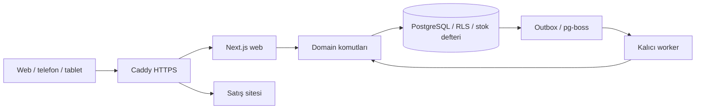

# Mimari ve sorumluluklar

## Ürün sözleşmesi

Etkin WMS, müşteriler/çalışma alanları birbirinden yalıtılmış sektör bağımsız SaaS'tır. Motive Rubber ilk pilot; üç depo bir ürün sınırı değildir. Depo/personel/birim/ürün türü müşteriye göre ayarlanır. Aylık kiralama hedefi, canlı tahsilatın veya bütün SaaS modüllerinin tamamlandığı iddiası değildir.

Pilot akışı: hammadde kabul → depo/raf → üretim tüketimi ve mamul çıktısı → transfer → sevkiyat. Giriş/çıkış/sayım/ters kayıt miktarsal ve izlenebilir olmalı. Cari referans desteklenir; muhasebe, e-İrsaliye düzenleme ve kapsamlı MRP ayrı entegrasyondur.

## Modüler monolit / monorepo

| Sınır | Gerçek kaynak | Sorumluluk |
|---|---|---|
| Web/API | `apps/web/app`, `apps/web/lib` | UI, ince HTTP/Server Action, kullanıcı oturumu |
| İş kuralları | `packages/domain/src` | Tenant yetkisi, stok komutları, katalog, üretim, sevkiyat |
| DB | `packages/db/src`, `packages/db/migrations` | Transaction, RLS, kilit sırası, şema, migration defteri |
| Kimlik | `packages/auth/src` | Better Auth, parola, MFA, oturum, kurtarma politikaları |
| Ortak sözleşme | `packages/shared/src` | Doğrulama, hata kodu, decimal, i18n/arayüz sözleşmeleri |
| UI | `packages/ui/src` | Ortak erişilebilir form, kart, seçim alanı |
| Worker/kuyruk | `apps/worker`, `packages/queue-adapter` | Outbox relay, pg-boss, arka plan işleri |
| Dosya | `packages/storage` | ObjectStorage sınırı; canlı sağlayıcı konfigürasyonunu ayrıca doğrula |
| Satış | `marketing/` | Ayrı hafif servis; WMS üyeliği/kimlik tablolarından ayrı |
| İşletim | `deploy/vps/`, `.github/workflows/` | Konteynerler, DB, CI, sınırlı yayın |

Ölçek hedefleri kapasite ölçümü değildir. Yeni servis, Redis veya mikroservis yalnız ölçülmüş ihtiyaç ve ADR ile eklenir; stok doğruluğu cache/kuyruğa taşınmaz. Sürüm otoritesi `package.json`/lockfile ve `docs/STACK.md`; sürüm tahmin etme.

## Rol düzeni (kişi/çalışan veya zorunlu model listesi değildir)

| Rol | Karar / teslim | Sınır |
|---|---|---|
| Ürün sahibi | Kullanıcı hedefi, öncelik, ticari kapsam | Gerçek onayları varsayma |
| Proje mimarı | Paket sınırı, ADR, görev bağımlılığı | Gereksiz yeniden mimari yok |
| Veri tabanı mimarı | Tenant/RLS, migration, stok/belge ilişki tasarımı | UI kolaylığı için veri güvenini bozmaz |
| Backend geliştirici | Domain/API/worker uygulaması | Şemayı görev dışı değiştirmez |
| UI/UX mimarı + frontend | Acemi kullanıcı akışı, responsive tasarım, erişilebilir bileşen | İş kuralını istemciye taşımaz |
| QA | Gerçek kabul, izolasyon/eşzamanlılık/cihaz kanıtı | Sahte yeşil veya sadece ekran görüntüsüyle tam kabul yok |
| Güvenlik inceleyicisi | Exact diff, çağrı/yetki bağlamı, bulgu | Uygulayıcının kendi raporu bağımsız sayılmaz |
| DevOps/operatör | Erişim, yedek, kesim, rollback, health | Runtime/migration sırlarını AI sohbetine taşımaz |
| Koordinatör | Tek sıradaki görev, kart, kanıt, STATE | Aynı VPS/şema üzerinde iki operatör çalıştırmaz |

Tek kişi birden fazla rol üstlenebilir; bağımsız inceleme gerektiren risklerde gerçek ayrı inceleme şartı korunur. Model adları veya başka aracın rol dosyaları canlı yetki kanıtı değildir.
