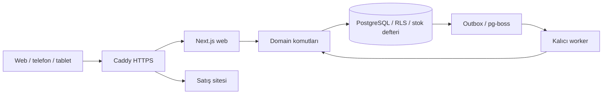

# Mimari ve sorumluluklar

## Ürün sözleşmesi

Etkin WMS, müşteriler/çalışma alanları birbirinden yalıtılmış sektör bağımsız SaaS'tır. Motive Rubber ilk pilot; üç depo bir ürün sınırı değildir. Depo/personel/birim/ürün türü müşteriye göre ayarlanır. Aylık kiralama hedefi, canlı tahsilatın veya bütün SaaS modüllerinin tamamlandığı iddiası değildir.

Pilot akışı: hammadde kabul → depo/raf → üretim tüketimi ve mamul çıktısı → transfer → sevkiyat. Giriş/çıkış/sayım/ters kayıt miktarsal ve izlenebilir olmalı. Cari referans desteklenir; muhasebe, e-İrsaliye düzenleme ve kapsamlı MRP ayrı entegrasyondur.

## Modüler monolit / monorepo

| Sınır | Gerçek kaynak | Sorumluluk |
|---|---|---|
| Web/API | `apps/web/app`, `apps/web/lib` | UI, ince HTTP/Server Action, kullanıcı oturumu |
| İş kuralları | `packages/domain/src` | Tenant yetkisi, stok komutları, katalog, üretim, sevkiyat |
| DB | `packages/db/src`, `packages/db/migrations` | Transaction, RLS, kilit sırası, şema, migration defteri |
| Kimlik | `packages/auth/src` | Better Auth, parola, MFA, oturum, kurtarma politikaları |
| Ortak sözleşme | `packages/shared/src` | Doğrulama, hata kodu, decimal, i18n/arayüz sözleşmeleri |
| UI | `packages/ui/src` | Ortak erişilebilir form, kart, seçim alanı |
| Worker/kuyruk | `apps/worker`, `packages/queue-adapter` | Outbox relay, pg-boss, arka plan işleri |
| Dosya | `packages/storage` | ObjectStorage sınırı; canlı sağlayıcı konfigürasyonunu ayrıca doğrula |
| Satış | `marketing/` | Ayrı hafif servis; WMS üyeliği/kimlik tablolarından ayrı. Panelden yayınlanan içeriği iç uçtan okur (T-407) |
| Yönetim paneli | `apps/web/app/panel`, `packages/domain/src/platform`, `wms_platform` şeması | `yonet.` (ADR-027): müşteriler (yalnız sayılar), paketler, ödemeler, demo talepleri, satış sayfası, özet, işlem kaydı; erişim yalnız operatör denetimli `wms_probe.platform_*` işlevleriyle |
| Saha girişi | `apps/web/app/field`, `packages/auth/src/field.ts` | E-postasız saha personeli: kayıtlı cihaz + 6 hane PIN, ortak cihaz kaydı (ADR-026 §7) |
| İşletim | `deploy/vps/`, `.github/workflows/` | Konteynerler, DB, CI, sınırlı yayın |

Ölçek hedefleri kapasite ölçümü değildir. Yeni servis, Redis veya mikroservis yalnız ölçülmüş ihtiyaç ve ADR ile eklenir; stok doğruluğu cache/kuyruğa taşınmaz. Sürüm otoritesi `package.json`/lockfile ve `docs/STACK.md`; sürüm tahmin etme.

## Rol düzeni (kişi/çalışan veya zorunlu model listesi değildir)

| Rol | Karar / teslim | Sınır |
|---|---|---|
| Ürün sahibi | Kullanıcı hedefi, öncelik, ticari kapsam | Gerçek onayları varsayma |
| Proje mimarı | Paket sınırı, ADR, görev bağımlılığı | Gereksiz yeniden mimari yok |
| Veri tabanı mimarı | Tenant/RLS, migration, stok/belge ilişki tasarımı | UI kolaylığı için veri güvenini bozmaz |
| Backend geliştirici | Domain/API/worker uygulaması | Şemayı görev dışı değiştirmez |
| UI/UX mimarı + frontend | Acemi kullanıcı akışı, responsive tasarım, erişilebilir bileşen | İş kuralını istemciye taşımaz |
| QA | Gerçek kabul, izolasyon/eşzamanlılık/cihaz kanıtı | Sahte yeşil veya sadece ekran görüntüsüyle tam kabul yok |
| Güvenlik inceleyicisi | Exact diff, çağrı/yetki bağlamı, bulgu | Uygulayıcının kendi raporu bağımsız sayılmaz |
| DevOps/operatör | Erişim, yedek, kesim, rollback, health | Runtime/migration sırlarını AI sohbetine taşımaz |
| Koordinatör | Tek sıradaki görev, kart, kanıt, STATE | Aynı VPS/şema üzerinde iki operatör çalıştırmaz |

Tek kişi birden fazla rol üstlenebilir; bağımsız inceleme gerektiren risklerde gerçek ayrı inceleme şartı korunur. Model adları veya başka aracın rol dosyaları canlı yetki kanıtı değildir.

## Mal kabul çevresindeki kullanıcı hedefleri — 13 Ekim ek kararı
- Excel örneği → doğrulanmış ürün/birim/çevrim/barkod önizlemesi → kabul paketleri → paket/palet etiketleri. Ürün içe aktarımı stok kabulüyle aynı şey değildir; mevcut opening-stock import paket kimliği üretmiş sayılmaz.
- Kart kodu ve işletme iç barkodu eksikse sunucu çakışmasız üretir; bu hedef henüz tüm import yolunda uygulanmış değildir. Ürün barkodu aynı ürünü, paket QR tek fiziksel kabı, palet QR alt paket grubunu tanımlar. Yeniden aktarma aynı satırları sessiz çoğaltmaz.
- Temel birim bilinmiyorsa KG yerine sessiz ADET atanmaz; aday eşleşme kısa önizlemede onaylanır. Dönüşüm katsayısı verilmediyse varilin/koli'nin ağırlığı tahmin edilmez. Dosya ve mevcut katalog çelişkisi satır üzerinde gösterilir; stoklu kartın temel birimi sessiz değiştirilmez.
- Fiş başlık/satır kimlikleri stok hareketine ve paketlere kalıcı bağlıdır. Taslak değişiklik aynı kimlikte/sürüm denetimiyle yapılır, sil-yeniden-oluştur yok. Fiş numarası tür/yıl/tenant sayacıyla sunucudan; istemci numara veya ERP numarasını stok kimliği yerine kullanmaz.
- Kaynak farkı: mevcut `stock/documents.ts:updateDraft` satır düzenlemesinde satırları DELETE+INSERT yapıyor. Paket bağlantılı yeni akış bu yolla düzenlenemez; kalıcı satır kimliğiyle diff/sürüm güncellemesi ayrı uygulama ve test ister. Henüz düzeltilmiş değildir.
- Kesinleşmiş fişte gerçek defter DELETE/UPDATE uygulanmaz (I-04/I-08). Kullanıcı hedefi kolay düzenle/geri al/sil işlemleridir; güvenli uygulama önerisi bağlı düzeltme/ters kayıt + aktif görünümden iptal. Kullanıcının “hareketleri de sil” isteği fiziksel silme onayı sayılmaz; bundan farklı politika seçilirse ayrı tasarım/test/geri dönüşsüz veri onayı gerekir.
- Düzeltme asıl belgeye ve satıra referans verir; tüketilmiş/sevk edilmiş paket, kapalı dönem veya aktif rezervasyon bağımlılığı sessiz koparılamaz. Engel ilgili fiş ve çözüm eylemiyle gösterilir. Yeni tarih/satır miktarı gelecekteki soy ağacını geriye dönük yeniden yazmaz.
- Görüntüle/oluştur/düzenle/geri al/ERP aktar/dönem aç yetkileri sunucuda kontrol edilir; mevcut izinler önce eşlenir, eksik ayrımlar ayrı gözden geçirilir. Yeni altı izin hazırmış veya kullanıcıdan ayrıca altı onay gerekirmiş diye varsayılmaz.
- ERP gelecekte adapter+kalıcı dış referans/idempotent outbox üzerinden; POSTED belge aktarılır. ERP'ye gitmiş belge düzeltme/ters kayıtla senkronize edilir, dış kayıt bağlantısı korunur. Gitti/bekliyor/hata durumları gerçek alındıdan gelir. Dönem kilidi/adapter/otomatik fiş senkronu mevcut temel kaynaklarla karıştırılmaz; bunlar geliştirme hedefidir.
- T-931 yalnız saf miktar/tarih/QR temel dilimidir. Mevcut CSV/Excel import, birim çevrimi, katalog barkodu, fiş numaralama ve dış referans altyapısı bu uçtan uca hedefin tamamlandığı kanıtı değildir.
