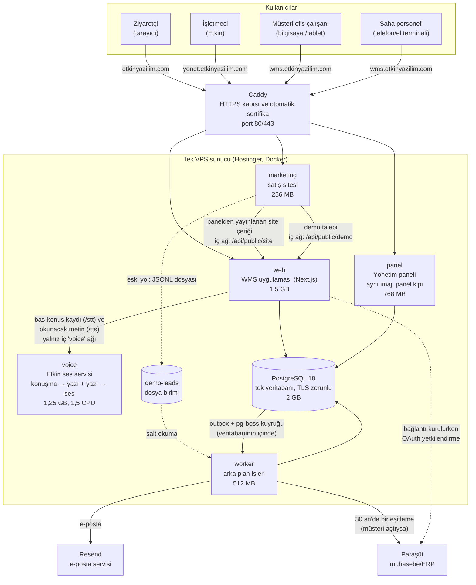
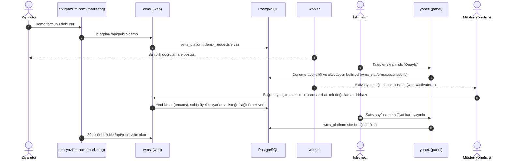
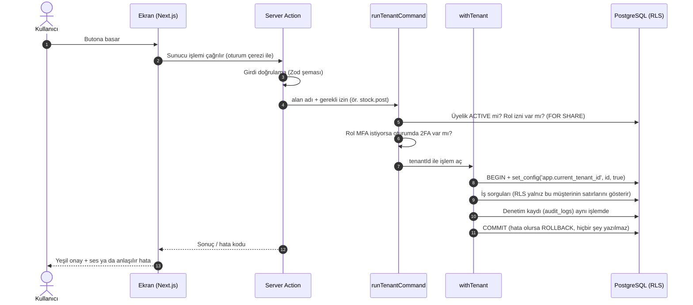
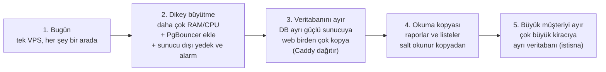

# 1. Genel sistem mimarisi ve alan adları

> **Bu bölüm neyi anlatır?** Üç web adresinin (etkinyazilim.com, yonet.etkinyazilim.com, wms.etkinyazilim.com) her birinin ne işe yaradığını, aralarında verinin nasıl aktığını, kullanıcıların nasıl giriş yaptığını, müşterilerin (kiracıların) verisinin birbirinden nasıl ayrıldığını ve sistemin bugünkü donanımla ne kadar yük taşıyabileceğini anlatır.
>
> **Kaynak:** main `2022915` · 29 Ekim 2026 (ilk sürüm main `36f3a13` · 23 Ekim; 28 Ekim sürümü main `8e2710d`). Bu bölümdeki her bilgi koddan okundu. Dayandığı dosyalar her başlığın altında `yol/dosya` biçiminde yazılı. Kapasite rakamları **tahmindir**: ölçülmedi, yük testi henüz yok (`tests/load` planlı).
>
> **Etiketler:** **[TAMAMLANDI]** kod main dalında uçtan uca bağlı demektir. **[GELİŞTİRİLİYOR]** bir kısmı yapıldı ya da yarım kaldı demektir. **[PLANLANDI]** yalnız yapılacaklar listesinde ya da tasarımda var demektir. Kodda olmak canlıda çalışmak demek değildir. Canlı durumu `docs/STATE.md` tutar ve ayrıca belirtilir.

---

## 1.1 Kısa özet: üç adres, tek sistem

| Adres | Kim kullanır? | Ne işe yarar? | Çalışan program | Durum |
| :--- | :--- | :--- | :--- | :--- |
| **etkinyazilim.com** | Potansiyel müşteri (ziyaretçi) | Tanıtım sayfası, fiyat kartları, **demo talep formu**. `www.` ve `.com.tr` adresleri buraya yönlenir. | `marketing` konteyneri (Node, port 3200) | [TAMAMLANDI] |
| **yonet.etkinyazilim.com** | Yalnız **Etkin işletmecisi** (siz / platform operatörü) | **Yönetim paneli:** müşteriler (yalnız sayılar), paketler, ödemeler, demo talepleri, satış sayfası içeriği, destek talepleri, işlem kaydı | `panel` konteyneri (WMS ile aynı program, "panel kipi") | [TAMAMLANDI] |
| **wms.etkinyazilim.com** | Müşterinin çalışanları (ofis + saha) | **Depo uygulamasının kendisi:** mal kabul, stok, toplama, sevk, sayım, üretim, raporlar, ekip yönetimi, Ayarlar (Firma · Kullanıcılar ve yetki · Entegrasyonlar · Görünüm), Etkin sesli komut. Masaüstünde bütün ekranlar ortak kabuk ve beş kalıptan (liste, kayıt kartı, form, ayar, pencere) birine oturur (`docs/design/STANDART.md`, `apps/web/app/t/[slug]/kalip/`). Her müşterinin adresi `wms.etkinyazilim.com/t/<alan-adı>` biçimindedir. Kısa yol `wms.etkinyazilim.com/<alan-adı>` de çalışır. | `web` konteyneri (Next.js, port 3000) | [TAMAMLANDI] |

**Önemli tasarım kararı (ADR-027):** Panel ile WMS **aynı programın iki ayrı çalıştırmasıdır**. Ortam değişkeni `APP_SURFACE=panel` verilirse program yönetim paneli gibi davranır. Verilmezse müşteri uygulaması gibi davranır. Bu yüzden:
- Panel adresinde müşteri ekranları açılmaz (404). Müşteri adresinde de panel ekranları açılmaz (404).
- Panelin oturum çerezi ayrıdır. WMS'e giriş yapmış biri panele otomatik giremez.

Kaynak: `apps/web/lib/surface.ts`, `apps/web/proxy.ts`, `deploy/vps/Caddyfile`, `deploy/vps/automation/compose.yml`.

---

## 1.2 Sistem mimarisi diyagramı

**Diyagramı okumak için:**
- Dışarıdan gelen her istek önce **Caddy**'ye gelir. Caddy HTTPS sertifikasını otomatik alır ve isteği adrese göre doğru konteynere iletir.
- `/api/public/*` yolları dışarıya kapalıdır: Caddy bunlara 404 döner. Bu uçları yalnız satış sitesi, sunucunun iç ağından çağırır.
- **Veritabanının dışarıya açık portu yoktur.** Yalnız Docker'ın iç ağından ve TLS (şifreli bağlantı) + parola doğrulamasıyla erişilir (`deploy/vps/database/compose.yml`, `pg_hba.conf`).
- Ses servisi (`voice`) yalnız `web` ile konuşabildiği kapalı bir ağdadır. İnternete çıkamaz. Sesi diske yazmaz. İki işi vardır: basılı tutulan düğmeyle kaydedilen sesi yazıya çevirmek (`/stt`) ve ekranda okunacak metni doğal Türkçe sesle okumak (`/tts`) (`services/voice/app.py`).
- Paraşüt bağlantısı ilk kez kurulurken müşteri yöneticisi Paraşüt'ün kendi giriş sayfasına gider. Paraşüt onaydan sonra kullanıcıyı `wms.` adresindeki geri dönüş ucuna (`/api/integrations/parasut/callback`) yollar. `web` bu sırada bir kez Paraşüt'le konuşur ve erişim anahtarını şifreli saklar. Sonraki düzenli eşitlemeyi `worker` yapar (`packages/domain/src/integrations/oauth.ts`).
- Yayın sırasında bir konteyner yenilenirken Caddy en çok 15 saniye, çeyrek saniye arayla yeniden bağlanmayı dener. Bu, yayın anındaki kısa "502" hatasını örtmek içindir. Karşıya ulaşmış bir istek tekrar gönderilmez (`deploy/vps/Caddyfile` → `deploy_connect_retry`, T-1070). Kodda var; canlıda etkisi STATE'te henüz doğrulanmadı (UNKNOWN).

---

## 1.3 Adresler arası veri akışı (kim kime ne gönderir?)

| Akış | Nereden | Nereye | Nasıl | Kaynak |
| :--- | :--- | :--- | :--- | :--- |
| Demo talebi | Satış sitesi | Veritabanı (`wms_platform`) | İç ağ uç noktası `/api/public/demo` | `marketing/server.mjs`, `apps/web/app/api/public/demo/route.ts`, migration `0038`, `0057` |
| Satış sayfası içeriği | Panel → veritabanı | Satış sitesi | Site, `web`'in iç ucundan 30 sn önbellekle okur | `apps/web/app/api/public/site/route.ts`, `0046_site_content` |
| Deneme aktivasyonu | Panel (onay) | Müşteri (e-posta) → WMS | Tek kullanımlık bağlantı `/activate/<belirteç>` | `packages/domain/src/platform/activation.ts`, `apps/web/app/activate/[token]` |
| Müşteri sayıları | WMS veritabanı | Panel | Panel yalnız **sayıları** görür (kaç ürün, kaç kullanıcı gibi). Müşterinin içeriğini göremez. | `0042_customers`, `wms_probe.platform_*` işlevleri |
| Destek talebi | WMS (müşteri) | Panel (işletmeci) | Aynı veritabanı. İşletmeci yalnız denetimli işlevlerle erişir. | `0054_support_tickets`, `apps/web/app/panel/support` |
| Paraşüt bağlantısı (OAuth) | Müşteri yöneticisi → Paraşüt giriş sayfası | WMS | Paraşüt onaydan sonra `/api/integrations/parasut/callback` adresine döner. Yetki `settings.manage` + son 10 dakikada kimlik doğrulaması. Tek kullanımlık deneme kaydı 10 dakika geçerlidir. Anahtarlar şifreli saklanır, ekranda gösterilmez. | `apps/web/app/api/integrations/parasut/callback/route.ts`, `packages/domain/src/integrations/oauth.ts`, `0061_integration_oauth` |
| Paraşüt eşitlemesi | Paraşüt ↔ veritabanı | — | `worker` 30 saniyede bir, açık akışı olan her bağlantı için tek iş kuyruğa koyar. İlk bağlantıda yalnız ürün kartları (miktarsız, fiyatsız) Paraşüt'ten çekilir. | `apps/worker/src/jobs/integration-sync.ts`, `packages/domain/src/integrations/sync.ts` |
| Etkin sesli komut / sesli yanıt | Kullanıcının telefonu | `voice` servisi (iç ağ) | `web`, kaydı `/stt`'ye, okunacak metni `/tts`'ye iletir. Ses ve metin loglanmaz. | `apps/web/lib/voice.ts`, `apps/web/app/t/[slug]/etkin/actions.ts` |

---

## 1.4 Kimlik doğrulama (giriş) nasıl çalışıyor?

Sistemde **iki tür kullanıcı girişi** vardır:

### a) Ofis kullanıcısı: e-posta + parola (+ iki adımlı kod) — [TAMAMLANDI]
- **Kütüphane:** Better Auth 1.7.7. Parolalar **Argon2id** ile özetlenir, yani düz metin olarak saklanmaz (`packages/auth/src/password.ts`).
- **Parola kuralı:** en az 12, en çok 128 karakter (`PASSWORD_MIN_LENGTH`).
- **İki adımlı doğrulama (MFA/TOTP):** telefon uygulamasındaki 6 haneli koddur. **Yönetici** ve **Depo yöneticisi** rollerinde zorunludur. Onay, ters kayıt ya da Excel aktarımı yetkisi taşıyan özel grup üyelerinde de zorunludur (`packages/domain/src/identity/access.ts` → `MFA_REQUIRED_ROLES`, `MFA_GRANTS`). Demo alanında (`tenants.is_demo`) bu zorunluluk kapalıdır. Kurulum, aktivasyon ve `/mfa` ekranında ortak 4 adımlı sihirbazla yapılır: uygulamayı kur → hesabı ekle (telefonda tek dokunuş, bilgisayarda QR) → 6 haneli kod → yedek kodlar (`apps/web/app/totp-sihirbaz.tsx`, T-1034).
- **5 yanlış kod → 15 dakika kilit** (`TWO_FACTOR_LOCKOUT`).
- **"Bu cihazı 30 gün hatırla":** bu seçenek işaretlenirse o cihazda 30 gün boyunca kod sorulmaz (`TRUST_DEVICE_MAX_AGE_SEC`). **Panelde (yonet.) ve işletmeci hesabında bu seçenek kapalıdır**: her girişte kod istenir (`apps/web/lib/auth-service.ts` → `webTrustDeviceAllowed`).
- **Oturum süresi:** kayan 12 saat; oturum 15 dakikada bir yenilenir (`SESSION_EXPIRES_IN_SEC`, `SESSION_UPDATE_AGE_SEC`).
- **Hassas işlemde yeniden doğrulama:** rol değiştirme, üye çıkarma, cihaz onayı gibi işlemlerde son 10 dakika içinde kimlik doğrulanmış olmalıdır. Değilse "yeniden giriş yap" istenir (`REAUTH_WINDOW_SEC`).
- **Deneme sınırları:** giriş için IP başına 10 dakikada 10, parola sıfırlama için saatte 5, 2FA için 10 dakikada 10 deneme (`RATE_LIMIT_RULES`).
- **Google / Microsoft ile giriş:** kodda vardır ama yalnız ortam ayarı açılırsa çalışır. Bu yolla yeni hesap açılamaz (`socialProvidersFor`). Canlıda açık olup olmadığı: UNKNOWN.

### b) Saha personeli: kullanıcı adı + 6 haneli PIN — [TAMAMLANDI]
- E-postası olmayan saha çalışanı içindir (ADR-026 §7). PIN yalnız **kayıtlı bir cihazda** çalışır. Cihaz, yöneticinin onayıyla kaydedilir ve kaydı 180 gün geçerlidir.
- Oturum en çok 12 saat sürer. 2 saat hareketsiz kalırsa kapanır (`FIELD_SESSION_MAX_SEC`, `FIELD_SESSION_IDLE_SEC`).
- Yanlış PIN denemeleri kilitlenir. Kilidi yönetici açar.
- Ayrıntılı ekran akışı: [02a — Kimlik, ekip ve yetki › Saha girişi](02a-kimlik-ekip-yetki.md).
- Kaynak: `packages/auth/src/field.ts`, migration `0044_field_logins`, `0045_shared_devices`, `0052_team_join`.

### c) Kullanıcı nasıl sisteme katılır? (4 yol)

| Yol | Kimin için | Akış | Durum |
| :--- | :--- | :--- | :--- |
| **Deneme aktivasyonu** | Yeni müşterinin ilk yöneticisi (hesap sahibi) | Demo talebi → işletmeci onayı → e-postadaki bağlantı → alan adı + parola + 2FA | [TAMAMLANDI] |
| **E-posta daveti** | Ofis kullanıcısı | Yönetici davet eder → 72 saat geçerli bağlantı → kişi kayıt olur/giriş yapar → üye olur | [TAMAMLANDI] |
| **Saha hesabı + etkinleştirme kodu** | Saha personeli | Yönetici kullanıcı adını açar → kod ekranda bir kez görünür → personel cihazında kodu girip PIN belirler | [TAMAMLANDI] |
| **QR ile ekibe katılma** | Saha personeli | Yönetici katılma QR'ı basar (7 gün geçerli) → personel QR'ı okutur, adını yazar → yönetici 6 haneli kodla onaylar → personel PIN belirler | [TAMAMLANDI] |
| Kendi kendine kayıt (`/onboarding`) | — | Yalnız yerel/test ortamında açıktır (`SIGNUP_ENABLED=true` ve `WMS_ENV=local/ci`). **Canlıda kapalıdır.** Müşteriler yalnız panelden onaylanarak açılır. | [TAMAMLANDI] (bilerek kapalı) |

---

## 1.5 Kiracı (müşteri) ayrımı: hangi model?

**Cevap: tek ortak veritabanı + her tabloda `tenant_id` sütunu + PostgreSQL satır düzeyi güvenlik (RLS).**
- Her müşteriye ayrı veritabanı açılmaz (DB-per-tenant **değil**).
- Her müşteriye ayrı şema da açılmaz (schema-per-tenant **değil**).

Koddan kanıt:
1. **Her iş tablosunda `tenant_id uuid NOT NULL` vardır.** Örnek: `packages/db/migrations/0010_warehouses_locations.up.sql` başlığında "Tüm tablolar: tenant_id NOT NULL, ENABLE + FORCE RLS" yazar.
2. **RLS politikası:** her tabloda `ENABLE ROW LEVEL SECURITY` + `FORCE` vardır. Politika yalnız `tenant_id = current_setting('app.current_tenant_id')` olan satırları gösterir. Diğer müşterinin satırı veritabanı düzeyinde **görünmez**.
3. **Tek giriş kapısı `withTenant`:** uygulama veritabanına yalnız bu işlevle girer. İşlev bir işlem (transaction) açar, `set_config('app.current_tenant_id', <id>, true)` ile o işleme müşteri kimliğini yazar ve işlem bitince ayar silinir (`packages/db/src/with-tenant.ts`). Bu sayede aynı bağlantıyı sonra kullanan başka bir müşteriye eski kimlik sızmaz.
4. **Üyelik denetimi:** her ekran ve komut `runTenantCommand` / `runTenantQuery` üzerinden çalışır. Sırası şöyledir: kullanıcının o alana **aktif üyeliği** var mı → rolü bu **izni** veriyor mu → gerekiyorsa **2FA** yapılmış mı → ancak sonra iş yapılır. Üye olmayan kişi alanın varlığını bile öğrenemez: cevap "bulunamadı" (404) olur (`packages/domain/src/identity/access.ts`).
5. **Veritabanı rolleri ayrıdır:** uygulama `wms_app`, kimlik katmanı `wms_auth`, arka plan işçisi `wms_worker` rolüyle bağlanır. Hiçbiri süper kullanıcı değildir ve RLS'yi atlayamaz (`NOBYPASSRLS`). Panel verileri ayrı `wms_platform` şemasındadır. Uygulama bu verilere doğrudan değil, yalnız denetimli `wms_probe.platform_*` işlevleriyle erişir (`docs/continuity/DATABASE.md`).
6. **Depo kapsamı:** bir üye yalnız belirli depolarla sınırlanabilir (`membership_warehouse_scopes`). Bu kısıt bugün uygulama katmanında uygulanır. Veritabanına taşınması planlıdır: 🔒 B-21 "Depo kapsamını RLS'e taşı" [PLANLANDI].

**Yazılımcı olmayanlar için benzetme:** Tüm müşteriler aynı binadaki (veritabanı) aynı rafları kullanır. Ancak her kutunun üstünde müşteri etiketi (`tenant_id`) vardır. Kapıdaki görevli (RLS) her girişte kartınızı okur ve size yalnız kendi etiketinizdeki kutuları gösterir. Başka müşterinin kutusu, siz rafın önünde dursanız bile görünmez.

---

## 1.6 Oturum yönetimi

| Konu | Davranış | Kaynak |
| :--- | :--- | :--- |
| Oturum çerezi | `better-auth.session_token`. HTTPS'te `__Secure-` önekiyle gönderilir. Tarayıcı JavaScript'i okuyamaz. | `apps/web/proxy.ts` |
| Korunan sayfalar | `/t/...`, `/onboarding`, `/mfa`, `/workspaces`: çerez yoksa giriş ekranına yönlendirilir. Bu kontrol **yalnız ön kontroldür**. Asıl yetki her işlemde sunucuda yeniden denetlenir. | `apps/web/proxy.ts` (`PROTECTED`) |
| Girişten sonra nereye? | Tek alan varsa doğrudan o alana gidilir. Birden çok alan varsa **son kullanılan** alana gidilir. Son kullanılan bulunamazsa seçici ekranı açılır. Hiç alan yoksa kuruluş ekranı açılır. | `packages/domain/src/identity/last-workspace.ts` (`landingFor`), `tenant_memberships.last_used_at` |
| Güvenlik başlıkları | Her istekte ayrı CSP (içerik güvenlik politikası), istek kimliği (`x-request-id`) ve maskeli erişim günlüğü. Belirteç taşıyan sayfalarda dış siteye adres sızmaz. | `apps/web/proxy.ts` |
| Rol değişince | Üyeliğin `roles_version` değeri artar. Kişinin açık oturumu bir sonraki işlemde yeni rolle çalışır. | `packages/domain/src/identity/memberships.ts` |
| Saha oturumu | Ayrı tablo `field_sessions` (cihaz bağlantısı). Cihaz iptal edilirse o cihazdaki oturumlar düşer. | `0045_shared_devices` |

---

## 1.7 Ortak servisler

| Servis | Ne yapar? | Nasıl çalışır? | Durum | Kaynak |
| :--- | :--- | :--- | :--- | :--- |
| **Arka plan işçisi (worker)** | E-posta gönderimi, davet teslimi, deneme aktivasyonu e-postası, demo talebi durum e-postası, stok belgesi işleme, gece stok tutarlılık kontrolü, yarım bırakılan sayımın kapatılması, Paraşüt eşitlemesi (30 sn'de bir), destek bildirimi, demo alanının yenilenmesi, kuyruk bakımı, "hayattayım" sinyali | Ayrı Node süreci, `apps/worker/src/jobs/*.ts` | [TAMAMLANDI] | `apps/worker/src/main.ts` |
| **Kuyruk: outbox + pg-boss** | Bir işlem "sonra şunu yap" diyorsa (ör. e-posta at), bu istek **aynı veritabanı işleminin içinde** kuyruğa yazılır. İşlem geri alınırsa kuyruk kaydı da geri alınır. Kuyruk ayrı bir sunucuda değil, **PostgreSQL'in içindedir** (Redis yok). | pg-boss 12.36 | [TAMAMLANDI] | `packages/queue-adapter`, ADR-005, INVARIANTS I-07 |
| **E-posta** | Davet, parola sıfırlama, aktivasyon, hoş geldiniz, destek bildirimi | `MAIL_MODE`: `resend` (canlı) / `mailpit` (test) / `disabled`. Ayar geçersizse gönderim kapanır; sahte "gönderildi" mesajı gösterilmez. | [TAMAMLANDI] | `packages/shared/src/mailer.ts`, `apps/worker/src/mail/` |
| **Ses servisi (Etkin bas-konuş)** | Basılı tutulan düğmeyle kaydedilen en çok 8,5 sn sesi yazıya çevirir (`/stt`). Sunucu bu yazıyı komut olarak yorumlar. | faster-whisper `small`, CPU'da çalışır. Model imajın içindedir, internet gerekmez. Aynı anda tek çözümleme yapar, en çok 4 istek bekler. Yetki: üyelik + `stock.view`. **Bellek her makinede aynı kalsın diye** (T-1114, T-1125, T-1126): iş parçacığı havuzu ve bellek arenası sabit, şeffaf büyük sayfalar (THP) süreçte kapalı, CTranslate2 matematik arka ucu her işlemcide aynı (`CT2_USE_MKL=0`). CI bellek testi sınırı 1100 MiB (kapsayıcı tavanı 1.280 MB) değişmedi; canlıda bellek izlemesi yok. | [GELİŞTİRİLİYOR] (kodda var, PR #158/#235; VPS ses servisi kurulumu B-130 açık, canlı UNKNOWN) | `services/voice/app.py`, `apps/web/lib/voice.ts`, `apps/web/app/t/[slug]/etkin/actions.ts` |
| **Doğal Türkçe ses (yazı → ses)** | Rehber hoparlörleri ve Etkin'in cevapları (sonuç, onay sorusu, okuma özeti) doğal Türkçe sesle okunur. Raf kodu ve "x,5" gibi ifadeler önce okunur biçime çevrilir. | Aynı ses servisinde `/tts` (EMA Lightning, PyTorch'un yalnız CPU yapısı; model imajda, SHA-256 ile sabit). Metin en çok 400 karakter, küçük önbellek, ayrı tek sıra (en çok 4 bekleyen). Servis yoksa cihazın kendi sesi kullanılır. Etkin cevaplarının sesli okunması firma ayarıdır: Ayarlar › Firma › "Etkin sesli yanıt" (varsayılan kapalı, `tenant_settings.voice_reply`); kullanıcının "Sessiz" tercihi ayrıca kapatır. | [GELİŞTİRİLİYOR] (kodda var, PR #241/#243, migration `0063`; canlı UNKNOWN, gerçek iPhone denemesi UNKNOWN) | `services/voice/app.py`, `apps/web/lib/voice.ts`, `apps/web/app/t/[slug]/kalip/sesli-oku.ts`, `0063_voice_reply` |
| **Dosya deposu (S3/MinIO)** | Ek, görsel, rapor dosyası saklama | `packages/storage` paketi ve testleri var. Uygulama ekranları **henüz bunu kullanmıyor**. Canlı sunucuda nesne deposu konteyneri yok. | [PLANLANDI] | `packages/storage`, ADR-006 |
| **Sağlık kontrolü** | `/api/health/live` (canlı mı?), `/api/health` (veritabanı/kuyruk/worker) | Docker 15–30 sn'de bir yoklar. Yoklama ayrı tek bağlantı kullanır, uygulama havuzunu tüketmez. | [TAMAMLANDI] | `apps/web/app/api/health`, `packages/db/src/health.ts` |
| **Denetim kaydı (audit)** | Her önemli işlem kim/ne zaman/ne değişti bilgisiyle `audit_logs` tablosuna yazılır. Kayıt, işlemle aynı veritabanı işleminde atılır. | Sonradan değiştirilemez | [TAMAMLANDI] | `packages/db/src/audit.ts`, `0004_audit` |
| **Paraşüt entegrasyonu** | Akışlar: depolar, ürün kartları, cariler, stok, satış siparişleri, sevkiyat/irsaliye (`INTEGRATION_FLOWS`). Bağlantı müşteri bazlı OAuth ile kurulur. İlk bağlantıda yalnız ürün kartları çekilir: miktar ve fiyat aktarılmaz; barkod, kategori/GTİP ve kaynak durumu gelir. Paraşüt'te arşivlenen/silinen kart Etkin'de yeni kullanıma kapanır, geçmişi ve stoku korunur. | `integration-sync` işi açılışta bir kez + **30 saniyede bir** (`INTEGRATION_SCHEDULE_INTERVAL_MS = 30_000`); bağlantı başına tek iş. Kimlik bilgileri ve anahtarlar şifreli saklanır. | [TAMAMLANDI] (kod). Canlı: STATE'e göre OAuth bağlantısı, otomatik ürün çekme ve kart yaşam döngüsü ilk müşteride canlıda doğrulandı (T-1066/T-1067/T-1068, DB defteri `0062`). Diğer akışların canlı kullanımı UNKNOWN. | `packages/domain/src/integrations`, `apps/worker/src/jobs/integration-sync.ts`, `0055`, `0059`–`0062` |
| **Haftalık güvenlik taraması** | Bağımlılık açıkları (pnpm audit, ses servisi pip-audit), Node ve PostgreSQL güvenlik sürümü denetimi | GitHub Actions, her pazartesi | [TAMAMLANDI] | `.github/workflows/security-scan.yml`, `scripts/security-scan.mjs` |
| **Dış izleme / alarm, sunucu dışı yedek** | Sunucu çökerse haber ver, verinin kopyası başka yerde dursun | — | [PLANLANDI] (P0: B-01, B-02, B-03) | `docs/BACKLOG.md` |

### 1.7b Ortak arayüz katmanı (kalıp) — 29 Ekim durumu

Kiracı ekranlarının hepsi ortak **kalıp** bileşenleriyle çizilir (`apps/web/app/t/[slug]/kalip/`; masaüstü standardı `docs/design/STANDART.md`, saha için `KalipSaha.dc.html`). 28 Ekim denetiminden sonra eski tasarım öğeleri (`@wms/ui` Banner / Button / TextField / Typeahead, kütüphane simgeleri, Tailwind düzen kutuları) belge formlarından (T-1119), pencere/uyarı/kilitli durumlardan (T-1121) ve saha ekranlarından (T-1122) kaldırıldı. Tek ortak parçalar:

| İhtiyaç | Ortak parça |
| :--- | :--- |
| Bildirim bandı (hata / uyarı / tamam / bilgi, sesli) | `KalipBildirim` (`kalip/belge.tsx`), uyarı bandı `KalipUyari` (`kalip/uyari.tsx`) |
| Düğme (ana / ikincil / tehlike, yükleniyor) | `KalipDugme` |
| Seçim (yerel `<select>` yok) | `KalipSecim`, sunucuda aranan seçim `KalipSecimAra` + ortak seçim sayfası (`ara`: 250 ms bekleme, eski sorgunun sonucu seçilmez, okutma sunucuda çözülür) |
| Ayar ekranı alt bölümleri ve yön seçimi | `kalip/ayar.tsx` (`KalipAltBolumler`, `KalipAyarKart`, `KalipAyarSatir`, `KalipYonSecimi`; T-1112) |
| Katlanır stok ağacı | `KalipPivot` (`kalip/pivot.tsx`; T-1116) |
| Rehber (odak, katlı simge, kart yeri) | `kalip/rehber*.ts(x)`, `kalip/kart-yeri.ts` (T-1124, T-1130) |
| Yüzen kısayol halkası (Rehber + Düzenle dahil) | `kabuk/kisayol.tsx`, yerleşim `kabuk/kisayol-yer.ts` (T-1120, T-1123, T-1131) |

Kalan küçük eski parçalar BACKLOG B-207'dedir (lokasyon ağacında Tailwind sınıfları, paketli kabulde iki saha düğmesi, aynı adlı iki `KalipUyari`'nin birleşmesi). Mekanik bekçi: `apps/web/app/ui-standards.test.ts`. Masaüstü CSS'i (`standart.css`) henüz tuval kaynağından üretilmiyor, elle aktarılıyor (B-177).

**Kiracı dışı ekranlar hâlâ eski bileşenlerle:** giriş (`login`, `auth-forms.tsx`), iki adımlı doğrulama sihirbazı (`totp-sihirbaz.tsx`), parola sıfırlama, deneme aktivasyonu, çalışma alanı seçimi (`workspaces`), saha katılımı (`field/join`) ve yönetim paneli (`panel/*`) `@wms/ui` bileşenlerini kullanır (29 Ekim araması). Giriş ailesinin tuvali `Giris.dc.html`'dir; geçiş ayrı iştir (bkz. 04 "Geliştirme önerileri").

---

## 1.8 Sistem gereksinimleri, kullanılan teknolojiler ve kapasite

### 1.8.1 Kullanılan teknolojiler (sürümler `docs/STACK.md` ile kilitli)

| Katman | Teknoloji | Sürüm | Ne işe yarar (sade) |
| :--- | :--- | :--- | :--- |
| Çalışma ortamı | Node.js | 24.22.1 (taban imaj) | Sunucu programlarını çalıştırır |
| Web çatısı | Next.js (App Router) + React | 16.4.1 / 19.3.0 | Ekranlar ve "server action" denen sunucu işlemleri |
| Görünüm | Tailwind CSS + tasarım kaynağından üretilen CSS | 4.3.3 | Ekran stilleri (tasarım tuvali ile birebir, I-18) |
| Dil | next-intl | 4.14.9 | Türkçe / İngilizce arayüz |
| Veritabanı | PostgreSQL | 18.6 | Tüm veriler, RLS ile kiracı ayrımı |
| Veritabanı erişimi | Drizzle ORM + postgres.js | 0.45.3 / 3.4.9 | Sorgular |
| Kimlik | Better Auth + Argon2id | 1.7.7 / 2.2.1 | Giriş, 2FA, oturum |
| Kuyruk | pg-boss | 12.36.0 | Arka plan işleri (veritabanı içinde) |
| Girdi doğrulama | Zod | 4.6.6 | Formdan gelen her alanın kontrolü |
| Barkod/QR okuma | zxing-wasm | 3.1.5 | Telefon kamerasıyla okutma (tarayıcı içinde) |
| Ses → yazı | faster-whisper (Python) | 1.2.1, `small` modeli | Etkin sesli komut |
| Yazı → ses | EMA Lightning + PyTorch (yalnız CPU) | 1.1.2 / 2.14.1 | Rehber ve Etkin cevaplarını doğal Türkçe sesle okur |
| HTTPS | Caddy | 2 | Sertifika ve yönlendirme |
| Kurulum | Docker Compose, GitHub Actions | — | main'e birleşen kod otomatik yayına çıkar: yedek → migration → kuyruk → sağlık kontrolü. Haftalık güvenlik taraması ayrı iş akışıdır. |

### 1.8.2 Sunucudaki konteynerler ve bellek sınırları

Kaynak: `deploy/vps/automation/compose.yml` (canlı tanım), `deploy/vps/database/compose.yml`. 23 Ekim'den bu yana sınırlar değişmedi.

| Konteyner | Görevi | Bellek tavanı | CPU tavanı |
| :--- | :--- | ---: | :--- |
| `web` | WMS uygulaması (wms.) | 1.536 MB | sınırsız |
| `panel` | Yönetim paneli (yonet.) | 768 MB | sınırsız |
| `worker` | Arka plan işleri | 512 MB | sınırsız |
| `voice` | Ses → yazı ve yazı → ses (yalnız ses imajı kayıtlıysa açılır) | 1.280 MB | 1,5 çekirdek, düşük öncelik |
| `marketing` | Satış sitesi | 256 MB | sınırsız |
| `proxy` (Caddy) | HTTPS kapısı | 256 MB | sınırsız |
| `etkinwms-postgres` | Veritabanı (`shared_buffers=512MB`, `max_connections=100`) | 2.048 MB | sınırsız |
| **Toplam tavan** | | **≈ 6,5 GB** | |

**Asgari sunucu önerisi (tahmini):** 4 vCPU, **8 GB RAM**, SSD disk. Bellek tavanlarının toplamı yaklaşık 6,5 GB'tır. İşletim sistemi ve dosya önbelleği için de pay gerekir. Ses servisi kapalıysa 6 GB RAM yeterli olabilir. Yazı → ses modeli aynı 1.280 MB tavan içinde çalışır; imaj içi test bu sınırı sınar (T-1106). Gerçek VPS'teki bellek kullanımı ölçülmedi (UNKNOWN). Bugünkü VPS'in kesin donanımı bu belgede doğrulanmadı (UNKNOWN).

**Bağlantı havuzu:** Her uygulama süreci veritabanına en çok **10 bağlantı** açar (`packages/db/src/client.ts` → `poolMax: 10`). Next.js sayfa paketleri ayrı kopyalar halinde yüklendiğinde her kopya kendi havuzunu açabilir. Veritabanının toplam sınırı 100 bağlantıdır. **Canlıda PgBouncer (bağlantı paylaştırıcı) yoktur**: yalnız yerel/test ortamında var (`infra/pgbouncer`). Kullanıcı sayısı büyüdüğünde ilk ayarlanacak noktalardan biri budur.

### 1.8.3 Paket (abonelik) sınırları

Her müşterinin paketinde **dört sayı sınırı** vardır: yönetici sayısı, saha kullanıcısı sayısı, depo sayısı, ürün kartı sayısı. Bu sınırlar **veritabanı tetikleyicisiyle** uygulanır. Sınır aşılırsa kayıt reddedilir ve ekranda "Paketindeki sınır doldu" yazar (`0041_plans` → `plan_limit_guard`, hata kodu `PLAN_LIMIT`).
- 0 = sınırsız. Paketi atanmamış müşteri sınırsızdır.
- Pakette ayrıca dört **özellik bayrağı** vardır: QR, sevkiyat, üretim, API. Bunlar panelde tanımlanır ama **uygulamada henüz hiçbir ekranı açıp kapatmıyor** (koddan kontrol edildi; yalnız `packages/domain/src/platform/plans.ts` içinde okunuyor) → [GELİŞTİRİLİYOR], gap listesinde.

### 1.8.4 Kaç müşteri / kaç kullanıcı taşır? (TAHMİN — ölçülmedi)

> ⚠️ **Uyarı:** Aşağıdaki rakamlar ölçüm değildir. Kod ve konteyner sınırlarına bakılarak yapılmış mühendislik tahminidir. Projede yük testi yok (`tests/load` "planlı"). Gerçek sınır, ilk yük testinde (k6) ölçülerek bu tabloya yazılmalıdır.

**Neden çok müşteriye uygun bir yapı?** Müşteri başına ayrı veritabanı ya da sunucu açılmaz. Yeni müşteri birkaç tablo satırı demektir. Müşteri sayısı tek başına darboğaz değildir. Belirleyici olan, **aynı anda** çalışan kullanıcı sayısı ve stok hareketi yoğunluğudur.

| Senaryo (bugünkü tek VPS) | Tahmini rahat sınır | Gerekçe |
| :--- | :--- | :--- |
| Kayıtlı müşteri (kiracı) sayısı | **200–500** küçük/orta müşteri | Veri ayrımı satır bazlıdır. Müşteri sayısının maliyeti indeks boyutudur, ayrı kaynak tüketmez. |
| Toplam kayıtlı kullanıcı | **2.000–5.000** | Kayıtlı ama aynı anda çalışmayan kullanıcının maliyeti düşüktür |
| **Aynı anda aktif** kullanıcı (ekran gezen, okutan) | **100–300** | Tek `web` süreci (1,5 GB) + veritabanı 100 bağlantı + uygulama havuzu 10 bağlantı |
| Saniyede stok hareketi (okut-onayla) | **20–50 işlem/sn** (aynı depo/ürüne yoğunlaşırsa daha az) | Her stok işlemi kilitli ve tam doğrulamalı tek bir işlemdir (I-04…I-15). Doğruluk hızdan önce gelir. |
| Büyük paket kabulü | 200 paket: hazırlama ~1,7 sn, işleme ~6,7 sn (geliştirme ortamı ölçümü, T-939) | `docs/continuity/DATABASE.md` (SLA değildir) |
| Sesli komut / sesli okuma | Konuşma → yazı ve yazı → ses için ayrı birer sıra: her birinde aynı anda **1** iş, en çok 4 bekleyen. Yoğun kullanımda "Etkin meşgul" cevabı alınır; okumada cihaz sesine düşülür. | `services/voice/app.py` |
| Paraşüt eşitlemesi | 30 saniyede bir, yalnız açık akışı olan bağlı müşteriler için iş açılır; aynı bağlantıya ikinci iş açılmaz. Çok sayıda bağlı müşteride kuyruk ve Paraşüt istek sınırı izlenmelidir (tahmin). | `apps/worker/src/jobs/integration-sync.ts` |

**Darboğaz sırası (ilk nerede tıkanır?):**
1. **Tek sunucu:** VPS çökerse her şey durur. Henüz sunucu dışı yedek ve alarm yok (B-01…B-03, P0). En büyük risk performans değil **süreklilik**tir.
2. **Veritabanı bağlantı sayısı:** 100 sınır var, PgBouncer yok. Aynı anda yüzlerce kullanıcı gelirse bağlantılar tükenebilir.
3. **Tek `web` süreci:** Next.js tek Node sürecinde çalışır ve bir CPU çekirdeğini verimli kullanır. Yoğun saatlerde ekranlar yavaşlar.
4. **Aynı ürün/rafta yoğun eşzamanlı işlem:** stok kilitleri bilerek sıraya sokar. Doğruluk için bilinçli bir yavaşlamadır.
5. **Ses servisi:** CPU'da çalışır; konuşma → yazı ve yazı → ses için tek sıralıdır ve aynı 1,5 çekirdeği paylaşır.

**Büyüme basamakları (sade dille, sırayla):**

| Basamak | Ne zaman? (gösterge) | Ne yapılır? | Kod değişikliği gerekir mi? |
| :--- | :--- | :--- | :--- |
| 2. Dikey büyütme | CPU sürekli > %70 ya da RAM dolu | VPS paketi büyütülür. PgBouncer (transaction modu) canlıya eklenir. Yedek ve alarm kurulur. | Az: kod PgBouncer'a hazır (`prepare: false`, işlem bazlı ayar) |
| 3. Yatay web | Aynı anda 300+ aktif kullanıcı | `web` 2–4 kopya çalışır. Veritabanı ayrı sunucuya taşınır. | Az: oturum veritabanında tutulduğu için web kopyaları birbirinden bağımsız çalışabilir |
| 4. Okuma kopyası | Raporlar ana işleri yavaşlatıyorsa | Rapor ve liste sorguları kopyaya yönlendirilir | Orta: stok doğruluğu her zaman ana veritabanından okunmalı (I-16) |
| 5. Kiracı ayırma | Tek müşteri tüm yükün büyük kısmını oluşturuyorsa | O müşteriye ayrı veritabanı | Büyük: ADR gerekir. Mimari kural: "yeni servis yalnız ölçülmüş ihtiyaç ve ADR ile" (`docs/continuity/ARCHITECTURE.md`) |

---

## 1.9 Bu bölümden çıkan açıklar (özet; ayrıntı [04 — Gap analizi](04-gap-analizi.md))
- Canlıda PgBouncer yok. Bağlantı sınırı ilk ölçek darboğazı olabilir.
- Paket özellik bayrakları (QR/sevk/üretim/API) uygulamada hiçbir şeyi kapatmıyor.
- Dosya deposu (S3) hazır ama hiçbir ekrana bağlı değil.
- Yük testi yok. Kapasite rakamları tahmin.
- Ses servisinin VPS kurulumu (B-130) ve sesli yanıtın gerçek cihazda denenmesi bekliyor; canlı UNKNOWN. Ses servisi belleği canlıda izlenmiyor; Intel işlemcili sunucuda ölçüm yalnız CI'da yapıldı.
- P0: sunucu dışı şifreli yedek, PITR, dış izleme/alarm, hata izleme yok (B-01…B-04).
- 🔒 B-21: depo kapsamının veritabanı düzeyine taşınması bekliyor.
