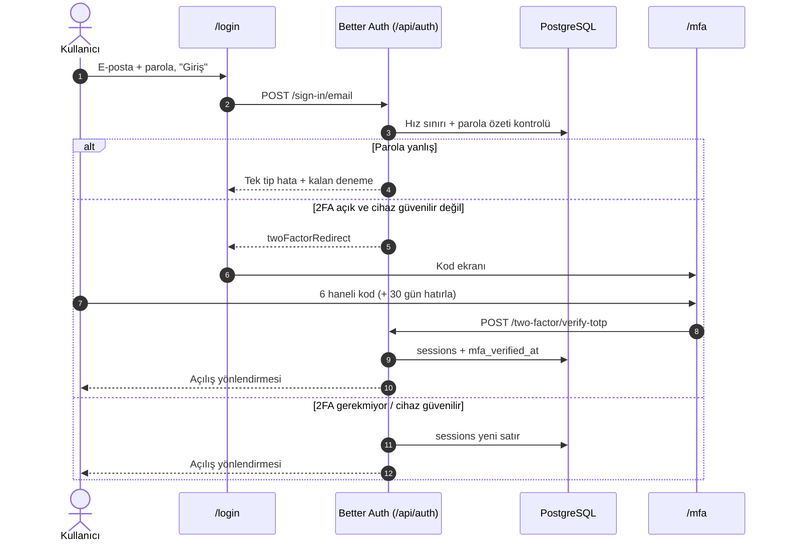
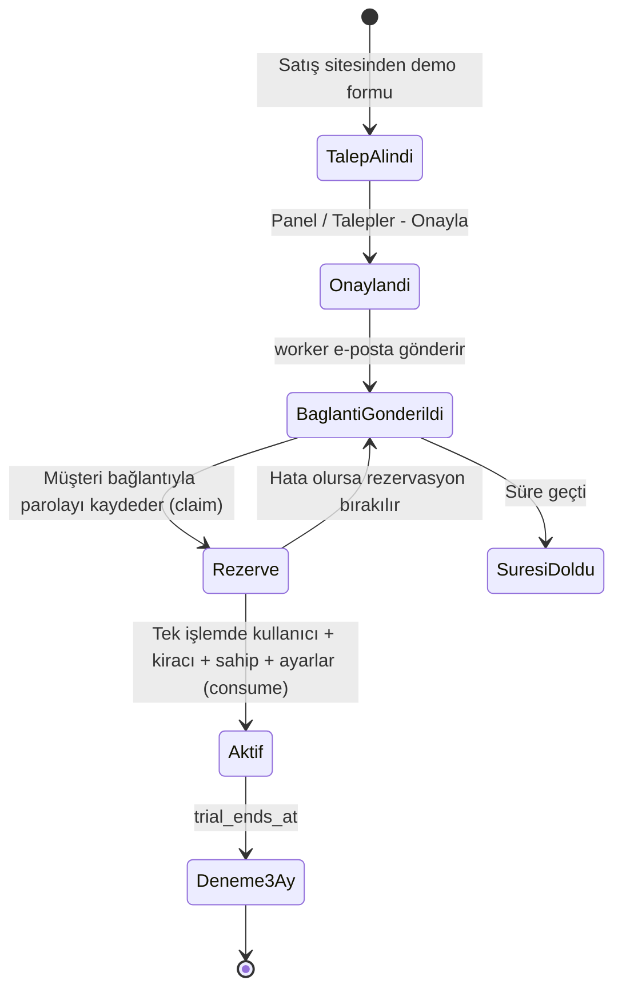
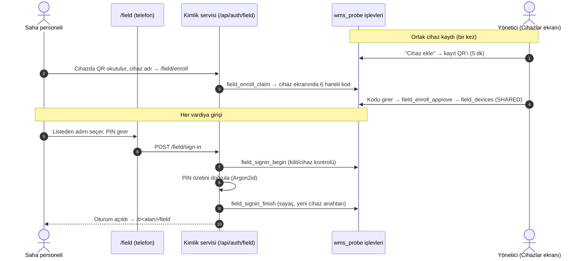
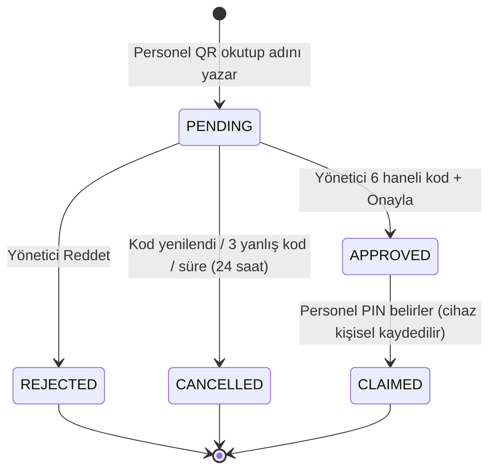
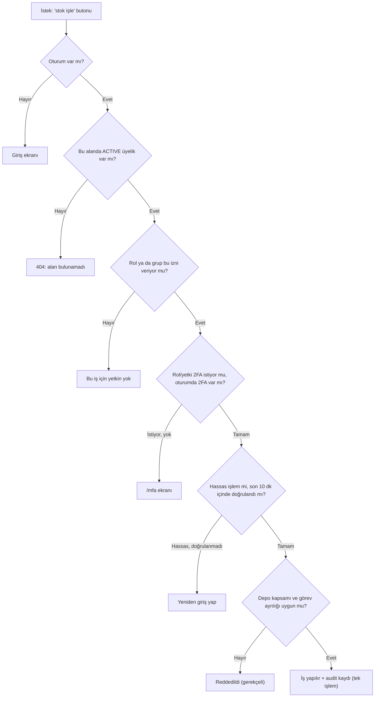

# 2A. Kimlik, ekip ve yetki modülleri

> **Bu dosya neyi anlatır?** Kullanıcının sisteme nasıl girdiğini, çalışma alanının nasıl kurulduğunu, ekibe kişinin nasıl eklendiğini ve kimin neyi yapabildiğini ekran ekran anlatır. Her ekranda "bu butona basılınca hangi sunucu işlemi çalışır, veritabanında hangi tabloya ne yazılır, hangi kural kontrol edilir" sorularının cevabı vardır.
>
> **Tablo sütunları nasıl okunur?**
> - **Tetiklenen API / Servis:** Ekranın sunucuda çağırdığı işlemdir. `xxxAction` ile bitenler Next.js "server action"dır: ekranın arkasında çalışan sunucu fonksiyonu. Yanındaki `packages/domain/...` iş kuralının asıl yazıldığı yerdir. `/api/auth/...` ile başlayanlar kimlik servisinin (Better Auth) uç noktalarıdır.
> - **Etkilenen DB tablosu:** `tablo.kolon` biçiminde yazılır. `wms_probe.xxx()` ile yazılanlar veritabanındaki denetimli işlevlerdir: uygulama o tabloya doğrudan yazamaz, yalnız bu işlev aracılığıyla yazar.
> - **Her yazma işlemi** aynı veritabanı işleminde `audit_logs` tablosuna "kim, ne zaman, ne yaptı" kaydı da atar. Tabloda tekrar edilmedi.
>
> **Ortak kurallar (her ekranda geçerli, tekrar yazılmadı):**
> - Ekip yönetimi ekranlarının hepsi `users.manage` iznini ister. Bu izin yalnız **Yönetici** rolünde vardır.
> - Hassas yönetici işlemleri (rol değiştirme, çıkarma, cihaz onayı, kod yenileme, grup değiştirme) için son 10 dakika içinde kimlik doğrulanmış olmalıdır. Değilse ekranda "kimliğini yeniden doğrula" yazar (`RECENT_AUTH_REQUIRED`).
> - **Demo alanında** üye ekleme, çıkarma ve grup değiştirme kapalıdır (herkese açık demo hesabı yetki yükseltemesin diye).
>
> **Canlı durumu:** Bu dosyadaki ekranların kodu main dalındadır. main'e birleşen kod otomatik yayına çıkar. Saha girişi (0044/0045), yetki grupları ve ekibe katılma (0051/0052, 19 Ekim) canlıdadır (`docs/STATE.md`). Ekran bazında ayrıca canlı tıklama testi bu belgede yapılmadı.

## Modül dizini

| # | Modül | Adres | Durum |
| :--- | :--- | :--- | :--- |
| 1 | Giriş, iki adımlı doğrulama, parola sıfırlama | `/login`, `/mfa`, `/reset-password` | [TAMAMLANDI] |
| 2 | Açılış ve çalışma alanı seçimi | `/`, `/workspaces` | [TAMAMLANDI] |
| 3 | Deneme aktivasyonu (yeni müşterinin kuruluşu) | `/activate/<belirteç>` | [TAMAMLANDI] |
| 4 | Kendi kendine kuruluş sihirbazı | `/onboarding` | [TAMAMLANDI] (canlıda bilerek kapalı) |
| 5 | Davet kabulü | `/invite/<belirteç>` | [TAMAMLANDI] |
| 6 | Saha girişi (PIN, cihaz kaydı, QR ile katılma) | `/field`, `/field/enroll`, `/field/join` | [TAMAMLANDI] |
| 7 | Ekip (yeni tasarım) | `/t/<alan>/team` | [TAMAMLANDI] |
| 8 | Kullanıcılar (ayrıntılı kişi yönetimi) | `/t/<alan>/members` | [TAMAMLANDI] (eski tasarım; yeni kalıba geçişi B-63 kapsamında) |
| 9 | Saha hesapları | `/t/<alan>/members/field` | [TAMAMLANDI] |
| 10 | Cihazlar (ortak/kişisel cihaz kaydı) | `/t/<alan>/members/devices` | [TAMAMLANDI] |
| 11 | Ekibe katılma QR'ı ve onaylar | `/t/<alan>/members/join` | [TAMAMLANDI] |
| 12 | Yetki grupları | `/t/<alan>/groups` | [TAMAMLANDI] |
| 13 | Rol / izin matrisi (kural tablosu, ekran değil) | `packages/domain/src/identity/permissions.ts` | [TAMAMLANDI] |

---

## Modül: wms. ve yonet. / Giriş, iki adımlı doğrulama, parola sıfırlama
- **Modül Durumu:** [TAMAMLANDI]
- **Ekranın amacı:** Ofis kullanıcısı ve işletmeci e-posta + parola ile girer. Rolü gerektiriyorsa telefonundaki 6 haneli kodu da girer. Parolasını unutan kişi kendi e-postasına sıfırlama bağlantısı ister. Aynı ekran hem wms. hem yonet. adresinde çalışır, ama iki adresin oturumları birbirinden ayrıdır.
- **Dosyalar:** `apps/web/app/login/flow.tsx`, `apps/web/app/mfa/page.tsx`, `apps/web/app/auth-forms.tsx`, `apps/web/app/reset-password/page.tsx`, `packages/auth/src/index.ts`.

| UI Bileşeni / Buton / Alan | Tipi | Kullanıcı Aksiyonu | Tetiklenen API / Servis | Etkilenen DB Tablosu & Kolonu | İş Kuralı / Validasyon | Mevcut Durum |
| :--- | :--- | :--- | :--- | :--- | :--- | :--- |
| E-posta, Parola | Input | Yazılır | — | — | Parola 12–128 karakter | [TAMAMLANDI] |
| "Giriş" | Buton | Tıklanır | `POST /api/auth/sign-in/email` (Better Auth) | Okur: `users.email`, `accounts.password` (Argon2id özeti). Yazar: `sessions` (yeni satır: `token`, `expires_at`, `ip_address`, `user_agent`), `security_events` (giriş olayı), `auth_rate_limits` | IP başına 10 dk'da 10 deneme. Hesap var/yok bilgisini sızdırmayan tek tip hata ("e-posta veya parola hatalı"). Kalan deneme ve bekleme süresi gösterilir. 2FA açıksa oturum yerine geçici `two_factor` çerezi verilir ve kod ekranına geçilir. | [TAMAMLANDI] |
| "Google / Microsoft ile gir" | Buton | Tıklanır | `POST /api/auth/sign-in/social` | `accounts` (sağlayıcı bağlantısı), `sessions` | Yalnız ortam ayarı açıksa görünür. Bu yolla yeni hesap açılamaz. | [GELİŞTİRİLİYOR] (kodda var; canlıda açık mı UNKNOWN) |
| 6 haneli kod | Input | Yazılır | — | — | Yalnız rakam | [TAMAMLANDI] |
| "Bu cihazı 30 gün hatırla" | Onay kutusu | İşaretlenir | Kod doğrulamasıyla birlikte gider (`trustDevice`) | Güvenilen cihaz çerezi (30 gün mutlak süre) | Panelde ve işletmeci hesabında gösterilmez (her girişte kod istenir) | [TAMAMLANDI] |
| "Doğrula" | Buton | Tıklanır | `POST /api/auth/two-factor/verify-totp` ya da `/verify-backup-code` | `two_factors.failed_verification_count`, `two_factors.locked_until`; `sessions.mfa_verified_at` (bu oturumda 2FA yapıldı damgası) | 5 hatalı kod → 15 dk kilit. 10 dk'da 10 deneme sınırı. | [TAMAMLANDI] |
| 2FA kurulumu (parola → QR → ilk kod) | Form | Doldurulur | `POST /api/auth/two-factor/enable` → `POST /api/auth/two-factor/verify-totp` | `two_factors.secret`, `two_factors.backup_codes`, `users.two_factor_enabled` | Yönetici ve Depo yöneticisi için zorunlu. Kurulmadan iş ekranları açılmaz (`MFA_REQUIRED` → `/mfa`). | [TAMAMLANDI] |
| "Parolamı unuttum" → e-posta | Form | Gönderilir | `POST /api/auth/request-password-reset` | `verifications` (tek kullanımlık belirteç); kuyruk: e-posta işi (`pgboss` şeması) | Saatte 5 istek. Hesap yoksa da aynı "gönderildi" cevabı verilir (hesap varlığı sızmaz). E-posta ayarı kapalıysa "gönderilemiyor" (503) denir; sahte başarı gösterilmez. | [TAMAMLANDI] |
| Yeni parola + "Kaydet" | Form | Gönderilir | `POST /api/auth/reset-password` | `accounts.password` güncellenir; `verifications` satırı tüketilir; eski oturumlar kapanır | Parola 12–128. Yönetici kaynaklı bağlantı 30 dk, tek kullanımlık. | [TAMAMLANDI] |
| "Çıkış" | Buton | Tıklanır | `POST /api/auth/sign-out` | `sessions` satırı silinir | — | [TAMAMLANDI] |

---

## Modül: wms. / Açılış ve çalışma alanı seçimi
- **Modül Durumu:** [TAMAMLANDI]
- **Ekranın amacı:** Girişten sonra kullanıcıyı doğru yere götürür. Birden çok firmada üyeliği olan kişi (örneğin muhasebeci) alan seçer.
- **Dosyalar:** `apps/web/app/page.tsx`, `apps/web/app/workspaces/view.tsx`, `packages/domain/src/identity/last-workspace.ts`, `packages/domain/src/identity/member-queries.ts`.

| UI Bileşeni / Buton / Alan | Tipi | Kullanıcı Aksiyonu | Tetiklenen API / Servis | Etkilenen DB Tablosu & Kolonu | İş Kuralı / Validasyon | Mevcut Durum |
| :--- | :--- | :--- | :--- | :--- | :--- | :--- |
| Ana adres `/` | Sayfa açılışı | Açılır | `getMembershipSummary` → `landingFor` | Okur: `tenant_memberships` (status=ACTIVE), `tenants.slug/name`, `tenant_memberships.last_used_at` | 1 alan → doğrudan alana. 0 alan → `/onboarding`. Çok alan → son kullanılan; son kullanılan yoksa `/workspaces`. | [TAMAMLANDI] |
| Alan kartı (ad + "SON" rozeti) | Kart / bağlantı | Tıklanır | `/t/<alan>` sayfasına gider | Alan sayfası açılınca `markWorkspaceUsed` → `tenant_memberships.last_used_at = now()` | Kayıt en çok 5 dakikada bir yazılır. Üyelik her istekte yeniden denetlenir. | [TAMAMLANDI] |
| Kısa adres `wms.etkinyazilim.com/<alan>` | URL | Yazılır | `apps/web/proxy.ts` → `/t/<alan>`'a 307 yönlendirme | — | Ayrılmış adlar (login, panel vb.) kısa adres sayılmaz | [TAMAMLANDI] |

---

## Modül: wms. / Deneme aktivasyonu (yeni müşterinin kuruluşu)
- **Modül Durumu:** [TAMAMLANDI]
- **Ekranın amacı:** İşletmeci demo talebini onaylayınca müşteriye bir bağlantı gider. Müşteri bu bağlantıyla 4 adımda kendi çalışma alanını açar: (1) firma adı + alan adı, (2) örnek veriyle mi boş mu başlanacak, (3) parola, (4) iki adımlı doğrulama. Sonunda 3 aylık deneme başlar.
- **Dosyalar:** `apps/web/app/activate/[token]/flow.tsx`, `apps/web/app/activate/[token]/actions.ts`, `packages/domain/src/platform/activation.ts`, `packages/domain/src/onboarding/workspace.ts` (`initializeNewTenant`), `packages/domain/src/onboarding/sample-data.ts`.

| UI Bileşeni / Buton / Alan | Tipi | Kullanıcı Aksiyonu | Tetiklenen API / Servis | Etkilenen DB Tablosu & Kolonu | İş Kuralı / Validasyon | Mevcut Durum |
| :--- | :--- | :--- | :--- | :--- | :--- | :--- |
| Sayfa açılışı | Sayfa | Bağlantı açılır | `previewActivation` → `wms_probe.platform_activation_preview` | Okur: `wms_platform.subscriptions` (aktivasyon belirteci özeti, `activation_expires_at`), demo talebi (firma, e-posta) | Bağlantı süresi dolmuşsa, kullanılmışsa ya da eksikse "Bu bağlantı kullanılamıyor" ekranı. Belirteç adres çubuğundan dış sitelere sızmaz. | [TAMAMLANDI] |
| FİRMA ADI | Input | Yazılır | — | — | Boş olamaz, kontrol karakteri içeremez | [TAMAMLANDI] |
| ÇALIŞMA ALANI ADI | Input | Yazılır | `checkWorkspaceNameAction` → `wms_probe.platform_workspace_name_taken` | Okur: `tenants.slug` | En az 3 karakter; küçük harf, rakam, tire. Ayrılmış adlar alınamaz. Sonradan değişmez. "Uygun · adresiniz …" ya da "Bu ad kullanılamaz" yazar. | [TAMAMLANDI] |
| "Örnek verilerle" / "Boş başla" | Seçim kartı | Seçilir | — | — | Örnek veri: örnek depo, raf ve ürünler eklenir | [TAMAMLANDI] |
| Parola + "PAROLAYI KAYDET" | Input + Buton | Tıklanır | `activateTrialAction` → `activateTrial` | (1) `wms_probe.platform_activation_claim`: belirteç 10 dk rezerve edilir. (2) `users`, `accounts` (Argon2id parola). (3) `tenants` (yeni satır: `slug`, `name`, `status='ACTIVE'`), `tenant_memberships` (`is_owner=true`), `membership_roles` (`TENANT_ADMIN`), `tenant_settings` (`locale`, `time_zone`, `onboarding_status`). (4) İsteğe bağlı örnek veri: `warehouses`, `locations`, `items`… (5) `wms_probe.platform_activation_consume` → `wms_platform.subscriptions.activated_at`, `trial_ends_at`. (6) Kuyruk: hoş geldiniz e-postası. | Hepsi **tek veritabanı işleminde** yapılır: biri başarısız olursa hiçbiri yazılmaz ve belirteç rezervasyonu geri bırakılır. Aynı bağlantı ikinci kez kullanılamaz. Parola 12–128 karakter. | [TAMAMLANDI] |
| 2FA adımı + "DOĞRULA" | Form | Kod girilir | `/api/auth/two-factor/enable` + `verify-totp` | `two_factors`, `users.two_factor_enabled` | Yönetici olduğu için zorunlu | [TAMAMLANDI] |
| "ÇALIŞMA ALANINI AÇ" | Buton | Tıklanır | `/t/<alan>`'a gider | — | — | [TAMAMLANDI] |

---

## Modül: wms. / Kendi kendine kuruluş sihirbazı (`/onboarding`)
- **Modül Durumu:** [TAMAMLANDI]. Canlıda **bilerek kapalıdır**: yalnız `SIGNUP_ENABLED=true` ve yerel/test ortamında açılır (`workspaceCreationAllowed`). Canlıda hiç üyeliği olmayan biri girerse ekranda "Yeni çalışma alanı şu an açılamıyor, yöneticinden davet iste" yazar.
- **Ekranın amacı:** (1) Alan adı → (2) sektör seçimi (Genel depo / Ambalaj ve sarf toptancısı) → "Oluştur".
- **Dosyalar:** `apps/web/app/onboarding/page.tsx`, `apps/web/app/onboarding/wizard.tsx`, `apps/web/app/onboarding/actions.ts`, `apps/web/app/onboarding/draft.ts`, `packages/domain/src/onboarding/workspace.ts`.

| UI Bileşeni / Buton / Alan | Tipi | Kullanıcı Aksiyonu | Tetiklenen API / Servis | Etkilenen DB Tablosu & Kolonu | İş Kuralı / Validasyon | Mevcut Durum |
| :--- | :--- | :--- | :--- | :--- | :--- | :--- |
| Çalışma alanı adı + "Devam" | Input + Buton | Tıklanır | `saveWorkspaceNameAction` | Veritabanına yazılmaz. Taslak 30 dk'lık çerezde tutulur (`wms_onboarding`). | En çok 120 karakter. Adres önizlemesi gösterilir. | [TAMAMLANDI] |
| Sektör seçimi | Radio | Seçilir | — | — | Şablon önizlemesi: koli birimi, bölge/raf/göz terimleri | [TAMAMLANDI] |
| "Oluştur" | Buton | Tıklanır | `createWorkspaceAction` → `createWorkspace` → `initializeNewTenant` | `tenants`, `tenant_memberships` (`is_owner`), `membership_roles` (`TENANT_ADMIN`), `tenant_settings` (`sector_template_key/version`, `terminology`, `onboarding_status`) | Aynı istek kimliği iki kez gelirse ikinci alan açılmaz (tekrar güvenli). Ad doluysa adrese kısa kod eklenir. Demo e-postasıyla açılamaz. | [TAMAMLANDI] |

---

## Modül: wms. / Davet kabulü (`/invite/<belirteç>`)
- **Modül Durumu:** [TAMAMLANDI]
- **Ekranın amacı:** Yöneticinin e-postayla davet ettiği ofis kullanıcısı bağlantıyı açar. Hesabı yoksa ad + parola yazarak hesap açar. Hesabı varsa giriş yapıp "Kabul et"e basar.
- **Dosyalar:** `apps/web/app/invite/[token]/page.tsx`, `apps/web/app/invite/[token]/actions.ts`, `apps/web/app/auth-forms.tsx` (`InviteAcceptForm`), `packages/domain/src/identity/invitations.ts`.

| UI Bileşeni / Buton / Alan | Tipi | Kullanıcı Aksiyonu | Tetiklenen API / Servis | Etkilenen DB Tablosu & Kolonu | İş Kuralı / Validasyon | Mevcut Durum |
| :--- | :--- | :--- | :--- | :--- | :--- | :--- |
| Davet özeti (firma, rol, son tarih) | Bilgi | — | `previewInvitation` → `wms_probe.invitation_preview_for_token` | Okur: `invitations` (`token_hash`, `role_key`, `expires_at`), `tenants.name` | Geçersiz/süresi dolmuş/iptal → "bulunamadı" | [TAMAMLANDI] |
| Ad, Parola (yeni hesap) + "Kabul et" | Form | Gönderilir | `acceptInvitationAction` → `acceptInvitation` + `createInvitedAccount` | `invitations.claim_id/claim_expires_at` (10 dk rezervasyon) → `users`, `accounts` → `tenant_memberships` (yeni ya da REMOVED→ACTIVE), `membership_roles.role_key` → `invitations.accepted_at` | Hesap e-postası davet e-postasıyla birebir aynı ve doğrulanmış olmalı. Zaten aktif üye ise reddedilir. Demo adresine davet yok. Yeni hesapta oturum açılmaz; giriş ekranına, oradan alana yönlendirilir. | [TAMAMLANDI] |
| "Kabul et" (oturum açıkken) | Buton | Tıklanır | Aynı işlem | Aynı (hesap açılmaz) | Rol yönetici/depo yöneticisiyse önce 2FA kurulumu istenir | [TAMAMLANDI] |

---

## Modül: wms. / Saha girişi (`/field`, `/field/enroll`, `/field/join`)
- **Modül Durumu:** [TAMAMLANDI]
- **Ekranın amacı:** E-postası olmayan depo çalışanı telefondan ya da ortak el terminalinden girer. Üç durum vardır:
  1. **Kişisel telefon, ilk kez:** Alan adı + kullanıcı adı + yöneticinin verdiği kod + yeni 6 haneli PIN girilir. Telefon "kişisel cihaz" olarak kaydedilir.
  2. **Ortak cihaz (vardiya terminali):** Cihaz önceden yönetici onayıyla kaydedilir. Personel listeden adını seçer ve PIN'ini girer.
  3. **QR ile katılma:** Duvardaki QR okutulur, kişi adını ve kullanıcı adını yazar. Ekranda 6 haneli kod çıkar. Yönetici bu kodla onaylar, sonra personel PIN belirler.
- **Dosyalar:** `apps/web/app/field/flow.tsx`, `apps/web/app/field/enroll/flow.tsx`, `apps/web/app/field/join/flow.tsx`, `packages/auth/src/field.ts`; veritabanı işlevleri migration `0044`, `0045`, `0052`, `0053`.

| UI Bileşeni / Buton / Alan | Tipi | Kullanıcı Aksiyonu | Tetiklenen API / Servis | Etkilenen DB Tablosu & Kolonu | İş Kuralı / Validasyon | Mevcut Durum |
| :--- | :--- | :--- | :--- | :--- | :--- | :--- |
| Sayfa açılışı (cihaz durumu) | Otomatik | Açılır | `GET /api/auth/field/device` → `wms_probe.field_device_status` | Okur: `field_devices` (cihaz çerezi özeti `token_hash`, `kind`, `revoked_at`, `expires_at`) | Kayıtlı ortak cihazda personel listesi gelir. Kayıtsız cihazda etkinleştirme formu çıkar. | [TAMAMLANDI] |
| Personel listesi (ortak cihaz) | Seçim kartları | Ad seçilir | `GET /api/auth/field/staff` → `wms_probe.field_device_staff` | Okur: `field_logins.username`, kişi adları | Yalnız bu cihazın alanındaki aktif saha hesapları | [TAMAMLANDI] |
| 6 haneli PIN + "Gir" | PIN tuş takımı | Girilir | `POST /api/auth/field/sign-in` → `wms_probe.field_signin_begin` / `field_signin_finish` | `field_logins.failed_count`, `locked_until`, `lock_count`; `field_devices.token_hash` (her girişte cihaz anahtarı **yenilenir**), `last_used_at`; `sessions` + `field_sessions` (oturum ↔ cihaz) | Cihaz çerezi yoksa/başka alana aitse genel ret. 5 yanlış PIN → 15 dk kilit; 3. kilitte kalıcı kilit (yönetici açar). Aynı ortak cihazdan 60 dk'da 3 farklı hesap kilitlenirse cihaz otomatik iptal olur (`revoke_reason='LOCK_SPREE'`). Cihaz başına 15 dk'da 20, alan başına 15 dk'da 300 deneme. Oturum 12 saat, 2 saat hareketsizlikte kapanır. | [TAMAMLANDI] |
| Alan adı + kullanıcı adı + kod + yeni PIN, "Etkinleştir" | Form | Gönderilir | `POST /api/auth/field/activate` → `wms_probe.field_activate` | `field_logins.pin_hash`, `pin_set_at`, `activation_hash` (silinir), `activation_failed_count`; `field_devices` (yeni `kind='PERSONAL'`); `sessions` | Kod 24 saat geçerli. Kullanıcı başına saatte 10 deneme. PIN kolay tahmin edilen dizi olamaz (`pinAcceptable`). | [TAMAMLANDI] |
| Ortak cihaz kaydı `/field/enroll` (cihaz adı + "Kaydet") | Form | Gönderilir | `POST /api/auth/field/enroll` → `wms_probe.field_enroll_claim` | `field_enrollments.claim_token_hash`, `claimed_at`, `device_name`, `confirm_code` | Yöneticinin ekranındaki kayıt QR'ı 5 dk geçerli. Cihaz ekranında 6 haneli onay kodu çıkar; yönetici bu kodu kendi ekranına girer. | [TAMAMLANDI] |
| QR ile katılma `/field/join` (ad, kullanıcı adı + "Gönder") | Form | Gönderilir | `POST /api/auth/field/join/link` → `field_join_link`; `POST /api/auth/field/join` → `wms_probe.field_join_request` | `team_join_requests` (yeni: `name`, `username`, `confirm_code`, `status='PENDING'`, `expires_at` +24 saat) | QR bağlantısı 7 gün geçerli. IP başına 10 dk'da 20 talep. | [TAMAMLANDI] |
| Bekleme ekranı (otomatik yoklama) | Otomatik | — | `GET /api/auth/field/join/status` → `field_join_status` | Okur: `team_join_requests.status` | Onaylanınca PIN adımı açılır. Reddedilirse "cihaz giremez" yazar. | [TAMAMLANDI] |
| PIN belirle (katılma sonrası) | PIN tuş takımı | Girilir | `POST /api/auth/field/join/activate` → `field_join_activate` | `team_join_requests.status='CLAIMED'`, `claimed_at`; `field_logins.pin_hash`; `field_devices` (kişisel); `sessions` | Talep başına saatte 10 deneme | [TAMAMLANDI] |

---

## Modül: wms. / Ekip (`/t/<alan>/team`)
- **Modül Durumu:** [TAMAMLANDI] (yeni tasarım `Ekip.dc.html`, T-430)
- **Ekranın amacı:** Yöneticinin "ekibim" ekranıdır. Sekmeler: **KİŞİ** (herkes; saha/ofis filtresi), **ONAY BEKLİYOR** (QR ile katılmak isteyenler), **GRUP**. Ayrıca "EKLE" ile ofis kullanıcısı e-posta daveti ya da saha personeli için katılma QR'ı oluşturulur. Rol, depo ve şifre işlemleri için "Kullanıcılar ekranı ›" bağlantısı vardır.
- **Dosyalar:** `apps/web/app/t/[slug]/team/page.tsx`, `apps/web/app/t/[slug]/team/team-view.tsx`, `apps/web/app/t/[slug]/members/actions.ts`, `apps/web/app/t/[slug]/groups/actions.ts`.

| UI Bileşeni / Buton / Alan | Tipi | Kullanıcı Aksiyonu | Tetiklenen API / Servis | Etkilenen DB Tablosu & Kolonu | İş Kuralı / Validasyon | Mevcut Durum |
| :--- | :--- | :--- | :--- | :--- | :--- | :--- |
| KİŞİ listesi (Hepsi / Saha / Ofis) | Liste + filtre | Görüntülenir | `listGroups` (sayfa yüklenirken) | Okur: `tenant_memberships`, `membership_roles`, `member_groups`, `permission_groups`, `users.name` | E-posta adresleri bu ekrana gelmez (kişisel veri) | [TAMAMLANDI] |
| ONAY BEKLİYOR kartı → "GRUP SEÇ" → 6 haneli kod → "ONAYLA" | Kart + Input + Buton | Tıklanır | `approveJoinAction` → `approveJoinRequest` (+ seçildiyse `setMemberGroup`) | `wms_probe.field_join_verify` (kod doğrulama damgası) → `team_join_requests.status='APPROVED'`, `decided_by`, `decided_at`, `membership_id`; yeni `users`, `tenant_memberships`, `membership_roles`, `field_logins`; `member_groups` | Önce grup seçilmeli. Kod yanlışsa "N hak kaldı"; 3 yanlışta talep düşer. Paket kişi sınırı (`PLAN_LIMIT`) kontrol edilir. Grup atanamazsa kişi açılır ve ekranda "Gruplar ekranından ekle" uyarısı çıkar. | [TAMAMLANDI] |
| "Reddet" | Buton | Tıklanır | `rejectJoinAction` → `rejectJoinRequest` | `team_join_requests.status='REJECTED'`, `decided_by/at` | Yalnız PENDING talep | [TAMAMLANDI] |
| EKLE › E-POSTA: e-posta + grup + "DAVET GÖNDER" | Form | Gönderilir | `inviteMemberAction` → `inviteMember` | `invitations` (yeni: `email_normalized`, `role_key`, `token_hash`, `expires_at` +72 saat, `delivered_via`); varsa aynı adrese eski davet `revoked_at`; kuyruk: davet e-postası | Geçerli e-posta. Aktif üyeye davet yok. **Yönetici rolüyle davet yalnız hesap sahibine açık.** Paket yönetici sınırı. Demo alanında kapalı. | [TAMAMLANDI] |
| EKLE › QR: "QR OLUŞTUR" / "YAZDIR" / "PAYLAŞ" | Buton | Tıklanır | `createJoinLinkAction` → `createJoinLink` | `team_join_links`: eski bağlantı `revoked_at`, yeni satır (`token_hash`, `expires_at` +7 gün) | Yeni QR basılınca eskisi geçersiz olur ("Yeni QR hazır · eskisi geçersiz"). "PAYLAŞ" yalnız telefonun paylaşım penceresini açar. | [TAMAMLANDI] ("PAYLAŞ" geliştirmesi PR #145 açık: [GELİŞTİRİLİYOR]) |
| Kişi kartında grup değiştirme | Seçim | Seçilir | `setMemberGroupAction` → `setMemberGroup` | `member_groups` (ekle/değiştir/kaldır), `tenant_memberships.roles_version` +1 | Yalnız hesap sahibi. Sahip gruba konamaz. Saha hesabına onay/ters kayıt/aktarım içeren grup verilemez. | [TAMAMLANDI] |

---

## Modül: wms. / Kullanıcılar (`/t/<alan>/members`)
- **Modül Durumu:** [TAMAMLANDI] (eski görünüm; yeni kalıba geçişi B-63 kapsamında)
- **Ekranın amacı:** Ayrıntılı kişi yönetimi: rol değiştirme, depo kısıtı, çıkarma, sahiplik devri, parola sıfırlama bağlantısı, saha kodu yenileme ve kilit açma.
- **Dosyalar:** `apps/web/app/t/[slug]/members/members-view.tsx`, `parts.tsx`, `invite-dialog.tsx`, `actions.ts`; `packages/domain/src/identity/memberships.ts`, `invitations.ts`, `field-users.ts`; `packages/domain/src/warehouse` (`setMembershipWarehouseScopes`).

| UI Bileşeni / Buton / Alan | Tipi | Kullanıcı Aksiyonu | Tetiklenen API / Servis | Etkilenen DB Tablosu & Kolonu | İş Kuralı / Validasyon | Mevcut Durum |
| :--- | :--- | :--- | :--- | :--- | :--- | :--- |
| Üye listesi (Sahip / Sen / Demo rozetleri) | Liste | Görüntülenir | `member-queries.ts` | Okur: `tenant_memberships`, `membership_roles`, `users`, `invitations` (bekleyen davetler) | — | [TAMAMLANDI] |
| "Üye davet et" | Buton → pencere | Tıklanır | `inviteMemberAction` → `inviteMember` | `invitations` | Ekip ekranındaki davetle aynı kurallar | [TAMAMLANDI] |
| Bekleyen davet → "İptal" | Buton | Tıklanır | `revokeInvitationAction` → `revokeInvitation` | `invitations.revoked_at` | — | [TAMAMLANDI] |
| Rol seçimi + "Rolü değiştir" | Select + onay penceresi | Onaylanır | `changeRoleAction` → `changeRole` | `membership_roles` (eski rol silinir, yeni rol eklenir), `tenant_memberships.roles_version` +1 | **Kendi rolünü yükseltemezsin.** Sahibin rolü yalnız Yönetici olabilir. Başka bir yöneticiyi değiştirmek ya da birine yöneticilik vermek **yalnız hesap sahibinin** işidir. Son yönetici düşürülemez. Hepsi yeniden doğrulama ister. | [TAMAMLANDI] |
| "Depoları değiştir" (Tümü / depo listesi) | Çoklu seçim + onay | Kaydedilir | `setWarehouseScopeAction` → `setMembershipWarehouseScopes` | `membership_warehouse_scopes` (satırlar eklenir/silinir) | "Tümü" ya da en az 1 depo. Kişinin açık oturumu yeni kısıtla devam eder. | [TAMAMLANDI] |
| "Çıkar" | Buton + onay | Onaylanır | `removeMemberAction` → `removeMember` | `tenant_memberships.status='REMOVED'`, `removed_at` | Kendini çıkaramazsın. Son sahip ve son yönetici çıkarılamaz. Geçmiş kayıtlar silinmez. | [TAMAMLANDI] |
| "Sahipliği devret" | Buton + onay | Onaylanır | `transferOwnershipAction` → `transferOwnership` | `tenant_memberships.is_owner` (eski false, yeni true), `membership_roles` | Hedef aktif üye olmalı. Yeniden doğrulama gerekir. | [TAMAMLANDI] |
| "Parola sıfırlama bağlantısı oluştur" | Buton + onay | Onaylanır | `issuePasswordResetLinkAction` → `issuePasswordResetLink` | `verifications` (belirteç), `admin_reset_grants` (kim, hangi alan için, ne zaman) | Bağlantı 30 dk geçerli ve tek kullanımlıktır. **Yalnız bir kez gösterilir**; yönetici kişiye kendisi iletir. Kendi hesabına üretilemez. | [TAMAMLANDI] |
| Saha hesabı → "Yeni kod" | Buton + onay | Onaylanır | `resetFieldCodeAction` → `resetFieldCode` → `wms_probe.field_admin_reset` | `field_logins.activation_hash`, `pin_hash` (silinir); bekleyen `team_join_requests` → `CANCELLED` | Eski PIN, kişisel telefon kaydı ve açık oturumlar geçersiz olur. Kod yalnız bu yanıtta görünür. | [TAMAMLANDI] |
| Saha hesabı → "Kilidi aç" | Buton + onay | Onaylanır | `unlockFieldLoginAction` → `unlockFieldLogin` | `field_logins.failed_count=0`, `locked_until=NULL` | PIN ve cihaz kaydı değişmez | [TAMAMLANDI] |
| "Alandan ayrıl" (kendi üyeliğini bırakma) | — | — | `leaveTenantAction` → `leaveTenant` **sunucuda var** | `tenant_memberships.status='REMOVED'` | Son sahip/son yönetici ayrılamaz | [GELİŞTİRİLİYOR] — **ekranda butonu yok** |

---

## Modül: wms. / Saha hesapları (`/t/<alan>/members/field`)
- **Modül Durumu:** [TAMAMLANDI]
- **Ekranın amacı:** E-postasız saha personeli açmak. Ad, kullanıcı adı, rol (Toplayıcı / Sayımcı) ve isteğe bağlı tek depo seçilir. Ekranda bir kez **etkinleştirme kodu** gösterilir.
- **Dosyalar:** `apps/web/app/t/[slug]/members/field/view.tsx`, `packages/domain/src/identity/field-users.ts`.

| UI Bileşeni / Buton / Alan | Tipi | Kullanıcı Aksiyonu | Tetiklenen API / Servis | Etkilenen DB Tablosu & Kolonu | İş Kuralı / Validasyon | Mevcut Durum |
| :--- | :--- | :--- | :--- | :--- | :--- | :--- |
| Ad, Kullanıcı adı, Rol, Depo + "Oluştur" | Form | Gönderilir | `createFieldUserAction` → `createFieldUser` (+ `createFieldAccount`) | `users` (e-posta yerine `@field.invalid` iç adres), `tenant_memberships`, `membership_roles` (`PICKER`/`COUNTER`), `field_logins` (`username`, `activation_hash`, `activation_expires_at` +24 saat), `membership_warehouse_scopes` (depo seçildiyse) | Ad 2–100, kullanıcı adı 3–40 karakter. Alan içinde kullanıcı adı tekil (`CODE_TAKEN`). Paket saha kullanıcısı sınırı (`PLAN_LIMIT`). Saha hesabı yalnız Toplayıcı/Sayımcı olabilir. | [TAMAMLANDI] |
| Liste → "Yeni kod" | Buton | Tıklanır | `resetFieldCodeAction` | Bkz. Kullanıcılar | — | [TAMAMLANDI] |

---

## Modül: wms. / Cihazlar (`/t/<alan>/members/devices`)
- **Modül Durumu:** [TAMAMLANDI]
- **Ekranın amacı:** Ortak el terminali/tablet kaydetmek, kayıtlı cihazları görmek ve kaybolan cihazı iptal etmek. Otomatik askıya alınan cihazlar (toplu kilitleme koruması) burada görünür.
- **Dosyalar:** `apps/web/app/t/[slug]/members/devices/view.tsx`, `packages/domain/src/identity/devices.ts`.

| UI Bileşeni / Buton / Alan | Tipi | Kullanıcı Aksiyonu | Tetiklenen API / Servis | Etkilenen DB Tablosu & Kolonu | İş Kuralı / Validasyon | Mevcut Durum |
| :--- | :--- | :--- | :--- | :--- | :--- | :--- |
| Cihaz listesi | Liste | Görüntülenir | `listDevices`, `listSuspendedDevices` | Okur: `field_devices` (son 60 gün kullanılanlar; `kind`, `name`, `last_used_at`, `revoke_reason`) | Son 7 gündeki otomatik askıya almalar ayrı gösterilir | [TAMAMLANDI] |
| "Cihaz ekle" → QR | Buton | Tıklanır | `startEnrollmentAction` → `startEnrollment` | `field_enrollments` (yeni: `token_hash`, `expires_at` +5 dk); açık eski kayıt `cancelled_at` | Yeniden doğrulama | [TAMAMLANDI] |
| Durum yoklama (Bekliyor / Cihaz okuttu / Onaylandı / Süresi doldu) | Otomatik | — | `enrollmentStatusAction` → `getEnrollment` | Okur: `field_enrollments` | Cihaz okuttuktan sonra 10 dk içinde onaylanmazsa süresi dolar | [TAMAMLANDI] |
| Cihazdaki 6 haneli kod + "Onayla" | Input + Buton | Tıklanır | `approveEnrollmentAction` → `approveEnrollment` → `wms_probe.field_enroll_approve` | `field_enrollments.approved_at`, `device_id`; `field_devices` (yeni `kind='SHARED'`, `expires_at` +180 gün) | Kod 6 hane. 3 yanlışta kayıt iptal olur. | [TAMAMLANDI] |
| "Vazgeç" | Buton | Tıklanır | `cancelEnrollmentAction` | `field_enrollments.cancelled_at` | — | [TAMAMLANDI] |
| "İptal et" (cihaz) | Buton | Tıklanır | `revokeDeviceAction` → `revokeDevice` → `wms_probe.field_device_revoke` | `field_devices.revoked_at`, `revoked_by`, `revoke_reason='MANUAL'`; o cihazın `sessions` kayıtları silinir | Yeniden doğrulama | [TAMAMLANDI] |

---

## Modül: wms. / Ekibe katılma QR'ı (`/t/<alan>/members/join`)
- **Modül Durumu:** [TAMAMLANDI] (Ekip ekranındaki QR/onay işlevinin eski görünümlü eşi)
- **Dosyalar:** `apps/web/app/t/[slug]/members/join/view.tsx`, `packages/domain/src/identity/team-join.ts`.

| UI Bileşeni / Buton / Alan | Tipi | Kullanıcı Aksiyonu | Tetiklenen API / Servis | Etkilenen DB Tablosu & Kolonu | İş Kuralı / Validasyon | Mevcut Durum |
| :--- | :--- | :--- | :--- | :--- | :--- | :--- |
| "QR oluştur" | Buton | Tıklanır | `createJoinLinkAction` | `team_join_links` | Eski QR geçersiz olur; yeni QR 7 gün geçerli | [TAMAMLANDI] |
| "QR'ı kapat" | Buton | Tıklanır | `revokeJoinLinkAction` → `revokeJoinLink` | `team_join_links.revoked_at` | — | [TAMAMLANDI] |
| Bekleyen talep → Onayla / Reddet | Buton | Tıklanır | `approveJoinAction` / `rejectJoinAction` | Bkz. Ekip ekranı | Onay kodu DB'de doğrulanır (`field_join_verify`). Geçersiz durum geçişlerini veritabanı tetikleyicisi reddeder. | [TAMAMLANDI] |

---

## Modül: wms. / Yetki grupları (`/t/<alan>/groups`)
- **Modül Durumu:** [TAMAMLANDI] (`Gruplar.dc.html`, T-421; migration 0051 canlıda)
- **Ekranın amacı:** Hesap sahibi rolün üstüne **ek yetki** ve **görünen ekranlar** listesi tanımlar. Örnek: "Kabul ekibi" grubu yalnız Giriş görevi ekranını görsün ve stok işleyebilsin. Üç adımda yapılır: (1) ad, renk, ekranlar, yetkiler → (2) kişileri seç → (3) bitti.
- **Dosyalar:** `apps/web/app/t/[slug]/groups/groups-view.tsx`, `apps/web/app/t/[slug]/groups/actions.ts`, `packages/domain/src/identity/groups.ts`, menü süzgeci `apps/web/app/t/[slug]/kabuk/modules.ts`.

| UI Bileşeni / Buton / Alan | Tipi | Kullanıcı Aksiyonu | Tetiklenen API / Servis | Etkilenen DB Tablosu & Kolonu | İş Kuralı / Validasyon | Mevcut Durum |
| :--- | :--- | :--- | :--- | :--- | :--- | :--- |
| Grup listesi + hazır (rol) grupları | Liste | Görüntülenir | `listGroups` | Okur: `permission_groups`, `member_groups` | Hazır gruplar rolden gelir, değiştirilemez | [TAMAMLANDI] |
| "YENİ GRUP" / gruba dokun → Ad, Renk | Input + renk seçimi | Doldurulur | — | — | Ad 1–60 karakter, alan içinde tekil. Renk yalnız 5 tasarım renginden biri. | [TAMAMLANDI] |
| Ekranlar (Giriş görevi, Çıkış görevi, Transfer, Üretim, Sayım, Etiket, Raporlar, Sorun) | Çoklu seçim | Seçilir | — | `permission_groups.screens` | Kapalı liste: 8 ekran (DB CHECK) | [TAMAMLANDI] |
| Ek yetkiler (stok işle, belge oluştur, onayla, sayım farkı onayla, ters kayıt, Excel aktarımı) | Çoklu seçim | Seçilir | — | `permission_groups.grants` | Kapalı liste: 6 yetki. **Ekip yönetimi ve ayarlar gruba verilemez.** | [TAMAMLANDI] |
| "DEVAM: KİŞİLER" → "KAYDET (n)" | Buton | Tıklanır | `saveGroupAction` → `saveGroup`; ardından kişi başına `setMemberGroupAction` | `permission_groups` (yeni ya da güncelleme: `name`, `color`, `screens`, `grants`, `version` +1, `updated_at`); `member_groups`; etkilenen üyelerin `tenant_memberships.roles_version` +1 | **Yalnız hesap sahibi.** Saha hesabına MFA gerektiren yetki (onay/ters kayıt/aktarım) verilemez; atlanan kişiler ekranda listelenir. Grup başkası tarafından değiştirildiyse "Grup bu arada değişti" (sürüm çakışması). | [TAMAMLANDI] |
| "Arşivle" / "Geri al" | Buton | Tıklanır | `archiveGroupAction` → `setGroupArchived` | `permission_groups.archived_at` | Silinmez, arşivlenir | [TAMAMLANDI] |
| Ekran listesinin etkisi | Menü | — | `kabukModules` | — | Listede olmayan ekranın **menü kutusu çizilmez**. Not: bu bir görünüm süzgecidir. Asıl işlem yetkisini rol + ek yetki belirler (gap listesinde). | [TAMAMLANDI] |

---

## Modül: Rol / izin matrisi (kural tablosu)
- **Modül Durumu:** [TAMAMLANDI]
- **Kaynak:** `packages/domain/src/identity/permissions.ts` (tek kaynak), `packages/domain/src/identity/access.ts` (MFA), `packages/domain/src/identity/separation.ts` (görev ayrılığı).

**5 sabit rol:** Yönetici (`TENANT_ADMIN`), Depo yöneticisi (`WAREHOUSE_MANAGER`), Toplayıcı (`PICKER`), Sayımcı (`COUNTER`), İzleyici (`READ_ONLY`). Ayrıca **hesap sahibi** (`is_owner`) vardır: rolü her zaman Yönetici'dir ve ek ayrıcalıkları bulunur.

| İzin (sade anlamı) | Yönetici | Depo yöneticisi | Toplayıcı | Sayımcı | İzleyici | Gruba verilebilir mi? |
| :--- | :---: | :---: | :---: | :---: | :---: | :---: |
| `stock.view`: stoku ve ekranları görme | ✅ | ✅ | ✅ | ✅ | ✅ | (herkeste var) |
| `document.create`: belge/taslak oluşturma (kabul, sayım satırı) | ✅ | ✅ | — | ✅ | — | ✅ |
| `document.approve`: belge onaylama | ✅ | ✅ | — | — | — | ✅ (2FA ister) |
| `stock.post`: stoğa işleme (okut-onayla, toplama, yerleştirme) | ✅ | ✅ | ✅ | — | — | ✅ |
| `reversal.create`: ters kayıt (yanlış işlemi geri alma) | ✅ | ✅ | — | — | — | ✅ (2FA ister) |
| `count_diff.approve`: sayım farkını onaylama | ✅ | ✅ | — | — | — | ✅ (2FA ister) |
| `takeout.request`: çıkış talebi | ✅ | — | — | — | — | — |
| `settings.manage`: ayarlar, entegrasyonlar, görev ayrılığı | ✅ | — | — | — | — | ❌ (yalnız Yönetici) |
| `users.manage`: ekip, davet, cihaz, rol | ✅ | — | — | — | — | ❌ (yalnız Yönetici) |
| `audit.view`: işlem kaydını görme / dışa aktarma | ✅ | ✅ | — | — | — | — |
| `data.import`: Excel'den aktarım | ✅ | — | — | — | — | ✅ (2FA ister) |
| **2FA zorunlu mu?** | Evet | Evet | Hayır* | Hayır* | Hayır | |

\* Gruptan onay, ters kayıt ya da aktarım yetkisi aldıysa evet.

**Yalnız hesap sahibinin yapabildikleri:** başka bir yöneticiyi yönetmek ya da birine yöneticilik vermek, yönetici rolüyle davet göndermek, yetki gruplarını oluşturmak/değiştirmek/atamak, sahipliği devretmek.

**Görev ayrılığı (firma ayarı, varsayılan KAPALI):** Açıksa aynı kişi bir işin hem hazırlayanı hem onaylayanı olamaz: belgeyi oluşturan onaylayamaz, sayan kişi sayım farkını onaylayamaz, belgeyi oluşturan ya da işleyen kişi ters kayıt yapamaz. Ayar `tenant_settings.separation_of_duties` sütunundadır ve Ayarlar ekranından değiştirilir.

**Depo kapsamı:** Bir üye belirli depolarla sınırlanabilir (`membership_warehouse_scopes`). Sınırlı üye diğer depoların stokunu ve işini görmez.

---

## Bu dosyadan çıkan açıklar (özet; birleşik liste [04 — Gap analizi](04-gap-analizi.md))
- `leaveTenantAction` (alandan ayrılma) sunucuda var, **hiçbir ekranda butonu yok**.
- Grup "ekranlar" listesi yalnız menüyü gizler. Doğrudan adresle girilen ekranda işlem yetkisini rol ve ek yetkiler belirler. Ekran kısıtının sunucuda da uygulanıp uygulanmayacağı ürün kararıdır.
- `takeout.request` izni matriste var, ama kullanan bir ekran yok. Tam veri teslimi (B-67) için ayrılmış.
- Kullanıcılar (`members`) ile Ekip (`team`) ekranları kısmen aynı işi yapıyor. Eski görünümün yeni kalıba geçişi B-63 kapsamında.
- Google/Microsoft ile giriş canlıda açık mı: UNKNOWN.
- 🔒 B-17, B-20: kimlik ve üyelik yazmalarında veritabanı düzeyinde ikinci savunma (P1, açık).
- 🔒 B-12: saha girişi migration'larının geri alınmasına veri bekçisi (P1, açık).
