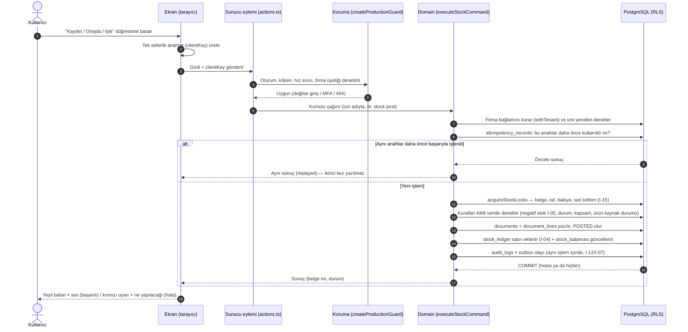
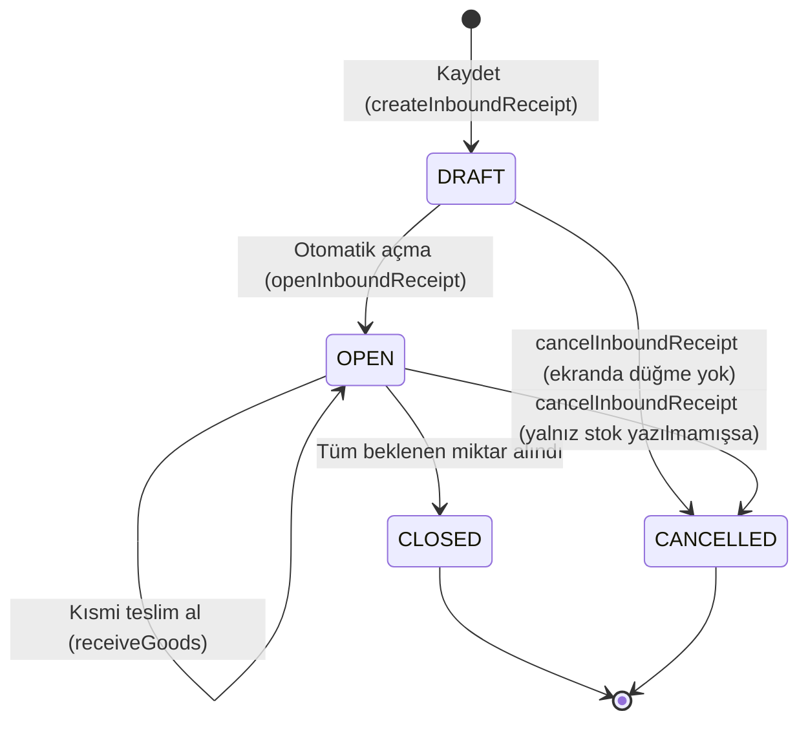
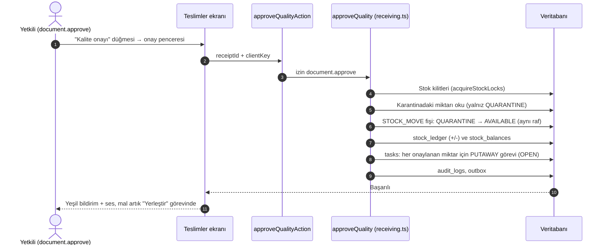
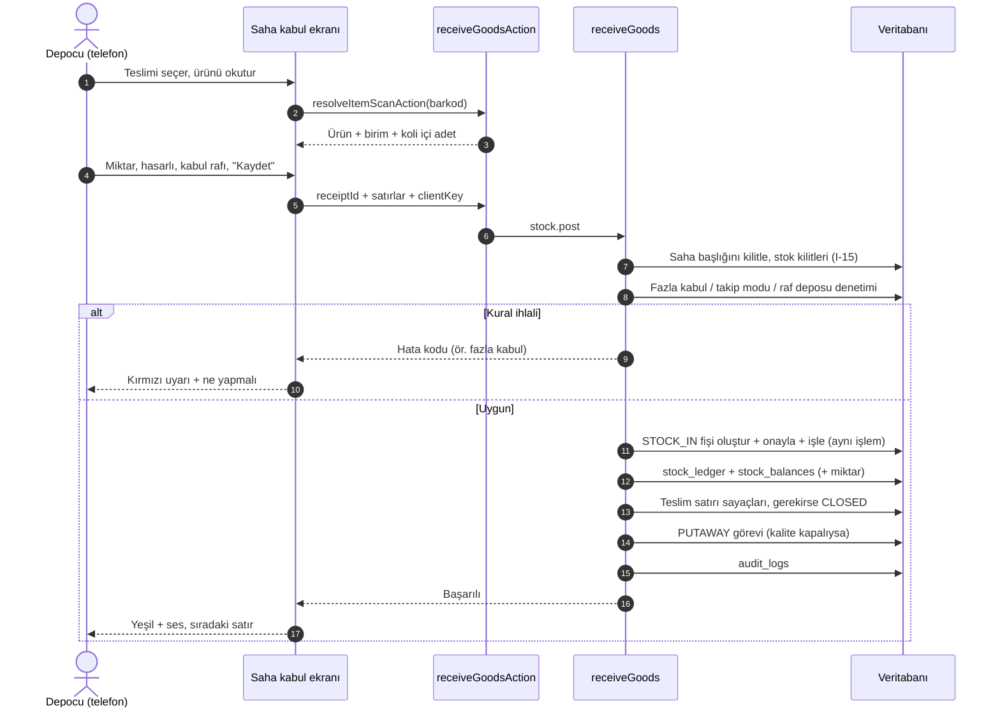
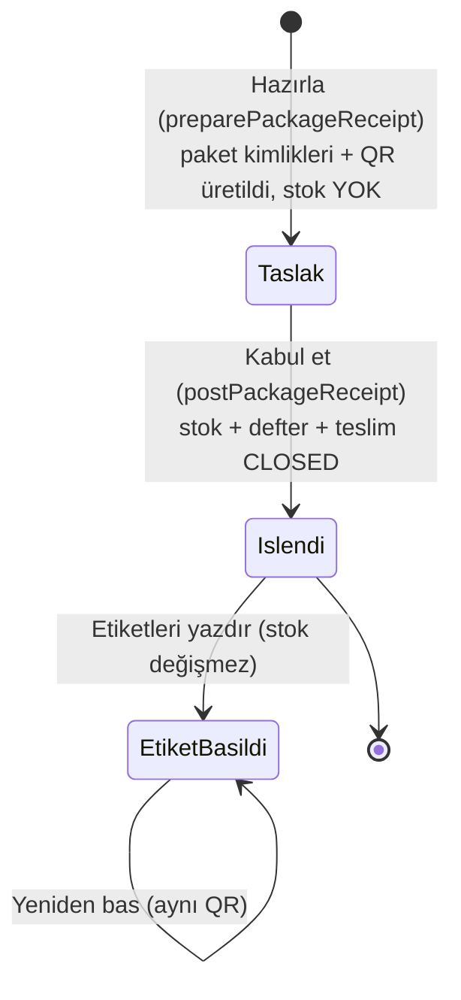
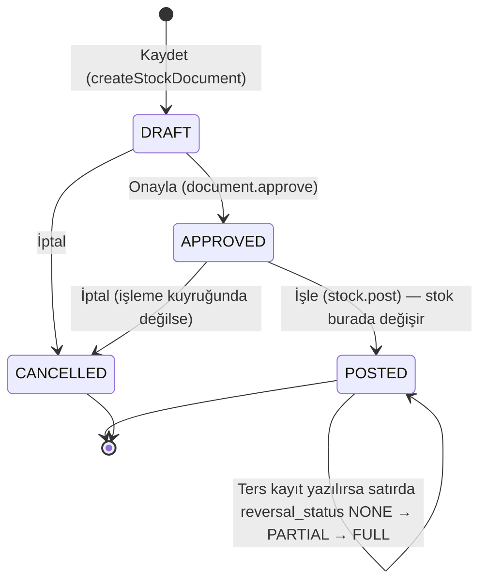
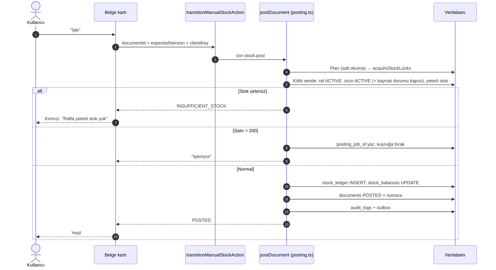
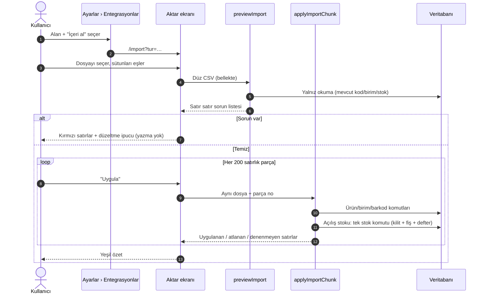
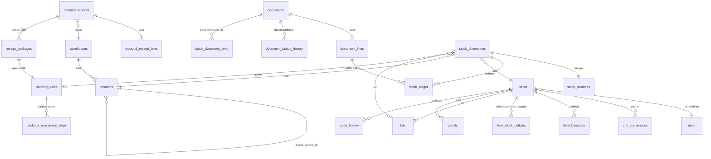

# 2B. Mal Kabul, Stok ve Katalog Modülleri (wms.etkinyazilim.com)

> **Bu bölüm neyi anlatır?** Depoya mal girişinden (mal kabul) başlayıp, stok listesi, stok fişleri (giriş/çıkış/transfer), ürün kartları, cariler (müşteri/tedarikçi), depolar ve raf yerleri, etiket basımı ve Excel'den veri aktarma ekranlarını anlatır.
> Her ekran için: ne işe yaradığı, hangi düğmeye basınca ne olduğu, veri tabanında (DB) hangi tablonun değiştiği ve hangi kuralın işlediği yazılıdır.
>
> **Kaynak:** main `2022915` · 29 Ekim 2026 (ilk sürüm main `36f3a13` · 23 Ekim; T-1029…T-1110 28 Ekim'de, T-1111…T-1131 29 Ekim'de, T-1133…T-1142 1 Kasım'da işlendi; main `008070a`). **1 Kasım farkı:** ürün / cari / depo / raf yeri kartlarındaki her yazma işlemi artık kendi **bölüm × işlem** anahtarını ister (T-1141; yetkisizde kilitli düğme + sarı balon, gizlenmez) ve bu anahtarlar Yetkiler ekranından gruba verilebilir (T-1142; ayrıntı 02a). Paraşüt'e bağlı cari ve depo kartları da ürün gibi Paraşüt'te silinince/arşivlenince arşive alınır (T-1140; ayrıntı 02d). Belge kod okunarak yazıldı (`apps/web/app/t/[slug]/…`, `packages/domain/src/…`, `packages/db/migrations/…`). Kod okuması canlı (yayındaki) sürümün kanıtı değildir; canlı durum `docs/STATE.md` dosyasındadır. Bu belgede "canlıda" yalnız STATE öyle diyorsa yazılır.
>
> **Etiketler:** **[TAMAMLANDI]** ekran → sunucu → veri tabanı uçtan uca bağlı (main'de) · **[GELİŞTİRİLİYOR]** kodu kısmen var / kapalı anahtarla duruyor / yarım · **[PLANLANDI]** yalnız iş listesinde (BACKLOG) veya tasarımda.

## Sözlük (bu bölümde sık geçen terimler)

| Terim | Sade anlamı |
|---|---|
| Sunucu eylemi (server action) | Ekrandaki düğmeye basınca sunucuda çalışan küçük fonksiyon. Dosya adı `actions.ts`. |
| Domain fonksiyonu | Asıl iş kuralının yazıldığı yer (`packages/domain`). Ekran kuralı kendisi yazmaz, buraya sorar. |
| Fiş / belge (`documents`) | Her stok hareketinin resmi kaydı. Durumları: Taslak → Onaylı → İşlendi (ya da İptal). |
| Stok defteri (`stock_ledger`) | Muhasebe defteri gibi; yalnız satır eklenir, silinmez/değiştirilmez (I-04). Stok miktarının asıl kaynağı budur. |
| Bakiye (`stock_balances`) | Defterin "şu an elde ne kadar var" özeti; defterle aynı anda güncellenir. |
| Stok boyutu (`stock_dimensions`) | "Hangi ürün + hangi raf + hangi lot/seri + hangi durum (kullanılabilir/karantina/hasarlı) + hangi paket" birleşimi. Bakiye bu birleşim başına tutulur. |
| İstemci anahtarı / idempotency (I-06) | Her kaydet düğmesi tek seferlik bir anahtar gönderir. İnternet kesilip düğmeye tekrar basılırsa aynı işlem **ikinci kez yazılmaz**, ilk sonuç geri döner. |
| Kilit (I-15) | Aynı rafta aynı anda iki kişi işlem yaparsa stok yanlış çıkmasın diye sunucu sırayla kilit alır (`acquireStockLocks`). |
| Ters kayıt (I-08) | İşlenmiş fiş silinmez; hatayı düzeltmek için tersine bir fiş (`REVERSAL`) yazılır. |
| Ondalık (I-09) | Miktarlar yazı (metin) olarak taşınır ve 6 haneli ondalıkla saklanır; bilgisayar yuvarlama hatası olmaz. |
| Audit (I-12) | "Kim, ne zaman, ne yaptı" kaydı (`audit_logs`). İşlemle aynı anda yazılır. |
| Tenant | Müşteri firma (çalışma alanı). Adres çubuğundaki `/t/<firma-kısa-adı>/` kısmı. Her firma yalnız kendi verisini görür (RLS). |
| Kaynak durumu (0062) | Ürün Paraşüt'ten geliyorsa, kaynaktaki arşiv/silinme bilgisi (`items.source_state`, `.source_disposition`). WMS kartı silinmez; yalnız yeni kullanım kapanır ve uygun olunca arşive geçer (bkz. 2B.8). |

## Ortak masaüstü kalıpları (ekran standardı, 26 Ekim kararı)

Bu bölümdeki ekranlar `docs/design/STANDART.md` kalıplarıyla yazılır; ortak parçalar `apps/web/app/t/[slug]/kalip/` altındadır. Modüllerde tekrar anlatılmaz:

| Kalıp | Ortak parça | Bu bölümde kullanan ekranlar |
|---|---|---|
| **Liste** — Kart / Liste geçişi, "Sütunlar" seçimi, başlığa tıklayınca sıralanan tablo (T-1047/T-1048) | `kalip/tablo.tsx` (`KalipTablo`, `KalipGorunumSec`, `KalipSutunSec`, `useKalipGorunum`, `useKalipSutunlar`); seçim bu cihazda hatırlanır | Ürünler, Cariler, Depolar |
| **Kaydırınca otomatik yükleme** — "Daha fazla" düğmesi yerine liste sonuna gelince sonraki sayfa; karttan geri dönünce aynı uzunluk (T-1055/T-1058/T-1059) | `KalipSonsuz`, `useKalipDerinlik` + ekranın `loadMore…Action` eylemi (keyset imleç, OFFSET yok) | Ürünler, Cariler, Depolar, Beklenen teslimler, Stok işlemleri |
| **Kayıt kartı** — üst şerit (ad, etiketler, sayı kutuları, hızlı işlemler), sekmeler, bilgi ızgarası, son hareketler (T-1049 vd.) | `kalip/kart.tsx` (`KalipKayitKart`, `KalipKartSerit`, `KalipKartSekmeler`, `KalipBilgiIzgara`, `KalipSonHareketler`) | Ürün kartı, Depo kartı, Raf yeri kartı, Cari kartı, Stok belgesi kartı |
| **Form** — tam ekran, tek Kaydet üst/alt çubukta, yalnız değişiklikte etkin; yarım işte çıkış sorusu (T-990, T-1037) | `KalipFormEkran`, `KalipGrup`, `KalipSecim`, `useCikisKorumasi`; alan başı simge `KalipAlan ikon`, yan yana alan `KalipAlanSira`, şeritte büyük tür seçimi `KalipOnizleme secim` (T-1117) | Yeni teslim, yeni ürün / ürün düzenleme, cari formu, yeni depo / raf yeri, stok fişi |
| **Belge formunun içi** (28 Ekim, T-1119/T-1121): eski `@wms/ui` Banner / Button / TextField / Typeahead ve Tailwind kutuları **kalmadı** | `kalip/belge.tsx` (`KalipBildirim` tek ortak bildirim bandı, `KalipDugme`, `KalipSatirKart`, `KalipFormKap`), `kalip/uyari.tsx` (`KalipUyari` hata/uyarı/bilgi bandı), `KalipSecimAra` (sunucuda aranan seçim: aynı aramalı seçim sayfası, 250 ms bekleme, eski sorgunun sonucu seçilmez, okutma sunucuda çözülür) | Mal kabul, sevk, üretim, stok fişi, sayım formları ve stok belgesi kartı; React durumundaki satır/seçim `data-dirty` ile çıkış korumasını tetikler |
| **Adım adım rehber** — "Nasıl kullanırım?": ekran bulanıklaşır, yalnız dokunulacak yer açık, iş yapılınca kendiliğinden ilerler (T-1095, T-1100, T-1105); **sırayla odak** — her adımda ilk boş alan klavye odağını alır, iş bitince (ekranın "bitti" işareti) ilerler, yazarken ilerlemez (T-1124); kart yapılacak yeri **hiçbir görünümde örtmez** (T-1130) | `kalip/adim-rehber.tsx`, `adim-rehber-plan.ts`, `kalip/rehber.tsx`, `rehber-plan.ts`, ortak durum `rehber-durum.ts`, odak `rehber-hedef.ts`, kart yeri `kart-yeri.ts` + `useKartYeri` | Ürün / depo / cari aktarma, mal kabul, yerleştirme, çıkış, transfer, sayım |

Rehberler yalnız sunumdur; sunucu eylemi çağırmaz, durum yalnız cihazda tutulur. Başka bölüme geçince rehber kapanmaz, **katlı simgeye** döner: Kaldığın yerden devam · Baştan · Başka bölüm · Kapat (T-1124). Rehber her ekranda yüzen şimşek halkasından da açılır (T-1120; ayrıntı 02c). Liste ekranlarında **Excel simgesi yoktur** (T-1092/T-1094): Excel yalnız Ayarlar › Entegrasyonlar'dan açılır (bkz. 2B.12).

## Modül dizini

| # | Modül | Adres | Durum |
|---|---|---|---|
| 2B.1 | Mal Kabul — Beklenen Teslimler (masa) | `/t/<firma>/receipts` | [TAMAMLANDI] |
| 2B.2 | Mal Kabul — Saha (telefon/el terminali) | `/t/<firma>/field/receive` | [TAMAMLANDI] |
| 2B.3 | Paketli (QR'lı) Mal Kabul + Paket Etiketleri | `/t/<firma>/receipts/packages`, `…/packages/labels` | [GELİŞTİRİLİYOR] |
| 2B.4 | Saha Paket İşlemleri (kalite serbest bırak, yerleştir, depolar arası taşı) | `/t/<firma>/field/packages` | [GELİŞTİRİLİYOR] |
| 2B.5 | Yerleştirme (kabul sonrası rafa koyma) — kısa | `/t/<firma>/field/putaway` | [TAMAMLANDI] (ayrıntı 02c) |
| 2B.6 | Stok Durumu (Stok Listesi) | `/t/<firma>/stock` | [TAMAMLANDI] |
| 2B.7 | Stok İşlemleri / Fişler (giriş, çıkış, depolar arası transfer, onay, işle, iptal) + belge kartı | `/t/<firma>/stock/documents` | [TAMAMLANDI] (ters kayıt ekranı [PLANLANDI]) |
| 2B.8 | Ürün Kartları (liste + kayıt kartı, sekmeler) | `/t/<firma>/items`, `/t/<firma>/items/<ürün>?sekme=…` | [TAMAMLANDI] |
| 2B.9 | Cariler (müşteri / tedarikçi) + cari kartı | `/t/<firma>/parties`, `/t/<firma>/parties/<cari>` | [TAMAMLANDI] |
| 2B.10 | Depolar, depo kartı ve raf yeri kartı | `/t/<firma>/warehouses`, `/t/<firma>/warehouses/<depo>`, `…/<depo>/locations/<raf>` | [TAMAMLANDI] |
| 2B.11 | Etiket Basma (ürün / raf etiketi, toplu ürün QR etiketi) | `/t/<firma>/labels` | [TAMAMLANDI] |
| 2B.12 | Excel/CSV İçe Aktarma (Aktar) + Excel'e dışa aktarma | `/t/<firma>/settings/baglantilar` → `/t/<firma>/import`, `/api/t/<firma>/export/<tür>` | [TAMAMLANDI] |

---

## Ortak akış: her "Kaydet" düğmesinde arka planda ne olur?

Aşağıdaki şema bu bölümdeki **bütün stok yazan düğmeler** için geçerlidir (mal kabul, fiş işleme, transfer, yerleştirme, içe aktarma). Tek tek modüllerde tekrar çizilmez.

**Önemli:** Hata olursa hiçbir satır yazılmaz (tek veritabanı işlemi = transaction). Bağlantı koparsa ekran "sonuç belirsiz, tekrar dene" der; tekrar deneme aynı anahtarla gittiği için çift kayıt oluşmaz.

**Ürün kaynak durumu kapısı (T-1067, `stock/reservation-reads.ts → assertItemsActive`):** Arşivli ürüne hiçbir yeni hareket yazılmaz. Paraşüt'te arşivlenmiş/silinmiş ve WMS'de "arşiv bekliyor" (`source_disposition = PENDING`) olan ürüne **yeni giriş, yeni teslim, sipariş, üretim planı** açılamaz; ama **çıkış, raf/durum taşıma, sayım düzeltmesi, rezervasyon tüketimi** ve kaynak değişmeden önce açılmış belgeler tamamlanabilir. STATE: T-1067/T-1068 canlıda.

---

## 2B.1 Mal Kabul — Beklenen Teslimler (masa ekranı)

- **Adres:** `/t/<firma>/receipts` (liste), `/t/<firma>/receipts?new=1` (yeni teslim formu, tam ekran)
- **Modül Durumu:** [TAMAMLANDI]
- **Ekranın Amacı:** Ofisteki kişi, tedarikçiden gelecek malı önceden "beklenen teslim" olarak girer (hangi depoya, hangi ürün, ne kadar). Sahadaki depocu mal gelince bu kaydı açıp sayarak teslim alır. Kalite kontrol açıksa gelen mal önce **karantina**ya düşer; yetkili kişi bu ekrandan "kalite onayı" verir.
- **Kod:** `apps/web/app/t/[slug]/receipts/page.tsx`, `receipts-view.tsx`, `receipt-form.tsx`, `receipts/actions.ts`; ortak `stock/form-ekran.tsx` (form kabı); domain `packages/domain/src/operations/receiving.ts`, `receiving-queries.ts`.

### Arayüz Elemanları ve Aksiyon Tablosu

| UI Bileşeni / Buton / Alan | Tipi | Kullanıcı Aksiyonu | Tetiklenen API / Servis | Etkilenen DB Tablosu & Kolonu | İş Kuralı / Validasyon | Mevcut Durum |
|---|---|---|---|---|---|---|
| Teslim listesi (kartlar) | Liste (30'lu sayfa) | Sayfa açılır | `listInboundReceipts` (`receiving-queries.ts`), sayfa sunucu bileşeni | Okuma: `inbound_receipts`, `inbound_receipt_lines` | `stock.view` izni; kullanıcının depo kapsamı; üye değilse 404, MFA gerekiyorsa kurulum sayfası; toplam yalnız ilk sayfada sayılır | [TAMAMLANDI] |
| Kaydırınca sonraki sayfa | Otomatik yükleme (`KalipSonsuz`) | Liste sonuna gelinir | `loadMoreReceiptsAction` → `listInboundReceipts` (keyset imleç `after`) | Okuma | T-1059; eski "Daha fazla" bağlantısı kalktı | [TAMAMLANDI] |
| "Yeni teslim" (+) | Buton | Tıklanır | `?new=1` → tam ekran form (`FormEkran`) | — | Yalnız `document.create` izni olana açılır | [TAMAMLANDI] |
| Depo seçimi | Seçim kutuları (`KalipSecim`, yalnız ACTIVE depolar) | Seçilir | `listWarehouses` | Okuma: `warehouses` | Arşivli depo listelenmez | [TAMAMLANDI] |
| Tedarikçi referansı | Metin (≤100) | Yazılır | — | `inbound_receipts.supplier_ref` | Boşsa saklanmaz; kontrol karakteri reddi; cari kartına **bağlı değil** (serbest metin) | [TAMAMLANDI] |
| Ürün ara / okut | Aramalı seçim (`KalipSecimAra`, T-1119) + kamera | Yazılır / okutulur | `searchItemsAction` (≤10 sonuç, şema sınırında), `itemUnitsAction` | Okuma: `items`, `unit_conversions`, `units` | Ürünün temel birimi + tanımlı çevrim birimleri listelenir | [TAMAMLANDI] |
| Satır: birim + beklenen miktar | Seçim + sayı | Girilir | — | `inbound_receipt_lines.unit_id`, `.expected_quantity`, `.conversion_factor` | Miktar metin olarak, ondalık kuralı domain'de (I-09); en çok 200 satır | [TAMAMLANDI] |
| "Kaydet" (form çubuğunda) | Buton | Tıklanır | `createReceiptAction` → `createInboundReceipt` + `openInboundReceipt` | `inbound_receipts` (DRAFT → OPEN, `number` = KBL-… sayaç), `inbound_receipt_lines`, `audit_logs`, `idempotency_records` | `document.create` izni; numara sunucudan (tür/yıl/firma sayacı); arşivli ya da "arşiv bekliyor" ürün reddedilir; açma başarısızsa DRAFT kalır, aynı anahtarla tekrar gönderim yalnız açmayı tamamlar (I-06) | [TAMAMLANDI] |
| Kart üstü "Teslim al" | Bağlantı | Tıklanır | Saha ekranına gider: `/field/receive?receipt=<id>` | — | — | [TAMAMLANDI] |
| "Kalite onayı" | Buton + onay penceresi (`KalipOnay`) | Tıklanır, onaylanır | `approveQualityAction` → `approveQuality` | Yeni `documents` (STOCK_MOVE, QUARANTINE → AVAILABLE), `stock_ledger`, `stock_balances`, `tasks` (PUTAWAY görevi, OPEN), `audit_logs` | `document.approve` izni; görev ayrılığı açıksa kabul eden kişi onaylayamaz; **hasarlı (DAMAGED) stok hiçbir yolla kullanılabilir olmaz** (DB tetikleyicisi 0020 + plan kuralı) | [TAMAMLANDI] |
| "Paketli kabul" kısayolu | Bağlantı (`KalipDaha`) | Tıklanır | `/receipts/packages` | — | Yalnız sunucuda `PACKAGE_RECEIVING_ENABLED=true` ve `stock.view` + `document.create` + `stock.post` varsa görünür; anahtar henüz açılmadı (B-50) | [GELİŞTİRİLİYOR] |
| "Nasıl kullanırım?" — mal kabul rehberi | Odaklı adım rehberi | Açılır | `kalip/rehber.tsx` (T-1105) | — | Yalnız sunum | [TAMAMLANDI] |
| Teslimi iptal et | — | — | Domain'de `cancelInboundReceipt` var, **ekranda düğmesi yok** | (`inbound_receipts.status` → CANCELLED olurdu) | — | [PLANLANDI] |
| Eksik kalan teslimi kapat | — | — | Komut yok; kısmi kabul sonrası teslim OPEN kalır (kod notu A-305-5) | — | — | [PLANLANDI] |

### Teslim (inbound_receipts) durum makinesi

DB'deki geçerli değerler (`0016_field_documents`): `DRAFT`, `OPEN`, `CLOSED`, `CANCELLED`.

### Kalite onayı akışı

---

## 2B.2 Mal Kabul — Saha (telefon / el terminali)

- **Adres:** `/t/<firma>/field/receive` (açık teslimler) ve `?receipt=<id>` (seçili teslimin sayımı)
- **Modül Durumu:** [TAMAMLANDI] — 23 Ekim'den bu yana ekran kodu değişmedi; yalnız odaklı rehber eklendi (T-1105).
- **Ekranın Amacı:** Depocu kamyondan inen malı telefonla okutur, adedini girer, hasarlı varsa ayırır ve malın bırakıldığı **kabul rafını** seçer. Kayıt anında stok artar (kalite kontrol açıksa karantina olarak).
- **Kod:** `field/receive/page.tsx`, `receive-view.tsx`, `receive-flow.tsx`; eylemler `receipts/actions.ts` içinden; domain `receiving.ts → receiveGoods`, `field-posting.ts`.

| UI Bileşeni / Buton / Alan | Tipi | Kullanıcı Aksiyonu | Tetiklenen API / Servis | Etkilenen DB Tablosu & Kolonu | İş Kuralı / Validasyon | Mevcut Durum |
|---|---|---|---|---|---|---|
| Açık teslim listesi | Liste | Bir teslime dokunulur | `listInboundReceipts`, `getInboundReceipt` | Okuma: `inbound_receipts`, `inbound_receipt_lines` | Yalnız kendi depo kapsamı | [TAMAMLANDI] |
| Ürün okut (kamera / el terminali / kodu yaz) | Tarayıcı | Barkod okutulur | `resolveItemScanAction` → `resolveBarcodeQuery` | Okuma: `item_barcodes`, `items` | Koli barkodu okutulursa koli içi adet temel birime çevrilir (`baseQuantity`); bulunamazsa kırmızı uyarı; iki ürüne uyan barkod → "belirsiz" | [TAMAMLANDI] |
| "2 koli + 3 adet" gösterimi | Bilgi | — | `compoundQuantityAction` → `formatCompound` | Okuma: `unit_conversions` | Yalnız görüntü; saklama temel birimde | [TAMAMLANDI] |
| Alınan miktar / hasarlı miktar | Sayı | Girilir | — | `inbound_receipt_lines.received_quantity`, `.damaged_quantity` | Fazla kabul reddedilir (`VALIDATION_FAILED`); ondalık ölçeği ürünün `quantity_scale` değerine uymalı | [TAMAMLANDI] |
| Kabul rafı | Okut / seç | Raf okutulur | `resolveLocationScanAction` → `findLocationByCode` | Okuma: `locations` | Raf o teslimin deposunda olmalı; sayımda kilitli raf reddedilir | [TAMAMLANDI] |
| "Teslim al / Kaydet" | Buton | Tıklanır | `receiveGoodsAction` → `receiveGoods` | `documents` (STOCK_IN, POSTED), `document_lines` (`stock_status` = QUARANTINE / DAMAGED / AVAILABLE), `stock_dimensions`, `stock_ledger` (neden RECEIPT), `stock_balances.quantity`, `inbound_receipt_lines.received_quantity`, `inbound_receipts.status` (→ CLOSED tamamlanınca), `tasks` (PUTAWAY, kalite kapalıysa), `audit_logs`, `idempotency_records` | `stock.post` izni; **lot/seri takipli ürün bu ekranda kabul edilmez** (`TRACKING_VIOLATION`; B-152); kalite açık (`tenant_settings.receiving_qc_enabled`) → sağlam kısım karantina, hasarlı kısım DAMAGED; tek işlem içinde (I-04, I-06, I-12, I-15) | [TAMAMLANDI] |

---

## 2B.3 Paketli (QR'lı) Mal Kabul + Paket Etiketleri

- **Adres:** `/t/<firma>/receipts/packages` (sihirbaz), `/t/<firma>/receipts/packages/labels?receipt=<id>` (etiket önizleme/baskı)
- **Modül Durumu:** [GELİŞTİRİLİYOR] — kod main'de ve testli; sunucu anahtarı `PACKAGE_RECEIVING_ENABLED` açılmadı (BACKLOG B-50 / T-975: "Paketli/QR akışı normal girişe bağla, anahtarı aç" açık iş). 23 Ekim'den bu yana bu ekranların kodu değişmedi.
- **Ekranın Amacı:** Her fiziksel kabı (koli, palet, varil) ayrı kimlikle kabul eder. Her paket için lot kodu, üretim ve son kullanma tarihi girilir; sistem her pakete benzersiz bir **QR kodu** verir ve etiketini basar. Böylece sonradan "bu varil nerede, hangi lottan, ne kadar kaldı" izlenebilir.
- **Kod:** `receipts/packages/page.tsx`, `package-flow.tsx`, `receipts/packages/actions.ts`, `labels/page.tsx`, `package-label-ekran.tsx`, `package-label-preview.tsx`, `package-labels.ts`; domain `operations/package-receiving.ts`, `package-receiving-queries.ts`, `package-receipt-input.ts`; DB `0032_receipt_packages`, `0033`, `0034`.

| UI Bileşeni / Buton / Alan | Tipi | Kullanıcı Aksiyonu | Tetiklenen API / Servis | Etkilenen DB Tablosu & Kolonu | İş Kuralı / Validasyon | Mevcut Durum |
|---|---|---|---|---|---|---|
| Depo seçimi | Seçim (sayfalı) | Seçilir | `packageWarehousesAction` → `listWarehouses` | Okuma: `warehouses` | Depo kapsamı | [GELİŞTİRİLİYOR] |
| Kabul rafı | Seçim (ağaç, sayfalı) | Seçilir | `packageReceivingLocationsAction` → `getLocationTree` | Okuma: `locations` (kind = RECEIVING) | Yalnız RECEIVING türü raf | [GELİŞTİRİLİYOR] |
| Ürün ara / okut | Arama + kamera | Yazılır / okutulur | `searchPackageItemsAction`, `resolvePackageItemScanAction`, `packageItemOptionsAction` | Okuma: `items`, `item_barcodes`, `unit_conversions` | Seri takipli ürün (SERIAL / LOT_AND_SERIAL) reddedilir; arşivli / "arşiv bekliyor" ürün reddedilir | [GELİŞTİRİLİYOR] |
| Paket sayısı, paket başı miktar, birim | Sayı + seçim | Girilir | — | `inbound_receipt_lines`, `document_lines.quantity/base_quantity/conversion_factor` | Paket 1–200; eşit dağıtım ya da tek tek miktar; çevrim katsayısı sunucuda hesaplanır, istemciden alınmaz | [GELİŞTİRİLİYOR] |
| Lot kodu, üretim tarihi, SKT | Metin + tarih | Girilir | — | `receipt_packages.lot_code`, `.produced_on`, `.expires_on`, `.catalog_lot_id`; `lots` | SKT ≥ üretim tarihi; aynı lot kodu farklı tarihle gelirse ret (mevcut lot tarihi sessiz değişmez) | [GELİŞTİRİLİYOR] |
| "Hazırla" | Buton | Tıklanır | `preparePackageReceiptAction` → `preparePackageReceipt` | `inbound_receipts` (+`package_document_id`), `inbound_receipt_lines`, `documents` (DRAFT, STOCK_IN), `document_lines`, `handling_units` (KOLI / PALET / VARIL, `package_receipt_id`), `receipt_packages`, `audit_logs` | `document.create` izni; henüz **stok yazılmaz**; bağlantı koparsa aynı anahtar aynı taslağı ve aynı QR kimliklerini döndürür (I-06) | [GELİŞTİRİLİYOR] |
| "Kabul et / İşle" | Buton | Tıklanır | `postPackageReceiptAction` → `postPackageReceipt` (`buildPostCommand` + posting çekirdeği) | `documents.status` → POSTED + `number`, `stock_dimensions.handling_unit_id`, `stock_ledger`, `stock_balances`, `inbound_receipts.status` → CLOSED, `audit_logs` (2 kayıt) | `stock.post` izni; tüm paketler tek işlemde (hepsi ya da hiçbiri); DB tetikleyicileri paket ↔ fiş ↔ satır zincirini doğrular | [GELİŞTİRİLİYOR] |
| Paket etiketleri sayfası | Önizleme + Yazdır | Açılır / yazdırılır | `getPackageReceiptAction` → `getPackageReceipt`; tarayıcı baskısı | Okuma: `receipt_packages`, `handling_units` | Yalnız POSTED kabulde "etiket hazır"; yeniden basım aynı QR'ı üretir, stok tekrar yazılmaz | [GELİŞTİRİLİYOR] |

> Not: Taslak paket kabulünü düzenleme/iptal etme ve paketi bölme/birleştirme henüz yok (bkz. Gap listesi). Kullanıcının 26 Ekim "tekil QR takibi" kararı (kart üzerinde takip seçimi, girişte paket başı QR) B-165'te bekliyor.

---

## 2B.4 Saha Paket İşlemleri

- **Adres:** `/t/<firma>/field/packages`
- **Modül Durumu:** [GELİŞTİRİLİYOR] — 2B.3 ile aynı anahtara (`PACKAGE_RECEIVING_ENABLED`) bağlı, anahtar kapalı (B-50).
- **Ekranın Amacı:** Depocu paket QR'ını okutur; ekran paketin şu an nerede ve hangi durumda olduğunu gösterir ve üç işten birini yaptırır: **kalite serbest bırak** (karantina → kullanılabilir), **yerleştir** (kabul rafından depolama rafına), **depolar arası taşı**.
- **Kod:** `field/packages/page.tsx`, `package-flow.tsx`, `field/packages/actions.ts`; domain `operations/package-movement.ts`, `package-transfer.ts`, `package-movement-queries.ts`; DB `0034_package_movement_steps`, `0035_package_transfers`.

| UI Bileşeni / Buton / Alan | Tipi | Kullanıcı Aksiyonu | Tetiklenen API / Servis | Etkilenen DB Tablosu & Kolonu | İş Kuralı / Validasyon | Mevcut Durum |
|---|---|---|---|---|---|---|
| Paket QR okut | Kamera | Okutulur | `resolveCurrentPackageQrAction` → `resolveCurrentPackageQr` | Okuma: `receipt_packages`, `handling_units`, `package_movement_steps`, `stock_balances` | QR önce çözülür, sonra yetkili firma sorgusu; paketin güncel deposu son adımdan + pozitif bakiyeden bulunur | [GELİŞTİRİLİYOR] |
| "Kalite serbest bırak" | Buton | Tıklanır | `qualityReleasePackageAction` → `approvePackageQuality` | `documents` (STOCK_MOVE), `stock_ledger`, `stock_balances`, `package_movement_steps` (operation = QC_RELEASE), `audit_logs` | Yalnız karantinadaki paket; paketin tamamı | [GELİŞTİRİLİYOR] |
| Hedef raf (liste veya okut) | Seçim / kamera | Seçilir | `packageStorageLocationsAction`, `resolvePackageDestinationAction` | Okuma: `locations` | Hedef STORAGE türü olmalı | [GELİŞTİRİLİYOR] |
| "Yerleştir" | Buton | Tıklanır | `putawayPackageAction` → `putawayPackage` | `documents`, `stock_ledger`, `stock_balances`, `package_movement_steps` (PUTAWAY) | Tek paket aynı anda iki rafta olamaz: kalan içeriğin tamamı taşınır | [GELİŞTİRİLİYOR] |
| Hedef depo + raf | Seçim | Seçilir | `packageTransferWarehousesAction`, `packageTransferLocationsAction`, `resolvePackageTransferDestinationAction` | Okuma | Kaynak ve hedef depo farklı; hedef STORAGE | [GELİŞTİRİLİYOR] |
| "Depoya taşı" | Buton | Tıklanır | `transferPackageAction` → `transferPackage` | İki POSTED fiş (kaynakta OUT, hedefte IN), `stock_document_links` (kind = TRANSFER), `package_movement_steps`, `audit_logs` | Çıkış ve giriş bacağı aynı işlemde (atomik); lot, birim katsayısı değişmez | [GELİŞTİRİLİYOR] |

---

## 2B.5 Yerleştirme (kabul sonrası adım — kısa)

- **Adres:** `/t/<firma>/field/putaway` · **Durum:** [TAMAMLANDI] · Ayrıntı ve görev akışı için bkz. **02c — Depo Operasyonları**.
- Kalite onayından (ya da kalite kapalıyken kabulden) sonra açılan **PUTAWAY görevi** bu ekranda kapanır: kaynak raf (kabul alanı) → hedef **STORAGE** raf. Düğme `putawayAction` → `putaway` (`operations/putaway.ts`; eylem `receipts/actions.ts` içinde); yazılan tablolar `documents` (STOCK_MOVE), `stock_ledger`, `stock_balances`, `tasks.status`. Sayımda kilitli raf `LOCATION_LOCKED` ile reddedilir. Varsayılan miktar `availableAtLocationAction` ile gelir. Odaklı "Nasıl kullanırım?" rehberi T-1105 ile eklendi (yalnız sunum).

---

## 2B.6 Stok Durumu (Stok Listesi)

- **Adres:** `/t/<firma>/stock` (`?q=` arama, `?warehouse=` depo süzgeci, `?after=` sonraki sayfa)
- **Modül Durumu:** [TAMAMLANDI] — 23 Ekim'den bu yana davranış değişmedi; ortak liste tablosu (Kart/Liste, Sütunlar) ve kaydırınca yükleme **bu ekrana henüz uygulanmadı**.
- **Ekranın Amacı:** "Hangi üründen hangi depoda ne kadar var?" sorusunun cevabı. Her kartta ürün, depo, **kullanılabilir** miktar (büyük rozet), fiziksel ve **ayrılmış** (siparişe rezerve) miktar görünür.
- **Kod:** `stock/page.tsx`, `stock/belge-kalip.ts` (bölüm çipleri); domain `stock/queries.ts → listStockOverview`.

| UI Bileşeni / Buton / Alan | Tipi | Kullanıcı Aksiyonu | Tetiklenen API / Servis | Etkilenen DB Tablosu & Kolonu | İş Kuralı / Validasyon | Mevcut Durum |
|---|---|---|---|---|---|---|
| Arama kutusu | Metin | Yazılıp aranır | `listStockOverview(q)` | Okuma: `stock_balances.quantity`, `.reserved_quantity`, `stock_dimensions`, `items`, `warehouses`, `units` | `stock.view` izni; yoksa "kilitli ekran"; depo kapsamı | [TAMAMLANDI] |
| Bölüm çipleri (Stok / Fişler / Sevkiyat / Üretim) | Çip | Tıklanır | Sayfa geçişi (`bolumCipleri`) | — | — | [TAMAMLANDI] |
| Stok kartı | Kart | Dokunulur | Ürün kartına gider (`/items/<ürün>`) | — | Kullanılabilir = fiziksel − ayrılmış | [TAMAMLANDI] |
| "Yeni" (+) / "İlk girişi yap" | Buton | Tıklanır | `/stock/documents?new=STOCK_IN` | — | — | [TAMAMLANDI] |
| "İlk sayfa" / "Sonraki" | Bağlantı (`KalipDaha`) | Tıklanır | Keyset sayfalama | Okuma | — | [TAMAMLANDI] |
| Minimum stok trafik ışığı | — | — | Bu sorguda minimum politikası yok (kod notu); ürün listesinde ve ürün kartında var (bkz. 2B.8) | — | — | [PLANLANDI] |
| Sesle arama | — | — | Etkin sesli asistan (B-62) ile | — | — | [GELİŞTİRİLİYOR] |

---

## 2B.7 Stok İşlemleri / Fişler

- **Adres:** `/t/<firma>/stock/documents` (liste), `?id=<fiş>` (belge kartı), `?new=SEC` (tür seçimi), `?new=STOCK_IN | STOCK_OUT | TRANSFER` (yeni)
- **Modül Durumu:** [TAMAMLANDI] — Ters kayıt ekranı [PLANLANDI] (komut domain'de hazır, düğme yok).
- **Ekranın Amacı:** Elle stok girişi (ör. sayım dışı bulunan mal), elle stok çıkışı (ör. fire, numune) ve depolar arası transfer. Fiş önce **taslak**, sonra **onaylı**, sonra **işlenmiş** olur; ancak işlenince stok değişir.
- **Kod:** `stock/documents/page.tsx`, `yeni-secim.tsx` (tür seçimi, T-1037), `document-card.tsx` (belge kartı, T-1091), `kartlar.ts`, `document-form.tsx`, `stock/documents/actions.ts`; domain `stock/documents.ts`, `stock/posting.ts`, `stock/document-queries.ts`, `operations/warehouse-transfer.ts`, `stock/reversal.ts`.

| UI Bileşeni / Buton / Alan | Tipi | Kullanıcı Aksiyonu | Tetiklenen API / Servis | Etkilenen DB Tablosu & Kolonu | İş Kuralı / Validasyon | Mevcut Durum |
|---|---|---|---|---|---|---|
| Fiş listesi | Liste (kaydırınca yükleme) | Açılır / kaydırılır | `listStockDocuments`; sonraki sayfalar `loadMoreDocumentsAction` (T-1059) | Okuma: `documents`, `warehouses` | `stock.view`; izin bayrakları (create / approve / post) ekrana döner; depo kapsamı | [TAMAMLANDI] |
| Belge kartı (şerit, belge bilgileri, satırlar; sağda durum ve işlemler, ilgili fiş) | Kayıt kartı (T-1091) | Kart tıklanır | `getStockDocument` | Okuma: `documents`, `document_lines`, `stock_document_links` | Transferde karşı fişe bağlantı gösterilir; durum etiketi ekran okuyucuya bildirilir | [TAMAMLANDI] |
| "Yeni" → tür seçimi (Giriş · Çıkış · Transfer) | Ana işlem + büyük ikonlu seçim kutuları (`KalipSecimKutulari`) | Tıklanır | `?new=SEC` → `?new=…` formu | — | Giriş/çıkış `document.create`, transfer `stock.post` ister; yetkisi olmayan seçenek kilitli (dokununca ses + gerekçe balonu). Eski iki kesik çizgili düğme kalktı (T-1037) | [TAMAMLANDI] |
| Depo / ürün / raf / lot / seri seçimi | Arama seçimi | Yazılır, seçilir | `stockChoicesAction` → `searchStockChoices` | Okuma: `warehouses`, `items`, `locations`, `lots`, `serials` | Raf seçilen depoda olmalı | [TAMAMLANDI] |
| Miktar + gerekçe (zorunlu, ≤500) | Sayı + metin | Girilir | — | `document_lines.quantity`, `documents.reason` | Ondalık metin (I-09); elle fişte birim = temel birim, katsayı 1 | [TAMAMLANDI] |
| "Kaydet" (giriş/çıkış) | Buton | Tıklanır | `createManualStockAction` → `createStockDocument` | `documents` (DRAFT, version 1), `document_lines`, `document_status_history`, `audit_logs`, `idempotency_records` | `document.create`; **henüz stok değişmez**; "arşiv bekliyor" üründe giriş reddedilir, çıkış serbest | [TAMAMLANDI] |
| "Kaydet" (transfer) | Buton | Tıklanır | `transferStockAction` → `transferBetweenWarehouses` | İki fiş (STOCK_OUT kaynak, STOCK_IN hedef) POSTED, `stock_document_links` (TRANSFER), `stock_ledger`, `stock_balances`, `audit_logs` | `stock.post`; iki bacak aynı işlemde; yetersiz stok → ret (I-05) | [TAMAMLANDI] |
| "Onayla" | Buton (yalnız DRAFT'ta) | Tıklanır | `transitionManualStockAction(approve)` → `approveDocument` | `documents.status` → APPROVED, `version`+1, `document_status_history` | `document.approve`; görev ayrılığı açıksa fişi yazan onaylayamaz; sürüm uyuşmazsa `VERSION_CONFLICT` | [TAMAMLANDI] |
| "İşle" | Buton (yalnız APPROVED'da) | Tıklanır | `transitionManualStockAction(post)` → `postDocument` | `documents.status` → POSTED + `number`, `stock_ledger` (yeni satırlar), `stock_balances`, `reservations` (çıkışta kendi rezervasyonu tüketilir), `audit_logs`, outbox | `stock.post`; kilitler (I-15); **negatif stok reddi** (I-05, `INSUFFICIENT_STOCK`); arşivli raf/ürüne stok yazılmaz; 200 satırı aşan fiş arka planda (worker) işlenir, o sırada "işleniyor" | [TAMAMLANDI] |
| "İptal" | Buton (DRAFT veya APPROVED'da) | Tıklanır | `transitionManualStockAction(cancel)` → `cancelDocument` | `documents.status` → CANCELLED, `document_status_history` | `document.create`; işlenmiş fiş iptal edilemez | [TAMAMLANDI] |
| "Tekrar dene" (belirsiz sonuç) | Buton | Tıklanır | Aynı eylem, aynı anahtar | — | Ağ hatasında çift kayıt olmaz (I-06) | [TAMAMLANDI] |
| "Yenile" | Buton | Tıklanır | Sayfa yenilenir | Okuma | — | [TAMAMLANDI] |
| "Nasıl kullanırım?" — çıkış / transfer rehberi | Odaklı adım rehberi | Açılır | `kalip/rehber.tsx` (T-1105) | — | Yalnız sunum | [TAMAMLANDI] |
| Ters kayıt ("Geri al") | — | — | Domain'de `reverseDocument` (`reversal.create` izni) hazır; **ekranda düğme yok** | (Olsaydı: yeni REVERSAL fişi, `document_lines.reversed_quantity`, `.reversal_status`) | Kalan miktarı aşamaz, tüketilmiş/rezerve stok geri alınamaz | [PLANLANDI] |
| Taslağı düzenle | — | — | Domain'de `updateDraft` var, ekranda yok | — | Satırları sil-yeniden-yaz yapıyor; kalıcı satır kimliğiyle düzenleme ayrı iş | [PLANLANDI] |

### Fiş (documents) durum makinesi

DB değerleri (`0012_stock_documents`): `documents.status` ∈ `DRAFT, APPROVED, POSTED, CANCELLED`; `documents.kind` ∈ `STOCK_IN, STOCK_OUT, STOCK_MOVE, REVERSAL`; `document_lines.stock_status` ∈ `AVAILABLE, QUARANTINE, DAMAGED, BLOCKED`; `document_lines.reversal_status` ∈ `NONE, PARTIAL, FULL`. İşlenmiş fiş veri tabanı tetikleyicisiyle kilitlidir (yalnız ters kayıt sayaçları ilerleyebilir).

---

## 2B.8 Ürün Kartları

- **Adres:** `/t/<firma>/items` (liste; `?q=`, `?type=HM|YM|MM|TM`, `?status=ARCHIVED|REMOVED`, `?category=`, `?tracking=`, `?barcode=PRESENT|MISSING`, `?filters=1` süzgeç ekranı, `?new=1` yeni ürün), `/t/<firma>/items/<ürün>` (kayıt kartı; `?sekme=` ile Genel, Stok ve yer, Hareketler, Birimler, Barkodlar, Takip, Paraşüt, Değişiklik geçmişi; formlar `?edit=1`, `?kod=1`, `?conv=1`, `?barcode=1`)
- **Modül Durumu:** [TAMAMLANDI]
- **Ekranın Amacı:** Depoda tutulan her ürünün kimlik kartı: kod, ad, **kart türü** (HM hammadde, YM yarı mamul, MM mamul, TM ticari mal), temel birim, takip şekli (lot/seri), toplama politikası (FIFO ilk giren ilk çıkar / FEFO son kullanma tarihi en yakın ilk çıkar), birim çevrimleri (1 koli = 12 adet gibi) ve barkodlar. Kart, ürünün nerede ne kadar olduğunu, minimumu ve son hareketleri gösterir; ürün Paraşüt'ten geliyorsa kaynak bilgisi salt okunur ayrı sekmededir.
- **Kod:** `items/page.tsx`, `items-view.tsx` (liste + yeni ürün formu), `list-page.ts` (sayfa okuyucu, 50'lik), `filters.ts`, `filters-view.tsx` (T-1063), `card-visual.ts`, `items/[itemId]/page.tsx`, `item-detail.tsx` (kayıt kartı, T-1049), `items/actions.ts`, ortak `code-edit-dialog.tsx`; domain `catalog/items.ts`, `catalog/reads.ts`, `units.ts`, `barcodes.ts`, `code-suggest.ts`, `stock/item-card.ts`, `integrations/product-info.ts`, `integrations/product-lifecycle.ts`; ortak `kalip/pivot.tsx` (`KalipPivot`, T-1116); DB `0060_product_source_info` (`items.source_product_info`), `0062_product_lifecycle` (kaynak durumu kolonları), `0065_item_fixed_fields` (sabit alanlar ilk kullanıma kadar, T-1129).

### Ürün listesi

| UI Bileşeni / Buton / Alan | Tipi | Kullanıcı Aksiyonu | Tetiklenen API / Servis | Etkilenen DB Tablosu & Kolonu | İş Kuralı / Validasyon | Mevcut Durum |
|---|---|---|---|---|---|---|
| Ürün listesi — Kart / Liste görünümü | Kart listesi ya da tablo (`KalipTablo`) | Açılır, görünüm değiştirilir | `loadItemsPage` → `searchItems` + `sumItemsStock` (eldeki + ayrılmış + kullanılabilir, tek gruplama) + `listPrimaryBarcodes` (T-1117) | Okuma: `items`, `units`, `stock_balances`, `stock_dimensions`, `item_stock_policies.min_quantity` | `stock.view` (yoksa kilitli ekran); 50'lik keyset sayfa, toplam yalnız ilk sayfada; normal listede arşivli ve "Kaldırıldı" ürün yok (T-1040) | [TAMAMLANDI] |
| Tablo sütunları | Sütun seçimi (`KalipSutunSec`) | Seçilir, başlıkla sıralanır | — | — | Sütunlar: **Kod, Ad** (sabit), Tür, Birim, Eldeki, **Kullanılabilir** (varsayılan açık; stok özetiyle aynı tanım: kullanılabilir durumda, toplamaya açık depolama/hazırlık yerinde eldeki − ayrılmış), **Barkod** (varsayılan kapalı; temel birim barkodu önce, yoksa en eski), Durum. Durum: Stokta / Az / Kritik / Yok / Arşivli / ARŞİV BEKLİYOR / KALDIRILDI. Kayıtlı sütun seçimi olan kişide yeni sütun "Varsayılana dön"e kadar görünmez (seçim yalnız bu cihazda) | [TAMAMLANDI] (T-1117) |
| Görsel sütunu (T-1200) | Küçük resim + nokta göstergesi | — | `loadItemsPage` → `listItemMainThumbs` (kapak küçük resmi `data:` adresi ≤ 16 KiB + görsel sayısı) | Okuma: `item_images.thumb` | Görselsiz satırda aynı hizada "+"; satır kartı açar (iç içe bağlantı yok); sütun Sütunlar seçiminde kapatılabilir | [KODDA VAR] |
| Stok rozeti + trafik ışığı | Rozet | — | `sumItemsStock` | Okuma | Kapsamdaki depoların eldeki toplamı; minimum tanımlıysa renk (kritik/az), yoksa sakin. Minimum / maksimum ürün kartından girilir (T-1200) | [TAMAMLANDI] |
| Kaydırınca sonraki 50 ürün | Otomatik yükleme | Liste sonuna gelinir | `loadMoreItemsAction` → `loadItemsPage` (T-1055) | Okuma | Aynı ürün iki kez çizilmez; geri dönünce aynı uzunluk | [TAMAMLANDI] |
| Boşta liste yenilenmesi | Arka plan | Sayfa görünür ve boştayken | `watchListUpdates` → sayfa yenileme (T-1066) | Okuma | Arka planda Paraşüt aktarımı olunca liste kendiliğinden tazelenir; form/pencere açıkken yenilemez | [TAMAMLANDI] |
| Arama / okut | Metin + kamera | Yazılır, okutulur | Canlı sonuç `searchItemsAction` (≤10); Enter / okutma tek eşleşmede kartı açar | Okuma: `items`, `item_barcodes`, `code_history` | Eski kodla eşleşirse "bu kod X olarak değişti" notu | [TAMAMLANDI] |
| Süzgeç çipleri | Çip | Tıklanır | Adres değişir | Okuma | Süzgeç (kategori/takip/barkod var-yok, ayrı ekran), **Etiket bas** (aynı süzgeçle toplu QR, bkz. 2B.11), Tümü, Arşivli, **Kaldırıldı** (kaynakta silinmiş, kullanılmamış kart), HM · MM · YM · TM | [TAMAMLANDI] |
| Kart türü (HM/YM/MM/TM) | Seçim kutuları | Seçilir | `suggestItemCodeAction` → `suggestCode` (türe göre kod önerisi) | Okuma: `items.code` | Kod çakışmasız önerilir | [TAMAMLANDI] |
| Kod, ad, temel birim, takip modu, ölçek, toplama politikası | Tam ekran form (`KalipFormEkran`, `?new=1`) | Girilir | — | `items.code`, `.name`, `.base_unit_id`, `.tracking_mode`, `.quantity_scale`, `.pick_policy`, `.card_type` | Takip ∈ NONE / LOT / SERIAL / LOT_AND_SERIAL; ölçek 0–6; politika FIFO/FEFO; yerel açılır liste yok | [TAMAMLANDI] |
| "Yeni birim" | Satır içi mini form | Kaydedilir | `createUnitAction` → `createUnit` | `units` | `items.create` (T-1141; yeni birim var olanı değiştirmez); paylaşılan birimin **adını** değiştirmek (`renameUnit`) `settings.manage` ister (T-1142; web'de ekranı yok); kod tekil (`CODE_TAKEN`) | [TAMAMLANDI] |
| "Kaydet" (yeni ürün) | Buton | Tıklanır | `createItemAction` → `createItem` / `createItemWithDefaultUnit` / `createWithSuggestedCode` | `items`, (gerekirse `units`), `audit_logs` | `items.create` (T-1141; yetkisizde ana işlem kilitli + "Ürün ekleme yetkin yok · Yetki iste: yöneticine sor", `?new=1` açmaz); kod firma içinde benzersiz (`CODE_TAKEN`); kod boşsa sunucu üretir; birim seçilmezse varsayılan birim ve ürün tek işlemde; paket sınırı (plan limiti) aşılırsa ret | [TAMAMLANDI] |

### Ürün kartı (kayıt kartı, T-1049)

Onaylı tuvale getirildi (T-1116, 28 Ekim; StandartUrunKarti + StandartUrunKartiStok). Üst şerit: ad, etiketler (kod, kart türü, birim, FIFO/FEFO, takip, Aktif/Arşivli), sayı kutuları **Eldeki · Kullanılabilir · Ayrılmış** (+ **Minimum** tanımlıysa; "Raf yeri" kutusu kalktı, pivot gösterir), hızlı işlemler **Etiket · Sayım · Transfer** (yalnız aktif kartta ve yetkiye göre; arşivli kartta kısa yol yok, T-1040). Ana işlem **Düzenle**. Sekmeler tuval sırasıyla: **Genel · Stok ve yer · Hareketler · Birimler · Barkodlar · Takip** (yalnız lot/seri izlenen üründe) **· Paraşüt** (kaynak bilgisi varsa; bağlantı simgesi + Paraşüt turuncusu) **· Değişiklik geçmişi** (yalnız `audit.view`). Sekme verisi yalnız o sekme açıkken sunucuda okunur. Açık sekme adreste (`?sekme=`), formdan dönüş aynı sekmeye. Bildirim ve arşiv notu `KalipKartNot`, birim/barkod satırları `KalipKartSatirlar` (eski Banner ve Tailwind satırları kalktı).

| UI Bileşeni / Buton / Alan | Tipi | Kullanıcı Aksiyonu | Tetiklenen API / Servis | Etkilenen DB Tablosu & Kolonu | İş Kuralı / Validasyon | Mevcut Durum |
|---|---|---|---|---|---|---|
| Genel — bilgi ızgarası (3 sütun) + son hareketler | Bilgi + zaman çizgisi | — | `getItem`, `listItemConversions`, `getItemFixedState`, `getItemStockCard` | Okuma: `items`, `unit_conversions`, `stock_ledger`/`documents` (son 5 hareket) | Temel birim, takip, ölçek: ürün kullanılmışsa kilitli satır + neden (ilk kullanım nedeni, `item_fixed_usage`); kullanılmamışsa "değiştirilebilir" | [TAMAMLANDI] |
| Şerit sayı kutuları: Eldeki · Kullanılabilir · Ayrılmış | Sayı kutuları | — | `getItemStockCard` (kapsam toplamı: `have`, `reserved`, `available`; ondalık metin, I-09) | Okuma: `stock_balances`, `stock_dimensions`, `reservations` | Eldeki artık ilk 60 raf yerinin değil bütün kapsamın toplamı; kullanılabilir tanımı stok özetiyle aynı | [TAMAMLANDI] (T-1116) |
| Stok ve yer — katlanır **pivot** (Depo › Raf yeri › Lot › Palet › Koli) + toplam şeridi | Ağaç tablo (`KalipPivot`) | Sekme açılır; satıra dokununca aç/kapat; Hepsini aç / kapat | `getItemStockPivot` (≤ 500 satır + "kesildi" işareti) → `pivotAgaci` | Okuma: `stock_balances`, `stock_dimensions`, `locations`, `lots`, `handling_units`, `reservations`, `item_stock_policies` | `stock.view` + depo kapsamı; satırda miktar, lot SKT'si, durum hapı (Kullanılabilir / Karantina / Hasarlı / Bloke) + ayrılmış hapı; paketsiz miktar ayrı satır; sabit toplam şeridi ("2 depo · 5 raf yeri · …"). Pivotta sürükleyerek gruplama, "+ Seri", Tam ekran **yok**; yalnız bir üst paket düzeyi | [TAMAMLANDI] (T-1116) |
| Hareketler | Liste | Sekme açılır | `listItemMoves` (son 50 belge + toplam) | Okuma: `stock_ledger`, `documents` | Satır belge kartını açar | [TAMAMLANDI] (T-1116) |
| Takip (lot / seri) | İki liste | Sekme açılır; "Daha fazla" | `listItemTracking`; sonraki sayfa `loadMoreItemTrackingAction` → `listItemLots` / `listItemSerials` (keyset, ilk 100 + toplam) | Okuma: `lots`, `serials`, `stock_balances` | Lotlar SKT sırasıyla + eldeki miktar; seriler + raf yeri; yalnız takipli üründe | [TAMAMLANDI] (T-1116) |
| Değişiklik geçmişi | Zaman çizgisi | Sekme açılır | `listAudit` (yeni `entityType` + `entityId` süzgeci) | Okuma: `audit_logs` (+ `code_history` kod değişiklikleri denetimde) | Yalnız `audit.view`; işlem kaydı ekranıyla aynı yetki/kimlik/depo kapsamı; 50'den çoksa "Tümü · işlem kaydı" (`/audit?q=<id>`). Kayıt türü/kimliği için ayrı dizin yok (tarama süre sınırlı) | [TAMAMLANDI] (T-1116) |
| Şerit görseli + "Görsel ekle" / "Fotoğraf çek" (T-1200) | Görsel kutusu (oklar, "1 / 3") + düğmeler | Dosya seçilir ya da kamera açılır (dokunmatikte `capture`) | `POST /api/t/<alan>/items/<ürün>/images` → `processItemImage` (bayt imzası JPEG/PNG/WebP, yeniden kodlama, EXIF silme) → `addItemImage` | `item_images` (+ `audit_logs` `item_image.added`) | `items.edit` (gruptan verilmişse MFA); ≤ 5 MiB, ≤ 5 görsel; ilk görsel kapak; aynı baytlar tekrar eklenmez; "Geri al" balonu | [KODDA VAR] |
| Büyük görünüm: Kapak yap · Değiştir · Sil (T-1200) | Pencere (ortak perde) | Dokunulur; ok tuşları / kaydırma | `setItemImageMainAction`, yükleme `?replaces=`, `removeItemImageAction` / Geri al `restoreItemImageAction`; sunma `GET …/images/<görsel>` | `item_images.is_main`, `.removed_at` (+ audit `main_set` / `replaced` / `removed` / `restored`) | Silme onay sormaz (Geri al); silinen görselin baytları 10 dk sonra boşaltılır; yetkisizde düğmeler kilitli + neden | [KODDA VAR] |
| Genel: Minimum stok · Maksimum stok + kalem → tam ekran form `?minmax=1` (T-1200) | Bilgi kutusu + form (depo seçimi, Minimum, Maksimum) | Kaydedilir | `setStockPolicyAction` → `setItemStockPolicy`; okuma `listItemStockPolicies` | `item_stock_policies.min_quantity`, `.max_quantity` (+ audit `item_stock_policy.set`) | `items.edit`; depo başına, depo kapsamına uyar; ≥ 0, ürünün ondalık hassasiyeti (`QUANTITY_SCALE`), min ≤ maks (`MIN_MAX_INVALID`); 0 / 0 = minimum yok; değişmeyen değer yazılmaz | [KODDA VAR] |
| Birimler: dönüşüm satırında "Kaldır" (T-1200) | Satır düğmesi | Dokunulur | `removeConversionAction` → `removeUnitConversion`; Geri al `setConversionAction` (aynı katsayı) | `unit_conversions` (DELETE; + audit `unit_conversion.removed`) | Belge / mal kabul satırı ya da birimli barkod o birimi kullanıyorsa kilitli + neden (`IN_USE`; işlenmiş geçmiş korunur, I-08/I-09); 0074 DB bekçisi aynı kural | [KODDA VAR] |
| Düzenle: ad / kart türü / toplama politikası **+ temel birim, miktar hassasiyeti, takip modu** (ürün hiç kullanılmadıysa) | Tam ekran form (`?edit=1`) | Kaydedilir | `updateItemAction` → `updateItem` | `items.name`, `.card_type`, `.pick_policy`, `.base_unit_id`, `.quantity_scale`, `.tracking_mode` (0065), `audit_logs` (eski → yeni) | `items.edit` (T-1141; kod, barkod ekle/sil ve birim dönüşümü de aynı anahtar; yetkisizde Düzenle, kod kalemi, Barkod ekle / Sil, Dönüşüm ekle kilitli düğme + neden); arşivli kart düzenlenmez. Sabit alanlar: kullanılmamışsa kalıp seçimleri (temel birim aramalı liste, hassasiyet listesi, takip modu kutuları), kullanılmışsa kilitli kutu + neden (`KalipKilit`). Karar veritabanında (`item_fixed_usage` + `items_guard_unused_fixed`, ürün satırı kilitli); kullanılmış → `IN_USE`; yeni birim aynı firmanın etkin birimi; Paraşüt'e bağlı üründe temel birim hep kilitli (A-87/A-107, B-188) | [TAMAMLANDI] (T-1129; canlı: UNKNOWN) |
| Kod değiştir | Tam ekran form (`?kod=1`) + "Geri al" bildirimi | Kaydedilir | `updateItemAction(code)` | `items.code`, `code_history` | Eski kod tarihçede saklanır; aynı kod → "değişmedi" | [TAMAMLANDI] |
| Birimler — çevrim ekle/değiştir | Tam ekran form (`?conv=1`) | Kaydedilir | `setConversionAction` → `setUnitConversion` | `unit_conversions.to_base_factor` | Katsayı > 0, ondalık metin (I-09) | [TAMAMLANDI] |
| Barkodlar — barkod ekle | Tam ekran form (`?barcode=1`) | Kaydedilir | `addBarcodeAction` → `addBarcode` | `item_barcodes.barcode`, `.unit_id`, `.quantity` | Barkod firma içinde tekil; GS1 denetimi (`gs1.ts`) | [TAMAMLANDI] |
| Barkod sil | Onay penceresi | Tıklanır | `removeBarcodeAction` → `removeBarcode` | `item_barcodes` (satır silinir) | `items.edit` | [TAMAMLANDI] |
| Paraşüt (kaynak sistem) sekmesi | Salt okunur bilgi ızgarası | Sekme açılır | `getProductSourceInfo` (T-1064) | Okuma: `items.source_product_info`, `.source_disposition`, `.source_state` | Kategori, GTİP, kaynak birimi, kaynakta arşivli mi, envanter takibi, kaynak durumu (Arşiv bekliyor / Arşivlendi / Kaldırıldı); her satır kilitli ("kaynaktan gelir"); fiyat ve miktar alınmaz | [TAMAMLANDI] |
| Ürünü arşivle | Onay penceresi | Tıklanır | `archiveItemAction` → `archiveItem` | `items.status` → ARCHIVED, `.archived_at`, `.source_managed_archive`, `.source_disposition` | `items.archive` (yetkisizde kilitli "Arşivle", onay penceresi açılmaz). Fiziksel silme yok; eldeki/ayrılmış stok ya da açık rezervasyon varsa ret (`IN_USE`); kullanılmış ürünün sabit alanları değiştirilemez (DB tetikleyicisi, 0065). Arşivden geri alma ekranı yok | [TAMAMLANDI] |
| Kaynakta arşiv / silinme yansıması | Arka plan (Paraşüt eşitlemesi) | — | `integrations/product-lifecycle.ts` (T-1067/T-1068) | `items.source_state`, `.source_disposition` (NONE → PENDING → ARCHIVED / REMOVED), `.source_managed_archive`, `.source_missing_since`, `audit_logs` | Yeni kullanım kapanır (bkz. "Ürün kaynak durumu kapısı"); stok ve açık işler bitince otomatik arşiv; hiç kullanılmamış ve kaynakta silinmiş kart **Kaldırıldı** görünümüne geçer; geçmiş/QR/eşleme korunur. STATE: canlıda | [TAMAMLANDI] |
| "Etiket" hızlı işlemi | Bağlantı | Tıklanır | `/labels?item=<ürün>` | — | — | [TAMAMLANDI] |
| Lot / seri kartı yönetimi (ayrı ekran) | — | — | Lotlar kabulde otomatik oluşur; elle lot/seri ekranı yok | `lots`, `serials` | — | [PLANLANDI] |

**Tuval farkı (29 Ekim güncellemesi):** 28 Ekim'de sayılan farkların ekranla kapanabilenleri T-1116/T-1117 ile kapandı (Kullanılabilir + Barkod sütunları, Kullanılabilir/Ayrılmış kutuları, Hareketler · Takip · Değişiklik geçmişi sekmeleri, Stok ve yer pivotu). Kalanlar:
- **Ürünler listesi:** **Görsel**, **Raf** (A-1-1-1, ana raf) ve **Paraşüt durumu** sütunları ile **Pasif** çipi veri gerektirir (B-206, B-172).
- **Ürün kartı:** görsel kutusu / "Görsel ekle", "Ana raf yeri", "Montaj" veri ister; tuvaldeki **İş akışı** ve **Etiket/yazıcı** bağlantıları ilgili Ayarlar sekmeleri gelince (B-168, B-166).
- **Stok ve yer pivotu:** sürükleyerek gruplama, "+ Seri" ve Tam ekran yok (yalnız sunum, migration yok).
- **Ürün görseli büyük görünüm:** görsel saklama altyapısı yok (büyük veri işi).

---

## 2B.9 Cariler (Müşteri / Tedarikçi)

- **Adres:** `/t/<firma>/parties` (liste; `?q=`, `?arsiv=1`, `?new=1`, `?edit=<id>`), `/t/<firma>/parties/<cari>` (cari kartı)
- **Modül Durumu:** [TAMAMLANDI]
- **Ekranın Amacı:** Müşteri ve tedarikçi kartlarını tutar (kod, unvan, kısa ad, tür, vergi no/dairesi, telefon, e-posta, il, ilçe, adres, varsayılan teslimat). Excel'den toplu aktarılabilir (Ayarlar › Entegrasyonlar üzerinden).
- **Kod:** `parties/page.tsx`, `parties-view.tsx` (liste + form), `list-page.ts` (50'lik), `parties/[partyId]/page.tsx`, `party-card.tsx` (T-1090), `parties/actions.ts`; domain `catalog/parties.ts`, `catalog/code-suggest.ts`; DB `0050_parties`, `0064_party_details` (kısa ad, ilçe, varsayılan teslimat; T-1117).

| UI Bileşeni / Buton / Alan | Tipi | Kullanıcı Aksiyonu | Tetiklenen API / Servis | Etkilenen DB Tablosu & Kolonu | İş Kuralı / Validasyon | Mevcut Durum |
|---|---|---|---|---|---|---|
| Cari listesi — Kart / Liste görünümü | Kart listesi ya da tablo | Açılır / aranır | `listParties` | Okuma: `parties` | `stock.view`; tablo sütunları **Kod, Ünvan** (sabit), Tür, Şehir, Telefon; isteğe bağlı E-posta, Vergi no; Etkin / Arşivli çipleri adresi değiştirir; tür çipleri yüklenen listeyi süzer | [TAMAMLANDI] |
| Kaydırınca sonraki 50 cari | Otomatik yükleme | Liste sonuna gelinir | `loadMorePartiesAction` → `listParties` (T-1058) | Okuma | Toplam yalnız ilk sayfada sayılır | [TAMAMLANDI] |
| Cari kartı | Kayıt kartı (şerit + bilgi ızgarası) | Liste satırına dokunulur | `getParty` (salt okuma, T-1090) | Okuma: `parties` | Kimlik, vergi ve iletişim bilgileri, kısa ad, ilçe, varsayılan teslimat; telefon / e-posta tek dokunuşla arar / yazar; **Düzenle** forma (`?edit=<id>`) götürür; başka firmanın carisi 404 (negatif testli) | [TAMAMLANDI] |
| Yeni / düzenle formu (onaylı tuval StandartYeniCari, T-1117) | Tam ekran form: şeritte büyük simgeli tür seçimi (Müşteri / Tedarikçi / Müşteri ve tedarikçi) + canlı ünvan + "otomatik kod" notu; üç sütun **Kimlik** (Ünvan, Cari kodu, Kısa ad) · **Vergi ve iletişim** (Vergi/TC no + Vergi dairesi, Telefon, E-posta) · **Adres ve teslimat** (İl + İlçe, Adres, Varsayılan teslimat: Kendi personelim / Kargo firması); alan başı renkli simgeler | "Kaydet" | `savePartyAction` → `saveParty` | `parties.code`, `.code_key`, `.name`, `.short_name`, `.kind` (CUSTOMER / SUPPLIER / BOTH), `.tax_no`, `.tax_office`, `.phone`, `.email`, `.city`, `.district`, `.address`, `.delivery_mode` (OWN / CARRIER, varsayılan OWN), `.version`, `audit_logs` | `settings.manage`; kod büyük/küçük harf ve boşluktan bağımsız tekil; vergi no 10/11 hane yalnız **uyarı**; e-posta biçimi; kısa ad / ilçe 1–100, kontrol karakteri yok; güncellemede teslimat verilmezse korunur; sürüm çakışması denetimi; ilk hatalı alan Ünvan | [TAMAMLANDI] (0064 canlı: UNKNOWN) |
| Otomatik cari kodu | Form alanı (değiştirilebilir) | Tür seçilir | `suggestPartyCodeAction` → `suggestCode` (`party`, T-1093) | Okuma: `parties.code_key` | Müşteri `MUS-0001`, tedarikçi `TED-0001`, ikisi `CAR-0001`; tür değişince eski öneri otomatik sayılmaz; kaydetmede yalnız önerilen biçimde çakışma yeniden denenir | [TAMAMLANDI] |
| Arşivle / geri al | Buton (formun altında) + "Geri al" balonu | Tıklanır | `archivePartyAction` → `setPartyArchived` | `parties.archived_at`, `.version` | `parties.archive` (arşivden çıkarma da aynı anahtar; T-1141). Fiziksel silme yok. T-1140: kullanıcının arşivlediği/geri açtığı karttan sistem arşiv sahipliği kalkar (Paraşüt durumu değişmedikçe yeniden arşivlenmez) | [TAMAMLANDI] |
| Paraşüt'te silinme / arşiv yansıması (T-1140) | Arka plan (cari akışı açık, yalnız OAuth bağlantısı) | — | `card-lifecycle.ts` `observeCard` | `parties.archived_at`, `integration_card_states.source_*` (0069), audit `party.archived/restored` (`via: integration`) | Ürünle aynı kural: ≥30 sn arayla iki yokluk, fiziksel silme yok; açık sipariş / mal kabul / siparişten taslak-onaylı belge varsa bekler (PENDING); yalnız sistemin arşivlediği kart Paraşüt'te yeniden etkinleşince açılır. Cari akışı "Etkin'den gönder" / "İki yönlü" iken formdaki ve Excel'deki değişiklik Paraşüt'e de gider; formda bunu söyleyen satır yok (B-240) | [TAMAMLANDI] (kod; gerçek Paraşüt `archived` alanı UNKNOWN, B-235) |
| Excel'den aktar (kontrol + uygula) | Aktar akışı (`/import?tur=cari`) | Yüklenir | `importPartiesAction` → `importParties` (`dryRun` ile önce kontrol) | `parties`, `audit_logs` | `data.import`; Kısa ad, İlçe, Teslimat sütunları da eşlenir ("kendi personelim" / "kargo firması"; bilinmeyen değer `DELIVERY_UNKNOWN`); aynı kod varsa günceller, boş hücre mevcut değeri silmez; Güncelle kipinde yeni kod eklenip eklenmeyeceği seçilir; liste ekranında Excel düğmesi yok | [TAMAMLANDI] |
| Cariyi mal kabul / sevkiyat fişine bağlama | — | — | **Bağ yok:** teslimde yalnız serbest metin `supplier_ref`; hiçbir belge tablosunda `party_id` yok | — | — | [PLANLANDI] |

**Tuval farkı (Yeni cari, 29 Ekim):** T-1117 ile kapandı (şerit tür seçimi, 3 sütun, kısa ad, ilçe, varsayılan teslimat — migration 0064). Kalan tek fark: tür etiketi tuvalde **"İkisi de"**, uygulamada **"Müşteri ve tedarikçi"** (liste çipi ve testlerle ortak) — **karar gerekli**. Varsayılan teslimatın siparişe taşınması İş akışı (B-168) işiyle gelir.

---

## 2B.10 Depolar, Depo Kartı ve Raf Yeri Kartı

- **Adres:** `/t/<firma>/warehouses` (depo listesi; `?q=`, arşivli görünümü), `/t/<firma>/warehouses/<depo>` (depo kartı + raf yeri ağacı; formlar `?new=1`, `?new=1&parent=<id>`, `?kod=<id>`, `?bulk=1`), `/t/<firma>/warehouses/<depo>/locations/<raf>` (raf yeri kartı)
- **Modül Durumu:** [TAMAMLANDI]
- **Ekranın Amacı:** Depoları ve içindeki raf yerlerini (lokasyonları) ağaç şeklinde tanımlar. Raf türü: **RECEIVING** (kabul alanı), **STORAGE** (depolama), **STAGING** (sevk hazırlık), **TRANSIT** (yolda). "A bölgesi, raf 1–10, göz 1–5" gibi toplu raf üretimi yapılabilir. Her raf yerinin kendi kartı vardır: rafta ne var, bağlı olduğu yer, son hareketler.
- **Kod:** `warehouses/page.tsx`, `warehouses-view.tsx`, `list-page.ts` (50'lik), `[warehouseId]/page.tsx`, `location-tree.tsx` (depo kartı, T-1051), `[warehouseId]/locations/[locationId]/page.tsx`, `location-card.tsx` (T-1082), `warehouses/actions.ts`, `easy-setup/bulk-builder.tsx`; domain `warehouse/warehouses.ts`, `locations.ts`, `bulk-locations.ts`, `location-card.ts`, `setup-queries.ts`.

| UI Bileşeni / Buton / Alan | Tipi | Kullanıcı Aksiyonu | Tetiklenen API / Servis | Etkilenen DB Tablosu & Kolonu | İş Kuralı / Validasyon | Mevcut Durum |
|---|---|---|---|---|---|---|
| Depo listesi — Kart / Liste görünümü | Kart listesi ya da tablo | Açılır / aranır | `listWarehouses` (+ raf yeri sayımı) | Okuma: `warehouses`, `locations` | Depo kapsamı; tablo sütunları **Kod, Ad** (sabit), Raf yeri sayısı, Durum, İşlemler; arşivli depo yalnız arşiv görünümünde (T-1040) | [TAMAMLANDI] |
| Kaydırınca sonraki 50 depo | Otomatik yükleme | Liste sonuna gelinir | `loadMoreWarehousesAction` | Okuma | — | [TAMAMLANDI] |
| "Yeni depo" | Tam ekran form | Kaydedilir | `createWarehouseAction` → `createWarehouse` (+ `suggestCodeAction`) | `warehouses.code`, `.name`, `.status`, `audit_logs` | `warehouses.create` (T-1141); kod tekil; plan limiti | [TAMAMLANDI] |
| Depo kodunu değiştir (kart ve tablo satırı) | Form | Kaydedilir | `renameWarehouseAction` → `renameWarehouse` | `warehouses.code`, `code_history`, `audit_logs` | `warehouses.edit` (yetkisizde kart ve liste görünümünde kilitli düğme + neden); kod normalleştirme ve benzersizlik domain'de; eski kod tarihçede (ad değil, **kod** değişir) | [TAMAMLANDI] |
| Depoyu arşivle (kart ve tablo satırı) | Onay penceresi | Tıklanır | `archiveWarehouseAction` | `warehouses.status` → ARCHIVED, `.archived_at` | `warehouses.archive`; stoklu depo arşivlenemez (`stock-usage.ts`). T-1140: Paraşüt'te silinen/arşivlenen bağlı depo aynı kuralla arşive alınır; etkin raf yeri, bakiye ya da açık iş varsa bekler (PENDING; B-237) | [TAMAMLANDI] |
| Depo kartı — şerit (ad, kod, durum, raf yeri sayısı, hızlı işlem) | Kayıt kartı (T-1051) | Açılır | `getWarehouse`, `countLocationsByWarehouse` | Okuma | — | [TAMAMLANDI] |
| Raf yeri ağacı (daha fazla yükle) | Ağaç | Açılır | `getLocationTree`, `loadMoreLocationsAction` | Okuma: `locations` | Ağaç tarayıcıda `parentId` ile kurulur; arşivli raf yerleri gizli, "Arşivlileri göster (n)" düğmesiyle açılır; şeritte arşivli sayısı kutusu | [TAMAMLANDI] |
| "Yeni raf yeri" (kök / alt) | Tam ekran form | Kaydedilir | `createLocationAction` → `createLocation` | `locations.code`, `.name`, `.kind`, `.parent_id`, `.depth` | `locations.create` (alt raf yeri ve toplu oluşturucu dahil; 2FA istemez); ebeveyn aynı depoda; TRANSIT yalnız kök; depo başına raf üst sınırı | [TAMAMLANDI] |
| Raf yeri kodunu değiştir / arşivle | Form / onay penceresi | Kaydedilir | `renameLocationAction`, `archiveLocationAction` | `locations.code` + `code_history`, `.status`, `.archived_at` | `locations.edit` (kod, tür) / `locations.archive`; depo içi tekil kod; stoklu raf arşivlenemez. Arşivli raftaki stok Paraşüt'e giden stok toplamına girmez (T-1140) | [TAMAMLANDI] |
| Raf yeri kartı | Kayıt kartı (T-1082) | Ağaçta raf yerine dokunulur | `getLocationCard` (salt okuma) | Okuma: `locations`, `stock_balances`, `stock_dimensions`, `items`, `stock_ledger` | Kimlik, tür, "toplamaya kapalı" etiketi, bağlı olduğu yer, raftaki ürünler (eldeki/ayrılmış; her ürün kendi kartını açar), son 5 hareket; tenant + depo kapsamı (negatif testli) | [TAMAMLANDI] |
| Toplu raf: önizle → oluştur | Tam ekran form (`?bulk=1`) + 2 buton | Tıklanır | `previewBulkLocationsAction` → `createBulkLocationsAction` | `locations` (çok satır, tek işlem) | `locations.create`; kod biçimi `<BÖLGE>-<raf>-<göz>`; mevcut kodla çakışma varsa hiçbiri oluşmaz | [TAMAMLANDI] |
| Raf ara | Metin | Yazılır | `searchLocationsAction` | Okuma | — | [TAMAMLANDI] |
| Kurulum ilerlemesi | Bilgi | — | `getSetupProgressAction` | Okuma | Kurulum rehberi bunu kullanır | [TAMAMLANDI] |
| "Raf etiketi bas" | Bağlantı | Tıklanır | `/labels?warehouse=…&location=…&subtree=1` | — | — | [TAMAMLANDI] |
| Raf "toplamaya kapalı" işaretini değiştirme | — | — | Kolon kartta **gösterilir** (`locations.pick_blocked`), değiştiren ekran/komut yok | `locations.pick_blocked` | — | [PLANLANDI] |
| Raf adresi sadeleştirme (Koridor-Sütun-Kat-Göz, otomatik depo kodu) | — | — | Kullanıcı kararı 26 Ekim, B-164 | — | — | [PLANLANDI] |

---

## 2B.11 Etiket Basma (ürün / raf etiketi, toplu ürün QR etiketi)

- **Adres:** `/t/<firma>/labels?item=…` veya `?warehouse=…&location=…&subtree=1`, `&copies=N`; toplu ürün QR etiketi `?products=1` + ürün listesinin süzgeçleri (`q`, `type`, `status`, `category`, `tracking`, `barcode`, `after`)
- **Modül Durumu:** [TAMAMLANDI] — toplu ürün QR etiketi T-1063/T-1064 ile main'de; STATE'e göre fiziksel baskı UNKNOWN.
- **Ekranın Amacı:** 100×50 mm barkodlu etiket üretir; ekranda önizleme (SVG), endüstriyel yazıcı için ZPL çıktısı. Ürün etiketi ürünü, raf etiketi rafı tanımlar (paket etiketi ayrıdır, bkz. 2B.3). Ürün listesindeki **Etiket bas** çipi, listede görünen süzgeçle 100'erlik gruplar halinde **ürün QR etiketi** önizler (QR standart ürün barkodunu taşır; fiziksel paket kimliği üretmez).
- **Kod:** `labels/page.tsx`, `label-preview.tsx`, `product-qr.ts`, `print-settings.ts`, `print.css`; domain `labels/templates.ts`, `code128.ts`, `loadProductLabelBatch` (T-1063).

| UI Bileşeni / Buton / Alan | Tipi | Kullanıcı Aksiyonu | Tetiklenen API / Servis | Etkilenen DB Tablosu & Kolonu | İş Kuralı / Validasyon | Mevcut Durum |
|---|---|---|---|---|---|---|
| Önizleme (tek kaynak) | Görsel | Sayfa açılır | `loadLabelSource`, `toSvgPages`, `toZplDocument` | Okuma: `items`, `item_barcodes`, `locations` | Belge başına en çok 1000 etiket; ASCII dışı karakter / çok uzun metin uyarısı | [TAMAMLANDI] |
| Toplu ürün QR önizlemesi | Görsel + "sonraki grup" bağlantısı | Ürün listesinden açılır | `loadProductLabelBatch` → `productQrDocument` | Okuma: `items`, `item_barcodes` | `stock.view`; 100'erlik keyset grup; temel birim etiketi koli miktarlı ya da anlamı çakışan barkodu seçmez; geçersiz barkod → uyarı; QR en küçük modül boyu korunur | [TAMAMLANDI] |
| Kâğıt seçimi (A4 / Rulo) + ölçüler | Çip + sayı | Seçilir | `printCss` (`print-settings.ts`) | — | Geçersiz ölçü reddi | [TAMAMLANDI] |
| Kopya sayısı | Sayı | Girilir | Adres parametresi `copies` | — | 1–1000 (toplamda) | [TAMAMLANDI] |
| "Yazdır" / "ZPL indir" | Buton | Tıklanır | Tarayıcı baskısı / ZPL dosyası | — (veri yazılmaz) | Yazdırırken kalıp çubukları basılmaz; gerçek yazıcıda denenmedi (Q-77, B-56); yerel yazıcı köprüsü kapalı anahtar arkasında, çalışmıyor | [TAMAMLANDI] |
| Etiket tasarımı ve yazıcı ayarları (tür başına birden çok tasarım) | — | — | Kullanıcı kararı 26 Ekim, B-166; Ayarlar'da "Etiket ve yazıcı" sekmesi yok | — | — | [PLANLANDI] |

---

## 2B.12 Excel/CSV İçe Aktarma ("Aktar") ve Dışa Aktarma

- **Adres:** giriş **Ayarlar › Entegrasyonlar** (`/t/<firma>/settings/baglantilar`; 1 · Alan, 2 · İşlem seçilir) → içe alma/güncelleme `/t/<firma>/import?tur=urun|cari|acilis|depo|raf[&kip=guncelle]`; dışa aktarma `GET /api/t/<firma>/export/<tür>`
- **Modül Durumu:** [TAMAMLANDI]
- **Ekranın Amacı:** Başlangıçta ürünleri, birimleri, barkodları, **açılış stokunu**, carileri, depoları ve rafları Excel'den toplu yüklemek. Önce önizleme (hiçbir şey yazılmaz, bütün hatalar bir arada gösterilir), sonra 200'er satırlık parçalarla uygulama. "Güncelle" kipi koda göre günceller. **Liste ekranlarındaki Excel menüsü/simgesi kaldırıldı** (T-1092, T-1094): giriş yalnız Ayarlar › Entegrasyonlar ve kurulum yolculuğu adımlarıdır (`yolculuk/steps.ts` doğrudan `/import?tur=…` açar).
- **Kod:** `settings/baglantilar/page.tsx`, `baglantilar-view.tsx`, `import/page.tsx`, `aktar-view.tsx` (1 Tür → 2 Dosya → 3 Eşleştir → 4 Kontrol → 5 Bitti), `import/actions.ts`, `master-actions.ts`, `parties/actions.ts` (cari), `kalip/excel.tsx` (indirme); tarayıcı tarafı `apps/web/lib/sheet/read.ts`, `mapping.ts`; domain `onboarding/import-parse.ts`, `import-apply.ts`, `master-import.ts`, `data-export.ts`, `catalog/unit-alias.ts`.

| UI Bileşeni / Buton / Alan | Tipi | Kullanıcı Aksiyonu | Tetiklenen API / Servis | Etkilenen DB Tablosu & Kolonu | İş Kuralı / Validasyon | Mevcut Durum |
|---|---|---|---|---|---|---|
| Ayarlar › Entegrasyonlar: Alan (Ürünler, Cariler, Depolar, Raf yerleri, Stok) + İşlem (İçeri al, Güncelle, Dışarı aktar) | Büyük ikonlu seçim kutuları + ana işlem | Seçilir | İçeri al / Güncelle → `/import?tur=…`; Dışarı aktar → `excelIndir` | — | Seçim tamamlanmadan ana işlem pasif; yetkiye göre kilit (`canData`, `canMaster`) | [TAMAMLANDI] |
| Dosya seç (.xlsx / .csv) + sayfa seçimi | Dosya | Yüklenir | Tarayıcıda okunur (`lib/sheet/read.ts`) | — | Dosya boyutu üst sınırı (`IMPORT_MAX_BYTES`); dosya diske/loga yazılmaz; ERP'lerin ürettiği .xlsx okunur, eski ikili .xls okunmaz (T-1035) | [TAMAMLANDI] |
| Sütun eşleştirme (BULDUM / DOĞRU MU? / SEÇMEN GEREK) | Otomatik + tek dokunuş | Seçilir | `autoMap`, eşleştirme hafızası tarayıcıda | — | Miktar sütunu koli içi adete gitmez; tarih ve birim eş adları (m², m³ doğrusal metreye gitmez; T-1035) | [TAMAMLANDI] |
| "Kontrol et / Önizle" | Buton | Tıklanır | `previewImportAction` → `previewImport` (kayıt türlerinde `dryRun`) | Okuma (yazma yok) | `data.import`; birim bilinmiyorsa sessizce ADET atanmaz; stoklu kartın temel birimi değiştirilmez; Güncelle kipinde yeni/değişen/atlanan sayıları | [TAMAMLANDI] |
| "Uygula" (parça parça) | Buton | Tıklanır | `applyImportChunkAction` → `applyImportChunk` | `units`, `items`, `unit_conversions`, `item_barcodes`, açılış stoku için `documents` (STOCK_IN, neden `import.opening_stock`) + `stock_ledger` + `stock_balances`, `audit_logs` | Sunucu dosyayı **yeniden** ayrıştırır; sorun varsa hiçbir şey yazılmaz; ilk hatalı satırda durur ve hangi satırların uygulandığını söyler; aynı dosyayı tekrar yüklemek çift stok yazmaz; açılış stokunda Güncelle kipi yok (I-04) | [TAMAMLANDI] |
| Cari / depo / raf aktarımı | Buton | Tıklanır | `importPartiesAction`, `importWarehousesAction`, `importLocationsAction` → `master-import.ts` / `importParties` | `parties`, `warehouses`, `locations`, `audit_logs` | `data.import`; satır üst sınırı; Güncelle kipinde eksik kodu ekleme seçimi | [TAMAMLANDI] |
| "Dışarı aktar (.xlsx)" | Ana işlem | Tıklanır | `GET /api/t/<firma>/export/<tür>` → `data-export.ts` | Okuma; `audit_logs` (`data.exported`) | `data.import`; depo kapsamı; en çok 5.000 satır; dakikada 6 istek; cari kişisel alanları ek yetki + yeniden doğrulama ister | [TAMAMLANDI] |
| "Nasıl kullanırım?" — ürün / depo / cari aktarma rehberi | Odaklı adım rehberi | Açılır | `kalip/adim-rehber.tsx` (T-1095) | — | Entegrasyonlar → İçeri al → dosya → kontrol → uygula adımlarını iş yapıldıkça ilerletir; yalnız sunum | [TAMAMLANDI] |
| Paraşüt'ten ürün / barkod / kaynak bilgisi çekme | — | — | Ayrı entegrasyon ekranı (bkz. **02d**); bu bölümde yalnız ürün kartındaki etkisi anlatıldı | `items.source_product_info`, `integrations.pull_product_barcodes` (0059) | Fiyat ve miktar alınmaz | [TAMAMLANDI] |
| Entegrasyonlar ekranının tuvaldeki sol alt-bölüm düzeni | — | — | Tuval farkı (sol alt-bölüm listesi, akış başına yön seçici, Bağlantı + Excel tek bölüm); B-120 ve T-1112 sırada | — | — | [PLANLANDI] |

---

## Veri ilişkileri (bu bölümün tabloları)

`parties` tablosu bu şemada hiçbir belge tablosuna bağlı değildir (bkz. Gap 6).

**Bölümdeki ana durum kodları**

| Tablo.kolon | Değerler (anlamı) |
|---|---|
| `inbound_receipts.status` | DRAFT (taslak), OPEN (teslim bekleniyor / kısmen alındı), CLOSED (tamamı alındı), CANCELLED (iptal) |
| `documents.kind` | STOCK_IN (giriş), STOCK_OUT (çıkış), STOCK_MOVE (raf/durum değişikliği), REVERSAL (ters kayıt) |
| `documents.status` | DRAFT, APPROVED, POSTED (stok işlendi), CANCELLED |
| `document_lines.stock_status` / `stock_dimensions.stock_status` | AVAILABLE (kullanılabilir), QUARANTINE (kalite bekliyor), DAMAGED (hasarlı), BLOCKED (bloke) |
| `items.tracking_mode` | NONE, LOT, SERIAL, LOT_AND_SERIAL |
| `items.card_type` | HM (hammadde), YM (yarı mamul), MM (mamul), TM (ticari mal; varsayılan) |
| `items.pick_policy` | FIFO, FEFO |
| `items.source_state` (0062) | ACTIVE, ARCHIVED, DELETED (ürünün Paraşüt'teki durumu) |
| `items.source_disposition` (0062) | NONE, PENDING (arşiv bekliyor: yeni kullanım kapalı), ARCHIVED (kaynak nedeniyle arşivlendi), REMOVED (kaynakta silinmiş, hiç kullanılmamış; "Kaldırıldı" görünümü) |
| `locations.kind` | RECEIVING, STORAGE, STAGING, TRANSIT |
| `warehouses/locations/items/units.status` | ACTIVE, ARCHIVED |
| `handling_units.kind` / `.status` | KOLI, PALET, VARIL / OPEN, CLOSED, EMPTIED |
| `parties.kind` | CUSTOMER (müşteri), SUPPLIER (tedarikçi), BOTH (müşteri ve tedarikçi) |
| `parties.delivery_mode` (0064) | OWN (kendi personelim), CARRIER (kargo firması) |
| `package_movement_steps.operation` | QC_RELEASE, PUTAWAY (+ 0035 ile depolar arası transfer adımları) |
| `stock_document_links.kind` | TRANSFER, PRODUCTION |
| `idempotency_records.status` | IN_PROGRESS, COMPLETED, REJECTED, FAILED |

---

## Bu bölümün eksik / bekleyen işleri (Gap özeti)

1. **Ters kayıt (geri al) ekranı yok** — `reverseDocument` komutu ve testleri hazır; belge kartında düğme yok. [PLANLANDI]
2. **Teslim iptali ve eksik kalan teslimi kapatma** — `cancelInboundReceipt` domain'de var, ekranda yok; kısmi kabul sonrası "kapat" komutu hiç yok (teslim OPEN kalıyor). [PLANLANDI]
3. **Taslak fiş düzenleme** — `updateDraft` ekranda kullanılmıyor; ayrıca satırları sil-yeniden-yaz yöntemiyle çalışıyor, paketli akış için kalıcı satır kimliğiyle düzenleme gerekir. [PLANLANDI]
4. **Paketli/QR kabul ve saha paket ekranı kapalı anahtar arkasında** (`PACKAGE_RECEIVING_ENABLED`, B-50/T-975); taslak paket düzenleme/iptal, paket bölme/birleştirme, kısmi tüketim soy ağacı henüz yok; tekil QR takibi kararı B-165'te. [GELİŞTİRİLİYOR]
5. **Lot/seri takipli ürün normal saha kabulünde kabul edilmiyor** (`TRACKING_VIOLATION`, B-152); yalnız paketli kabulde lot var, seri takipli ürün hiçbir kabul yolunda yok. [PLANLANDI]
6. **Cariler fişlere bağlı değil** — teslimde tedarikçi yalnız serbest metin (`supplier_ref`); veri tabanında hiçbir belge tablosunda `party_id` yok. [PLANLANDI]
7. **DB'de var, ekranda yönetilemiyor:** `locations.pick_blocked` (raf yeri kartında yalnız gösteriliyor, değiştiren komut yok), `lots.supplier_lot` (tedarikçi lot no), `stock_dimensions.inventory_owner_id` / `inventory_owners` (emanet stok sahibi), `stock_status = BLOCKED` (bloke stok için ekran yok), `handling_units.parent_id` (palet içi koli hiyerarşisi), `item_stock_policies` (minimum/maksimum yalnız okunuyor; giren ekran ya da aktarım yok).
8. **Minimum stok trafik ışığı stok listesinde yok** — ürün listesinde ve ürün kartında var (politika tanımlıysa), stok durumu sorgusunda yok. [PLANLANDI]
9. **Elle lot/seri kartı yönetimi** ekranı yok. [PLANLANDI]
10. **Fazla kabul hatası ayrıntısız** dönüyor (`VALIDATION_FAILED`; kod notu A-305-3) — kullanıcıya "ne kadar fazla" söylenmiyor.
11. **Etiket şablonu ve ürün QR etiketi gerçek yazıcıda doğrulanmadı** (Q-77; donanım denemesi B-56); etiket tasarımı/yazıcı ayarları B-166'da. [PLANLANDI]
12. **Ters kayıtta kapalı dönem denetimi yok** (kod notu A-71) — dönem kilidi henüz tasarlanmadı.
13. **Stok durumu ekranı ortak liste kalıbına geçmedi** — Kart/Liste tablosu, Sütunlar ve kaydırınca yükleme yok; "İlk sayfa / Sonraki" bağlantılarıyla sayfalanıyor. [PLANLANDI]
14. **Arşivli ürünü geri alma** ekranı/komutu yok (cari için var). [PLANLANDI]
15. **Onaylı masaüstü tuvaline göre eksikler** (29 Ekim; 28 Ekim listesinin ekranla kapanabilenleri T-1112, T-1116, T-1117 ile kapandı; ayrıntı 2B.8 ve 2B.9 altında):
    - Ürünler listesi: Raf (A-1-1-1), Paraşüt durumu sütunları ve Pasif çipi (veri işi; B-206, B-172). Görsel sütunu T-1200 ile geldi.
    - Ürün kartı: ana raf ("Ana raf yeri"; veri modelinde alan yok, BACKLOG), montaj (veri işi); pivotta sürükleyerek gruplama, "+ Seri", Tam ekran (yalnız sunum). Görsel ve büyük görünüm T-1200 ile geldi (görseller veritabanında; nesne deposu canlıda kapalı).
    - Yeni cari: tür etiketi "İkisi de" / "Müşteri ve tedarikçi" (karar gerekli).
16. **Raf adresi sadeleştirme** (Koridor-Sütun-Kat-Göz, otomatik depo kodu, seviye sayısı) — kullanıcı kararı 26 Ekim, B-164. [PLANLANDI]
17. Güvenlik: bu modüllerle ilgili açık yetki/kapsam maddeleri yalnız genel başlıkla izlenir — 🔒 B-21 (depo kapsamının veri tabanı düzeyine taşınması), 🔒 B-20. Ayrıntı açık depoya yazılmaz.
18. **Belge ve mal kabul satırında birim/katsayı veritabanında katalogla doğrulanmıyor** (T-1129 bağımsız incelemesinin notu; B-209). Ürünün temel birimi artık ilk kullanıma kadar değişebildiği için önemi arttı.
19. **Depo / raf yeri Excel içe aktarımı** kart anahtarı yerine hâlâ `settings.manage` ön koşulu taşır (T-1141 bulgusu; B-243).
20. **Cari formunda Paraşüt'e gönderim uyarısı yok:** cari akışı "Etkin'den gönder" / "İki yönlü" iken formdaki ve Excel'deki değişiklik Paraşüt'teki kaydı da değiştirir (B-240).
