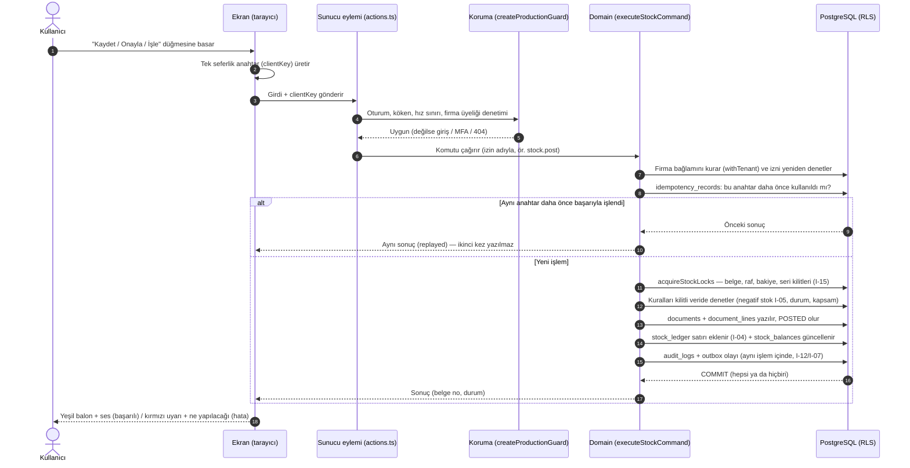
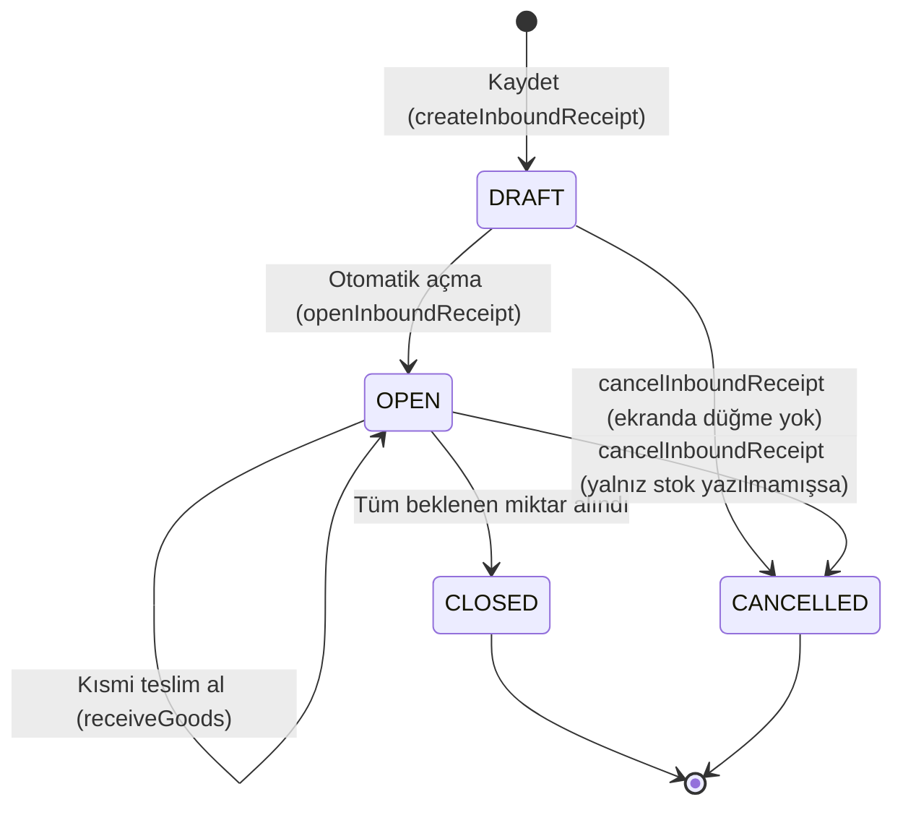
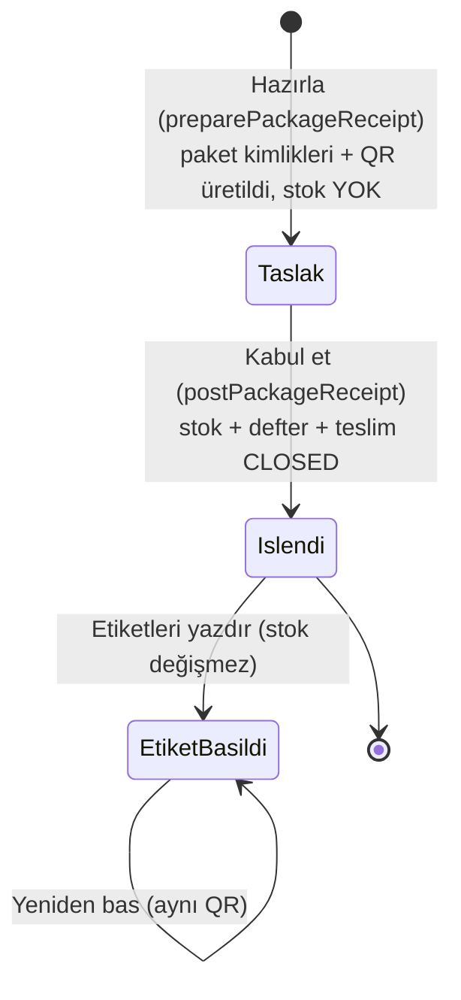
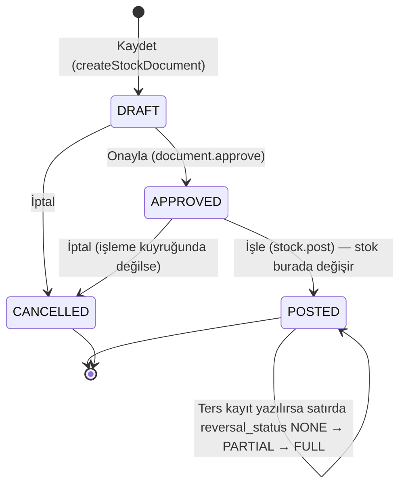
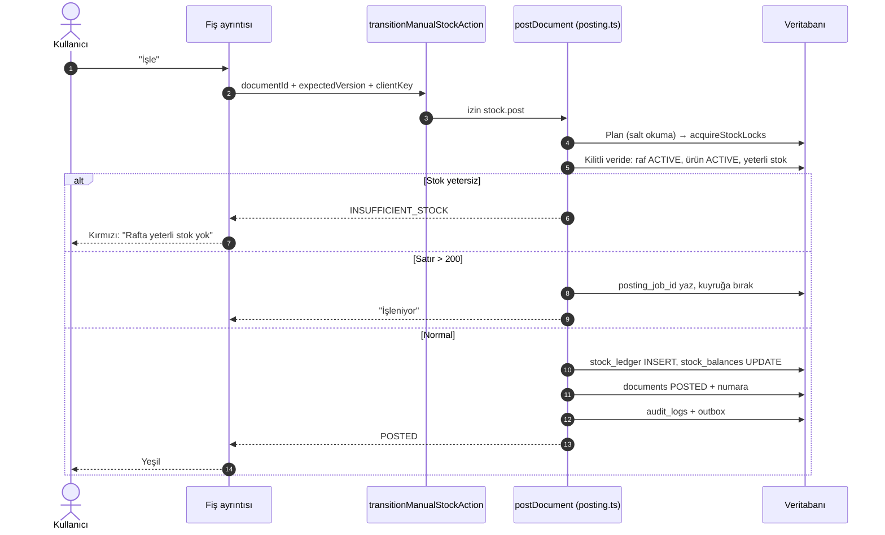
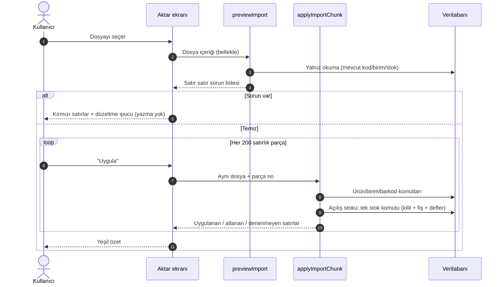
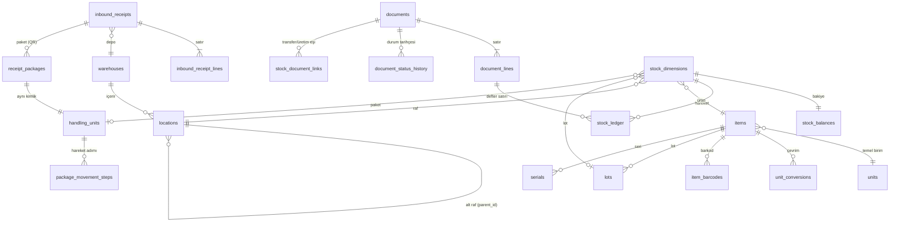

# 2B. Mal Kabul, Stok ve Katalog Modülleri (wms.etkinyazilim.com)

> **Bu bölüm neyi anlatır?** Depoya mal girişinden (mal kabul) başlayıp, stok listesi, stok fişleri (giriş/çıkış/transfer), ürün kartları, cariler (müşteri/tedarikçi), depolar ve raflar, etiket basımı ve Excel'den veri aktarma ekranlarını anlatır.
> Her ekran için: ne işe yaradığı, hangi düğmeye basınca ne olduğu, veri tabanında (DB) hangi tablonun değiştiği ve hangi kuralın işlediği yazılıdır.
>
> **Kaynak:** Bu belge main dalındaki kod okunarak yazıldı (`apps/web/app/t/[slug]/…`, `packages/domain/src/…`, `packages/db/migrations/…`). Kod okuması canlı (yayındaki) sürümün kanıtı değildir; canlı durum `docs/STATE.md` dosyasındadır.
>
> **Etiketler:** **[TAMAMLANDI]** ekran → sunucu → veri tabanı uçtan uca bağlı · **[GELİŞTİRİLİYOR]** kodu kısmen var / kapalı anahtarla duruyor / yarım · **[PLANLANDI]** yalnız iş listesinde (BACKLOG) veya tasarımda.

## Sözlük (bu bölümde sık geçen terimler)

| Terim | Sade anlamı |
|---|---|
| Sunucu eylemi (server action) | Ekrandaki düğmeye basınca sunucuda çalışan küçük fonksiyon. Dosya adı `actions.ts`. |
| Domain fonksiyonu | Asıl iş kuralının yazıldığı yer (`packages/domain`). Ekran kuralı kendisi yazmaz, buraya sorar. |
| Fiş / belge (`documents`) | Her stok hareketinin resmi kaydı. Durumları: Taslak → Onaylı → İşlendi (ya da İptal). |
| Stok defteri (`stock_ledger`) | Muhasebe defteri gibi; yalnız satır eklenir, silinmez/değiştirilmez (I-04). Stok miktarının asıl kaynağı budur. |
| Bakiye (`stock_balances`) | Defterin "şu an elde ne kadar var" özeti; defterle aynı anda güncellenir. |
| Stok boyutu (`stock_dimensions`) | "Hangi ürün + hangi raf + hangi lot/seri + hangi durum (kullanılabilir/karantina/hasarlı) + hangi paket" birleşimi. Bakiye bu birleşim başına tutulur. |
| İstemci anahtarı / idempotency (I-06) | Her kaydet düğmesi tek seferlik bir anahtar gönderir. İnternet kesilip düğmeye tekrar basılırsa aynı işlem **ikinci kez yazılmaz**, ilk sonuç geri döner. |
| Kilit (I-15) | Aynı rafta aynı anda iki kişi işlem yaparsa stok yanlış çıkmasın diye sunucu sırayla kilit alır (`acquireStockLocks`). |
| Ters kayıt (I-08) | İşlenmiş fiş silinmez; hatayı düzeltmek için tersine bir fiş (`REVERSAL`) yazılır. |
| Ondalık (I-09) | Miktarlar yazı (metin) olarak taşınır ve 6 haneli ondalıkla saklanır; bilgisayar yuvarlama hatası olmaz. |
| Audit (I-12) | "Kim, ne zaman, ne yaptı" kaydı (`audit_logs`). İşlemle aynı anda yazılır. |
| Tenant | Müşteri firma (çalışma alanı). Adres çubuğundaki `/t/<firma-kısa-adı>/` kısmı. Her firma yalnız kendi verisini görür (RLS). |

## Modül dizini

| # | Modül | Adres | Durum |
|---|---|---|---|
| 2B.1 | Mal Kabul — Beklenen Teslimler (masa) | `/t/<firma>/receipts` | [TAMAMLANDI] |
| 2B.2 | Mal Kabul — Saha (telefon/el terminali) | `/t/<firma>/field/receive` | [TAMAMLANDI] |
| 2B.3 | Paketli (QR'lı) Mal Kabul + Paket Etiketleri | `/t/<firma>/receipts/packages`, `…/packages/labels` | [GELİŞTİRİLİYOR] |
| 2B.4 | Saha Paket İşlemleri (kalite serbest bırak, yerleştir, depolar arası taşı) | `/t/<firma>/field/packages` | [GELİŞTİRİLİYOR] |
| 2B.5 | Yerleştirme (kabul sonrası rafa koyma) — kısa | `/t/<firma>/field/putaway` | [TAMAMLANDI] (ayrıntı 02c) |
| 2B.6 | Stok Durumu (Stok Listesi) | `/t/<firma>/stock` | [TAMAMLANDI] |
| 2B.7 | Stok İşlemleri / Fişler (giriş, çıkış, depolar arası transfer, onay, işle, iptal) | `/t/<firma>/stock/documents` | [TAMAMLANDI] (ters kayıt ekranı [PLANLANDI]) |
| 2B.8 | Ürün Kartları (liste + ürün ayrıntısı) | `/t/<firma>/items`, `/t/<firma>/items/<ürün>` | [TAMAMLANDI] |
| 2B.9 | Cariler (müşteri / tedarikçi) | `/t/<firma>/parties` | [TAMAMLANDI] |
| 2B.10 | Depolar ve Raflar (lokasyon ağacı) | `/t/<firma>/warehouses`, `/t/<firma>/warehouses/<depo>` | [TAMAMLANDI] |
| 2B.11 | Etiket Basma (ürün / raf etiketi) | `/t/<firma>/labels` | [TAMAMLANDI] |
| 2B.12 | Excel/CSV İçe Aktarma (Aktar) + Excel'e dışa aktarma | `/t/<firma>/import`, `/api/t/<firma>/export/<tür>` | [TAMAMLANDI] |

---

## Ortak akış: her "Kaydet" düğmesinde arka planda ne olur?

Aşağıdaki şema bu bölümdeki **bütün stok yazan düğmeler** için geçerlidir (mal kabul, fiş işleme, transfer, yerleştirme, içe aktarma). Tek tek modüllerde tekrar çizilmez.



**Önemli:** Hata olursa hiçbir satır yazılmaz (tek veritabanı işlemi = transaction). Bağlantı koparsa ekran "sonuç belirsiz, tekrar dene" der; tekrar deneme aynı anahtarla gittiği için çift kayıt oluşmaz.

---

## 2B.1 Mal Kabul — Beklenen Teslimler (masa ekranı)

- **Adres:** `/t/<firma>/receipts` (liste), `/t/<firma>/receipts?new=1` (yeni teslim formu)
- **Modül Durumu:** [TAMAMLANDI]
- **Ekranın Amacı:** Ofisteki kişi, tedarikçiden gelecek malı önceden "beklenen teslim" olarak girer (hangi depoya, hangi ürün, ne kadar). Sahadaki depocu mal gelince bu kaydı açıp sayarak teslim alır. Kalite kontrol açıksa gelen mal önce **karantina**ya düşer; yetkili kişi bu ekrandan "kalite onayı" verir.
- **Kod:** `apps/web/app/t/[slug]/receipts/page.tsx`, `receipts-view.tsx`, `receipt-form.tsx`, `receipts/actions.ts`; domain `packages/domain/src/operations/receiving.ts`, `receiving-queries.ts`.

### Arayüz Elemanları ve Aksiyon Tablosu

| UI Bileşeni / Buton / Alan | Tipi | Kullanıcı Aksiyonu | Tetiklenen API / Servis | Etkilenen DB Tablosu & Kolonu | İş Kuralı / Validasyon | Mevcut Durum |
|---|---|---|---|---|---|---|
| Teslim listesi (kartlar) | Liste (30'lu sayfa) | Sayfa açılır | `listInboundReceipts` (`receiving-queries.ts`), sayfa sunucu bileşeni | Okuma: `inbound_receipts`, `inbound_receipt_lines` | `stock.view` izni; kullanıcının depo kapsamı; üye değilse 404, MFA gerekiyorsa kurulum sayfası | [TAMAMLANDI] |
| "Daha fazla" | Bağlantı | Tıklanır | Aynı sorgu, sonraki sayfa (keyset imleci `after`) | Okuma | — | [TAMAMLANDI] |
| "Yeni teslim" (+) | Buton | Tıklanır | `?new=1` → form açılır | — | Yalnız `document.create` izni olana görünür | [TAMAMLANDI] |
| Depo seçimi | Seçim (yalnız ACTIVE depolar) | Seçilir | `listWarehouses` | Okuma: `warehouses` | Arşivli depo listelenmez | [TAMAMLANDI] |
| Tedarikçi referansı | Metin (≤100) | Yazılır | — | `inbound_receipts.supplier_ref` | Boşsa saklanmaz; kontrol karakteri reddi | [TAMAMLANDI] |
| Ürün ara / okut | Arama + kamera | Yazılır / okutulur | `searchItemsAction`, `itemUnitsAction` | Okuma: `items`, `unit_conversions`, `units` | Ürünün temel birimi + tanımlı çevrim birimleri listelenir | [TAMAMLANDI] |
| Satır: birim + beklenen miktar | Seçim + sayı | Girilir | — | `inbound_receipt_lines.unit_id`, `.expected_quantity`, `.conversion_factor` | Miktar metin olarak, ondalık kuralı domain'de (I-09); en çok 200 satır | [TAMAMLANDI] |
| "Kaydet" | Buton | Tıklanır | `createReceiptAction` → `createInboundReceipt` + `openInboundReceipt` | `inbound_receipts` (DRAFT → OPEN, `number` = KBL-… sayaç), `inbound_receipt_lines`, `audit_logs`, `idempotency_records` | `document.create` izni; numara sunucudan (tür/yıl/firma sayacı); açma başarısızsa DRAFT kalır, aynı anahtarla tekrar gönderim yalnız açmayı tamamlar (I-06) | [TAMAMLANDI] |
| Kart üstü "Teslim al" | Bağlantı | Tıklanır | Saha ekranına gider: `/field/receive?receipt=<id>` | — | — | [TAMAMLANDI] |
| "Kalite onayı" | Buton | Tıklanır | `approveQualityAction` → `approveQuality` | Yeni `documents` (STOCK_MOVE, QUARANTINE → AVAILABLE), `stock_ledger`, `stock_balances`, `tasks` (PUTAWAY görevi, OPEN), `audit_logs` | `document.approve` izni; görev ayrılığı açıksa kabul eden kişi onaylayamaz; **hasarlı (DAMAGED) stok hiçbir yolla kullanılabilir olmaz** (DB tetikleyicisi 0020 + plan kuralı) | [TAMAMLANDI] |
| "Paketli kabul" kısayolu | Bağlantı | Tıklanır | `/receipts/packages` | — | Yalnız sunucuda `PACKAGE_RECEIVING_ENABLED=true` ise görünür (canlıda kapalı) | [GELİŞTİRİLİYOR] |
| Teslimi iptal et | — | — | Domain'de `cancelInboundReceipt` var, **ekranda düğmesi yok** | (`inbound_receipts.status` → CANCELLED olurdu) | — | [PLANLANDI] |
| Eksik kalan teslimi kapat | — | — | Komut yok; kısmi kabul sonrası teslim OPEN kalır (kod notu A-305-5) | — | — | [PLANLANDI] |

### Teslim (inbound_receipts) durum makinesi



DB'deki geçerli değerler (`0016_field_documents`): `DRAFT`, `OPEN`, `CLOSED`, `CANCELLED`.

### Kalite onayı akışı

```mermaid
sequenceDiagram
    autonumber
    actor Y as Yetkili (document.approve)
    participant E as Teslimler ekranı
    participant A as approveQualityAction
    participant D as approveQuality (receiving.ts)
    participant DB as Veritabanı
    Y->>E: "Kalite onayı" düğmesi
    E->>A: receiptId + clientKey
    A->>D: izin document.approve
    D->>DB: Stok kilitleri (acquireStockLocks)
    D->>DB: Karantinadaki miktarı oku (yalnız QUARANTINE)
    D->>DB: STOCK_MOVE fişi: QUARANTINE → AVAILABLE (aynı raf)
    D->>DB: stock_ledger (+/-) ve stock_balances
    D->>DB: tasks: her onaylanan miktar için PUTAWAY görevi (OPEN)
    D->>DB: audit_logs, outbox
    DB-->>E: Başarılı
    E-->>Y: Yeşil bildirim; mal artık "Yerleştir" görevinde
```

---

## 2B.2 Mal Kabul — Saha (telefon / el terminali)

- **Adres:** `/t/<firma>/field/receive` (açık teslimler) ve `?receipt=<id>` (seçili teslimin sayımı)
- **Modül Durumu:** [TAMAMLANDI]
- **Ekranın Amacı:** Depocu kamyondan inen malı telefonla okutur, adedini girer, hasarlı varsa ayırır ve malın bırakıldığı **kabul rafını** seçer. Kayıt anında stok artar (kalite kontrol açıksa karantina olarak).
- **Kod:** `field/receive/page.tsx`, `receive-view.tsx`, `receive-flow.tsx`; eylemler `receipts/actions.ts` içinden; domain `receiving.ts → receiveGoods`, `field-posting.ts`.

| UI Bileşeni / Buton / Alan | Tipi | Kullanıcı Aksiyonu | Tetiklenen API / Servis | Etkilenen DB Tablosu & Kolonu | İş Kuralı / Validasyon | Mevcut Durum |
|---|---|---|---|---|---|---|
| Açık teslim listesi | Liste | Bir teslime dokunulur | `listInboundReceipts`, `getInboundReceipt` | Okuma: `inbound_receipts`, `inbound_receipt_lines` | Yalnız kendi depo kapsamı | [TAMAMLANDI] |
| Ürün okut (kamera / el terminali / kodu yaz) | Tarayıcı | Barkod okutulur | `resolveItemScanAction` → `resolveBarcodeQuery` | Okuma: `item_barcodes`, `items` | Koli barkodu okutulursa koli içi adet temel birime çevrilir (`baseQuantity`); bulunamazsa kırmızı uyarı; iki ürüne uyan barkod → "belirsiz" | [TAMAMLANDI] |
| "2 koli + 3 adet" gösterimi | Bilgi | — | `compoundQuantityAction` → `formatCompound` | Okuma: `unit_conversions` | Yalnız görüntü; saklama temel birimde | [TAMAMLANDI] |
| Alınan miktar / hasarlı miktar | Sayı | Girilir | — | `inbound_receipt_lines.received_quantity`, `.damaged_quantity` | Fazla kabul reddedilir (`VALIDATION_FAILED`); ondalık ölçeği ürünün `quantity_scale` değerine uymalı | [TAMAMLANDI] |
| Kabul rafı | Okut / seç | Raf okutulur | `resolveLocationScanAction` → `findLocationByCode` | Okuma: `locations` | Raf o teslimin deposunda olmalı; sayımda kilitli raf reddedilir | [TAMAMLANDI] |
| "Teslim al / Kaydet" | Buton | Tıklanır | `receiveGoodsAction` → `receiveGoods` | `documents` (STOCK_IN, POSTED), `document_lines` (`stock_status` = QUARANTINE / DAMAGED / AVAILABLE), `stock_dimensions`, `stock_ledger` (neden RECEIPT), `stock_balances.quantity`, `inbound_receipt_lines.received_quantity`, `inbound_receipts.status` (→ CLOSED tamamlanınca), `tasks` (PUTAWAY, kalite kapalıysa), `audit_logs`, `idempotency_records` | `stock.post` izni; **lot/seri takipli ürün bu ekranda kabul edilmez** (`TRACKING_VIOLATION`; paketli kabul gerekir); kalite açık (`tenant_settings.receiving_qc_enabled`) → sağlam kısım karantina, hasarlı kısım DAMAGED; tek işlem içinde (I-04, I-06, I-12, I-15) | [TAMAMLANDI] |

```mermaid
sequenceDiagram
    autonumber
    actor S as Depocu (telefon)
    participant E as Saha kabul ekranı
    participant A as receiveGoodsAction
    participant D as receiveGoods
    participant DB as Veritabanı
    S->>E: Teslimi seçer, ürünü okutur
    E->>A: resolveItemScanAction(barkod)
    A-->>E: Ürün + birim + koli içi adet
    S->>E: Miktar, hasarlı, kabul rafı, "Kaydet"
    E->>A: receiptId + satırlar + clientKey
    A->>D: stock.post
    D->>DB: Saha başlığını kilitle, stok kilitleri (I-15)
    D->>DB: Fazla kabul / takip modu / raf deposu denetimi
    alt Kural ihlali
        D-->>E: Hata kodu (ör. fazla kabul)
        E-->>S: Kırmızı uyarı + ne yapmalı
    else Uygun
        D->>DB: STOCK_IN fişi oluştur + onayla + işle (aynı işlem)
        D->>DB: stock_ledger + stock_balances (+ miktar)
        D->>DB: Teslim satırı sayaçları, gerekirse CLOSED
        D->>DB: PUTAWAY görevi (kalite kapalıysa)
        D->>DB: audit_logs
        D-->>E: Başarılı
        E-->>S: Yeşil + ses; sıradaki satır
    end
```

---

## 2B.3 Paketli (QR'lı) Mal Kabul + Paket Etiketleri

- **Adres:** `/t/<firma>/receipts/packages` (sihirbaz), `/t/<firma>/receipts/packages/labels?receipt=<id>` (etiket önizleme/baskı)
- **Modül Durumu:** [GELİŞTİRİLİYOR] — kod main'de ve testli; ancak sunucu anahtarı `PACKAGE_RECEIVING_ENABLED` canlıda **kapalı** (STATE: "bütün QR hattı tamamlanmadan normal kullanıcı akışı açılmaz"; iş listesi B-50 / T-975).
- **Ekranın Amacı:** Her fiziksel kabı (koli, palet, varil) ayrı kimlikle kabul eder. Her paket için lot kodu, üretim ve son kullanma tarihi girilir; sistem her pakete benzersiz bir **QR kodu** verir ve etiketini basar. Böylece sonradan "bu varil nerede, hangi lottan, ne kadar kaldı" izlenebilir.
- **Kod:** `receipts/packages/page.tsx`, `package-flow.tsx`, `receipts/packages/actions.ts`, `labels/page.tsx`, `package-label-preview.tsx`; domain `operations/package-receiving.ts`, `package-receiving-queries.ts`, `package-receipt-input.ts`; DB `0032_receipt_packages`, `0033`, `0034`.

| UI Bileşeni / Buton / Alan | Tipi | Kullanıcı Aksiyonu | Tetiklenen API / Servis | Etkilenen DB Tablosu & Kolonu | İş Kuralı / Validasyon | Mevcut Durum |
|---|---|---|---|---|---|---|
| Depo seçimi | Seçim (sayfalı) | Seçilir | `packageWarehousesAction` → `listWarehouses` | Okuma: `warehouses` | Depo kapsamı | [GELİŞTİRİLİYOR] |
| Kabul rafı | Seçim (ağaç, sayfalı) | Seçilir | `packageReceivingLocationsAction` → `getLocationTree` | Okuma: `locations` (kind = RECEIVING) | Yalnız RECEIVING türü raf | [GELİŞTİRİLİYOR] |
| Ürün ara / okut | Arama + kamera | Yazılır / okutulur | `searchPackageItemsAction`, `resolvePackageItemScanAction`, `packageItemOptionsAction` | Okuma: `items`, `item_barcodes`, `unit_conversions` | Seri takipli ürün (SERIAL / LOT_AND_SERIAL) reddedilir | [GELİŞTİRİLİYOR] |
| Paket sayısı, paket başı miktar, birim | Sayı + seçim | Girilir | — | `inbound_receipt_lines`, `document_lines.quantity/base_quantity/conversion_factor` | Paket 1–200; eşit dağıtım ya da tek tek miktar; çevrim katsayısı sunucuda hesaplanır, istemciden alınmaz | [GELİŞTİRİLİYOR] |
| Lot kodu, üretim tarihi, SKT | Metin + tarih | Girilir | — | `receipt_packages.lot_code`, `.produced_on`, `.expires_on`, `.catalog_lot_id`; `lots` | SKT ≥ üretim tarihi; aynı lot kodu farklı tarihle gelirse ret (mevcut lot tarihi sessiz değişmez) | [GELİŞTİRİLİYOR] |
| "Hazırla" | Buton | Tıklanır | `preparePackageReceiptAction` → `preparePackageReceipt` | `inbound_receipts` (+`package_document_id`), `inbound_receipt_lines`, `documents` (DRAFT, STOCK_IN), `document_lines`, `handling_units` (KOLI / PALET / VARIL, `package_receipt_id`), `receipt_packages`, `audit_logs` | `document.create` izni; henüz **stok yazılmaz**; bağlantı koparsa aynı anahtar aynı taslağı ve aynı QR kimliklerini döndürür (I-06) | [GELİŞTİRİLİYOR] |
| "Kabul et / İşle" | Buton | Tıklanır | `postPackageReceiptAction` → `postPackageReceipt` (`buildPostCommand` + posting çekirdeği) | `documents.status` → POSTED + `number`, `stock_dimensions.handling_unit_id`, `stock_ledger`, `stock_balances`, `inbound_receipts.status` → CLOSED, `audit_logs` (2 kayıt) | `stock.post` izni; tüm paketler tek işlemde (hepsi ya da hiçbiri); DB tetikleyicileri paket ↔ fiş ↔ satır zincirini doğrular | [GELİŞTİRİLİYOR] |
| Paket etiketleri sayfası | Önizleme + Yazdır | Açılır / yazdırılır | `getPackageReceiptAction` → `getPackageReceipt`; tarayıcı baskısı | Okuma: `receipt_packages`, `handling_units` | Yalnız POSTED kabulde "etiket hazır"; yeniden basım aynı QR'ı üretir, stok tekrar yazılmaz | [GELİŞTİRİLİYOR] |



> Not: Taslak paket kabulünü düzenleme/iptal etme ve paketi bölme/birleştirme henüz yok (bkz. Gap listesi).

---

## 2B.4 Saha Paket İşlemleri

- **Adres:** `/t/<firma>/field/packages`
- **Modül Durumu:** [GELİŞTİRİLİYOR] — 2B.3 ile aynı anahtara (`PACKAGE_RECEIVING_ENABLED`) bağlı, canlıda kapalı.
- **Ekranın Amacı:** Depocu paket QR'ını okutur; ekran paketin şu an nerede ve hangi durumda olduğunu gösterir ve üç işten birini yaptırır: **kalite serbest bırak** (karantina → kullanılabilir), **yerleştir** (kabul rafından depolama rafına), **depolar arası taşı**.
- **Kod:** `field/packages/page.tsx`, `package-flow.tsx`, `field/packages/actions.ts`; domain `operations/package-movement.ts`, `package-transfer.ts`, `package-movement-queries.ts`; DB `0034_package_movement_steps`, `0035_package_transfers`.

| UI Bileşeni / Buton / Alan | Tipi | Kullanıcı Aksiyonu | Tetiklenen API / Servis | Etkilenen DB Tablosu & Kolonu | İş Kuralı / Validasyon | Mevcut Durum |
|---|---|---|---|---|---|---|
| Paket QR okut | Kamera | Okutulur | `resolveCurrentPackageQrAction` → `resolveCurrentPackageQr` | Okuma: `receipt_packages`, `handling_units`, `package_movement_steps`, `stock_balances` | QR önce çözülür, sonra yetkili firma sorgusu; paketin güncel deposu son adımdan + pozitif bakiyeden bulunur | [GELİŞTİRİLİYOR] |
| "Kalite serbest bırak" | Buton | Tıklanır | `qualityReleasePackageAction` → `approvePackageQuality` | `documents` (STOCK_MOVE), `stock_ledger`, `stock_balances`, `package_movement_steps` (operation = QC_RELEASE), `audit_logs` | Yalnız karantinadaki paket; paketin tamamı | [GELİŞTİRİLİYOR] |
| Hedef raf (liste veya okut) | Seçim / kamera | Seçilir | `packageStorageLocationsAction`, `resolvePackageDestinationAction` | Okuma: `locations` | Hedef STORAGE türü olmalı | [GELİŞTİRİLİYOR] |
| "Yerleştir" | Buton | Tıklanır | `putawayPackageAction` → `putawayPackage` | `documents`, `stock_ledger`, `stock_balances`, `package_movement_steps` (PUTAWAY) | Tek paket aynı anda iki rafta olamaz: kalan içeriğin tamamı taşınır | [GELİŞTİRİLİYOR] |
| Hedef depo + raf | Seçim | Seçilir | `packageTransferWarehousesAction`, `packageTransferLocationsAction`, `resolvePackageTransferDestinationAction` | Okuma | Kaynak ve hedef depo farklı; hedef STORAGE | [GELİŞTİRİLİYOR] |
| "Depoya taşı" | Buton | Tıklanır | `transferPackageAction` → `transferPackage` | İki POSTED fiş (kaynakta OUT, hedefte IN), `stock_document_links` (kind = TRANSFER), `package_movement_steps`, `audit_logs` | Çıkış ve giriş bacağı aynı işlemde (atomik); lot, birim katsayısı değişmez | [GELİŞTİRİLİYOR] |

---

## 2B.5 Yerleştirme (kabul sonrası adım — kısa)

- **Adres:** `/t/<firma>/field/putaway` · **Durum:** [TAMAMLANDI] · Ayrıntı ve görev akışı için bkz. **02c — Saha Operasyonları**.
- Kalite onayından (ya da kalite kapalıyken kabulden) sonra açılan **PUTAWAY görevi** bu ekranda kapanır: kaynak raf (kabul alanı) → hedef **STORAGE** raf. Düğme `putawayAction` → `putaway` (`operations/putaway.ts`); yazılan tablolar `documents` (STOCK_MOVE), `stock_ledger`, `stock_balances`, `tasks.status`. Sayımda kilitli raf `LOCATION_LOCKED` ile reddedilir. Varsayılan miktar `availableAtLocationAction` ile gelir.

---

## 2B.6 Stok Durumu (Stok Listesi)

- **Adres:** `/t/<firma>/stock` (`?q=` arama, `?warehouse=` depo süzgeci)
- **Modül Durumu:** [TAMAMLANDI]
- **Ekranın Amacı:** "Hangi üründen hangi depoda ne kadar var?" sorusunun cevabı. Her kartta ürün, depo, **kullanılabilir** miktar (büyük rozet), fiziksel ve **ayrılmış** (siparişe rezerve) miktar görünür.
- **Kod:** `stock/page.tsx`; domain `stock/queries.ts → listStockOverview`.

| UI Bileşeni / Buton / Alan | Tipi | Kullanıcı Aksiyonu | Tetiklenen API / Servis | Etkilenen DB Tablosu & Kolonu | İş Kuralı / Validasyon | Mevcut Durum |
|---|---|---|---|---|---|---|
| Arama kutusu | Metin | Yazılıp aranır | `listStockOverview(q)` | Okuma: `stock_balances.quantity`, `.reserved_quantity`, `stock_dimensions`, `items`, `warehouses`, `units` | `stock.view` izni; yoksa "kilitli ekran"; depo kapsamı | [TAMAMLANDI] |
| Bölüm çipleri (Stok / Fişler / Sevkiyat / Üretim) | Çip | Tıklanır | Sayfa geçişi | — | — | [TAMAMLANDI] |
| Stok kartı | Kart | Dokunulur | Ürün ayrıntısına gider (`/items/<ürün>`) | — | Kullanılabilir = fiziksel − ayrılmış | [TAMAMLANDI] |
| "Yeni" (+) / "İlk girişi yap" | Buton | Tıklanır | `/stock/documents?new=STOCK_IN` | — | — | [TAMAMLANDI] |
| "İlk sayfa" / "Sonraki" | Bağlantı | Tıklanır | Keyset sayfalama | Okuma | — | [TAMAMLANDI] |
| Minimum stok trafik ışığı | — | — | Sorguda minimum politikası yok (kod notu) | — | — | [PLANLANDI] |
| Sesle arama | — | — | Etkin sesli asistan (B-62) ile | — | — | [GELİŞTİRİLİYOR] |

---

## 2B.7 Stok İşlemleri / Fişler

- **Adres:** `/t/<firma>/stock/documents` (liste), `?id=<fiş>` (ayrıntı), `?new=STOCK_IN | STOCK_OUT | TRANSFER` (yeni)
- **Modül Durumu:** [TAMAMLANDI] — Ters kayıt ekranı [PLANLANDI] (komut domain'de hazır, düğme yok).
- **Ekranın Amacı:** Elle stok girişi (ör. sayım dışı bulunan mal), elle stok çıkışı (ör. fire, numune) ve depolar arası transfer. Fiş önce **taslak**, sonra **onaylı**, sonra **işlenmiş** olur; ancak işlenince stok değişir.
- **Kod:** `stock/documents/page.tsx`, `document-form.tsx`, `stock/documents/actions.ts`; domain `stock/documents.ts`, `stock/posting.ts`, `stock/document-queries.ts`, `operations/warehouse-transfer.ts`, `stock/reversal.ts`.

| UI Bileşeni / Buton / Alan | Tipi | Kullanıcı Aksiyonu | Tetiklenen API / Servis | Etkilenen DB Tablosu & Kolonu | İş Kuralı / Validasyon | Mevcut Durum |
|---|---|---|---|---|---|---|
| Fiş listesi | Liste | Açılır | `listStockDocuments` | Okuma: `documents`, `warehouses` | `stock.view`; izin bayrakları (create / approve / post) ekrana döner | [TAMAMLANDI] |
| Fiş ayrıntısı (satırlar, durum, ilgili fiş) | Detay | Kart tıklanır | `getStockDocument` | Okuma: `documents`, `document_lines`, `stock_document_links` | Transferde karşı fişe bağlantı gösterilir | [TAMAMLANDI] |
| "Yeni giriş" / "Yeni çıkış" / "Transfer" | Buton | Tıklanır | `?new=…` formu | — | Giriş/çıkış `document.create`, transfer `stock.post` izni ister; yoksa kilitli ekran | [TAMAMLANDI] |
| Depo / ürün / raf / lot / seri seçimi | Arama seçimi | Yazılır, seçilir | `stockChoicesAction` → `searchStockChoices` | Okuma: `warehouses`, `items`, `locations`, `lots`, `serials` | Raf seçilen depoda olmalı | [TAMAMLANDI] |
| Miktar + gerekçe (zorunlu, ≤500) | Sayı + metin | Girilir | — | `document_lines.quantity`, `documents.reason` | Ondalık metin (I-09); elle fişte birim = temel birim, katsayı 1 | [TAMAMLANDI] |
| "Kaydet" (giriş/çıkış) | Buton | Tıklanır | `createManualStockAction` → `createStockDocument` | `documents` (DRAFT, version 1), `document_lines`, `document_status_history`, `audit_logs`, `idempotency_records` | `document.create`; **henüz stok değişmez** | [TAMAMLANDI] |
| "Kaydet" (transfer) | Buton | Tıklanır | `transferStockAction` → `transferBetweenWarehouses` | İki fiş (STOCK_OUT kaynak, STOCK_IN hedef) POSTED, `stock_document_links` (TRANSFER), `stock_ledger`, `stock_balances`, `audit_logs` | `stock.post`; iki bacak aynı işlemde; yetersiz stok → ret (I-05) | [TAMAMLANDI] |
| "Onayla" | Buton (yalnız DRAFT'ta) | Tıklanır | `transitionManualStockAction(approve)` → `approveDocument` | `documents.status` → APPROVED, `version`+1, `document_status_history` | `document.approve`; görev ayrılığı açıksa fişi yazan onaylayamaz; sürüm uyuşmazsa `VERSION_CONFLICT` | [TAMAMLANDI] |
| "İşle" | Buton (yalnız APPROVED'da) | Tıklanır | `transitionManualStockAction(post)` → `postDocument` | `documents.status` → POSTED + `number`, `stock_ledger` (yeni satırlar), `stock_balances`, `reservations` (çıkışta kendi rezervasyonu tüketilir), `audit_logs`, outbox | `stock.post`; kilitler (I-15); **negatif stok reddi** (I-05, `INSUFFICIENT_STOCK`); arşivli raf/ürüne stok yazılmaz; 200 satırı aşan fiş arka planda (worker) işlenir, o sırada "işleniyor" | [TAMAMLANDI] |
| "İptal" | Buton (DRAFT veya APPROVED'da) | Tıklanır | `transitionManualStockAction(cancel)` → `cancelDocument` | `documents.status` → CANCELLED, `document_status_history` | `document.create`; işlenmiş fiş iptal edilemez | [TAMAMLANDI] |
| "Tekrar dene" (belirsiz sonuç) | Buton | Tıklanır | Aynı eylem, aynı anahtar | — | Ağ hatasında çift kayıt olmaz (I-06) | [TAMAMLANDI] |
| "Yenile" | Buton | Tıklanır | Sayfa yenilenir | Okuma | — | [TAMAMLANDI] |
| Ters kayıt ("Geri al") | — | — | Domain'de `reverseDocument` (`reversal.create` izni) hazır; **ekranda düğme yok** | (Olsaydı: yeni REVERSAL fişi, `document_lines.reversed_quantity`, `.reversal_status`) | Kalan miktarı aşamaz, tüketilmiş/rezerve stok geri alınamaz | [PLANLANDI] |
| Taslağı düzenle | — | — | Domain'de `updateDraft` var, ekranda yok | — | Satırları sil-yeniden-yaz yapıyor; kalıcı satır kimliğiyle düzenleme ayrı iş | [PLANLANDI] |

### Fiş (documents) durum makinesi



DB değerleri (`0012_stock_documents`): `documents.status` ∈ `DRAFT, APPROVED, POSTED, CANCELLED`; `documents.kind` ∈ `STOCK_IN, STOCK_OUT, STOCK_MOVE, REVERSAL`; `document_lines.stock_status` ∈ `AVAILABLE, QUARANTINE, DAMAGED, BLOCKED`; `document_lines.reversal_status` ∈ `NONE, PARTIAL, FULL`. İşlenmiş fiş veri tabanı tetikleyicisiyle kilitlidir (yalnız ters kayıt sayaçları ilerleyebilir).



---

## 2B.8 Ürün Kartları

- **Adres:** `/t/<firma>/items` (liste + yeni ürün), `/t/<firma>/items/<ürün>` (ayrıntı)
- **Modül Durumu:** [TAMAMLANDI]
- **Ekranın Amacı:** Depoda tutulan her ürünün kimlik kartı: kod, ad, **kart türü** (HM hammadde, YM yarı mamul, MM mamul, TM ticari mal), temel birim, takip şekli (lot/seri), toplama politikası (FIFO ilk giren ilk çıkar / FEFO son kullanma tarihi en yakın ilk çıkar), birim çevrimleri (1 koli = 12 adet gibi) ve barkodlar. Ayrıntı sayfası ürünün stok kartını (depo/raf bazında miktar) gösterir.
- **Kod:** `items/page.tsx`, `items-view.tsx`, `items/[itemId]/page.tsx`, `item-detail.tsx`, `items/actions.ts`; domain `catalog/items.ts`, `units.ts`, `barcodes.ts`, `code-suggest.ts`, `stock/item-card.ts`.

| UI Bileşeni / Buton / Alan | Tipi | Kullanıcı Aksiyonu | Tetiklenen API / Servis | Etkilenen DB Tablosu & Kolonu | İş Kuralı / Validasyon | Mevcut Durum |
|---|---|---|---|---|---|---|
| Ürün listesi + toplam stok | Liste | Açılır / aranır | `searchItems`, `sumItemsStock` | Okuma: `items`, `stock_balances` | `stock.view` | [TAMAMLANDI] |
| Hızlı arama | Metin | Yazılır | `searchItemsAction` (≤10 sonuç) | Okuma: `items` | — | [TAMAMLANDI] |
| Kart türü (HM/YM/MM/TM) | Seçim | Seçilir | `suggestItemCodeAction` → `suggestCode` (türe göre kod önerisi) | Okuma: `items.code` | Kod çakışmasız önerilir | [TAMAMLANDI] |
| Kod, ad, temel birim, takip modu, ölçek, toplama politikası | Form alanları | Girilir | — | `items.code`, `.name`, `.base_unit_id`, `.tracking_mode`, `.quantity_scale`, `.pick_policy`, `.card_type` | Takip ∈ NONE / LOT / SERIAL / LOT_AND_SERIAL; ölçek 0–6; politika FIFO/FEFO | [TAMAMLANDI] |
| "Yeni birim" | Mini form | Kaydedilir | `createUnitAction` → `createUnit` | `units` | `settings.manage` | [TAMAMLANDI] |
| "Kaydet" (yeni ürün) | Buton | Tıklanır | `createItemAction` → `createItem` / `createWithSuggestedCode` | `items`, `audit_logs` | `settings.manage`; kod firma içinde benzersiz (`CODE_TAKEN`); kod boşsa sunucu üretir; paket sınırı (plan limiti) aşılırsa ret | [TAMAMLANDI] |
| Ad / kart türü / toplama politikası düzenle | Form | Kaydedilir | `updateItemAction` → `updateItem` | `items.name`, `.card_type`, `.pick_policy`, `audit_logs` | `settings.manage` | [TAMAMLANDI] |
| Kod değiştir | Form | Kaydedilir | `updateItemAction(code)` | `items.code`, `code_history` | Eski kod tarihçede saklanır | [TAMAMLANDI] |
| Birim çevrimi ekle/değiştir | Form | Kaydedilir | `setConversionAction` → `setUnitConversion` | `unit_conversions.to_base_factor` | Katsayı > 0, ondalık metin (I-09) | [TAMAMLANDI] |
| Barkod ekle | Form | Kaydedilir | `addBarcodeAction` → `addBarcode` | `item_barcodes.barcode`, `.unit_id`, `.quantity` | Barkod firma içinde tekil; GS1 denetimi (`gs1.ts`) | [TAMAMLANDI] |
| Barkod sil | Buton + onay | Tıklanır | `removeBarcodeAction` → `removeBarcode` | `item_barcodes` (satır silinir) | `settings.manage` | [TAMAMLANDI] |
| Ürünü arşivle | Buton + onay | Tıklanır | `archiveItemAction` → `archiveItem` | `items.status` → ARCHIVED, `.archived_at` | Fiziksel silme yok; stoklu ürünün takip modu değiştirilemez (DB tetikleyicisi) | [TAMAMLANDI] |
| Stok kartı (depo/raf/lot dağılımı) | Bilgi | — | `getItemStockCard` | Okuma: `stock_balances`, `stock_dimensions`, `locations`, `lots` | — | [TAMAMLANDI] |
| "Etiket bas" | Bağlantı | Tıklanır | `/labels?item=<ürün>` | — | — | [TAMAMLANDI] |
| Lot / seri kartı yönetimi (ayrı ekran) | — | — | Lotlar kabulde otomatik oluşur; elle lot/seri ekranı yok | `lots`, `serials` | — | [PLANLANDI] |

---

## 2B.9 Cariler (Müşteri / Tedarikçi)

- **Adres:** `/t/<firma>/parties`
- **Modül Durumu:** [TAMAMLANDI]
- **Ekranın Amacı:** Müşteri ve tedarikçi kartlarını tutar (kod, unvan, tür, vergi no/dairesi, telefon, e-posta, şehir, adres). Excel'den toplu aktarılabilir.
- **Kod:** `parties/page.tsx`, `parties-view.tsx`, `parties/actions.ts`; domain `catalog/parties.ts`; DB `0050_parties`.

| UI Bileşeni / Buton / Alan | Tipi | Kullanıcı Aksiyonu | Tetiklenen API / Servis | Etkilenen DB Tablosu & Kolonu | İş Kuralı / Validasyon | Mevcut Durum |
|---|---|---|---|---|---|---|
| Cari listesi | Liste | Açılır / aranır | Sayfa sorgusu (`catalog/parties.ts`) | Okuma: `parties` | `stock.view` | [TAMAMLANDI] |
| Yeni / düzenle formu | Form | "Kaydet" | `savePartyAction` → `saveParty` | `parties.code`, `.code_key`, `.name`, `.kind` (CUSTOMER / SUPPLIER / BOTH), `.tax_no`, `.tax_office`, `.phone`, `.email`, `.city`, `.address`, `.version`, `audit_logs` | `settings.manage`; kod büyük/küçük harf ve boşluktan bağımsız tekil; vergi no 10/11 hane yalnız **uyarı** | [TAMAMLANDI] |
| Arşivle / geri al | Buton | Tıklanır | `archivePartyAction` → `setPartyArchived` | `parties.archived_at` | Fiziksel silme yok | [TAMAMLANDI] |
| Excel'den aktar (kontrol + uygula) | Dosya + buton | Yüklenir | `importPartiesAction` → `importParties` (`dryRun` ile önce kontrol) | `parties`, `audit_logs` | `data.import`; aynı kod varsa günceller, boş hücre mevcut değeri silmez | [TAMAMLANDI] |
| Cariyi mal kabul / sevkiyat fişine bağlama | — | — | **Bağ yok:** teslimde yalnız serbest metin `supplier_ref`; hiçbir tabloda `party_id` yok | — | — | [PLANLANDI] |

---

## 2B.10 Depolar ve Raflar

- **Adres:** `/t/<firma>/warehouses` (depo listesi), `/t/<firma>/warehouses/<depo>` (raf ağacı)
- **Modül Durumu:** [TAMAMLANDI]
- **Ekranın Amacı:** Depoları ve içindeki rafları (lokasyonları) ağaç şeklinde tanımlar. Raf türü: **RECEIVING** (kabul alanı), **STORAGE** (depolama), **STAGING** (sevk hazırlık), **TRANSIT** (yolda). "A bölgesi, raf 1–10, göz 1–5" gibi toplu raf üretimi yapılabilir.
- **Kod:** `warehouses/page.tsx`, `warehouses-view.tsx`, `[warehouseId]/page.tsx`, `location-tree.tsx`, `warehouses/actions.ts`; domain `warehouse/warehouses.ts`, `locations.ts`, `bulk-locations.ts`, `setup-queries.ts`.

| UI Bileşeni / Buton / Alan | Tipi | Kullanıcı Aksiyonu | Tetiklenen API / Servis | Etkilenen DB Tablosu & Kolonu | İş Kuralı / Validasyon | Mevcut Durum |
|---|---|---|---|---|---|---|
| Depo listesi + kurulum ilerlemesi | Liste | Açılır | `listWarehouses`, `getSetupProgressAction` | Okuma: `warehouses`, `locations` | Depo kapsamı | [TAMAMLANDI] |
| "Yeni depo" | Form | Kaydedilir | `createWarehouseAction` → `createWarehouse` (+ `suggestCodeAction`) | `warehouses.code`, `.name`, `.status`, `audit_logs` | `settings.manage`; kod tekil; plan limiti | [TAMAMLANDI] |
| Depo adını değiştir | Form | Kaydedilir | `renameWarehouseAction` | `warehouses.name` | — | [TAMAMLANDI] |
| Depoyu arşivle | Buton + onay | Tıklanır | `archiveWarehouseAction` | `warehouses.status` → ARCHIVED, `.archived_at` | Stoklu depo arşivlenemez (`stock-usage.ts`) | [TAMAMLANDI] |
| Raf ağacı (daha fazla yükle) | Ağaç | Açılır | `getLocationTree`, `loadMoreLocationsAction` | Okuma: `locations` | — | [TAMAMLANDI] |
| "Yeni raf" | Form | Kaydedilir | `createLocationAction` → `createLocation` | `locations.code`, `.name`, `.kind`, `.parent_id`, `.depth` | Ebeveyn aynı depoda; depo başına raf üst sınırı | [TAMAMLANDI] |
| Raf adını değiştir / arşivle | Form / buton | Kaydedilir | `renameLocationAction`, `archiveLocationAction` | `locations.name`, `.status`, `.archived_at` | Stoklu raf arşivlenemez | [TAMAMLANDI] |
| Toplu raf: önizle → oluştur | Form + 2 buton | Tıklanır | `previewBulkLocationsAction` → `createBulkLocationsAction` | `locations` (çok satır, tek işlem) | Kod biçimi `<BÖLGE>-<raf>-<göz>`; mevcut kodla çakışma varsa hiçbiri oluşmaz | [TAMAMLANDI] |
| Raf ara | Metin | Yazılır | `searchLocationsAction` | Okuma | — | [TAMAMLANDI] |
| "Raf etiketi bas" | Bağlantı | Tıklanır | `/labels?warehouse=…&location=…&subtree=1` | — | — | [TAMAMLANDI] |
| Raf "toplamaya kapalı" işareti | — | — | Kolon var (`locations.pick_blocked`), ekranda düzenleme yok | `locations.pick_blocked` | — | [PLANLANDI] |

---

## 2B.11 Etiket Basma (ürün / raf etiketi)

- **Adres:** `/t/<firma>/labels?item=…` veya `?warehouse=…&location=…&subtree=1`, `&copies=N`
- **Modül Durumu:** [TAMAMLANDI]
- **Ekranın Amacı:** 100×50 mm barkodlu etiket üretir; ekranda önizleme (SVG) ve endüstriyel yazıcı için ZPL çıktısı. Ürün etiketi ürünü, raf etiketi rafı tanımlar (paket etiketi ayrıdır, bkz. 2B.3).
- **Kod:** `labels/page.tsx`, `label-preview.tsx`, `print.css`; domain `labels/templates.ts`, `code128.ts`.

| UI Bileşeni / Buton / Alan | Tipi | Kullanıcı Aksiyonu | Tetiklenen API / Servis | Etkilenen DB Tablosu & Kolonu | İş Kuralı / Validasyon | Mevcut Durum |
|---|---|---|---|---|---|---|
| Önizleme | Görsel | Sayfa açılır | `loadLabelSource`, `toSvgPages` | Okuma: `items`, `item_barcodes`, `locations` | Belge başına en çok 1000 etiket; ASCII dışı karakter / çok uzun metin uyarısı | [TAMAMLANDI] |
| Kopya sayısı | Sayı | Girilir | Adres parametresi `copies` | — | 1–1000 | [TAMAMLANDI] |
| "Yazdır" / ZPL | Buton | Tıklanır | Tarayıcı baskısı / ZPL metni | — (veri yazılmaz) | Gerçek yazıcıda denenmedi (kod varsayımı Q-77) | [TAMAMLANDI] |

---

## 2B.12 Excel/CSV İçe Aktarma ("Aktar") ve Dışa Aktarma

- **Adres:** `/t/<firma>/import`; dışa aktarma `GET /api/t/<firma>/export/<tür>`
- **Modül Durumu:** [TAMAMLANDI]
- **Ekranın Amacı:** Başlangıçta ürünleri, birimleri, barkodları, **açılış stokunu**, depoları ve rafları Excel'den toplu yüklemek. Önce önizleme (hiçbir şey yazılmaz, bütün hatalar bir arada gösterilir), sonra 200'er satırlık parçalarla uygulama. Ürün/cari/depo listelerindeki Excel düğmesiyle de açılır; "koda göre güncelle" kipi vardır.
- **Kod:** `import/page.tsx`, `aktar-view.tsx`, `import/actions.ts`, `master-actions.ts`; domain `onboarding/import-parse.ts`, `import-apply.ts`, `master-import.ts`, `data-export.ts`.

| UI Bileşeni / Buton / Alan | Tipi | Kullanıcı Aksiyonu | Tetiklenen API / Servis | Etkilenen DB Tablosu & Kolonu | İş Kuralı / Validasyon | Mevcut Durum |
|---|---|---|---|---|---|---|
| Dosya seç (.xlsx / .csv) + sayfa seçimi | Dosya | Yüklenir | — | — | Dosya boyutu üst sınırı (`IMPORT_MAX_BYTES`); dosya diske/loga yazılmaz | [TAMAMLANDI] |
| "Kontrol et / Önizle" | Buton | Tıklanır | `previewImportAction` → `previewImport` | Okuma (yazma yok) | `data.import`; birim bilinmiyorsa sessizce ADET atanmaz; stoklu kartın temel birimi değiştirilmez | [TAMAMLANDI] |
| "Uygula" (parça parça) | Buton | Tıklanır | `applyImportChunkAction` → `applyImportChunk` | `units`, `items`, `unit_conversions`, `item_barcodes`, açılış stoku için `documents` (STOCK_IN, neden `import.opening_stock`) + `stock_ledger` + `stock_balances`, `audit_logs` | Sunucu dosyayı **yeniden** ayrıştırır; sorun varsa hiçbir şey yazılmaz; ilk hatalı satırda durur ve hangi satırların uygulandığını söyler; aynı dosyayı tekrar yüklemek çift stok yazmaz; açılış stokunda güncelleme reddedilir (I-04) | [TAMAMLANDI] |
| Depo / raf aktarımı | Buton | Tıklanır | `importWarehousesAction`, `importLocationsAction` → `master-import.ts` | `warehouses`, `locations`, `audit_logs` | `data.import`; satır üst sınırı | [TAMAMLANDI] |
| "Dışarı aktar (.xlsx)" | Menü | Tıklanır | `GET /api/t/<firma>/export/<tür>` → `data-export.ts` | Okuma; `audit_logs` (`data.exported`) | `data.import`; depo kapsamı; en çok 5.000 satır; dakikada 6 istek; cari kişisel alanları ek yetki + yeniden doğrulama ister | [TAMAMLANDI] |
| Excel menüsü ve Bağlantılar ekranının tasarım tuvaline işlenmesi | — | — | B-120 | — | — | [GELİŞTİRİLİYOR] |



---

## Veri ilişkileri (bu bölümün tabloları)



**Bölümdeki ana durum kodları**

| Tablo.kolon | Değerler (anlamı) |
|---|---|
| `inbound_receipts.status` | DRAFT (taslak), OPEN (teslim bekleniyor / kısmen alındı), CLOSED (tamamı alındı), CANCELLED (iptal) |
| `documents.kind` | STOCK_IN (giriş), STOCK_OUT (çıkış), STOCK_MOVE (raf/durum değişikliği), REVERSAL (ters kayıt) |
| `documents.status` | DRAFT, APPROVED, POSTED (stok işlendi), CANCELLED |
| `document_lines.stock_status` / `stock_dimensions.stock_status` | AVAILABLE (kullanılabilir), QUARANTINE (kalite bekliyor), DAMAGED (hasarlı), BLOCKED (bloke) |
| `items.tracking_mode` | NONE, LOT, SERIAL, LOT_AND_SERIAL |
| `items.card_type` | HM (hammadde), YM (yarı mamul), MM (mamul), TM (ticari mal; varsayılan) |
| `items.pick_policy` | FIFO, FEFO |
| `locations.kind` | RECEIVING, STORAGE, STAGING, TRANSIT |
| `warehouses/locations/items/units.status` | ACTIVE, ARCHIVED |
| `handling_units.kind` / `.status` | KOLI, PALET, VARIL / OPEN, CLOSED, EMPTIED |
| `parties.kind` | CUSTOMER (müşteri), SUPPLIER (tedarikçi), BOTH (ikisi) |
| `package_movement_steps.operation` | QC_RELEASE, PUTAWAY (+ 0035 ile depolar arası transfer adımları) |
| `stock_document_links.kind` | TRANSFER, PRODUCTION |
| `idempotency_records.status` | IN_PROGRESS, COMPLETED, REJECTED, FAILED |

---

## Bu bölümün eksik / bekleyen işleri (Gap özeti)

1. **Ters kayıt (geri al) ekranı yok** — `reverseDocument` komutu ve testleri hazır; fiş ayrıntısında düğme yok. [PLANLANDI]
2. **Teslim iptali ve eksik kalan teslimi kapatma** — `cancelInboundReceipt` domain'de var, ekranda yok; kısmi kabul sonrası "kapat" komutu hiç yok (teslim OPEN kalıyor). [PLANLANDI]
3. **Taslak fiş düzenleme** — `updateDraft` ekranda kullanılmıyor; ayrıca satırları sil-yeniden-yaz yöntemiyle çalışıyor, paketli akış için kalıcı satır kimliğiyle düzenleme gerekir. [PLANLANDI]
4. **Paketli/QR kabul ve saha paket ekranı canlıda kapalı** (`PACKAGE_RECEIVING_ENABLED`, B-50/T-975); taslak paket düzenleme/iptal, paket bölme/birleştirme, kısmi tüketim soy ağacı henüz yok. [GELİŞTİRİLİYOR]
5. **Lot/seri takipli ürün normal saha kabulünde kabul edilmiyor** (`TRACKING_VIOLATION`); yalnız paketli kabulde lot var, seri takipli ürün hiçbir kabul yolunda yok. [PLANLANDI]
6. **Cariler fişlere bağlı değil** — teslimde tedarikçi yalnız serbest metin (`supplier_ref`); veri tabanında hiçbir belge tablosunda `party_id` yok. [PLANLANDI]
7. **DB'de var, ekranda yok:** `locations.pick_blocked` (raf toplamaya kapalı), `lots.supplier_lot` (tedarikçi lot no), `stock_dimensions.inventory_owner_id` / `inventory_owners` (emanet stok sahibi), `stock_status = BLOCKED` (bloke stok için ekran yok), `handling_units.parent_id` (palet içi koli hiyerarşisi). 
8. **Minimum stok / kritik seviye uyarısı** stok listesinde yok (sorguda politika yok). [PLANLANDI]
9. **Elle lot/seri kartı yönetimi** ekranı yok. [PLANLANDI]
10. **Fazla kabul hatası ayrıntısız** dönüyor (`VALIDATION_FAILED`; kod notu A-305-3) — kullanıcıya "ne kadar fazla" söylenmiyor.
11. **Etiket şablonu gerçek yazıcıda doğrulanmadı** (Q-77; donanım denemesi B-56).
12. **Ters kayıtta kapalı dönem denetimi yok** (kod notu A-71) — dönem kilidi henüz tasarlanmadı.
13. **Excel menüsü ve Bağlantılar ekranı tasarım tuvalinde yok** (B-120). 
14. Güvenlik: bu modüllerle ilgili açık yetki/kapsam maddeleri yalnız genel başlıkla izlenir — 🔒 B-21 (depo kapsamının veri tabanı düzeyine taşınması), 🔒 B-20. Ayrıntı açık depoya yazılmaz.
