# 2C. Depo operasyonları (wms.etkinyazilim.com) — ekran, aksiyon ve veritabanı eşlemesi

Bu bölüm depoda **her gün yapılan işleri** anlatır: ana ekran, görevler, okutma (OKUT), yerleştirme, paket işlemleri, depolar arası transfer,
sipariş–toplama–sevkiyat, sayım, üretim, iade, işlem kaydı (Kim ne yaptı?), raporlar ve sesli komut (Etkin).

Kaynak: `main` dalındaki kod (23 Ekim 2026). Tahmin yok; her satırda dosya yolu verildi. Mal kabul, stok listesi, ürün kartı ve stok belgeleri
(giriş/çıkış formu) **2B** bölümündedir; burada yalnız bağlantı noktası anılır.

## Etiketlerin anlamı

| Etiket | Anlamı (bu belgede) |
| :--- | :--- |
| [TAMAMLANDI] | Ekran → sunucu eylemi → iş kuralı → veritabanı zinciri `main` kodunda uçtan uca bağlı ve testli. |
| [GELİŞTİRİLİYOR] | Bir kısmı var: ör. arka uç (iş kuralı + tablo) hazır ama ekranı yok, ya da bir ayarla kapalı, ya da BACKLOG'da "kalan" maddesi var. |
| [PLANLANDI] | Yalnız BACKLOG/şartname/tasarım tuvalinde; kodu yok. |

**Canlı mı?** `main`'e birleşen her iş otomatik yayına çıkar (CLAUDE.md). Bu belgede ekran ekran canlı deneme yapılmadı; canlı durum
`docs/STATE.md` kayıtlarından ayrıca okunmalıdır. Bir satırda "Canlı: UNKNOWN" yazıyorsa kod `main`'dedir ama canlıda denendiği kayıtlı değildir.

---

## 0. Bütün depo işlemlerinin ortak çalışma şekli

Bu ekranların neredeyse hepsi aynı "stok komutu" kalıbıyla çalışır. Bir kez anlarsanız her modülde ne olduğunu bilirsiniz.

### 0.1 Sade anlatım

1. Kullanıcı ekranda düğmeye basar. Ekran tarayıcıda **tek kullanımlık bir anahtar** (`clientKey`) üretir. Bağlantı koparsa aynı anahtarla tekrar
   gönderilir; sistem işlemi **ikinci kez yapmaz**, ilk sonucu geri verir (buna *idempotency* = "tekrar güvenliği" denir, kural I-06).
2. İstek sunucudaki **sunucu eylemine** (*server action*: ekranın arkasındaki küçük sunucu fonksiyonu, ör. `postShipmentAction`) gider.
   Eylem oturumu, firmayı (kiracı/tenant) ve yetkiyi doğrular, istek hızını sınırlar (`apps/web/lib/action-guard.ts` → `limitVerifiedTenant`).
3. Eylem **iş kuralı katmanını** (`packages/domain/src/...`) çağırır. Stok değiştiren her iş `executeStockCommand` ile tek bir veritabanı
   işleminde (*transaction*: ya hepsi kaydolur ya hiçbiri) yürür (`packages/domain/src/stock/command.ts`):
   yetki → depo kapsamı → tekrar kaydı → **stok kilitleri** (`acquireStockLocks`, aynı rafa iki kişi aynı anda yazamasın; kural I-15) →
   iş kuralları → stok defteri + bakiye → **denetim kaydı** (`audit_logs`) → belge numarası → sonuç.
4. Kural ihlalinde (ör. stok yetersiz) **hiçbir şey yazılmaz**; ret, ayrı kısa bir kayıtla "reddedildi" olarak saklanır.
5. Geçici çakışmada (aynı anda iki kişi) sistem en çok 3 kez kendiliğinden yeniden dener.

### 0.2 Bu kalıbın dokunduğu ortak tablolar

| Tablo | Ne tutar (sade) |
| :--- | :--- |
| `documents` / `document_lines` | Stok fişi başlığı ve satırları. Tür (`kind`): `STOCK_IN` giriş, `STOCK_OUT` çıkış, `STOCK_MOVE` taşıma, `REVERSAL` ters kayıt, `COUNT_ADJUSTMENT` sayım farkı. Durum (`status`): `DRAFT` taslak → `APPROVED` onaylı → `POSTED` işlendi; `CANCELLED` iptal. |
| `stock_ledger` | **Stok defteri**: her giriş/çıkış bir satır; silinmez, değiştirilmez (I-04). |
| `stock_balances` | Anlık bakiye: `quantity` (eldeki), `reserved_quantity` (siparişe ayrılan). Eksiye düşemez (DB kısıtı `quantity >= 0`). |
| `stock_dimensions` | Stok "kimliği": ürün + raf + durum (`AVAILABLE` kullanılabilir / `QUARANTINE` karantina / `DAMAGED` hasarlı / `BLOCKED` bloke) + lot/seri/paket. |
| `reservations` | Siparişe ayrılan stok. Durum: `ACTIVE` (ayrılmış) → `CONSUMED` (sevkte tüketildi) veya `RELEASED` (serbest bırakıldı). |
| `idempotency_records` | Tekrar güvenliği kaydı: `IN_PROGRESS` / `COMPLETED` / `REJECTED` / `FAILED`. |
| `audit_logs` | Kim, ne zaman, hangi işlemi yaptı (Kim ne yaptı? ekranının kaynağı). |
| `number_sequences` | Fiş numarası sayaçları (firma + tür + yıl). |

### 0.3 Ortak yaşam döngüsü (bütün stok düğmeleri)

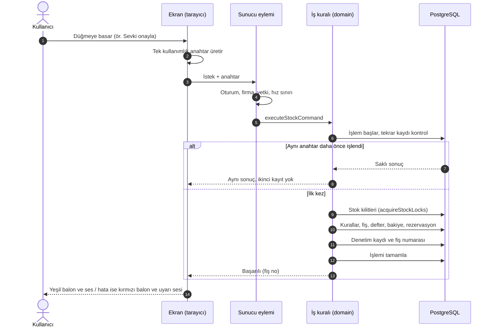

### 0.4 Roller ve izinler (düğmelerin kimde açık olduğu)

Kaynak: `packages/domain/src/identity/permissions.ts`.

| İzin anahtarı | Sade anlamı | Yönetici (TENANT_ADMIN) | Depo yöneticisi | Toplayıcı (PICKER) | Sayımcı (COUNTER) | Salt okur |
| :--- | :--- | :---: | :---: | :---: | :---: | :---: |
| `stock.view` | Stoğu ve işleri görme | ✓ | ✓ | ✓ | ✓ | ✓ |
| `stock.post` | Stoğu hareket ettirme (yerleştir, topla, sevk, üret, transfer) | ✓ | ✓ | ✓ | – | – |
| `document.create` | Belge/sayım satırı oluşturma | ✓ | ✓ | – | ✓ | – |
| `document.approve` | Onaylama, görev atama/iptal, sipariş ayırma, sayım başlatma | ✓ | ✓ | – | – | – |
| `count_diff.approve` | Sayım farkını onaylama ve işleme | ✓ | ✓ | – | – | – |
| `reversal.create` | Ters kayıt | ✓ | ✓ | – | – | – |
| `audit.view` | Kim ne yaptı? | ✓ | ✓ | – | – | – |
| `settings.manage` | Ayarlar, reçete tanımı, vardiya | ✓ | – | – | – | – |
| `data.import` | Excel içeri/dışarı aktarma | ✓ | – | – | – | – |

Özel **yetki grupları** ile bir kişiye ek izin verilebilir (`stock.post`, `document.create`, `document.approve`, `count_diff.approve`,
`reversal.create`, `data.import`); onay türü izinler iki adımlı doğrulama (MFA) ister. **Depo kapsamı**: bir kişi yalnız atandığı depoları görebilir (A-46).
**Görev ayrılığı** (`tenant_settings.separation_of_duties`, varsayılan kapalı): açıksa sayımı yapan kişi kendi sayımını onaylayamaz.

---

## 1. Modül: Ana ekran (Pano / Görevlerim / Kolay işlemler)

- **Modül Durumu:** [TAMAMLANDI] — "Tüm raporlar" kartı için bkz. Modül 14 [PLANLANDI]. Canlı: UNKNOWN.
- **Ekran:** `/t/<firma>` — `apps/web/app/t/[slug]/page.tsx`
- **Ekranın Amacı ve İşlevi:** Girişten sonra açılan ilk ekran **role göre** değişir:
  - **Hesap sahibi / depo yöneticisi → Depo panosu** (`pano/pano-board.tsx`, veri `getBoard` — `packages/domain/src/operations/board.ts`):
    bugünkü iş halkası (biten/atanan/atanmayan görev), "Dikkat isteyenler" (kritik stok, bekleyen sipariş, onay bekleyen sayım, sahadan sorun),
    rapor kartları, ekip şu an (OKUTUYOR / GÖREVDE / BOŞTA / BUGÜN GİRİŞ YOK).
  - **Toplayıcı / Sayımcı → Görevlerim / Sayımlarım** (`pano/pano-home.tsx`, veri `getWorkSummary` — `operations/work-summary.ts`):
    Giriş, Çıkış, Transfer, Üretim, Sayım bölümlerinde açık iş + kalem sayısı, ACİL rozeti, vardiya satırı, SORUN kartı.
  - **Diğer roller → Kolay işlemler** (`easy-operations.tsx`) ve "Bugün yaptıkların" (`listMyActionsToday` — `packages/domain/src/audit/today-impl.ts`).
- **Arayüz Elemanları ve Aksiyon Tablosu:**

| UI Bileşeni / Buton / Alan | Tipi | Kullanıcı Aksiyonu | Tetiklenen API / Servis | Etkilenen DB Tablosu & Kolonu | İş Kuralı / Validasyon | Mevcut Durum |
| :--- | :--- | :--- | :--- | :--- | :--- | :--- |
| İş halkası ("Bugün n iş · atandı · atanmadı") | Grafik halka | Görüntülenir | `getBoard` (`operations/board.ts`) | Okur: `warehouse_tasks.status`, `completed_at` | Yalnız `stock.view`; yalnız kişinin depo kapsamı; değerler gerçek tablolardan (uydurma sayı yok) | [TAMAMLANDI] |
| "Kritik stok" / "Satın alma" kartı | Kart (bağlantı) | Dokunulur → `/stock` | `getBoard` | Okur: `item_stock_policies.min_quantity/max_quantity`, `stock_balances.quantity` | Kritik = eldeki < min × 0,35; öneri = max − eldeki | [TAMAMLANDI] |
| "Bekleyen sipariş" kartı | Kart | Dokunulur → `/shipping` | `getBoard` | Okur: `sales_orders.status='OPEN'`, `sales_order_lines` | Siparişte teslim tarihi kolonu yok → "bekleme günü" = oluşturulmadan bu yana | [TAMAMLANDI] |
| "Sayım farkı · onay bekliyor" | Kart | Dokunulur → `/tasks?kind=COUNT` | `getBoard` | Okur: `count_sessions.status='SUBMITTED'` | — | [TAMAMLANDI] |
| "Devir hızı" | Kart | Dokunulur → `/stock` | `getBoard` | Okur: `stock_ledger` (son 90 gün çıkış) | Hareketsiz ürün = stoklu ama 90 gün hareketsiz | [TAMAMLANDI] |
| "Ekip şu an" satırları | Liste | Görüntülenir | `getBoard` | Okur: `tenant_memberships`, `warehouse_task_progress`, `audit_logs` | Kişisel veri en az (yalnız durum) | [TAMAMLANDI] |
| Görev "Ata" (panoda kişi seçimi) | Buton + seçim | Kişi seçilir | `assignTaskAction` → `assignTask` (`operations/tasks.ts`) | Yazar: `warehouse_tasks.status='ASSIGNED'`, `assigned_membership_id`, `version` + `audit_logs` | `document.approve`; atanan kişinin o görev türünü yapma izni ve depo kapsamı olmalı; sürüm kontrolü (aynı anda iki atama çakışmaz) | [TAMAMLANDI] |
| Görevlerim bölüm kartları (Giriş/Çıkış/Transfer/Üretim/Sayım) | Kart | Dokunulur → ilgili saha ekranı | `getWorkSummary` (`operations/work-summary.ts`) | Okur: `inbound_receipts`, `sales_orders`, `documents`, `stock_document_links`, `warehouse_tasks`, `count_session_lines` | Gün sınırı firmanın saat dilimine göre (`tenant_settings.time_zone`) | [TAMAMLANDI] |
| ACİL rozeti | Rozet | Görüntülenir | `getWorkSummary` | Okur: `work_priorities.urgent` | Yazan ekran yok → bkz. Gap | [GELİŞTİRİLİYOR] |
| Vardiya satırı | Metin | Görüntülenir | `getWorkSummary` | Okur: `tenant_settings.shift_start/shift_end` (varsayılan 08:00–17:00) | Değiştiren ekran yok → bkz. Gap | [GELİŞTİRİLİYOR] |
| "SORUN" (alt çubuk) → Sorun bildir | Alt sayfa (form) | Sebep seçilir + not → Gönder | `reportProblemAction` → `reportProblem` (`operations/work-signals.ts`) | Yazar: `problem_reports` (`reason`, `note`, `status='OPEN'`, `reported_by`) + `audit_logs` | `stock.post` veya `document.create` gerekir (salt okur bildiremez); sebep listesi: `DAMAGED`, `MISSING`, `WRONG_ITEM`, `NO_LABEL`, `LOCATION`, `OTHER`; not ≤ 500 karakter | [TAMAMLANDI] |
| Sorunu "Çözüldü" yapma | — | — | `resolveProblemAction` → `resolveProblem` (kodda var) | Yazacağı: `problem_reports.status='RESOLVED'`, `resolved_by/at` | `document.approve` | [GELİŞTİRİLİYOR] (ekranda düğmesi yok) |
| "Bugün yaptıkların" | Liste (son 5) | Görüntülenir | `listMyActionsToday` | Okur: `audit_logs` (yalnız kendi satırları; ip/açıklama dönmez) | Yalnız kendi kaydı | [TAMAMLANDI] |

- **İş Akış Şeması:**

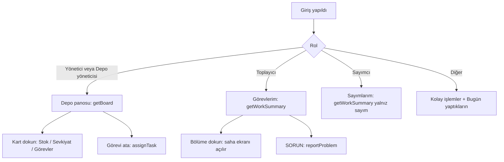

---

## 2. Modül: Görevler (yönetici) ve Görevlerim (saha)

- **Modül Durumu:** [TAMAMLANDI] — görev ilerleme kaydı ve "Yeniden yerleştirme" saha ekranı [GELİŞTİRİLİYOR]. Canlı: UNKNOWN.
- **Ekranlar:** Yönetici `/t/<firma>/tasks` (`tasks/page.tsx`, `tasks/tasks-view.tsx`); saha `/t/<firma>/field/tasks` (`field/tasks/page.tsx`).
- **Ekranın Amacı ve İşlevi:** Depo görevleri kendiliğinden doğar: mal kabulde **Yerleştirme**, sipariş toplama atamasında **Toplama**,
  sipariş iptalinde **Yeniden yerleştirme**, sayım başlatıldığında ve toplamada mal bulunamadığında **Sayım**. Yönetici kime yapacağını atar
  ya da iptal eder; sahadaki kişi "Üstlen" ile işi alır, "Başla" ile ilgili saha ekranına gider.
- **Görev türü → yapabilmek için gereken izin** (`TASK_KIND_PERMISSION`): Yerleştirme, Toplama, Yeniden yerleştirme = `stock.post`; Sayım = `document.create`.
- **Arayüz Elemanları ve Aksiyon Tablosu:**

| UI Bileşeni / Buton / Alan | Tipi | Kullanıcı Aksiyonu | Tetiklenen API / Servis | Etkilenen DB Tablosu & Kolonu | İş Kuralı / Validasyon | Mevcut Durum |
| :--- | :--- | :--- | :--- | :--- | :--- | :--- |
| Tür çipleri (Yerleştirme/Toplama/Yeniden yerleştirme/Sayım) ve Durum çipleri | Filtre çipi | Seçilir | `listTasks` / `listMyTasks` (`operations/tasks.ts`) | Okur: `warehouse_tasks.kind`, `status` | Sayfa başına en çok 200; depo kapsamı | [TAMAMLANDI] |
| Arama kutusu | Input | Yazılır | `listTasks` | Okur: ürün/raf adı (ILIKE) | — | [TAMAMLANDI] |
| "Ata" / "Yeniden ata" | Buton → kişi seçimi → Kaydet | Tıklanır | `assignTaskAction` → `assignTask` | Yazar: `warehouse_tasks.status='ASSIGNED'`, `assigned_membership_id`, `version+1`; `audit_logs` | `document.approve`; seçilen kişi ACTIVE, işi yapma izni var, depo kapsamında; `expectedVersion` uyuşmazsa "başkası değiştirdi" | [TAMAMLANDI] |
| "İptal et" + gerekçe | Buton + zorunlu metin | Onaylanır | `cancelTaskAction` → `cancelTask` | Yazar: `warehouse_tasks.status='CANCELLED'`; gerekçe `audit_logs.reason` | `document.approve`; gerekçe 1–500 karakter, kontrol karakteri yok; stok etkisi yok | [TAMAMLANDI] |
| Saha: "Üstlen" | Buton | Tıklanır | `claimTaskAction` → `claimTask` | Yazar: `warehouse_tasks.status='ASSIGNED'`, `assigned_membership_id = ben` | Yalnız `OPEN` görev; kişinin o türü yapma izni olmalı | [TAMAMLANDI] |
| Saha: "Başla" | Bağlantı | Tıklanır | Yönlendirme: Yerleştirme → `/field/putaway`, Toplama → `/field/pick`, Sayım (oturumlu) → `/field/count` | — (yalnız ekran açar) | Yeniden yerleştirme ve oturumsuz sayım için "Bu iş ekranı henüz açılmadı" | [TAMAMLANDI] / Yeniden yerleştirme [GELİŞTİRİLİYOR] |
| Adım adım ilerleme kaydı (okut → miktar → onay → kaydediliyor) | — | — | `recordTaskStepAction`, `beginSaveAction`, `saveTaskAction`, `resetTaskProgressAction`, `nextTaskAction` (`tasks/actions.ts` → `operations/task-progress.ts`) | Yazacağı: `warehouse_task_progress` (`step`: `SCAN_TARGET`/`ENTER_QUANTITY`/`CONFIRM`/`SAVING`) | Kodda ve testte var; **hiçbir ekran çağırmıyor** | [GELİŞTİRİLİYOR] |

- **Görev durum makinesi** (DB kısıtı `warehouse_tasks_status_chk` + `nextTaskStatus`, `operations/tasks.ts`; biten görev DB tetikleyicisiyle değişmez):

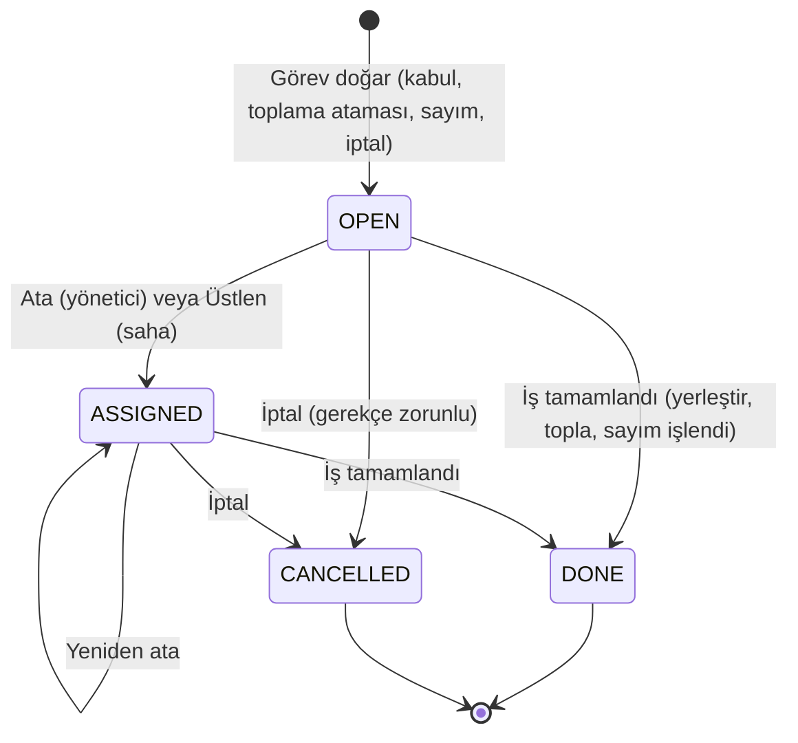

Durum kodları: `OPEN` Açık · `ASSIGNED` Atandı · `DONE` Tamamlandı · `CANCELLED` İptal edildi.
Görevin kaynağı (`source_kind`): `INBOUND_RECEIPT` mal kabul, `SALES_ORDER` sipariş, `CUSTOMER_RETURN` iade, `COUNT_SESSION` sayım.

---

## 3. Modül: Saha ana ekranı — OKUT (hızlı okutma)

- **Modül Durumu:** [TAMAMLANDI] — Canlı: STATE 21 Ekim kaydına göre T-446 (hızlı OKUT) canlıda; gerçek iPhone kamerası kullanıcı denemesi bekler.
- **Ekran:** `/t/<firma>/field` — `field/page.tsx`, `field/okut-view.tsx`, `field/saha-shell.tsx`; alt çubuktaki **OKUT** düğmesi buraya açar.
- **Ekranın Amacı ve İşlevi:** Sahada çalışan kişi hiçbir menüye girmeden **kodu okutur** (kamera, NFC, el terminali ya da elle yazma);
  sistem kodun ne olduğunu bulur ve **doğru işe kendiliğinden geçer**. Okuttuğu şey ürünse bekleyen kabule, raf ise yerleştirmeye veya o raftaki
  sayım/toplama görevine, paket QR'ı ise paket ekranına gider.
- **Arayüz Elemanları ve Aksiyon Tablosu:**

| UI Bileşeni / Buton / Alan | Tipi | Kullanıcı Aksiyonu | Tetiklenen API / Servis | Etkilenen DB Tablosu & Kolonu | İş Kuralı / Validasyon | Mevcut Durum |
| :--- | :--- | :--- | :--- | :--- | :--- | :--- |
| Kamera çerçevesi | Kamera (barkod/QR çözücü, cihazda) | Kod çerçeveye getirilir | `resolveFieldScanAction` (`field/actions.ts`) → `resolveFieldScan` (`operations/field-scan.ts`) + `findFieldWork` (`operations/field-work.ts`) | Okur: `item_barcodes`, `items.code`, `inbound_receipts.number`, `locations.code`, `warehouse_tasks` | Yalnız okuma (`stock.view`); arama sırası: ürün barkodu (GS1 dahil) → ürün kodu → açık teslim no → raf kodu; başka firmanın kodu "tanınmadı" döner (varlık sızmaz); depo kapsamı | [TAMAMLANDI] |
| "NFC'ye dokun" | Buton | Etikete dokunulur | Aynı eylem | Aynı | Cihazda NFC yoksa uyarı | [TAMAMLANDI] |
| "Kodu yaz" + "Bul" | Input + Buton | Elle yazılır | Aynı eylem | Aynı | Boş/çok uzun/kontrol karakterli kod reddedilir | [TAMAMLANDI] |
| Paket QR (`EWMS:PKG:1:<kimlik>`) | Okutma | Okutulur | `resolveCurrentPackageQr` | Okur: `receipt_packages`, `handling_units` | Paket akışı ayarı (`PACKAGE_RECEIVING_ENABLED`) kapalıysa "tanınmadı" | [GELİŞTİRİLİYOR] (ayar kapalı) |
| Sonuç yönlendirmesi | Otomatik geçiş | — | Aynı eylem | — | Öncelik: bana atanmış iş → bekleyen kabul → üstlenilebilir iş → ürün kartı / stok; stok yazma yetkisi yoksa yalnız bilgi ekranına gider | [TAMAMLANDI] |
| Ses ve titreşim | Geri bildirim | — | Cihaz | — | Bulundu: olumlu ses; tanınmadı: uyarı sesi | [TAMAMLANDI] |

- **İş Akış Şeması:**

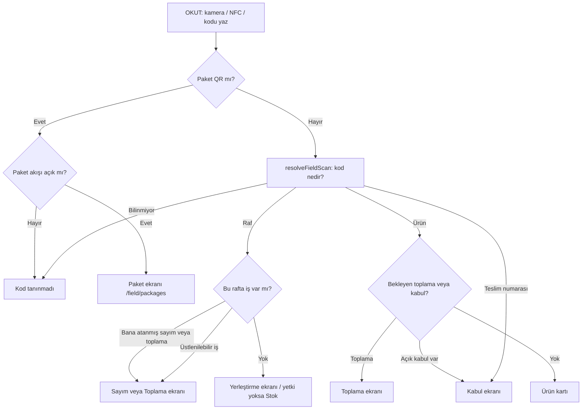

---

## 4. Modül: Yerleştirme (rafa koyma)

- **Modül Durumu:** [TAMAMLANDI] — Canlı: UNKNOWN.
- **Ekran:** `/t/<firma>/field/putaway` — `field/putaway/page.tsx`, `field/putaway/putaway-flow.tsx`.
- **Ekranın Amacı ve İşlevi:** Kabul alanına (RECEIVING) gelen ya da sevk alanından geri dönen malı **depolama rafına** (STORAGE) taşır.
  Toplam stok değişmez; yalnız yeri değişir. Görevle başlandıysa görev aynı anda "Tamamlandı" olur.
- **Arayüz Elemanları ve Aksiyon Tablosu:**

| UI Bileşeni / Buton / Alan | Tipi | Kullanıcı Aksiyonu | Tetiklenen API / Servis | Etkilenen DB Tablosu & Kolonu | İş Kuralı / Validasyon | Mevcut Durum |
| :--- | :--- | :--- | :--- | :--- | :--- | :--- |
| Görev listesi (Yerleştirme görevlerim) | Liste | Görev seçilir | `listMyTasks` (sayfa sunucuda) | Okur: `warehouse_tasks` (kind=PUTAWAY) | Yalnız bana atanmış veya açık görev | [TAMAMLANDI] |
| Ürün okut | Okutma alanı | Barkod okutulur | `resolveItemScanAction` (`receipts/actions.ts`) → `resolveBarcodeQuery` + `getItem` | Okur: `item_barcodes`, `items` | Görevdeki ürünle aynı olmalı | [TAMAMLANDI] |
| Raf okut | Okutma alanı | Raf etiketi okutulur | `resolveLocationScanAction` → `findLocationByCode` | Okur: `locations` | Hedef raf `STORAGE` türünde ve kaynaktan farklı olmalı | [TAMAMLANDI] |
| "Rafta n" bilgisi | Metin | Görüntülenir | `availableAtLocationAction` | Okur: `stock_balances` | — | [TAMAMLANDI] |
| Miktar tuş takımı / "TÜMÜ" | Sayı girişi | Tuşlanır / aynı barkod tekrar okutulur | Ekranda | — | Görevli yerleştirmede miktar görevle **birebir** eşleşmeli (kısmi yerleştirme görevi bitirmez) | [TAMAMLANDI] |
| "ONAYLA" | Buton | Tıklanır | `putawayAction` → `putaway` (`operations/putaway.ts`) | Yazar: `documents` (kind=`STOCK_MOVE`, `POSTED`), `document_lines`, `stock_ledger` (kaynaktan −, hedefe +), `stock_balances`, `warehouse_tasks.status='DONE'`, `audit_logs` | `stock.post`; tek işlem; raf sayımda kilitliyse `LOCATION_LOCKED`; başkasına atanmış görevi yalnız onay yetkilisi bitirebilir; görevsiz yerleştirme eşleşen açık görevleri sırayla kapatır | [TAMAMLANDI] |

- **İş Akış Şeması:**

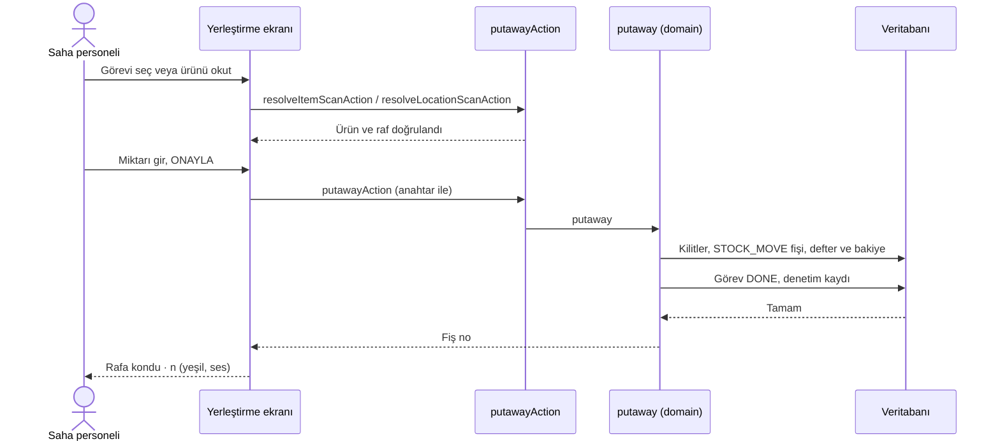

---

## 5. Modül: Paket işlemleri (kalite onayı, paketi rafa koy, paketi başka depoya taşı)

- **Modül Durumu:** [GELİŞTİRİLİYOR] — kod tam; ama **`PACKAGE_RECEIVING_ENABLED` ayarı açılmadıkça** paket ekranları kapalıdır
  (`apps/web/lib/package-receiving-config.ts`, güvenli varsayılan "kapalı"). BACKLOG B-50: "Paketli/QR akışını normal girişe bağla, ayarı aç".
- **Ekran:** `/t/<firma>/field/packages` — `field/packages/package-flow.tsx`, `field/packages/actions.ts`.
- **Ekranın Amacı ve İşlevi:** Her koli/varil/palet tekil bir QR ile izlenir. Bu ekranda paket okutulur ve **bütün paket** olarak işlem yapılır:
  karantinadaki paketin kalitesini onaylamak, paketi rafa koymak veya başka depoya taşımak.
- **Arayüz Elemanları ve Aksiyon Tablosu:**

| UI Bileşeni / Buton / Alan | Tipi | Kullanıcı Aksiyonu | Tetiklenen API / Servis | Etkilenen DB Tablosu & Kolonu | İş Kuralı / Validasyon | Mevcut Durum |
| :--- | :--- | :--- | :--- | :--- | :--- | :--- |
| "Paket okut" | Okutma | QR okutulur | `resolveCurrentPackageQrAction` / `getCurrentPackageAction` → `getCurrentPackage` (`operations/package-movement-queries.ts`) | Okur: `receipt_packages`, `handling_units`, `package_movement_steps`, `stock_balances` | `stock.view`; paketin güncel yeri ve durumu son adımdan hesaplanır | [GELİŞTİRİLİYOR] |
| "Kaliteyi onayla" | Buton | Tıklanır | `qualityReleasePackageAction` → `approvePackageQuality` (`operations/package-movement.ts`) | Yazar: `documents` + `stock_ledger` (KARANTİNA → KULLANILABİLİR), `package_movement_steps` (`operation='QC_RELEASE'`), `audit_logs` | `document.approve`; paketin bilinen son sürümü (`predecessorVersion`, `currentBalanceVersion`) eşleşmeli, aksi "güncel durumu al" | [GELİŞTİRİLİYOR] |
| "Yer okut" / "Yer seç" → "Buraya yerleştir" | Okutma / liste + buton | Raf seçilir, onaylanır | `resolvePackageDestinationAction`, `packageStorageLocationsAction`, `putawayPackageAction` → `putawayPackage` | Yazar: `package_movement_steps` (`PUTAWAY`), `documents`, `stock_ledger`, `stock_balances` | `stock.post`; bütün paket taşınır (bölme yok); hedef aynı depoda | [GELİŞTİRİLİYOR] |
| "Depoya taşı" → "Hedef depo" → "Yer seç" → "Taşımayı onayla" | Seçim + buton | Onaylanır | `packageTransferWarehousesAction`, `packageTransferLocationsAction`, `resolvePackageTransferDestinationAction`, `transferPackageAction` → `transferPackage` (`operations/package-transfer.ts`) | Yazar: iki bağlı fiş (kaynak deposunda `STOCK_OUT`, hedef deposunda `STOCK_IN`), `stock_document_links` (`kind='TRANSFER'`), `package_movement_steps` (`WAREHOUSE_TRANSFER`) | `stock.post`; kaynak ve hedef depo farklı, hedef raf STORAGE; iki fiş tek işlemde | [GELİŞTİRİLİYOR] |

- **İş Akış Şeması (paket durum makinesi, `package_movement_steps.operation`):**

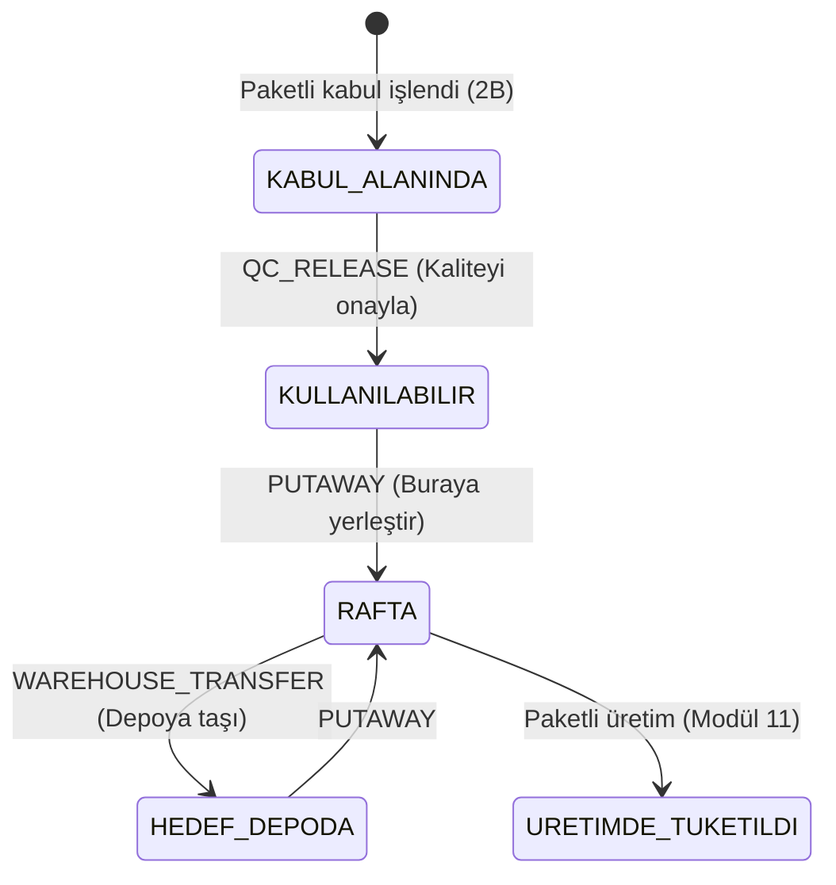

---

## 6. Modül: Depolar arası transfer (paketsiz)

- **Modül Durumu:** [TAMAMLANDI] — Canlı: UNKNOWN.
- **Ekran:** Stok işlemleri formundaki "Transfer" (`stock/documents/document-form.tsx`, ayrıntı 2B) ve Etkin sesli komut onay kartı (`kabuk/etkin.tsx`).
- **Ekranın Amacı ve İşlevi:** Bir depodaki raftan başka bir depodaki rafa mal göndermek. Arka planda **iki fiş** oluşur (çıkış + giriş) ve
  ikisi birbirine bağlanır; biri kaydolup diğeri kalamaz.
- **Arayüz Elemanları ve Aksiyon Tablosu:**

| UI Bileşeni / Buton / Alan | Tipi | Kullanıcı Aksiyonu | Tetiklenen API / Servis | Etkilenen DB Tablosu & Kolonu | İş Kuralı / Validasyon | Mevcut Durum |
| :--- | :--- | :--- | :--- | :--- | :--- | :--- |
| Kaynak raf, hedef raf, ürün, miktar, açıklama | Seçim + Input | Doldurulur | `stockChoicesAction` (seçenek arama) | Okur: `locations`, `items`, `stock_balances` | — | [TAMAMLANDI] |
| "Onayla" (transfer) | Buton | Tıklanır | `transferStockAction` (`stock/documents/actions.ts`) → `transferBetweenWarehouses` (`operations/warehouse-transfer.ts`) | Yazar: `documents` ×2 (`STOCK_OUT` kaynak depo, `STOCK_IN` hedef depo, ikisi `POSTED`), `document_lines`, `stock_ledger`, `stock_balances`, `audit_logs` | `stock.post`; açıklama zorunlu; miktar > 0; kaynak ve hedef **farklı depoda** olmalı (aynı depoda raf değişimi = yerleştirme/taşıma fişi); stok yetersizse ret; iki fiş tek işlem | [TAMAMLANDI] |

> Not: Paketsiz transferde iki fiş arasında `stock_document_links` kaydı yazılmaz; bağ yalnız paketli transferde ve üretimde yazılır
> (kod: `warehouse-transfer.ts` yalnız iki fişi işler). Ana ekrandaki "Transfer" sayacı kaynaksız `STOCK_MOVE` ve `TRANSFER` bağlarını sayar
> (`work-summary.ts`); paketsiz depolar arası transferin sayaca nasıl yansıdığı bu belgede doğrulanmadı (UNKNOWN).

---

## 7. Modül: Sipariş ve Sevkiyat yönetimi (masa)

- **Modül Durumu:** [TAMAMLANDI] — yalnız lot/seri takibi olmayan ürünler; sipariş düzenleme, satır iptali, cari bağlantısı [GELİŞTİRİLİYOR]. Canlı: UNKNOWN.
- **Ekran:** `/t/<firma>/shipping` — `shipping/page.tsx`, `shipping/shipping-form.tsx`, `shipping/actions.ts`.
- **Ekranın Amacı ve İşlevi:** Müşteri siparişini açar, stoktan **ayırır** (rezervasyon), toplama görevlerini üretir, toplanan malı **sevk eder**.
  Sipariş kaydı stok düşürmez; stok yalnız "Sevki onayla" ile düşer.
- **Arayüz Elemanları ve Aksiyon Tablosu:**

| UI Bileşeni / Buton / Alan | Tipi | Kullanıcı Aksiyonu | Tetiklenen API / Servis | Etkilenen DB Tablosu & Kolonu | İş Kuralı / Validasyon | Mevcut Durum |
| :--- | :--- | :--- | :--- | :--- | :--- | :--- |
| Sipariş listesi + arama | Liste + Input | Aranır / dokunulur | `listShippingOrders` (`operations/shipping-queries.ts`) | Okur: `sales_orders`, `sales_order_lines` | Arama ≤ 128 karakter; toplam sayı gösterilir | [TAMAMLANDI] |
| "Müşteri / sipariş açıklaması" | Input (serbest metin) | Yazılır | — | Yazacağı: `sales_orders.customer_ref` | 1–100 karakter; **Cari kartına bağlı değil** (bkz. Gap) | [TAMAMLANDI] |
| Ürün seç + miktar, "Ekle" / "Kaldır" | Seçim + Input + Buton | Satır eklenir | `stockChoicesAction` | — | En çok 200 satır; takipli (lot/seri) ürün reddedilir | [TAMAMLANDI] |
| "Siparişi oluştur" | Buton | Tıklanır | `createShippingOrderAction` → `createSalesOrder` (`operations/orders.ts`) | Yazar: `sales_orders` (`number` sistemden, `status='OPEN'`), `sales_order_lines.requested_quantity`, `audit_logs` | `document.create`; miktar temel birime çevrilir, ondalık uymuyorsa `QUANTITY_SCALE`; stok değişmez | [TAMAMLANDI] |
| "Stok ayır" | Buton | Tıklanır | `shippingOrderAction` (operation=`reserve`) → `reserveOrder` | Yazar: `reservations` (`status='ACTIVE'`), `stock_balances.reserved_quantity` | `document.approve`; ayrılabilir = açık − aktif ayrım; sayımdaki raf, toplama engelli raf, takipli stok ayrılmaz | [TAMAMLANDI] |
| "Toplama görevlerini oluştur" | Buton | Tıklanır | `shippingOrderAction` (operation=`assign`) → `createPickAssignment` (`operations/picking.ts`) | Yazar: `warehouse_tasks` (kind=`PICK`, ortak `group_id`), `audit_logs` | `document.approve`; stok etkisi yok; raf kodu sırasıyla görev; ayrılmamış satır görev üretmez | [TAMAMLANDI] |
| Görev satırında okut + "İşlemi kontrol et" + "Toplamayı onayla" | Okutma + Buton | Masadan toplama onayı | `previewShippingPickAction` → `confirmShippingPickAction` → `confirmPick` | Bkz. Modül 8 | Bkz. Modül 8 | [TAMAMLANDI] |
| "Sevke hazır miktar" satırı + "Sevk edilecek miktar" + "Sevki onayla" | Input + Buton | Tıklanır | `postShipmentAction` → `shipOrder` (`operations/shipping.ts`) | Yazar: `documents` (`STOCK_OUT`, kaynak `SALES_ORDER`, `POSTED`), `stock_ledger`, `stock_balances` (quantity ve reserved azalır), `reservations.status='CONSUMED'`, `sales_order_lines.shipped_quantity`, tüm satırlar bitince `sales_orders.status='CLOSED'`, `audit_logs` | `stock.post`; yalnız sevk alanında (STAGING) duran ve ayrılmış mal sevk edilir; fazlası `INSUFFICIENT_STOCK`; tek depodan sevk; DB kısıtı `shipped + cancelled ≤ requested` | [TAMAMLANDI] |
| "Siparişi iptal et" → "İptali onayla" | Buton (iki adım) | Onaylanır | `shippingOrderAction` (operation=`cancel`) → `cancelSalesOrder` | Yazar: `sales_orders.status='CANCELLED'`, `sales_order_lines.cancelled_quantity`, `reservations.status='RELEASED'`, sevk alanında kalan mal için `warehouse_tasks` (kind=`REPUTAWAY`) | `document.approve`; sürüm kontrolü; sevk edilmiş kısım iptal edilmez; fiziksel stok silinmez | [TAMAMLANDI] |
| Sipariş düzenleme, satır iptali, yeniden ayırma | — | — | `updateDraftOrder`, `cancelOrderLine`, `reallocateOrderLine` (kodda var) | `sales_order_lines` | Ekranda düğmesi yok | [GELİŞTİRİLİYOR] |

- **Sipariş durum makinesi** (`sales_orders_status_chk`: `OPEN`, `CLOSED`, `CANCELLED`):

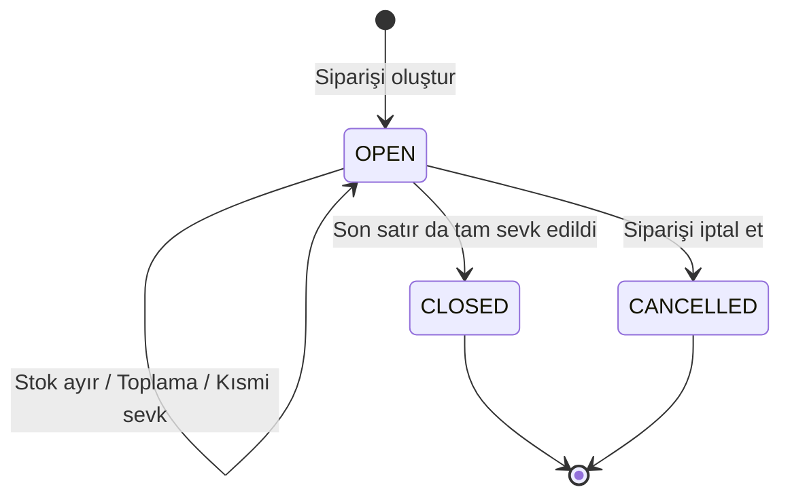

Satır miktarları: `requested_quantity` istenen · `shipped_quantity` sevk edilen · `cancelled_quantity` iptal · `returned_quantity` iade.
Açık miktar = istenen − sevk − iptal (kolon değil, hesaplanır). İade açık miktarı değiştirmez, siparişi yeniden açmaz.

- **Rezervasyon durum makinesi** (`reservations_status_chk`):

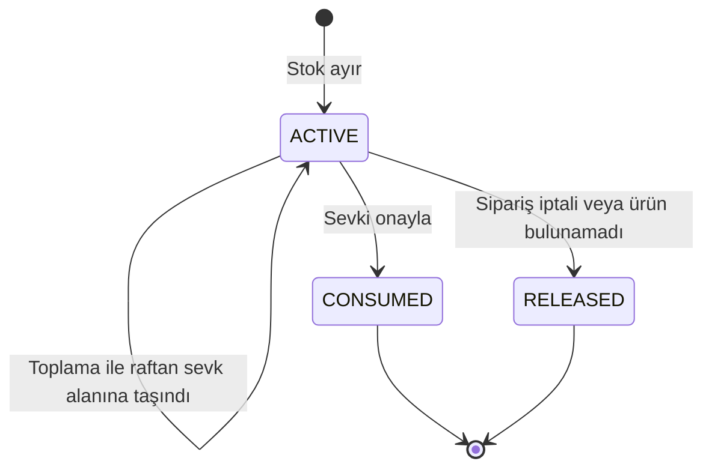

---

## 8. Modül: Toplama (saha)

- **Modül Durumu:** [TAMAMLANDI] — "rafta hiç ürün yok" bildirimi ve eksikten doğan sayımın sahadan başlatılması [GELİŞTİRİLİYOR] (BACKLOG B-96). Canlı: UNKNOWN (PR #140 main'de).
- **Ekran:** `/t/<firma>/field/pick` — `field/pick/page.tsx`, `field/pick/pick-flow.tsx`; veri `getPickWork` (`operations/field-work.ts`).
- **Ekranın Amacı ve İşlevi:** Toplayıcı rafa gider, raf etiketini ve ürün barkodunu okutur, kaç tane aldığını girer. Mal raftan **sevk alanına**
  (STAGING) taşınır, siparişe ayrılan stok da malla birlikte taşınır. Eksik bulunursa eksik kısmın ayrımı bırakılır, raf toplamaya kapatılır ve
  o raf için sayım görevi açılır.
- **Arayüz Elemanları ve Aksiyon Tablosu:**

| UI Bileşeni / Buton / Alan | Tipi | Kullanıcı Aksiyonu | Tetiklenen API / Servis | Etkilenen DB Tablosu & Kolonu | İş Kuralı / Validasyon | Mevcut Durum |
| :--- | :--- | :--- | :--- | :--- | :--- | :--- |
| İş kartı ("n birim · RAF X", "İSTENEN n") | Kart | Görüntülenir | `getPickWork` | Okur: `warehouse_tasks`, `sales_orders`, `reservations`, `locations` | Başkasına atanmış görev yalnız onay yetkilisine görünür | [TAMAMLANDI] |
| "Rafı okut" | Okutma | Raf etiketi okutulur | Ekranda karşılaştırma; sunucu onayda tekrar denetler | — | Yanlış raf: "Bu raf değil. Doğru raf: X" | [TAMAMLANDI] |
| "Ürünü okut" | Okutma | Barkod okutulur | `previewShippingPickAction` → `previewShippingPick` | Okur: `item_barcodes`, `unit_conversions` | Yanlış ürün: `SCAN_MISMATCH`; koli barkodu temel birime çevrilir, tam sayıya inmiyorsa uyarı | [TAMAMLANDI] |
| "Kaç tane aldın?" tuş takımı | Sayı girişi | Tuşlanır / aynı barkod tekrar okutulur | Ekranda | — | İstenenden fazlası reddedilir | [TAMAMLANDI] |
| "Toplamayı onayla" | Buton | Tıklanır | `confirmShippingPickAction` → `confirmPick` (`operations/picking.ts`) | Yazar: `documents` (`STOCK_MOVE`, POSTED), `stock_ledger`, `stock_balances`, `reservations` (yeni boyuta taşınır), `warehouse_tasks.status='DONE'`, `audit_logs`. **Eksikte ek:** `reservations.status='RELEASED'` (eksik kısım), `locations.pick_blocked=true`, yeni `warehouse_tasks` (kind=`COUNT`, kaynak sipariş) | `stock.post`; raf + ürün okutması zorunlu; eksikte defter değişmez; ardından ayrı işlemde `reallocateOrderLine` ile başka raftan yeniden ayırma denenir ve sonucu ekranda görünür | [TAMAMLANDI] |
| "Sıradaki toplama (n)" / "Sevke geç" | Bağlantı | Tıklanır | Yönlendirme | — | — | [TAMAMLANDI] |

- **İş Akış Şeması:**

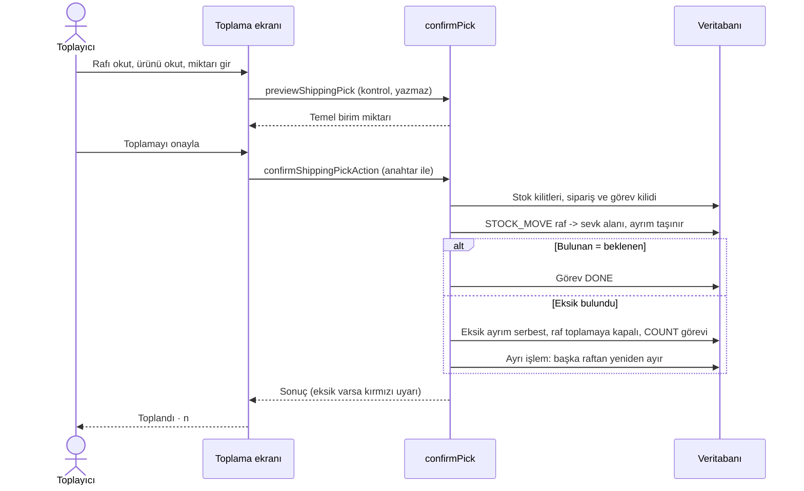

---

## 9. Modül: Sevk (saha)

- **Modül Durumu:** [TAMAMLANDI] — Canlı: UNKNOWN (PR #140 main'de).
- **Ekran:** `/t/<firma>/field/ship` — `field/ship/page.tsx`, `field/ship/ship-flow.tsx`; veri `getShippingOrder`.
- **Ekranın Amacı ve İşlevi:** Sevk alanında toplanmış malı araca yüklerken satır seçilir, miktar girilir, "yükleme onayı" verilir. Masadaki
  "Sevki onayla" ile aynı komuttur (Modül 7).

| UI Bileşeni / Buton / Alan | Tipi | Kullanıcı Aksiyonu | Tetiklenen API / Servis | Etkilenen DB Tablosu & Kolonu | İş Kuralı / Validasyon | Mevcut Durum |
| :--- | :--- | :--- | :--- | :--- | :--- | :--- |
| Sevke hazır satırlar | Liste | Satır seçilir | `getShippingOrder` | Okur: `reservations` (STAGING'deki ACTIVE), `sales_order_lines` | — | [TAMAMLANDI] |
| Miktar + "Sevki onayla" | Input + Buton | Tıklanır | `postShipmentAction` → `shipOrder` | Modül 7'deki "Sevki onayla" satırı ile aynı | Aynı | [TAMAMLANDI] |

---

## 10. Modül: Sayım (yönetici + saha)

- **Modül Durumu:** [TAMAMLANDI] — Canlı: UNKNOWN (PR #140 main'de). Kalan: B-96 (toplama eksiğinden doğan oturumsuz sayım görevinin sahadan başlatılması).
- **Ekranlar:** Yönetici `/t/<firma>/counts` (`counts/page.tsx`, `counts/counts-forms.tsx`, `counts/actions.ts`);
  saha `/t/<firma>/field/count` (`field/count/count-flow.tsx`, veri `getCountWork`).
- **Ekranın Amacı ve İşlevi:** Yönetici sayılacak rafları seçip sayımı başlatır; raflar sayım bitene kadar **kilitlenir** (o raflara giriş/çıkış
  yapılamaz) ve her raf için sahada sayım görevi açılır. Sayımcı rafı ve ürünü okutup saydığı miktarı girer. "Kör sayım" seçilirse sayımcı sistemdeki
  miktarı görmez. Bütün satırlar sayılınca yönetici farkları inceler, onaylar ve **fark fişini işler**; stok sayılan miktara eşitlenir.
- **Arayüz Elemanları ve Aksiyon Tablosu:**

| UI Bileşeni / Buton / Alan | Tipi | Kullanıcı Aksiyonu | Tetiklenen API / Servis | Etkilenen DB Tablosu & Kolonu | İş Kuralı / Validasyon | Mevcut Durum |
| :--- | :--- | :--- | :--- | :--- | :--- | :--- |
| Sayım listesi (durum rozetleri) | Liste | Satıra dokunulur | `listCountSessions`, `getCountReview` (`operations/count-queries.ts`) | Okur: `count_sessions`, `count_session_lines`, `warehouse_tasks` | `stock.view` + depo kapsamı | [TAMAMLANDI] |
| "Yeni sayım": Depo, Raf kodları, "Kör sayım" | Seçim + çok satırlı Input + onay kutusu | Doldurulur | — | — | En çok 200 raf kodu; depoda olmayan kodlar listelenir | [TAMAMLANDI] |
| "Sayımı başlat" | Buton | Tıklanır | `startCountAction` → `startCount` + `createCountTasks` (`operations/counting.ts`) | Yazar: `count_sessions` (`status='COUNTING'`, `blind`, `started_by`), `count_session_lines` (`reference_quantity`), `location_count_locks` (raf kilidi), `warehouse_tasks` (kind=`COUNT`, kaynak `COUNT_SESSION`), `audit_logs` | `document.approve`; raf kilitleri yalnız `acquireStockLocks` ile | [TAMAMLANDI] |
| Saha: rafı okut → ürünü okut/seç → sayı → "Kaydet" | Okutma + sayı + buton | Kaydedilir | `recordCountAction` → `recordCount` | Yazar: `count_session_lines.counted_quantity`, `counted_by`, `counted_at` (sistemde olmayan bulgu için yeni satır) | `document.create`; tekrar güvenliği; miktar ≥ 0, ondalık ürün ölçeğine uymalı; kapanmış oturuma yazılamaz (DB tetikleyicisi) | [TAMAMLANDI] |
| Saha: "Onaya gönder" | Buton | Tıklanır | `submitCountAction` → `submitCount` | Yazar: `count_sessions.status='SUBMITTED'` | Bütün satırlar sayılmış olmalı (sayılmayan satır sıfır sayılmaz) | [TAMAMLANDI] |
| "Farkı onayla" → "Onayı ver" | Buton | Tıklanır | `approveCountAction` → `approveCount` | Yazar: `count_sessions.status='APPROVED'`, `approved_by`, `approved_at` | `count_diff.approve`; **görev ayrılığı açıksa sayımı yapan onaylayamaz** (`assertSeparated`); COUNTING'den çağrılırsa önce SUBMITTED yapılır | [TAMAMLANDI] |
| "Fark fişini işle" → "Fişi işle" | Buton | Tıklanır | `postCountAction` → `postCountAdjustment` | Yazar: `documents` (kind=`COUNT_ADJUSTMENT`, numara `SAY-YYYY-nnnnnn`, `POSTED`), `stock_ledger`, `stock_balances`, `location_count_locks` → boşta, `locations.pick_blocked=false`, `count_sessions.status='POSTED'`, açık sayım görevleri `DONE`, `audit_logs` | `count_diff.approve`; fark **kilitli anlık bakiyeye göre** hesaplanır (sayım sırasında gösterilen sistem miktarına göre değil); fark ayrılmış miktarın altına inemez (`INSUFFICIENT_STOCK`); sayım farkı fişi ters kayıtla geri alınamaz | [TAMAMLANDI] |
| "Sayımı iptal et" + gerekçe → "İptali onayla" | Buton + Input | Onaylanır | `cancelCountAction` → `cancelCount` | Yazar: `count_sessions.status='CANCELLED'`, `cancel_reason`, kilitler açılır | `document.approve`; gerekçe 1–500 karakter; fark uygulanmaz | [TAMAMLANDI] |
| Terk edilmiş sayım uyarısı | Arka plan | — | `findAbandonedCounts` (worker) | Okur: `count_sessions`, `tenant_settings.count_abandon_hours` (1–168 saat) | — | [TAMAMLANDI] (ekranda gösterimi bu belgede doğrulanmadı) |

- **Sayım oturumu durum makinesi** (`count_sessions_status_chk` + 0017 tetikleyicisi atlamaya izin vermez):

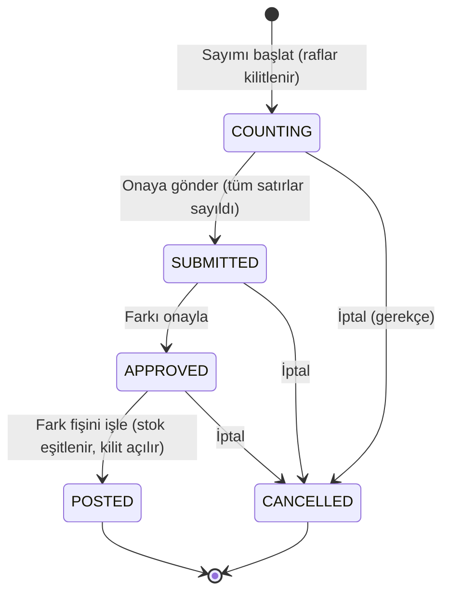

Durum kodları: `COUNTING` Sayılıyor · `SUBMITTED` Onay bekliyor · `APPROVED` Onaylandı · `POSTED` İşlendi · `CANCELLED` İptal.

- **İş Akış Şeması:**

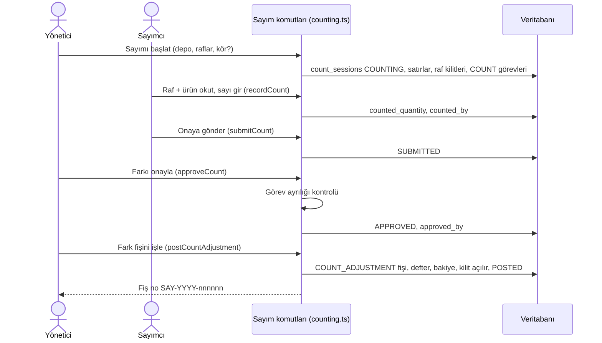

---

## 11. Modül: Üretim (reçete + üretim kaydı)

- **Modül Durumu:** Reçete ve paketsiz üretim [TAMAMLANDI]; **paketli üretim** (QR'lı koli/varil çıktısı) [GELİŞTİRİLİYOR] — arka uç ve tablolar hazır,
  ekran çağırmıyor. BACKLOG B-53 (üretim test düzeneği hataları). Canlı: UNKNOWN.
- **Ekran:** `/t/<firma>/production` — `production/page.tsx`, `production/production-form.tsx`, `production/actions.ts`.
- **Ekranın Amacı ve İşlevi:** Mamulün hangi hammaddelerden ne kadar yapıldığı **reçete** olarak tanımlanır. Üretim kaydında hammaddeler
  kaynak raflardan düşülür, mamul hedef rafa eklenir; hepsi tek işlemdir. Reçete kaydetmek stok değiştirmez; kaydedilen reçete sürümü değiştirilemez,
  değişiklik yeni sürümle yapılır.
- **Arayüz Elemanları ve Aksiyon Tablosu:**

| UI Bileşeni / Buton / Alan | Tipi | Kullanıcı Aksiyonu | Tetiklenen API / Servis | Etkilenen DB Tablosu & Kolonu | İş Kuralı / Validasyon | Mevcut Durum |
| :--- | :--- | :--- | :--- | :--- | :--- | :--- |
| Reçete listesi + "Reçete ara" | Liste + Input | Aranır / dokunulur | `listProductionRecipes`, `getProductionRecipe` (`operations/production.ts`) | Okur: `production_recipes`, `production_recipe_lines` | — | [TAMAMLANDI] |
| "Yeni reçete": Reçete kodu, Sürüm, Reçete adı, Mamul, Üretilecek miktar, Malzeme + Reçete miktarı, "Malzeme ekle/kaldır" | Input + Seçim | Doldurulur | `stockChoicesAction` | — | Kod ≤ 64, ad ≤ 200 karakter; 1–100 malzeme; mamul malzeme olamaz; aynı malzeme iki kez olamaz; miktar > 0 | [TAMAMLANDI] |
| "Reçeteyi kaydet" | Buton | Tıklanır | `createRecipeAction` → `createProductionRecipe` | Yazar: `production_recipes` (`code`, `version`, `output_item_id`, `output_quantity`), `production_recipe_lines`, `audit_logs` (`production_recipe.created`) | `settings.manage`; ürünler aktif olmalı; aynı kod+sürüm ikinci kez kaydedilemez | [TAMAMLANDI] |
| Üretim kaydı: üretilecek miktar, her malzeme için Depo/Konum/Parti/Seri, mamul Konum, "Üretim açıklaması" | Seçim + Input | Doldurulur | `previewProductionAction` (reçete miktarlarını ölçekler, yazmaz) | — | Açıklama zorunlu | [TAMAMLANDI] |
| "Tüketimi ve üretimi kontrol et" → "Onayla ve üret" | Buton (iki adım) | Tıklanır | `produceAction` → `produceFromRecipe` | Yazar: her kaynak depo için `documents` (`STOCK_OUT`), mamul için `documents` (`STOCK_IN`), hepsi `POSTED`; `stock_ledger`, `stock_balances`; `stock_document_links` (`kind='PRODUCTION'`, `recipe_id`); `audit_logs` | `stock.post`; malzeme yetersizse ret (eksi stok yok); bütün fişler tek işlem; reçete belgeye sabitlenir (sonradan reçete değişse eski üretim değişmez) | [TAMAMLANDI] |
| Paketli üretim (girdi paketleri, çıktı koli/varil QR'ları) | — | — | `previewPackageProductionAction`, `preparePackageProductionAction`, `postPackageProductionAction`, `getPackageProductionBatchAction` → `preparePackageProduction`, `postPackageProduction` | Yazacağı: `production_batches`, `production_inputs`, `production_packages`, `handling_units.package_production_id` | Kodda ve testte var; **ekranda düğmesi yok** | [GELİŞTİRİLİYOR] |

- **İş Akış Şeması:**

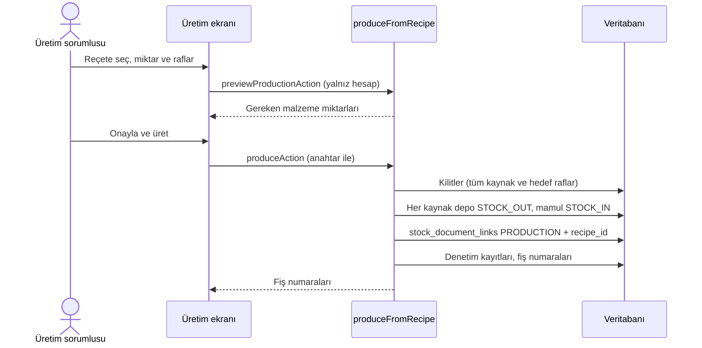

---

## 12. Modül: Müşteri iadesi

- **Modül Durumu:** [GELİŞTİRİLİYOR] — **ekranı yok**; iş kuralı `createCustomerReturn` (`packages/domain/src/operations/returns.ts`) kodda ve testli.
  BACKLOG B-52 kalanı: "iade ekranı (domain `returns.ts` var)".
- **Ekranın Amacı ve İşlevi (hedef):** Sevk edilmiş sipariş satırına bağlı iade almak. Mal kabul alanındaki seçilen rafa **karantina** durumunda girer
  (hemen satılabilir sayılmaz).

| UI Bileşeni / Buton / Alan | Tipi | Kullanıcı Aksiyonu | Tetiklenen API / Servis | Etkilenen DB Tablosu & Kolonu | İş Kuralı / Validasyon | Mevcut Durum |
| :--- | :--- | :--- | :--- | :--- | :--- | :--- |
| (Ekran yok) İade kaydet | — | — | `createCustomerReturn` (sunucu eylemi yok) | Yazacağı: `documents` (`STOCK_IN`, kaynak `SALES_ORDER`, `reason` zorunlu), `stock_ledger` (neden `RETURN`), `stock_balances` (QUARANTINE boyutu), `sales_order_lines.returned_quantity` | `document.approve`; iade ≤ sevk − önceki iade (`RETURN_EXCEEDS_SHIPPED`); gerekçe zorunlu ≤ 500; kapalı sipariş yeniden açılmaz | [GELİŞTİRİLİYOR] |

> `customer_returns` / `customer_return_lines` tabloları (0016) var ama bu komut onları **kullanmıyor** (iade başlığı açılmaz, A-308-5);
> şu an bu tablolara yazan kod yok.

---

## 13. Modül: Kim ne yaptı? (İşlem kaydı) ve dışa aktarma

- **Modül Durumu:** [TAMAMLANDI] — Canlı: UNKNOWN.
- **Ekranlar:** `/t/<firma>/audit` (`audit/page.tsx`, `audit/audit-view.tsx`); CSV indirme `GET /api/t/<firma>/audit/export`
  (`apps/web/app/api/t/[slug]/audit/export/route.ts`); Excel dışa aktarma `GET /api/t/<firma>/export/<tür>` (`apps/web/app/api/t/[slug]/export/[kind]/route.ts`).
- **Ekranın Amacı ve İşlevi:** Firmada kimin ne zaman hangi işlemi yaptığını gösterir (stok, üye, ayar, rol değişiklikleri). Kayıtlar silinemez.
  Yönetici tarih/işlem/arama ile süzer ve CSV indirir.

| UI Bileşeni / Buton / Alan | Tipi | Kullanıcı Aksiyonu | Tetiklenen API / Servis | Etkilenen DB Tablosu & Kolonu | İş Kuralı / Validasyon | Mevcut Durum |
| :--- | :--- | :--- | :--- | :--- | :--- | :--- |
| Hızlı çipler: Tümü / Bugün / Bu hafta / İşlem | Filtre çipi | Seçilir | `listAudit` (`packages/domain/src/audit/audit-query.ts`) | Okur: `audit_logs` (`occurred_at`, `action`, `entity_type`, `actor_user_id`, `reason`) | `audit.view`; sayfa başına 50 (en çok 100); "Daha fazla" ile devam | [TAMAMLANDI] |
| Başlangıç / Bitiş tarihi, İşlem, arama | Tarih + Seçim + Input | "Süz" | `listAudit` | Aynı | Metindeki e-postalar maskelenir | [TAMAMLANDI] |
| "CSV indir" | Bağlantı (dosya) | Tıklanır | `openAuditExport` | Okur: `audit_logs`; yazar: `audit_logs` (`audit.exported`) | Yeniden kimlik doğrulama isteyebilir; dakikada en çok 2; dosyada ip/tarayıcı/istek kimliği/e-posta yok; indirme sürerken eklenen kayıt dosyaya girmez | [TAMAMLANDI] |
| Excel dışa aktarma (Ürünler, Cariler, Depolar, Raflar, Açılış stoku) | Menü (ilgili ekranın Excel düğmesi) | "Dışarı aktar" | `exportData` (`packages/domain/src/onboarding/data-export.ts`) | Okur: ilgili tablolar; yazar: `audit_logs` (`data.exported`) | `data.import` (+ MFA); cari kişisel alanları yalnız `settings.manage` sahibine; depo kapsamı | [TAMAMLANDI] |

---

## 14. Modül: Raporlar

- **Modül Durumu:** [PLANLANDI] — ayrı bir rapor ekranı yok. Bugün "rapor" olarak yalnız Depo panosundaki kartlar var (Modül 1); "Tüm raporlar ·
  STOK, HAREKET, DOLULUK…" kartı **Stok durumu** ekranına (`/stock`) gider. BACKLOG'da ayrı rapor satırı bulunmadı.
- **Bugün elde olan veri kaynakları:** `stock_ledger` (hareket geçmişi), `stock_balances` (anlık stok), `audit_logs` (işlem geçmişi), `count_sessions`
  (sayım farkları), `sales_orders` (sipariş). Rapor ekranı istenirse bunlardan üretilebilir; önce tasarım tuvaline eklenmesi gerekir (I-18).

---

## 15. Modül: Etkin — sesli komut

- **Modül Durumu:** [GELİŞTİRİLİYOR] — konuşmayı yazıya çevirme + niyet + "Anladım" onay kartı kodda (PR #158 main'de). Kalan: sesli yanıt
  (B-129) ve VPS'te ses servisinin kurulumu (B-130). Ses servisi çalışmıyorsa Etkin "şu an kullanılamıyor" der.
- **Ekran:** Alt çubuktaki **Etkin** düğmesi (`apps/web/app/t/[slug]/kabuk/etkin.tsx`); sunucu `etkinAnlaAction` (`apps/web/app/t/[slug]/etkin/actions.ts`);
  niyet ve arama `packages/domain/src/voice/yanit.ts`, `sorgu.ts`; ses → yazı servisi `services/voice/app.py` (faster-whisper "small", sunucuda yerel,
  internete çıkmaz).
- **Ekranın Amacı ve İşlevi:** Elleri dolu çalışan kişi düğmeye basılı tutup konuşur ("C bir rafında ne var"). Okuma soruları (rafta ne var,
  kaç tane var, görevlerim) hemen sonuç açar. Stoğu değiştiren isteklerde (giriş, çıkış, transfer, sayım başlat) "Anladım" kartı çıkar;
  **Onayla** denmeden hiçbir şey kaydedilmez ve kayıt mevcut ekranların komutlarıyla yapılır.

| UI Bileşeni / Buton / Alan | Tipi | Kullanıcı Aksiyonu | Tetiklenen API / Servis | Etkilenen DB Tablosu & Kolonu | İş Kuralı / Validasyon | Mevcut Durum |
| :--- | :--- | :--- | :--- | :--- | :--- | :--- |
| Etkin düğmesi (basılı tut / iki kez dokun: uzun dinleme, "bitti") | Buton (mikrofon) | Konuşulur | `etkinAnlaAction` → iç ses servisi → `answerVoiceCommand` | Okur: `items`, `locations`, `stock_balances`, `warehouse_tasks` | `stock.view`; kişi başına dakikada 20 konuşma; ses en çok 8 sn, diske yazılmaz, kaydedilmez | [GELİŞTİRİLİYOR] |
| Okuma sonucu kartı ("Aç", "Tümünü aç") | Kart | Dokunulur | Yönlendirme | — | Yalnız gösterir | [GELİŞTİRİLİYOR] |
| "Anladım" kartı: İŞLEM / MİKTAR / ÜRÜN / YER, "Onayla" / "Düzelt" / "Vazgeç" | Kart + Buton (ya da sesle "onayla") | Onaylanır | `createManualStockAction`, `transferStockAction`, `startCountAction` (mevcut eylemler) | İlgili modülün tabloları (Modül 6, 10; giriş/çıkış 2B) | O eylemin kendi yetkisi ve kuralları; yeni yazma yolu yok | [GELİŞTİRİLİYOR] |
| Sesli yanıt (TTS) | — | — | Yok | — | B-129 | [PLANLANDI] |

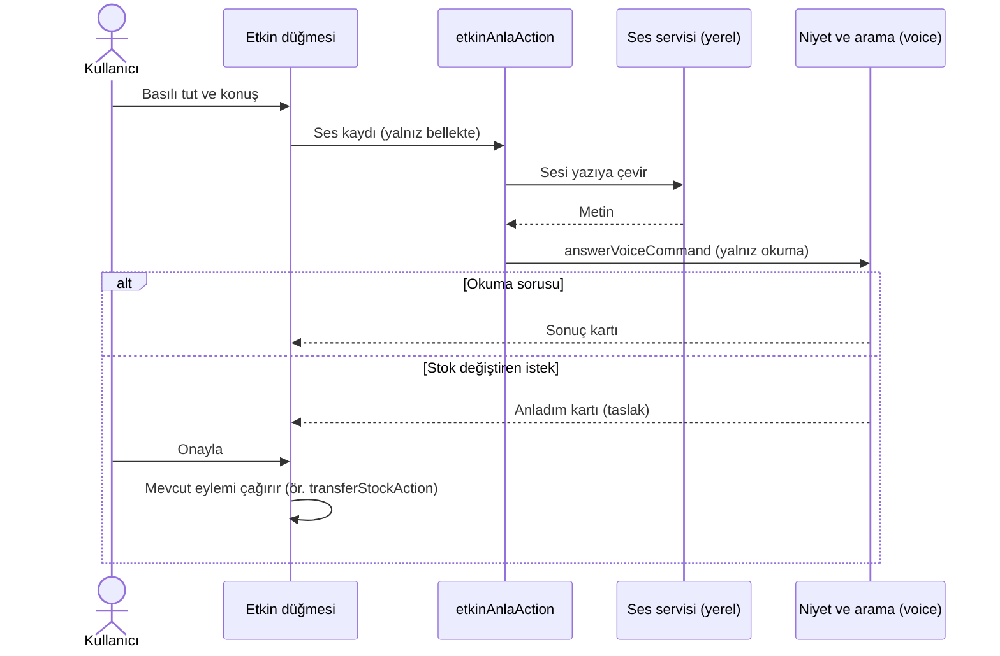

---

## 16. Bu bölümün GAP bulguları (eksik ve bekleyenler)

### 16.1 Arka ucu hazır, ekranı olmayan

| Konu | Hazır olan kod | Eksik |
| :--- | :--- | :--- |
| Görev adım adım ilerleme / kaldığı yerden devam | `tasks/actions.ts` (`recordTaskStepAction`, `beginSaveAction`, `saveTaskAction`, `resetTaskProgressAction`, `nextTaskAction`), tablo `warehouse_task_progress` | Hiçbir ekran çağırmıyor; panodaki "OKUTUYOR" durumu bu tabloya baktığı için şu an pratikte boş kalır. |
| ACİL işaretleme ve hedef saat | `setWorkPriorityAction` → `work_priorities` | Ekranda düğme yok; ACİL rozeti hiç yanmaz. |
| Vardiya saatleri | `updateWorkShiftAction` → `tenant_settings.shift_start/shift_end` | Ayarlar ekranında alan yok; herkes varsayılan 08:00–17:00 görür. |
| Sahadan bildirilen sorunu kapatma | `resolveProblemAction` → `problem_reports.status='RESOLVED'` | Ekranda "Çözüldü" düğmesi yok; açılan sorunlar hep açık kalır. |
| Paketli üretim | `production/actions.ts` paket eylemleri, tablolar `production_batches`, `production_inputs`, `production_packages` | Ekran yok. |
| Müşteri iadesi | `createCustomerReturn` (`operations/returns.ts`) | Sunucu eylemi ve ekran yok (B-52 kalanı). |
| Sipariş düzenleme, satır iptali, yeniden ayırma | `updateDraftOrder`, `cancelOrderLine`, `reallocateOrderLine` | Ekranda yok (yeniden ayırma yalnız toplama eksiğinde otomatik). |
| Yeniden yerleştirme görevi | Görev doğuyor (sipariş iptali / tahsis uzlaştırması) | Görevlerim'de "Başla" yok ("ekran henüz açılmadı"). |
| Paket işlemleri | Tam akış | `PACKAGE_RECEIVING_ENABLED` kapalı (B-50). |

### 16.2 Veritabanında olup ekranda görünmeyen

- `customer_returns`, `customer_return_lines`: tablo var, yazan kod yok.
- `sales_orders` müşteri bağlantısı yalnız serbest metin (`customer_ref`); **Cariler** (`parties`, 0050) ile bağlı değil. Siparişte teslim tarihi ve
  depo kolonu yok.
- `stock_alerts` (min/max uyarıları, 0017): tablo var ama web, iş kuralı ve worker kodunda **onu okuyan ya da yazan yer yok**. Pano kartları
  uyarıyı doğrudan `item_stock_policies` + `stock_balances`'tan hesaplıyor. Min/max değerini (`item_stock_policies`) giren ekran 2B'de ayrıca kontrol edilmeli.
- `tenant_settings.count_abandon_hours` (terk edilmiş sayım süresi): worker kullanıyor; kullanıcıya gösterildiği bu belgede doğrulanmadı.

### 16.3 Eksik kural / kısıt

- Sevkiyat, toplama ve sayım yalnız **lot/seri takibi olmayan** ürünlerde çalışır; takipli ürün sevk formunda reddedilir.
- Toplamada "rafta ürün hiç yok" barkodsuz bildirilemez; eksikten doğan oturumsuz sayım görevi sahada açılmaz (B-96).
- Paketsiz depolar arası transferde iki fiş arasında `stock_document_links` bağ kaydı yazılmıyor (paketli transfer ve üretimde yazılıyor);
  raporlamada iki fişin eşleştirilmesi için gerekirse eklenmeli (karar gerektirir).
- İade üst sınırı (`sevk − iade`) DB kısıtı değil, komut kuralıdır (kilit altında denetleniyor; bilinçli tasarım A-150).

### 16.4 Transaction (hep-ya-da-hiç) gerektiren noktalar — mevcut durum

- Transfer (iki fiş), üretim (çok fiş + bağ), sevk (fiş + rezervasyon + sipariş satırı + sipariş kapanışı), sayım fişi (defter + kilit açma +
  görevler) **tek işlemde** yapılıyor.
- Bilinçli istisna: toplamada "eksik" sonrası **yeniden ayırma ayrı işlemdir**; arada hata olursa satır ayrımsız açık kalır ve ekranda görünür
  (`picking.ts` açıklaması). Yönetici "Stok ayır" ile yeniden deneyebilir.

### 16.5 Güvenlik

- Bu bölümün ekranları için ayrıntı yazılmaz (depo herkese açık). İlgili genel başlıklar BACKLOG'daki 🔒 satırlarındadır: B-17, B-18, B-20, B-21.

### 16.6 Önerilen sıra (bu bölüm için)

1. B-50: paket akışını aç (ayar + normal girişe bağlama) — kod hazır, en hızlı kazanç.
2. Sorun kapatma + ACİL + vardiya ayarı ekranları — arka uç hazır, küçük iş; ana ekrandaki rozetler gerçekten çalışır hâle gelir.
3. B-96: toplamada "ürün yok" ve eksikten doğan sayımı sahadan başlatma.
4. İade ekranı (B-52 kalanı) — önce tasarım tuvaline eklenmeli.
5. Görev adım adım ilerleme ekranı ve Yeniden yerleştirme saha ekranı.
6. Sipariş ↔ Cari bağlantısı ve sipariş düzenleme (kullanıcı kararı gerekir: şema değişikliği).
7. Rapor modülü (önce tuval + kullanıcı onayı).
8. Etkin sesli yanıt (B-129) ve VPS ses servisi kurulumu (B-130, kullanıcı root adımı).
