# 2D. Yönetim Paneli, Satış Sitesi, Ayarlar ve Entegrasyon

> Bu bölüm üç adresin "çevre" modüllerini anlatır: **etkinyazilim.com** (satış sitesi), **yonet.etkinyazilim.com** (bizim, yani Etkin
> ekibinin müşteri yönetim paneli) ve **wms.etkinyazilim.com** içindeki firma ayarları, ERP bağlantısı, destek talebi, kurulum
> rehberi. En sonda arka planda kendi kendine çalışan işler (worker) listelenir.
>
> Kaynak: main 008070a · 1 Kasım 2026 dalındaki kod ve migration dosyaları (0038–0070; ilk sürüm 23 Ekim, main 36f3a13; 28 Ekim
> sürümü main 8e2710d; T-1111…T-1131 29 Ekim'de, T-1133…T-1142 1 Kasım'da işlendi). Tahmin yoktur;
> her satırın yanında dosya yolu verilmiştir. **Canlı (VPS) durumu ayrıdır:** "Canlı notu" satırları `docs/STATE.md` ve `docs/changes/`
> kayıtlarından alınmıştır; kodda olması canlıda olduğu anlamına gelmez.
>
> **1 Kasım canlı tabanı (STATE):** canlı main `008070a` (PR #279, deploy-vps ile yedek → migration → kuyruk → derin sağlık); şema
> 0070. T-1133…T-1142 ve migration 0066–0070 STATE'e göre canlıdadır. Gerçek Paraşüt hesabıyla doğrulanmamış davranışlar (ortak uygulama
> kaydı, webhook imzası, PUT alanları, `updated_at`) ayrıca UNKNOWN yazılır.

**Etiketler:** [TAMAMLANDI] = kodda ekrandan veritabanına kadar bağlı · [GELİŞTİRİLİYOR] = bir kısmı var, bir kısmı eksik ya da
yayın bekliyor · [PLANLANDI] = yalnız yapılacaklar listesinde (BACKLOG) veya tasarımda.

**Önemli ortak kural (panelin tamamı için):** Panel tabloları (`wms_platform` şeması) müşteri verisinden ayrıdır. Uygulamanın bu
tablolara doğrudan okuma/yazma izni yoktur; her işlem veritabanındaki özel "kapı" işlevlerinden (`wms_probe.platform_*`) geçer. Bu kapı
her seferinde "bu kişi operatör listesinde mi?" diye bakar (`wms_platform.operators`). Panele girişte ayrıca iki adımlı doğrulama (MFA)
zorunludur; para, paket, müşteri durumu gibi yazma işlemlerinde "az önce şifreni tekrar gir" (yakın zamanda doğrulama) istenir.
Kapı kodu: `apps/web/app/panel/gate.ts`. Operatör değilseniz panel "sayfa yok" (404) gösterir — panelin varlığı bile belli edilmez.

---

## İçindekiler
1. [Satış sitesi ve demo talebi (etkinyazilim.com)](#modül-etkinyazilimcom--satış-sitesi-ve-demo-formu)
2. [Deneme aktivasyonu (bağlantıyla çalışma alanı açma)](#modül-wmsetkinyazilimcom--deneme-aktivasyonu-activatetoken)
3. [Panel · Özet](#modül-yonetetkinyazilimcom--özet-ana-sayfa)
4. [Panel · Müşteriler](#modül-yonetetkinyazilimcom--müşteriler)
5. [Panel · Destek gelen kutusu](#modül-yonetetkinyazilimcom--destek-gelen-kutusu)
6. [Panel · Paketler](#modül-yonetetkinyazilimcom--paketler)
7. [Panel · Ödemeler](#modül-yonetetkinyazilimcom--ödemeler)
8. [Panel · Demo talepleri](#modül-yonetetkinyazilimcom--demo-talepleri)
9. [Panel · Satış sayfası içeriği](#modül-yonetetkinyazilimcom--satış-sayfası)
10. [Panel · İşlem kaydı](#modül-yonetetkinyazilimcom--işlem-kaydı)
11. [Ayarlar (Firma · Kullanıcılar ve yetki · Görünüm)](#modül-wmsetkinyazilimcom--ayarlar-sekmeli)
12. [Ayarlar › Entegrasyonlar (Excel toplu işlem, eski adı Bağlantılar)](#modül-wmsetkinyazilimcom--ayarlar--entegrasyonlar-bağlantılar)
13. [ERP entegrasyonu (Paraşüt)](#modül-wmsetkinyazilimcom--erp-entegrasyonu-paraşüt)
14. [Destek talebi (müşteri tarafı)](#modül-wmsetkinyazilimcom--destek-talebi-müşteri-tarafı)
15. [İlk kurulum yolculuğu ve örnek veri](#modül-wmsetkinyazilimcom--ilk-kurulum-yolculuğu-ve-örnek-veri)
16. [Yardım sayfası ve elle çalışma alanı açma](#modül-wmsetkinyazilimcom--yardım-sayfası-ve-elle-çalışma-alanı-açma)
17. [Arka plan işleri (worker)](#arka-plan-işleri-worker)
18. [Bu bölümün eksik/bekleyen işleri (Gap)](#bu-bölümün-eksik-ve-bekleyen-işleri-gap)

---

## Modül: etkinyazilim.com / Satış sitesi ve demo formu

- **Modül Durumu:** [TAMAMLANDI] (site + panelden yönetilen içerik + "kalıcı kayıt + sahiplik bağlantısı" demo formu, T-1025)
- **Canlı notu:** Site canlıda. T-1025 (yeni demo formu, migration 0057) PR #172/#173 ile `main`'de; STATE'e göre canlı veritabanı
  defteri 0062/62 olduğundan 0057 uygulanmıştır ve doğrulanan yayın `6b2f81d` bu kodu içerir. Gerçek ziyaretçiyle uçtan uca deneme
  STATE'te ayrıca yazılı değil (UNKNOWN). 23 Ekim'den beri `marketing/` ve `packages/domain/src/platform/` kodu değişmedi.
- **Not (T-1032):** müşteri sıfırlama betiği artık 0057 tekilleştirme tablolarını da temizler; aynı e-postayla gelen yeni talebin panelde
  hiç görünmemesi (sessiz tekilleştirme) tasarım gereğidir, "tekrar talep etti" bilgisi kullanıcı kararını bekliyor (B-157).
- **Ekranın Amacı:** Ürünü tanıtır, fiyat kartlarını gösterir, ilgilenen firmanın "Demo istiyorum" formunu toplar.
- **Teknik yapı (sade):** Ayrı, küçük bir Node sunucusu (`marketing/server.mjs`). Sayfa tasarım dosyasından üretilir
  (`marketing/src/landing.dc.html` → `marketing/build.mjs` → `marketing/public/*`). Başlık/alt metin/fiyat kartları panelden yayınlanan
  içerikten gelir; site bu içeriği iç ağdan `GET /api/public/site` ile 30 sn önbellekle okur. Dışarıdan `/api/public/*` adreslerine
  erişim kapalıdır (yalnız iç ağ).

| UI Bileşeni / Buton / Alan | Tipi | Kullanıcı Aksiyonu | Tetiklenen API / Servis | Etkilenen DB Tablosu & Kolonu | İş Kuralı / Validasyon | Mevcut Durum |
| :--- | :--- | :--- | :--- | :--- | :--- | :--- |
| Ana başlık, vurgulu satır, alt metin | Metin | Sayfa açılır | `marketing/server.mjs` → iç `GET /api/public/site` (`apps/web/app/api/public/site/route.ts`) → `getPublicSite` (`packages/domain/src/platform/site-content.ts`) → `wms_probe.platform_site_public` | `wms_platform.site_content` (yalnız yayınlanmış sürüm: `title1`, `title2`, `subtitle`) | İçerik yoksa/uç cevap vermezse tasarımdaki sabit metin kalır | [TAMAMLANDI] |
| Fiyat kartları (Kiralama bölümü) | Kart listesi | Görüntülenir | Aynı uç | `site_content.plan_ids` + `wms_platform.plans`/`plan_versions` (`price_monthly`, sınırlar, özellikler) | Yalnız **yayında** olan paketler; içerik yoksa fiyat bölümü hiç görünmez | [TAMAMLANDI] |
| Önizleme bağlantısı `/?onizleme=…` | Bağlantı | Operatör panelden ürettiği bağlantıyı açar | `x-site-preview` başlığıyla aynı uç | `wms_platform.site_previews` (`token_hash`, `expires_at`) | 30 dk geçerli; arama motoruna kapalı; süresi geçmişse yayındaki içerik gösterilir | [TAMAMLANDI] |
| Demo formu: Ad, Firma, E-posta, Sektör (ikonlu seçim), Mesaj, iletişim onayı | Form | "Gönder" | `POST /api/demo` (`marketing/server.mjs`) → iç köprü `POST /api/public/demo` (`apps/web/app/api/public/demo/route.ts`) → `submitDemo` (`packages/domain/src/platform/demo-submit.ts`) → `wms_probe.demo_submit` | `wms_platform.demo_requests` (yeni satır, `status=PENDING`), `wms_platform.demo_email_reservations` (e-posta tekilliği), `wms_platform.demo_request_keys`, `wms_platform.demo_status_deliveries` (sahiplik postası) | Zorunlu alanlar; gövde ≤ 8 KB; IP başına saatte 5 deneme; aynı e-posta ikinci kez kayıt açmaz; yanıt herkese aynıdır (`{ok:true}`) — "bu adres zaten var" bilgisi sızdırılmaz; veritabanı yoksa 503 ve aynı anahtarla tekrar denenir | [TAMAMLANDI] (T-1025) |
| Başarı kutusu (yeşil onay) | Bilgi | Gönderim başarılı | — | — | Talep numarası/durumu gösterilmez | [TAMAMLANDI] |
| "Hemen konuşalım" (WhatsApp) | Bağlantı | — | — | — | Herkese açık WhatsApp numarası yok | [PLANLANDI] (B-102) |
| Sahiplik e-postasındaki bağlantı → `/demo-status` | Sayfa + düğme | E-postadaki bağlantıya tıklar, sayfadaki düğmeye basar | `POST /api/demo-status` → `consumeDemoStatus` → `wms_probe.demo_status_consume` | `demo_status_deliveries.consumed_at`; onaylıysa `demo_requests.activation_token_hash`, `activation_expires_at` (+15 dk), `owner_link_issued_at`; `security_events` (`platform.demo_owner.verified`) | Bağlantı 15 dk, tek kullanımlık; sonuç: `pending` (onay bekliyor) / `setup` (kurulum bağlantısı hazır) / `in_progress` / `ready` (zaten açılmış → giriş) / `invalid` | [TAMAMLANDI] (T-1025) |
| Yöneticiye "yeni talep" e-postası | Arka plan | Yeni kayıtta | `marketing/notify.mjs` (Resend) | — | Saatte en çok 20; ayar yoksa gönderilmez; en iyi çaba | [TAMAMLANDI] |
| Gizlilik metni | Katman | "Gizlilik" bağlantısı | `marketing/src/form-ui.js` | — | Form verisi kaybolmadan aynı sayfada açılır | [TAMAMLANDI] |

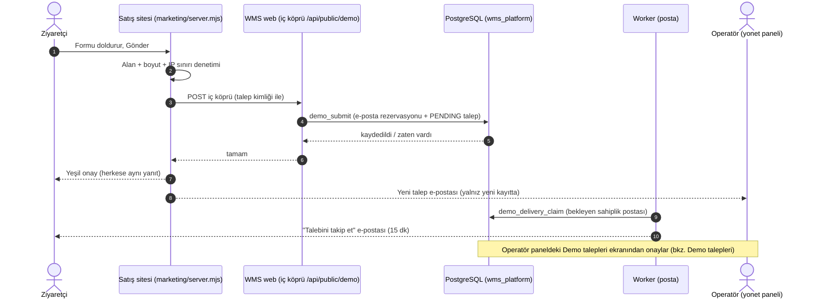

---

## Modül: wms.etkinyazilim.com / Deneme aktivasyonu (`/activate/[token]`)

- **Modül Durumu:** [TAMAMLANDI]
- **Canlı notu:** 0039 16 Ekim'de canlıya çıktı (STATE).
- **Ekranın Amacı:** Onaylanan demo talebinin sahibi, kendisine gelen tek kullanımlık bağlantıyla kendi çalışma alanını (firma
  hesabını) açar: firma adı, adres adı (ör. `motive`), örnek veri isteyip istemediği ve parola. Sonunda giriş + zorunlu iki adımlı
  doğrulama (MFA) kurulumu gelir. Deneme süresi 3 aydır.
- **Kod:** `apps/web/app/activate/[token]/{page,flow,actions}.tsx|ts`, `packages/domain/src/platform/activation.ts`; iki adımlı doğrulama
  sihirbazı `apps/web/app/totp-sihirbaz.tsx` (T-1034), mağaza yönlendirmesi `apps/web/app/help/indir/[app]/route.ts` (T-1043).

| UI Bileşeni / Buton / Alan | Tipi | Kullanıcı Aksiyonu | Tetiklenen API / Servis | Etkilenen DB Tablosu & Kolonu | İş Kuralı / Validasyon | Mevcut Durum |
| :--- | :--- | :--- | :--- | :--- | :--- | :--- |
| Bağlantı açılışı (ad/firma önizlemesi) | Sayfa | Bağlantıyı açar | `previewActivation` → `wms_probe.platform_activation_preview` | `demo_requests` (okuma: `activation_token_hash`, `activation_expires_at`) | Belirteç DB'de yalnız özetle (SHA-256) durur; süresi geçmiş/kullanılmış bağlantı "geçersiz" | [TAMAMLANDI] |
| Çalışma alanı adı | Input | Yazar | `checkWorkspaceNameAction` → `checkWorkspaceName` → `wms_probe.platform_workspace_name_taken` | `tenants.slug` (okuma) | Biçim kuralı (`isAllowedWorkspaceName`), ayrılmış adlar reddedilir; anlık "uygun / dolu" | [TAMAMLANDI] |
| Örnek veri: "Örnek verilerle / Boş" | Seçim | Seçer | (aktivasyonla birlikte) | `demo_requests.activation_sample` | "Örnek verilerle" seçilirse ayrı "Örnek depo" + örnek ürünler `is_sample=true` yazılır, stok hareketi yazılmaz | [TAMAMLANDI] |
| Parola (+ tekrar) | Input | Yazar | — | — | Parola politikası (`packages/auth`) | [TAMAMLANDI] |
| "Çalışma alanımı aç" | Buton | Tıklar | `activateTrialAction` → `activateTrial`: (1) `platform_activation_claim` (10 dk talep), (2) hesap açılır (`wms_auth`), (3) tek transaction'da tenant + ayarlar + `platform_activation_consume` | `demo_requests.activation_claim_id/…_expires_at`, `activated_at`; `tenants` (yeni satır), `tenant_memberships` (sahip), `tenant_settings`, `wms_platform.subscriptions` (`plan=TRIAL`, `trial_ends_at`=+3 ay, `demo_request_id`); varsayılan paket atanır (`platform_assign_default_plan`); `security_events` | Bağlantı tek kullanımlık; 3. adım başarısızsa talep serbest bırakılır, aynı bağlantıyla tekrar denenince aynı hesap kullanılır; e-posta/ad formdan değil talepten okunur | [TAMAMLANDI] |
| İki adımlı doğrulama kurulumu (aktivasyonun son adımı ve `/mfa` ortak) | 4 adımlı sihirbaz | Uygulamayı kur → hesabı ekle (telefonda tek dokunuş, bilgisayarda QR, anahtarı KOPYALA) → 6 haneli kod (kendiliğinden doğrular) → yedek kodlar (İNDİR / KOPYALA / YAZDIR, "Kaydettim" zorunlu) | Mevcut MFA sunucu eylemleri (sözleşme değişmedi) | (kimlik tabloları) | Bilgisayardaki QR `/help/indir/<uygulama>` adresine gider; telefon kamerasıyla okutulunca iPhone'da App Store'a, Android'de Google Play'e yönlenir (sabit tablo, açık yönlendirme yok, oturum gerekmez) | [TAMAMLANDI] (T-1034, T-1043) |
| Hoş geldin e-postası | Arka plan | Aktivasyon sonrası | Kuyruk işi `trial.welcome` (`apps/worker/src/jobs/trial-activation.ts`) | (okuma) | E-posta sır taşımaz | [TAMAMLANDI] |

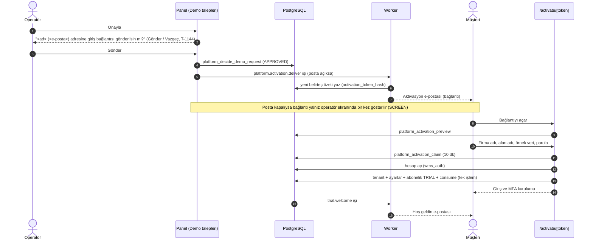

```mermaid
stateDiagram-v2
    [*] --> PENDING: Satış sitesinden talep
    PENDING --> APPROVED: Operatör onaylar
    PENDING --> REJECTED: Operatör reddeder ("Talep reddedilsin mi?")
    REJECTED --> PENDING: Geri aç (T-1144, 0071; karar alanları temizlenir)
    APPROVED --> BaglantiGonderildi: activation_token_hash yazılır (EMAIL veya SCREEN)
    BaglantiGonderildi --> BaglantiGonderildi: Yeniden gönder (REISSUE, eski bağlantı geçersiz)
    BaglantiGonderildi --> Aktive: activated_at dolar (tenant açıldı)
    REJECTED --> [*]
    Aktive --> [*]
```

*Not:* Veritabanındaki `status` yalnız `PENDING / APPROVED / REJECTED` değerlerini alır (`demo_requests_status_chk`, 0038).
"Bağlantı gönderildi" ve "Aktive" ayrı durum kodu değil, `activation_*` ve `activated_at` kolonlarının dolu olmasıdır.

---

## Modül: yonet.etkinyazilim.com / Özet (ana sayfa)

- **Modül Durumu:** [TAMAMLANDI] · **Canlı notu:** 17 Ekim'de canlı (T-408). Açık panelin kendiliğinden tazelenmesi (T-1027, B-148)
  doğrulanan `6b2f81d` yayınının içindedir. Panel kodu (`apps/web/app/panel/`) 23 Ekim'den beri değişmedi.
- **Ekranın Amacı:** Operatörün sabah bakacağı tek ekran: kaç müşteri var, kimin denemesi bitiyor, kim paket sınırına yaklaştı, geciken
  ödeme, bekleyen demo talebi, açık destek talebi.
- **Kod:** `apps/web/app/panel/page.tsx`, `ozet-view.tsx`, `ozet-rules.ts`, menü `nav.ts`.

| UI Bileşeni / Buton / Alan | Tipi | Kullanıcı Aksiyonu | Tetiklenen API / Servis | Etkilenen DB Tablosu & Kolonu | İş Kuralı / Validasyon | Mevcut Durum |
| :--- | :--- | :--- | :--- | :--- | :--- | :--- |
| Sol menü sayaçları (Demo talepleri, Ödemeler, Destek) | Rozet | Görüntülenir | `panelNav` → `listDemoRequests`, `listCharges`, `countOpenSupportTickets` | `demo_requests.status=PENDING`, `charges` (geciken), `support_tickets.status=OPEN` | Sayılar gerçek veriden | [TAMAMLANDI] |
| "Sınıra yaklaşıyor" uyarıları | Kart | Görüntülenir | `listCustomers` + `nearLimit` (`ozet-rules.ts`) | `platform_list_customers` sayım kolonları | Sınır > 0 ve kalan ≤ sınırın %20'si; 0 = sınırsız | [TAMAMLANDI] |
| Otomatik yenileme | Arka plan | Sayfa açıkken | `auto-refresh.ts` | — | Açık ekran belli aralıkla tazelenir | [TAMAMLANDI] |
| Çıkış, tema | Buton | Tıklar | `shell.tsx` | — | — | [TAMAMLANDI] |

---

## Modül: yonet.etkinyazilim.com / Müşteriler

- **Modül Durumu:** [TAMAMLANDI] · **Canlı notu:** 17 Ekim'de canlı (T-403, 0042).
- **Ekranın Amacı:** Bütün müşteri firmaların listesi: durum (deneme / aktif / askıda / gecikmede), paket, kullanıcı-depo-ürün sayıları,
  son giriş, bu ayki hareket sayısı. **Müşterinin içeriği (ürün adı, stok miktarı, kişi) bu ekrana hiç gelmez — yalnız sayılar.**
- **Kod:** `apps/web/app/panel/musteriler/{page,view,actions}.tsx|ts`, `packages/domain/src/platform/customers.ts`.

| UI Bileşeni / Buton / Alan | Tipi | Kullanıcı Aksiyonu | Tetiklenen API / Servis | Etkilenen DB Tablosu & Kolonu | İş Kuralı / Validasyon | Mevcut Durum |
| :--- | :--- | :--- | :--- | :--- | :--- | :--- |
| Müşteri listesi | Tablo | Görüntülenir | `listCustomers` → `wms_probe.platform_list_customers` | `tenants` (`name`, `slug`, `status`), `subscriptions` (`plan`, `trial_ends_at`, `plan_id`), `warehouses`/`items` (yalnız sayım, `is_sample` hariç), `tenant_memberships`, `security_events` (son giriş), `charges` (gecikme) | Demo firması listede ayrı tutulur | [TAMAMLANDI] |
| Müşteri satırı → ayrıntı | Satır | Tıklar (`?m=<id>`) | `getCustomerActivity` → `platform_customer_activity` | `stock_ledger` (yalnız bu ayki **sayı**) | — | [TAMAMLANDI] |
| "Askıya al" + gerekçe | Buton + Input | Tıklar | `customerAction` (intent `SUSPEND`) → `setCustomerSuspended` → `platform_set_customer_status` | `tenants.status` ACTIVE → SUSPENDED; `security_events` (`platform.*`) | Gerekçe zorunlu; yakın zamanda doğrulama; yalnız ACTIVE ↔ SUSPENDED (demo ve kapanan firma hariç). **Veri silinmez**; askıdaki firmada kullanıcı işlemleri `TENANT_SUSPENDED` hatası alır | [TAMAMLANDI] |
| "Devam ettir" | Buton | Tıklar | intent `RESUME` → aynı işlev | `tenants.status` SUSPENDED → ACTIVE | Yakın zamanda doğrulama | [TAMAMLANDI] |
| "Denemeyi 30 gün uzat" | Buton | Tıklar | intent `EXTEND` → `extendCustomerTrial` → `platform_extend_trial` | `subscriptions.trial_ends_at` (+30 gün) | Yalnız deneme (TRIAL) aboneliğinde | [TAMAMLANDI] |
| "Paketi değiştir" | Select + Buton | Seçer, Kaydet | intent `PLAN` → `changeCustomerPlan` → `platform_change_customer_plan` | `subscriptions.plan_id`, `plan_version`, `plan` (ACTIVE) | Paketin **o anki sürümüne** bağlanır; sonradan pakette fiyat değişse müşteri eski sürümde kalır | [TAMAMLANDI] |
| Müşteriyi kalıcı silme | — | — | Panelde yok; yalnız operatörün elle çalıştırdığı sıfırlama betiği var (`deploy/vps/ops/reset-tenants.sql`, T-1005) | — | Kalıcı silmeden önce kullanıcıya haber verilir (proje kuralı) | [PLANLANDI] (panel düğmesi yok) |

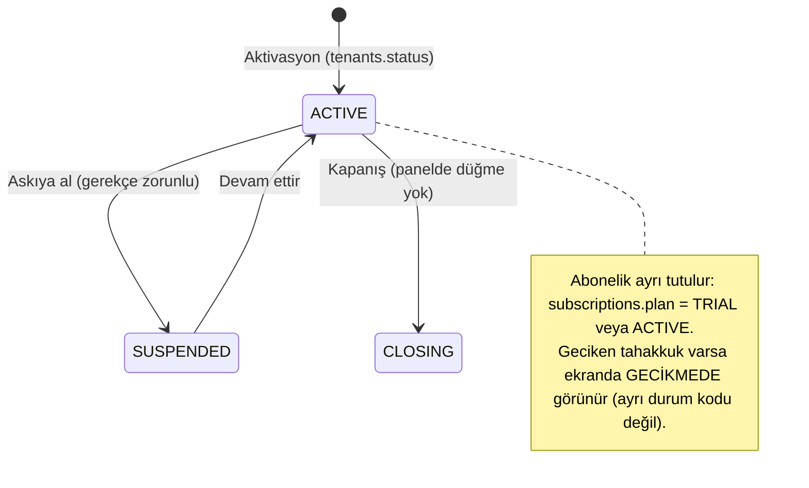

---

## Modül: yonet.etkinyazilim.com / Destek gelen kutusu

- **Modül Durumu:** [TAMAMLANDI] (metin yazışma) · Ekran görüntüsü eki ve "erişim iste" [PLANLANDI] (B-88, B-89)
- **Canlı notu:** 0054, `int/21ekim-ekranlar` (PR #134) ile `main`'e girdi; STATE'e göre canlı migration defteri 0062/62 olduğundan
  0054 uygulanmıştır.
- **Ekranın Amacı:** Müşterilerin uygulama içindeki "Destek" ikonundan yazdığı talepleri görmek, yanıtlamak, kapatmak.
- **Kod:** `apps/web/app/panel/support/{page,view,actions,format}.ts|tsx`, `packages/domain/src/platform/support.ts`.

| UI Bileşeni / Buton / Alan | Tipi | Kullanıcı Aksiyonu | Tetiklenen API / Servis | Etkilenen DB Tablosu & Kolonu | İş Kuralı / Validasyon | Mevcut Durum |
| :--- | :--- | :--- | :--- | :--- | :--- | :--- |
| Talep listesi + durum/firma süzgeci | Liste | Görüntüler, süzer | `listSupportInbox` → `wms_probe.platform_support_list` | `support_tickets` (`number`, `subject_kind`, `status`, `created_at`), `support_ticket_messages` (sayı, son yazan) | En çok 500 satır | [TAMAMLANDI] |
| Talep ayrıntısı | Panel | Satıra tıklar (`?t=<id>`) | `getSupportTicket`, `platform_support_messages` | `support_tickets.body`, `context` (ekran/sürüm bilgisi), mesajlar | Metin loga yazılmaz | [TAMAMLANDI] |
| "Yanıtla" | Textarea + Buton | Yazar, Gönder | `supportReplyAction` → `replySupportTicket` → `platform_support_reply` | `support_ticket_messages` (yeni, `author_kind=OPERATOR`); `support_tickets.status` → ANSWERED, `operator_replied_at`; `security_events` (`platform.support.*`) | Kapalı talebe yazılamaz | [TAMAMLANDI] |
| "Kapat" / "Yeniden aç" | Buton | Tıklar | `supportStatusAction` → `setSupportTicketStatus` → `platform_support_set_status` | `support_tickets.status` (OPEN/CLOSED) | Yalnız operatör kapatır | [TAMAMLANDI] |
| "Erişim iste" | Buton | — | — | — | Müşteri onaylı süreli destek erişimi akışı yok; düğme pasif | [PLANLANDI] (B-89) |

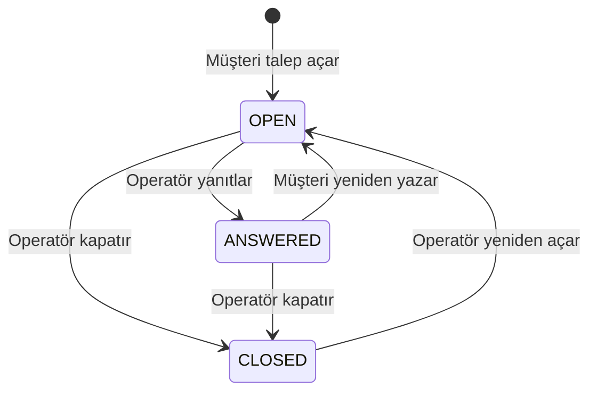

---

## Modül: yonet.etkinyazilim.com / Paketler

- **Modül Durumu:** [TAMAMLANDI] · **Canlı notu:** 17 Ekim'de canlı (T-404, 0041).
- **Ekranın Amacı:** Satılacak paketleri (ör. Başlangıç, Pro) tanımlamak: aylık fiyat, sınırlar (yönetici, saha kullanıcısı, depo, ürün
  sayısı; 0 = sınırsız) ve özellik anahtarları (QR, Sevkiyat, Üretim, API).
- **Kod:** `apps/web/app/panel/paketler/*`, `packages/domain/src/platform/plans.ts`.

| UI Bileşeni / Buton / Alan | Tipi | Kullanıcı Aksiyonu | Tetiklenen API / Servis | Etkilenen DB Tablosu & Kolonu | İş Kuralı / Validasyon | Mevcut Durum |
| :--- | :--- | :--- | :--- | :--- | :--- | :--- |
| Paket listesi (+ kaç müşteride kullanıldığı) | Kart | Görüntülenir | `listPlans` → `platform_list_plans` | `plans`, `plan_versions`, `subscriptions` (sayım) | — | [TAMAMLANDI] |
| Ad, Aylık fiyat | Input | Yazar | — | `plans.name`, `plan_versions.price_monthly` | Ad 1–60 karakter; fiyat 0–1.000.000; yalnız rakam (−5 veya 1.5 sessizce düzeltilmez, reddedilir) | [TAMAMLANDI] |
| Sınırlar: yönetici / saha / depo / ürün | Input (sayı) | Yazar | — | `plan_versions.max_admins/max_field/max_warehouses/max_items` | 0 = sınırsız | [TAMAMLANDI] |
| Özellikler: QR, Sevkiyat, Üretim, API | Anahtar | Açar/kapar | — | `plan_versions.feat_qr/feat_ship/feat_prod/feat_api` | — | [TAMAMLANDI] |
| "Önerilen" | Anahtar | İşaretler | — | `plans.recommended` | Yalnız yayındaki paket önerilen olabilir | [TAMAMLANDI] |
| "Taslak kaydet" / "Yayınla" | Buton | Tıklar | `savePlanAction` (intent `DRAFT`/`PUBLISH`) → `savePlan` → `platform_save_plan` | `plans.published`, `current_version`; değişiklikte **yeni** `plan_versions` satırı | Fiyat/sınır/özellik değişince yeni sürüm açılır; mevcut müşteriler eski sürümde kalır; yakın zamanda doğrulama | [TAMAMLANDI] |
| Sınırın uygulanması | (Arka) | Müşteri yeni depo/ürün/kullanıcı ekler | Veritabanı tetikleyicisi (0041) | `warehouses`, `items`, `tenant_memberships` INSERT öncesi sayım | Aşımda `PLAN_LIMIT` hatası; paketsiz firma sınırsız | [TAMAMLANDI] |
| Özellik anahtarlarının (QR/Sevkiyat/Üretim/API) uygulamada ekranı kapatması | — | — | — | — | Kodda bu bayrakların ekran/komut kapattığına dair bağlantı yok (T-1028 incelemesi) | [PLANLANDI] (B-153) |

---

## Modül: yonet.etkinyazilim.com / Ödemeler

- **Modül Durumu:** [TAMAMLANDI] (elle tahakkuk + elle "ödendi") · Online tahsilat [PLANLANDI] (B-40 iyzico) · e-Fatura/e-Arşiv
  [PLANLANDI] (B-45)
- **Canlı notu:** 17 Ekim'de canlı (T-406, 0043).
- **Ekranın Amacı:** Her ay müşteri başına borç (tahakkuk) açmak ve havale/kart/nakit ile gelen ödemeyi elle "ödendi" işaretlemek.
  **Şu an sistemde kart çekimi yapan bir ödeme sağlayıcısı yoktur.**
- **Kod:** `apps/web/app/panel/odemeler/*`, `packages/domain/src/platform/charges.ts`.

| UI Bileşeni / Buton / Alan | Tipi | Kullanıcı Aksiyonu | Tetiklenen API / Servis | Etkilenen DB Tablosu & Kolonu | İş Kuralı / Validasyon | Mevcut Durum |
| :--- | :--- | :--- | :--- | :--- | :--- | :--- |
| Tahakkuk listesi | Tablo | Görüntülenir | `listCharges` → `platform_list_charges` | `charges` (`period`, `amount`, `due_on`, `paid_on`, `paid_method`, `invoice_no`), abonelik no `ABN-xxxx` | Durum hesaplanır: ödendiyse PAID, vadesi geçtiyse OVERDUE, değilse PENDING | [TAMAMLANDI] |
| "Dönem tahakkuku" | Buton | Tıklar | `paymentAction` (intent `ACCRUE`) → `accrueCharges` → `platform_accrue_charges` | `charges` (bu ay için her ücretli abonelikte yeni satır) | Dönem ayın 1'i; aynı ay ikinci kez açılmaz; tutar > 0; yakın zamanda doğrulama | [TAMAMLANDI] |
| "Ödendi" + tarih + yöntem + not | Form | Doldurur, Kaydet | intent `PAID` → `markChargePaid` → `platform_mark_charge_paid` | `charges.paid_on`, `paid_method` (HAVALE/KART/NAKIT), `paid_note`, `paid_by`, `paid_recorded_at` | Tarih gg.aa.yyyy; ödenmiş kayıt tetikleyiciyle değişmez | [TAMAMLANDI] |
| "Hatırlat" (müşteriye ödeme hatırlatması) | — | — | — | — | Yok | [PLANLANDI] (B-40) |
| Otomatik aylık tahakkuk | — | — | — | — | Elle düğmeyle yapılıyor | [PLANLANDI] (B-40) |

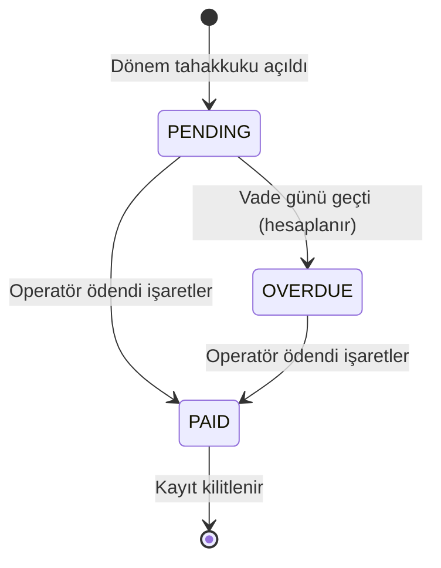

---

## Modül: yonet.etkinyazilim.com / Demo talepleri

- **Modül Durumu:** [TAMAMLANDI] · **Canlı notu:** 16 Ekim'de canlı (0038–0040).
- **Ekranın Amacı:** Satış sitesinden gelen talepleri görmek, onaylamak/reddetmek; onaylananlara aktivasyon bağlantısı göndermek.
- **Kod:** `apps/web/app/panel/talepler/*`, `packages/domain/src/platform/demo-requests.ts`.

| UI Bileşeni / Buton / Alan | Tipi | Kullanıcı Aksiyonu | Tetiklenen API / Servis | Etkilenen DB Tablosu & Kolonu | İş Kuralı / Validasyon | Mevcut Durum |
| :--- | :--- | :--- | :--- | :--- | :--- | :--- |
| Talep listesi (ad, firma, e-posta, sektör, mesaj, durum, bağlantı durumu) | Tablo | Görüntülenir | `listDemoRequests` → `platform_list_demo_requests` | `demo_requests` (`status`, `decided_at`, `activation_delivery`, `activation_expires_at`, `activated_at`) | Belirteç/özet asla dönmez | [TAMAMLANDI] |
| "Onayla" | Buton | Tıklar → onay penceresi "<ad> (<e-posta>) adresine giriş bağlantısı gönderilsin mi?" (Gönder / Vazgeç, T-1144) | `demoRequestAction` (intent `APPROVED`) → `decideDemoRequest` → `platform_decide_demo_request` + `platform_issue_activation` | `demo_requests.status=APPROVED`, `decided_at`, `decided_by`; aktivasyon kolonları | Yakın zamanda doğrulama; posta açıksa e-posta işi (`platform.activation.deliver`), kapalıysa bağlantı **yalnız bu yanıtta, bir kez** ekranda | [TAMAMLANDI] |
| "Reddet" | Buton | Tıklar → onay penceresi "Talep reddedilsin mi?" (Reddet / Vazgeç) | intent `REJECTED` | `demo_requests.status=REJECTED`, `decided_*` dolu | Onay sorar (T-1144); "Geri aç" ile geri alınabilir | [TAMAMLANDI] |
| "Geri aç" (yalnız reddedilmiş talepte) | Buton | Tıklar → onay penceresi "Talep geri açılsın mı?" (Geri aç / Vazgeç) | intent `REOPEN` → `reopenDemoRequest` → `platform_reopen_demo_request` (0071) | `demo_requests.status=PENDING`, `decided_at`/`decided_by` NULL; `security_events` `platform.demo_request.reopened` | Operatör (DB) + MFA + yakın zamanda doğrulama; yalnız REJECTED → PENDING (onaylı talep `VERSION_CONFLICT`); idempotent (zaten bekleyende değişiklik/olay yok); aynı e-postanın (`lower(btrim)`) başka bir satırı bekleyen/onaylı/etkinse ret `VERSION_CONFLICT`/`DEMO_EMAIL_TAKEN` ("Bu e-posta için açık ya da onaylı bir talep zaten var"; eski yinelenen kopyadan ikinci deneme alanı açılmaz); sonuç balon + ses | [TAMAMLANDI] (T-1144) |
| "Yeni bağlantı gönder" | Buton | Tıklar | intent `REISSUE` → `reissueActivation` | `activation_token_hash`, `activation_expires_at` (yenilenir) | Eski bağlantı geçersiz olur | [TAMAMLANDI] |

---

## Modül: yonet.etkinyazilim.com / Satış sayfası

- **Modül Durumu:** [TAMAMLANDI] · **Canlı notu:** 17 Ekim'de canlı (T-407, 0046).
- **Ekranın Amacı:** etkinyazilim.com ana başlığını, vurgulu satırı, alt metni ve fiyat bölümünde hangi paketlerin görüneceğini kod
  değiştirmeden güncellemek.
- **Kod:** `apps/web/app/panel/satis/*`, `packages/domain/src/platform/site-content.ts`.

| UI Bileşeni / Buton / Alan | Tipi | Kullanıcı Aksiyonu | Tetiklenen API / Servis | Etkilenen DB Tablosu & Kolonu | İş Kuralı / Validasyon | Mevcut Durum |
| :--- | :--- | :--- | :--- | :--- | :--- | :--- |
| Başlık 1, Başlık 2 (vurgulu), Alt metin | Input/Textarea | Yazar | — | `site_content.title1` (≤80), `title2` (≤60), `subtitle` (≤400) | Düz metin; `<` `>` ve denetim karakteri reddedilir | [TAMAMLANDI] |
| Gösterilecek paketler | Çoklu seçim | İşaretler | — | `site_content.plan_ids` (≤12) | Yalnız yayındaki paketler sitede çıkar | [TAMAMLANDI] |
| "Önizle" | Buton | Tıklar | `siteContentAction` (intent `PREVIEW`) → `createSitePreview` → `platform_site_save` + `platform_site_preview` | `site_content` (yeni sürüm, yayınlanmamış), `site_previews` | 30 dk geçerli bağlantı yalnız bu yanıtta gösterilir | [TAMAMLANDI] |
| "Yayınla" | Buton | Tıklar | intent `PUBLISH` → `saveSiteContent` → `platform_site_publish` | `site_content.published_at`, `published_by`; `security_events` | Yayınlanmış sürüm değişmez (yeni sürüm açılır); site ≤ 30 sn içinde görür | [TAMAMLANDI] |

---

## Modül: yonet.etkinyazilim.com / İşlem kaydı

- **Modül Durumu:** [TAMAMLANDI] · **Canlı notu:** 17 Ekim'de canlı (T-408, 0047).
- **Ekranın Amacı:** Panelde kim ne yaptı (onay, askıya alma, paket, ödeme, yayın, destek yanıtı) — silinemez kayıt.
- **Kod:** `apps/web/app/panel/kayit/*`, `packages/domain/src/platform/events.ts`.

| UI Bileşeni / Buton / Alan | Tipi | Kullanıcı Aksiyonu | Tetiklenen API / Servis | Etkilenen DB Tablosu & Kolonu | İş Kuralı / Validasyon | Mevcut Durum |
| :--- | :--- | :--- | :--- | :--- | :--- | :--- |
| Olay listesi | Liste | Görüntülenir | `listPanelEvents` → `platform_list_events` | `security_events` (`event_type` `platform.*`, `detail`) | IP, tarayıcı, istek kimliği gösterilmez; kişi yerine "operatör / sistem" | [TAMAMLANDI] |
| Olay açıklaması | Metin | — | `kayit/describe.ts` | — | Teknik olay adı sade cümleye çevrilir | [TAMAMLANDI] |

---

## Modül: wms.etkinyazilim.com / Ayarlar (sekmeli)

- **Modül Durumu:** [TAMAMLANDI] (Firma · Kullanıcılar ve yetki · Entegrasyonlar · Görünüm) · Tuvaldeki "İş akışı" ve "Etiket ve yazıcı"
  sekmeleri [PLANLANDI] (ayar verisi yok; B-171, B-166)
- **Canlı notu:** Sekmeli düzen T-1046 (PR #195) doğrulanan `6b2f81d` yayınının içindedir. "Etkin sesli yanıt" anahtarı (T-1109,
  migration 0063) canlı şemadadır (STATE: şema 0070); gerçek cihazda sesli yanıt denemesi UNKNOWN.
- **Ekranın Amacı:** Firma yöneticisinin çalışma alanı adını, dilini, saat dilimini, görev ayrılığı kuralını, Etkin'in sesli yanıtını,
  temayı ayarlaması; örnek verileri temizlemesi; kişilere/yetki gruplarına ve parola sıfırlamaya gitmesi. Ayarlar her kalıp ekranının
  Hesap menüsünden açılır (yalnız `settings.manage`, T-1039).
- **Düzen (STANDART §5 ayar kalıbı, T-1046):** üstte ortak sekme şeridi `ayarSekmeleri` (`settings/sekmeler.ts`): **Firma**
  (`/settings`), **Kullanıcılar ve yetki** (`?sekme=kullanici`), **Entegrasyonlar** (ayrı ekran: ERP yetkilisinde `/integrations`, T-1112;
  yalnız Excel aktarımcısında `/settings/baglantilar`), **Görünüm**
  (`?sekme=gorunum`). Firma / Kullanıcılar / Görünüm aynı taslağın sekmeleridir: geçişte taslak korunur, tek alt "KAYDET" hepsini birlikte
  gönderir; Entegrasyonlar'a geçişte kaydedilmemiş iş varsa ortak çıkış koruması sorar (`useCikisKorumasi`). Boş sekme gösterilmez.
- **Kod:** `apps/web/app/t/[slug]/settings/{page,settings-view,sekmeler,form-actions,sample-actions,sod-actions,actions}.tsx|ts`;
  domain `packages/domain/src/onboarding/{workspace,settings-queries,sample-data}.ts`, `identity/separation.ts`, `voice/ayar.ts`.
- **Yetki:** `settings.manage` (yalnız hesap sahibi / TENANT_ADMIN). Diğer rollerde satırlar kilitli görünür (tema ve parola hariç).

| UI Bileşeni / Buton / Alan | Tipi | Kullanıcı Aksiyonu | Tetiklenen API / Servis | Etkilenen DB Tablosu & Kolonu | İş Kuralı / Validasyon | Mevcut Durum |
| :--- | :--- | :--- | :--- | :--- | :--- | :--- |
| Sekme şeridi (Firma · Kullanıcılar ve yetki · Entegrasyonlar · Görünüm) | Sekme | Tıklar | `router.replace` (aynı taslak) / sayfa geçişi (Entegrasyonlar) | — | Seçili sekme açık mavi; taslak sekmeler arasında korunur (T-1046 düzeltmesi: gizli değişiklik Kaydet'le gitmez) | [TAMAMLANDI] |
| **Firma ›** Çalışma alanı adı | Satır + Input | Değiştirir | Tek "Kaydet" → `saveSettingsFormAction` → `updateTenantSettings` | `tenants.name`; `audit_log` | Boş ad kaydedilmez; ≤ 500 karakter (sunucu), giriş kutusu 120; değişmediyse "değişiklik yok" | [TAMAMLANDI] |
| **Firma ›** Dil (Türkçe/English) | Seçim | Seçer | Aynı | `tenant_settings.locale` | Kayıttan sonra bütün düzen yeni dille yeniden çizilir | [TAMAMLANDI] (kullanıcı başına dil yok: B-105) |
| **Firma ›** Saat dilimi | Seçim (3 hazır + "Diğer" aramalı liste) | Seçer | Aynı | `tenant_settings.time_zone` | Yalnız izinli liste (`lib/timezones.ts`) | [TAMAMLANDI] (arayüzde gösterim sabit İstanbul: B-105) |
| **Firma ›** "Örnek verileri temizle" + onay kutusu | Satır + Buton | Tıklar | `clearSampleDataAction` → `clearSampleData` | `items`, `warehouses`, `locations` (`is_sample=true`) silinir **ya da** bağlıysa `status=ARCHIVED`; audit `sample_data.cleared` | Yalnız etkin örnek kayıt varsa çizilir; onay kutusu zorunlu; yakın zamanda doğrulama; stoğu/rezervasyonu olan örnek kayıt `IN_USE`; sonuç balonda "silindi / pasife alındı / yok" | [TAMAMLANDI] |
| **Firma ›** Görev ayrılığı (aynı kişi hem yapıp hem onaylayamaz) | Anahtar | Açar/kapar | Aynı Kaydet → `setSeparationOfDuties` | `tenant_settings.separation_of_duties`; audit `tenant.settings_changed` | Yakın zamanda doğrulama ister (`sod=reauth` bandı); kural onay/sayım onayı/ters kayıt komutlarında uygulanır | [TAMAMLANDI] |
| **Firma ›** Etkin sesli yanıt | Anahtar | Açar/kapar | Aynı Kaydet → `setVoiceReply` (`packages/domain/src/voice/ayar.ts`) | `tenant_settings.voice_reply` (0063, varsayılan KAPALI); audit `tenant.settings_changed` | `settings.manage`; yeniden giriş istemez; açıkken Etkin'in cevabı doğal Türkçe sesle okunur, kullanıcının cihazdaki "Sessiz" tercihi ayrıca kapatır | [TAMAMLANDI] (T-1109; canlı UNKNOWN, gerçek iPhone UNKNOWN) |
| **Firma ›** Ad satırındaki mikrofon | Düğme (pasif) | Tıklar | — | — | "Sesle yakında" balonu | [PLANLANDI] |
| **Kullanıcılar ve yetki ›** Kişiler, Yetki grupları, Yetkiler | Bağlantı satırı | Tıklar | `/t/<alan>/members`, `/t/<alan>/groups`, `/t/<alan>/yetkiler` (T-1142) | — | Bu ekranlar ayrı modüldür (02a) | [TAMAMLANDI] |
| **Kullanıcılar ve yetki ›** İki adımlı doğrulama | Bilgi rozeti | — | — | — | Oturumun gerçek durumu (açık/kapalı) | [TAMAMLANDI] |
| **Kullanıcılar ve yetki ›** Parola | Satır + bağlantı | Tıklar | `/reset-password` sayfası | (kimlik tabloları) | Bağlantıyı o sayfa e-postayla gönderir | [TAMAMLANDI] |
| **Görünüm ›** Tema (Açık / Koyu / Otomatik) | Seçim | Seçer | Tarayıcı çerezi (`design/theme.ts` `temaYaz`) | — (sunucuya gitmez) | Cihaz tercihidir; "Otomatik" sistem temasını izler | [TAMAMLANDI] |
| **Entegrasyonlar** | Sekme | Tıklar | `settings.manage` varsa `/integrations` (Entegrasyon ekranı, alt bölümlü), yoksa `/settings/baglantilar` (Excel) | — | Aşağıdaki iki modül (T-1112) | [TAMAMLANDI] |
| İş akışı sekmesi (teslimat yolu, iş adımları, teslim teyidi) | — | — | — | Ayar verisi yok | Tuvalde var (StandartAyarlar); mevcut iş akışı ayarları (kabul QC, sayım bırakma, vardiya, görev ayrılığı) bu sekmeye taşınabilir | [PLANLANDI] (B-171) |
| Etiket ve yazıcı sekmesi | — | — | — | Ayar verisi yok | Etiket tasarımı + yazıcı tanımı ayrı iş | [PLANLANDI] (B-166) |

*Not:* Eski "Excel ile içeri al" bağlantısı Ayarlar'dan kalktı; Excel toplu işlem yalnız **Ayarlar › Entegrasyonlar** ekranındadır
(listelerdeki Excel menüsü T-1092, Modüller'deki "Excel'den aktar" kutusu T-1094 ile kaldırıldı).

---

## Modül: wms.etkinyazilim.com / Ayarlar › Entegrasyonlar (Bağlantılar)

- **Modül Durumu:** [TAMAMLANDI] (Excel toplu işlem + Paraşüt kısayolu) · Logo [PLANLANDI] (B-111). 29 Ekim: ERP yetkilisi bu ekrana
  Entegrasyon ekranının **Bağlantı ve veri kaynağı** bölümündeki "Excel aktarımı" bağlantısıyla gelir; Geri o bölüme döner (T-1112).
  31 Ekim (T-1137): Entegrasyon ekranının kaynak listesinde Paraşüt'ün yanında **Excel** kartı var (bağlı değilken kart, bağlıyken
  "Veri kaynağı: Excel" satırı); ikisi de bu ekranı açar. Aktarma mantığı hâlâ burada; Excel'in Entegrasyon ekranının içine alınması kalan
  iştir (B-196).
- **Canlı notu:** T-981b PR #146; ekran başlığı T-1046 ile "Entegrasyonlar" oldu ve ortak ayar sekmelerini çizer (doğrulanan `6b2f81d`
  yayınında).
- **Ekranın Amacı:** Excel ile toplu içeri al / güncelle / dışarı aktar için tek giriş noktası; ERP bağlantısına geçiş.
- **Kod:** `apps/web/app/t/[slug]/settings/baglantilar/{page,baglantilar-view}.tsx`; dışa aktarma
  `packages/domain/src/onboarding/data-export.ts`, `apps/web/app/api/t/[slug]/export/[kind]/route.ts`.
- **Yetki (gösterim):** aktarım `data.import`; depo/raf **içe** aktarma ayrıca `settings.manage`; asıl karar Aktar eylemlerinde ve dışa
  aktarma ucundadır.

| UI Bileşeni / Buton / Alan | Tipi | Kullanıcı Aksiyonu | Tetiklenen API / Servis | Etkilenen DB Tablosu & Kolonu | İş Kuralı / Validasyon | Mevcut Durum |
| :--- | :--- | :--- | :--- | :--- | :--- | :--- |
| Ortak ayar sekme şeridi (bu ekran "Entegrasyonlar") | Sekme | Tıklar | `ayarSekmeleri` | — | — | [TAMAMLANDI] |
| TOPLU İŞLEM · 1 Alan (Ürünler, Cariler, Depolar, Raflar, Açılış stoku) | Büyük ikonlu seçim | Seçer | — | — | — | [TAMAMLANDI] |
| TOPLU İŞLEM · 2 İşlem (İçeri al / Güncelle / Dışarı aktar) | Büyük ikonlu seçim | Seçer | — | — | Kilitli seçenek nedenini balonda söyler; Açılış stoku güncellenemez (I-04) | [TAMAMLANDI] |
| Alt düğme: AKTAR'A GEÇ / GÜNCELLE | Buton | Tıklar | `/import?tur=&kip=` ekranı açılır (içe aktarma modülü) | — | Seçim eksikse uyarı sesi + balon (sessiz kalmaz) | [TAMAMLANDI] |
| Alt düğme: İNDİR | Buton | Tıklar | `GET /api/t/<alan>/export/<tür>` → `exportData` | Okuma + `audit_log` (`data.exported`) | `data.import` izni; depo kapsamı dışındaki depolar görünmez; cari kişisel alanları yalnız `settings.manage`; kesilmiş/kişisel alansız sonuç balonda söylenir | [TAMAMLANDI] |
| Boş şablon indir | Buton | Tıklar | Aynı uç `?template=1` | — | Önce alan seçilmeli | [TAMAMLANDI] |
| Entegrasyonlar › Paraşüt satırı | Bağlantı | Tıklar | `/t/<alan>/integrations` açılır | — | Bağlantı durumu satırda gösterilmez (B-196); durum ve sağlık bandı Entegrasyon ekranındadır (T-1137) | [TAMAMLANDI] |
| Entegrasyonlar › Logo satırı | Etiket "YAKINDA" | — | — | — | Bağlantı kurulamaz (`available: false`) | [PLANLANDI] (B-111) |

---

## Modül: wms.etkinyazilim.com / ERP entegrasyonu (Paraşüt)

- **Modül Durumu:** [TAMAMLANDI] (tek yol OAuth: Etkin'in ortak uygulaması ya da firmanın kendi uygulaması, 3 adımlı bağlanma — T-1133,
  T-1139; ürün kartı alma, barkod tercihi, kaynak bilgisi, açılış stoku; onaylı tuvaldeki alt bölümlü düzen ve her zaman görünen yön seçimi
  — T-1112, T-1134; yön seçiminin sonuç cümlesi + dolu katalogda onay — T-1136; güvenlik kilitleri stok ⟂ irsaliye, Devir kapısı, ondalık,
  koşu günlüğü — T-1135; sağlık bandı + kuyruk çözüm düğmeleri — T-1137; anlık bildirim (webhook) — T-1138; gerçek iki yönlü kart eşitleme
  ve cari/depo yaşam döngüsü — T-1140) · Gerçek Paraşüt hesabıyla doğrulama [GELİŞTİRİLİYOR] (ortak uygulama kaydı B-219, webhook B-229,
  iki yönlü PUT ve `updated_at` B-235, irsaliye/stok B-110) · Logo [PLANLANDI] (B-111) · Alan sahipliği, pasif/arşiv politika seçimi,
  satış faturasından iş [PLANLANDI] (veri; B-200, B-238, B-170)
- **Canlı notu (STATE):** T-1066 (0061, müşteri bazlı OAuth + 30 sn zamanlayıcı) ve T-1067/T-1068 (0062 ürün yaşam döngüsü) 28 Ekim'de
  canlıda doğrulandı (release `6b2f81d`; Motive `CONNECTED`, `PRODUCTS/PULL` koşuları `SUCCESS`). T-1133…T-1140 ve migration 0066–0069 STATE'e göre canlıdadır (canlı main `008070a`). Ortak uygulama ancak sahip
  Paraşüt'te uygulamayı kaydedip sunucuya `PARASUT_OAUTH_CLIENT_ID/SECRET` girince çalışır (B-219; canlı UNKNOWN). 0068'in canlıda kaç
  bağlantı kestiği OPERATIONS'taki sorguyla okunacak (UNKNOWN). Canlı tarayıcı / gerçek cihaz kontrolü UNKNOWN.
- **Ekranın Amacı:** Paraşüt muhasebe programıyla bağlantı: ürün/cari/depo kartlarını almak-göndermek (iki yönlü dahil), sevk irsaliyesini
  ya da stok toplamını (ikisi birlikte değil) Etkin'den Paraşüt'e göndermek. **Altın kural (I-04):** ERP'den gelen kart Etkin'deki stok miktarını asla değiştirmez; stok ve
  irsaliye yalnız Etkin → ERP yönündedir. Ürün aktarımı **miktarsız ve fiyatsızdır** (B-182). Tek istisna: bir kezlik "açılış stoku".
- **Kod:** `apps/web/app/t/[slug]/integrations/{page,integrations-view,actions}.tsx|ts`, OAuth dönüşü
  `apps/web/app/api/integrations/parasut/callback/route.ts`; domain `packages/domain/src/integrations/{connections,oauth,catalog,apply,sync,
  store,parasut,secrets,opening-stock,external-refs,product-settings,product-info,product-lifecycle,product-lifecycle-reads,stock-reads,
  card-sync,card-lifecycle}.ts` (T-1140: iki yönlü karar + cari/depo yaşam döngüsü; migration 0069 `integration_card_states`);
  worker `apps/worker/src/jobs/integration-sync.ts`. Anlık bildirim (T-1138): alıcı `apps/web/app/api/integrations/parasut/webhook/route.ts`,
  domain `webhook.ts` (ayrıştırma, imza, tek kart olayı) + `webhook-register.ts` (kayıt, kesmede silme, kademe), worker
  `apps/worker/src/jobs/integration-webhook.ts`; migration 0067 (`integration_webhooks`, `integrations.webhook_*`).
- **Yetki:** `settings.manage` (yalnız Yönetici); diğer rollerde kilitli tam ekran (`KalipKilitliEkran`). Demo alanında bağlantı
  kurulamaz. Bağlama, uygulama bilgisi kaydetme, şirket seçme ve kesme yakın zamanda doğrulama ister (yoksa ekranda "yeniden giriş"
  düğmesi). Eşitleme (worker ve webhook işi) bağlayan kişinin yetkisiyle yazar: bağlayan artık etkin Yönetici değilse bağlantı
  `CONNECTOR_REVOKED` ile durur; webhook işi yazım anında bağlantıyı, bağlayanı ve akış yönünü yeniden doğrular.
- **Ekran düzeni (T-1112, 28 Ekim; onaylı tuval `StandartAyarlarEntegrasyon.dc.html`, STANDART §5 ayar kalıbı):** üstte Ayarlar sekme
  şeridi (Entegrasyonlar seçili), Geri → Ayarlar. Solda **alt bölümler** (telefonda yatay çip satırı), sağda yalnız seçili bölüm; adres
  `?bolum=baglanti|akis|sahiplik|arsiv|hatalar` (bağlıyken varsayılan `akis`, değilken `baglanti`). Ortak kalıp parçaları
  `kalip/ayar.tsx`: `KalipAltBolumler`, `KalipAyarKart`, `KalipAyarSatir`, `KalipYonSecimi` (Paraşüt turuncusu STANDART §7).
  1. **Bağlantı ve veri kaynağı:** kaynak listesi (bağlı değilken Paraşüt + **Excel** kartı, Logo YAKINDA; T-1137) / bağlantı kartı (sına,
     kes, yeniden bağlan), bağlı bantta **sağlık bandı** (T-1137) ve **anlık bildirim satırı** (T-1138), barkod tercihi, açılış stoku,
     "Veri kaynağı: Excel" satırı, en altta "Gelişmiş: kendi Paraşüt uygulamanı kullan" satırı (T-1133). Boş durum ortak kalıpta biçimli
     (`.dzf/.dzd .nomatch`, T-1134).

  **Bağlanma (T-1133, kullanıcı kararı 30 Ekim):** Etkin TEK ortak Paraşüt uygulaması kaydeder (sunucu env `PARASUT_OAUTH_CLIENT_ID` /
  `PARASUT_OAUTH_CLIENT_SECRET`, dönüş `<BETTER_AUTH_URL>/api/integrations/parasut/callback`); müşteri anahtar girmez. Muhasebe programı
  bağlantısı 3 adım: **BAĞLAN → Paraşüt'te giriş yap ve izin ver → şirketini seç** (tek şirket kendiliğinden). Çözüm sırası: firmanın kendi
  uygulaması (Gelişmiş) → ortak uygulama → yok ("henüz hazır değil" balonu, Gelişmiş açılır). Deneme (state + HttpOnly nonce) her iki
  durumda firma + kullanıcı + üyeliğe bağlıdır; ortak uygulama sırrı audit/log/URL/istemciye girmez (yenileme için bağlantının mühürlü kutusunda). Callback başarısızlığı yalnız sabit neden
  kodunu (`oauth_reason`) taşır, ekran `reasons.*` ile söyler. Ortak uygulamayla kurulan bağlantıda ürün yaşam döngüsü, bağlanma anını
  kapsayan tamamlanmış yetki kodu denemesine (sabit ortak sürüm) bağlanır.

  **Tek yol OAuth (T-1139, kullanıcı kararı 31 Ekim: "eski yöntem olmasın"):** e-posta + parola ile bağlanma projede yoktur (domain,
  istemci, sunucu eylemi ve ekran kaldırıldı). Bu yöntemle kurulmuş bağlantılar migration 0068 ile kesildi (DISCONNECTED +
  `LEGACY_METHOD_REMOVED`; kimlik kutusu ve webhook anahtarları silindi; audit `integration.disconnected` via `migration_0068`). Müşteri
  verisi ve akış tercihleri yerindedir. Ekranda bağlı değil görünümünde Paraşüt kartının yerinde tek kırmızı bant "Paraşüt bağlantısı
  yenilendi; devam etmek için yeniden bağlan." ve tek "Yeniden bağlan" düğmesi (OAuth); yeniden bağlanınca akışlar olduğu gibi döner.
  2. **Ne çekilsin, gönderilsin:** "Paraşüt bağlı · son eşitleme SS:DD"; üstte aynı sağlık bandı; akış başına satır ve **her zaman görünen
     yön seçimi** (yalnız katalogun desteklediği yönler + "Yalnız Etkin WMS" = akış kapalı; telefonda 2×2 ızgara, T-1134); seçili yönün
     **sonucu satır altında tek cümle** (T-1136, metin T-1140 kuralıyla): al = "Paraşüt'ten gelir, ona uyar; buradan gitmez.", gönder =
     "Eksikler ve düzeltmeler Paraşüt'e gider; oradan gelmez.", iki yönlü = "Değişiklik iki yana yansır; çakışmada son değişen kazanır.";
     dolu katalogda yeni "al" ya da yeni "gönder" önce ortak `KalipOnay` sorar (yerel sayı sunucuda `countFlowRecords`; Vazgeç eski yönü
     korur). "Şimdi çalıştır" (44 px) açık akışın satırında. Kullanıcı kararı 28 Ekim: Depolar satırında "İki yönlü" de gösterilir.
     Paraşüt'te karşılığı olmayan Siparişler "Paraşüt'te sipariş yok · satış faturasıyla gelecek" nedeniyle yalnız "Yalnız Etkin WMS".
  3. **Alan sahipliği:** solda "YAKINDA" rozeti; içeride tek cümle + "Yön seçimine git" (T-1134). Veri yok (B-200, B-238).
  4. **Pasif ve arşiv:** tek satır açıklama (T-1140: ürün, cari ve depo Paraşüt'te arşivlenince/silinince Etkin'de silinmez, arşive
     alınır) + Ürünler › Arşivli / Kaldırıldı süzgeci bağlantıları (sayı yok; okuma işlevi yok).
  5. **Bekleyenler ve hatalar:** satır satır karar bekleyen (CHECK) ve gönderilemeyen (FAILED) irsaliyeler ile bekletilen kartlar (en çok
     50 + toplam) ve çözüm düğmeleri (T-1137: Yeniden gönder / Yeniden dene · Gönderildi say · Gönderme), hatalı akışlar, son koşular;
     soldaki rozet = CHECK + FAILED + bekletilen kart + hatalı akış sayısı.

  Alt cam çubuğun ana düğmesi bağlı değilken **BAĞLAN**, bağlıyken **EŞİTLE** (açık akış yoksa nedenini söyler). Kurulum yolculuğu
  (açılış stoku) ve aktarma rehberi (akış adımları) doğru bölümü açar. Etkin'e "entegrasyon / Paraşüt" denince bu ekran açılır (T-1118).

| UI Bileşeni / Buton / Alan | Tipi | Kullanıcı Aksiyonu | Tetiklenen API / Servis | Etkilenen DB Tablosu & Kolonu | İş Kuralı / Validasyon | Mevcut Durum |
| :--- | :--- | :--- | :--- | :--- | :--- | :--- |
| Sağlayıcı kartları (Paraşüt, Excel, Logo) + bağlantı şeridi | Kart + durum | Görüntülenir | `getIntegrationOverview` | `integrations` (`provider`, `status`, `account_label`, `last_checked_at`, `last_error_code`) — `credentials` **hiç okunmaz** | Ekrana yalnız "bağlı · şirket adı" gider; Excel kartı (`data-provider="EXCEL"`, T-1137) mevcut `/settings/baglantilar` aktarımını açar | [TAMAMLANDI] |
| **Sağlık bandı** (bağlı bant ve "Ne çekilsin" üstü) + sol rozet (T-1137) | Bant (`KalipBildirim` hata/uyarı/tamam) + tek düğme | Görüntülenir / tıklar | `getIntegrationOverview` içinde `classifyIntegrationHealth` (`health.ts`, saf) | Okuma, aynı işlemde: `integrations` (durum, hata kodu, webhook durumu, DB `now()`), `integration_flows` (`last_success_at`, `enabled_at`, `error_count`, `last_status`), son 15 `integration_runs` | Öncelik: AUTH (bağlantı ERROR, yeniden giriş, anahtar okunamadı, bağlayanın yetkisi kalktı, `LEGACY_METHOD_REMOVED`) → "Yeniden bağlan" · STUCK (15 dk'dan uzun RUNNING) → "Ayrıntı" · TIMEOUT (son koşu FAILED/TIMEOUT; sonra başarı varsa sayılmaz) → "Şimdi çalıştır" · FAILING (art arda 3 FAILED) → "Ayrıntı" · STALE (son başarı eşikten eski: taramada 10 dk, webhook açıkken ürün/cari 25 dk) → "Şimdi çalıştır" | [TAMAMLANDI] |
| Gelişmiş: kendi Paraşüt uygulamanı kullan (3 adım: dönüş adresi + Kopyala · Paraşüt uygulama kimliği / gizli anahtarı · BAĞLAN) | Açılır satır + tam ekran form | Kopyalar, doldurur, Kaydet | `saveParasutOAuthSettingsAction` → `saveParasutOAuthSettings` | `integration_oauth_apps` (0061; firma başına, mühürlü; arayüzden geri okunmaz); audit `integration.oauth_configured` | T-1133: iki alan zorunlu (boş KAYDET → kırmızı + "2 alan eksik"); dönüş adresi yazılmaz, sunucunun gerçek callback'i (salt okunur); "Elle" anahtarı açıksa yetki kodu (OOB). Gizli anahtar kayıttan sonra gösterilmez | [TAMAMLANDI] |
| BAĞLAN / "Paraşüt ile bağlan" | Buton | Tıklar | `beginParasutOAuthAction` → `beginParasutOAuth` → Paraşüt izin sayfası; dönüş `GET /api/integrations/parasut/callback` → `completeParasutOAuth` | `integration_oauth_attempts` (0061; kısa ömürlü, tek kullanımlık deneme, parola/düz belirteç yok); audit `integration.oauth_started` / `oauth_failed` | T-1133: önce firmanın kendi uygulaması, yoksa Etkin'in ortak uygulaması; ikisi de yoksa "henüz hazır değil" balonu + Gelişmiş açılır (anahtar alanı gösterilmez); deneme tarayıcıya HttpOnly çerezle bağlıdır, 10 dk geçerli; başarısız dönüşte sabit neden kodu `reasons.*` ile gösterilir | [TAMAMLANDI] |
| Yetki kodu (OOB) formu | Tam ekran form | "Paraşüt'te izin ver" → kodu yapıştırır | `completeParasutOAuthCodeAction` | Aynı | Aynı tarayıcı denemesine bağlı | [TAMAMLANDI] |
| Şirket seçimi | Seçim listesi | Seçer, BAĞLAN | `selectParasutOAuthCompanyAction` → `selectParasutOAuthCompany` → `connectParasutAuthorized` | `integrations` (`status=CONNECTED`, `account_label`, `account_ref`, `credentials` = şifreli kutu, `connected_by`, `connected_membership_id`); `integration_flows` (6 satır, kapalı); audit `integration.connected` | Tek şirket varsa seçim atlanır; bağlı eşlemesi olan hesapta şirket değiştirme reddedilir (`COMPANY_CHANGED`). **İlk** OAuth bağlantısında Ürün kartları akışı `PULL` olarak açılır ve hemen bir koşu kuyruğa girer; yeniden bağlanma mevcut akış tercihlerini korur | [TAMAMLANDI] |
| "Paraşüt bağlantısı yenilendi" bandı + "Yeniden bağlan" (T-1139) | Bant + buton | Tıklar | `beginParasutOAuthAction` (OAuth) | Okuma: `integrations.status=DISCONNECTED`, `last_error_code=LEGACY_METHOD_REMOVED` (0068) → sağlık AUTH; yeniden bağlanınca `connectParasutAuthorized` kodu siler | Yalnız 0068'in kestiği eski yöntem bağlantısında; Paraşüt kaynak kartının yerine tek bant ve tek düğme; eşleme varken başka şirkete bağlanma reddedilir | [TAMAMLANDI] |
| "Bağlantıyı sına" | Buton | Tıklar | `checkIntegrationAction` → `checkIntegration` | `integrations.last_checked_at`, `last_error_code`, `status` (CONNECTED/ERROR) | Belirteç süresi dolduysa tek yazarlı yenileme | [TAMAMLANDI] |
| "Yeniden bağlan" | Buton | Tıklar | OAuth akışını yeniden başlatır | — | Belirteç kaybında (`REAUTH_REQUIRED`) | [TAMAMLANDI] |
| "Bağlantıyı kes" | Buton + onay | Tıklar | `disconnectIntegrationAction` → `disconnectIntegration` | `integrations.status=DISCONNECTED`, `credentials=NULL` | Yakın zamanda doğrulama; eşlemeler (`external_refs`) korunur | [TAMAMLANDI] |
| Ürün barkodları: "Paraşüt barkodlarını al" | Anahtar | Açar/kapar | `setProductBarcodeAction` → `setProductBarcodeSetting` | `integrations.pull_product_barcodes` (0059, varsayılan KAPALI); audit | Mevcut etiketler korunur; barkodu olmayan ürüne kalıcı dahili barkod, dış barkod alternatif olarak eklenir; ayrılmış QR biçimi ve eşdeğer GTIN çakışması reddedilir | [TAMAMLANDI] (T-1061) |
| Akış satırları + **yön seçimi** (Ürün kartları, Cari kartlar, Depolar, Siparişler, İrsaliye, Stok miktarı) | Tek seçici (`KalipYonSecimi`), her zaman görünür | Yön seçer ya da "Yalnız Etkin WMS" | `setIntegrationFlowAction` → `setIntegrationFlow` (açılınca hemen bir `integration.sync` işi kuyruğa) | `integration_flows.enabled`, `direction` (PULL/PUSH/BOTH), `enabled_at`, `first_enabled_at` (0066) | T-1135: İrsaliye ile Stok miktarı birlikte açılamaz; Stok miktarı Devir tamamlanmadan açılamaz (sade neden balonda). Yalnız katalogun desteklediği yönler: kartlarda "Paraşüt → Etkin / Etkin → Paraşüt / İki yönlü" (Depolar dahil, kullanıcı kararı 28 Ekim), Stok ve İrsaliye yalnız "Etkin → Paraşüt" (DB kuralı); "Yalnız Etkin WMS" = `enabled=false` (veri değişmez); Siparişler Paraşüt'te karşılığı olmadığı için yalnız "Yalnız Etkin WMS" | [TAMAMLANDI] (T-1112) |
| Akış altı bilgi: son koşu zamanı / son hata, hata rozeti, "Şimdi çalıştır" | Metin + Buton | Tıklar | `runIntegrationAction` → `requestIntegrationRun` → kuyruk `integration.sync` (`trigger=MANUAL`) | `integration_runs` (yeni koşu) | Aynı bağlantı için kuyrukta/çalışan ikinci iş açılmaz | [TAMAMLANDI] |
| Ürün kaynak bilgisi (kategori, GTİP, birim, kaynakta arşivli mi) | Arka plan | Ürün alma koşusunda | `productSourceInfo` (`product-info.ts`) | `items.source_product_info` (0060, jsonb; fiyat/stok alanı kabul edilmez) | Bilinmeyen/uyuşmayan birim reddedilir, yeni kart 6 ondalıkla açılır; mevcut kartın birimi değişmez (T-1060) | [TAMAMLANDI] (T-1062) |
| Anlık bildirim satırı (bağlı bant): "Anlık bildirim açık · son bildirim SS:DD" / "kurulamadı · 30 sn'de bir taranıyor" | Durum satırı | Görüntülenir | `getWebhookStatus` | `integrations.webhook_status` (OFF/ACTIVE/FAILED), `webhook_last_event_at`, `webhook_checked_at` (0067) | Paraşüt webhook'u: ürün × {create, update, delete} ve cari × {create, update, delete} bağlanınca ve günde bir uzlaştırılır (kurulamazsa saatte bir yeniden denenir); alıcı `POST /api/integrations/parasut/webhook` (tenant yalnız şirket eşlememizden, imza tenant'ın mühürlü anahtarıyla, kart Paraşüt'ten kimliğiyle yeniden okunur, tekrar teslim `processed_events` ile tek etki). Kademe: anlık bildirim açıkken ürün/cari taraması 15 dk, depo 3 dk (Paraşüt'te depo bildirimi yok); kapalıyken 30 sn. Kesince Paraşüt'teki kayıt silinir, anahtar NULL. Anahtar atama ve imza yapısı gerçek hesapta UNKNOWN | [GELİŞTİRİLİYOR] (T-1138, kodda; canlı doğrulama B-110) |
| Ürün yaşam döngüsü (kaynakta arşiv / silinme) | Arka plan + ürün listesi süzgeci | Ürün alma koşusunda | `observeProduct` (`product-lifecycle.ts`) | `items.source_state` (ACTIVE/ARCHIVED/DELETED), `source_disposition` (NONE/PENDING/ARCHIVED/REMOVED), `source_managed_archive`, `source_missing_since`, `source_checked_at` (0062); audit | Yalnız OAuth bağlantısı (firmanın kendi uygulaması ya da T-1133'ten beri ortak uygulama; bağlanma anını kapsayan tamamlanmış yetki kodu denemesi) + açık `PRODUCTS` PULL/BOTH akışı + bağlayan kişi o alanda hâlâ etkin üye ve **Yönetici** (TENANT_ADMIN) iken çalışır (hesap sahipliğini devretmek tek başına durdurmaz; yönetici rolü kalkarsa ya da üyelik biterse bağlantı `CONNECTOR_REVOKED` ile durur — `connectorAllowed`, `lifecycleBinding`). Bir kez görünmemek silme sayılmaz: aynı bağlamda ≥ 30 sn arayla ikinci yokluk gerekir; ağ hatası/eksik tarama silme sayılmaz. Stoğu ya da açık işi olan kart `PENDING` (yeni kullanım kapanır, iş bitince arşiv); kullanılmış kart `ARCHIVED`; hiç kullanılmamış silinen kart `REMOVED` ("Kaldırıldı" süzgeci). Kaynakta yeniden etkinleşince yalnız sistemin arşivlediği kart açılır. Geçmiş, QR, eşleme ve miktar korunur | [TAMAMLANDI] (T-1067/T-1068, B-183) |
| İki yönlü kart eşitleme (T-1140) | Arka plan | Eşitleme koşusu + webhook | `syncRemoteCard` / `decideCardSync` (`card-sync.ts`), düzeltme turu `pushEdited` (`sync.ts`) → Paraşüt `PUT /v4/{şirket}/{products, contacts, warehouses}/{id}` | `integration_card_states` (0069: `local_hash`, `remote_hash`, `local_sig`, `synced_at`, `remote_updated_at`, `last_pulled_at`, `last_pushed_at`); `audit_logs` `integration.conflict_resolved` | Al: Paraşüt değeri; Gönder: yerel düzeltme gider, hiçbir şey alınmaz; İki yönlü: değişen taraf yansır, ikisi değiştiyse son değişen (Paraşüt `updated_at` ↔ son entegrasyon dışı audit), eşit/bilinmeyen zamanda Paraşüt; kesin 4xx kart bekletilir (`UPDATE_REJECTED`) | [TAMAMLANDI] (kod; gerçek hesapta PUT/`updated_at` UNKNOWN, B-235) |
| "Paraşüt'ten al" kaynak kilidi (T-1201) | Kilitli Yeni (+ "Şimdi eşitle"), kilitli alan / kod / Arşivle + gerekçe | Bölüm PULL iken yeni kart / Paraşüt alanı / arşiv dener | `source-guard.ts` (`readSourceRule` akış satırı FOR SHARE, `sourceLinked`); çağıranlar `createItem`, `createItemWithDefaultUnit`, `updateItem`, `archiveItem`, `saveParty`, `setPartyArchived`, `importParties`, `createWarehouse`, `renameWarehouse`, `archiveWarehouse`, Excel ürün önizlemesi, depo aktarımı, kurulum depo adımı; ekran `getSourceLock` / `getSourceLinkedIds` | `integration_flows` (enabled, direction), `integrations.status`, `external_refs` | `SOURCE_MANAGED_CREATE / FIELD / ARCHIVE`; entegrasyonun kendi yazımı (apply.ts) engellenmez; yetkisiz üye önce FORBIDDEN | [KODDA VAR] |
| Cari / depo yaşam döngüsü (T-1140) | Arka plan | Cari/depo alma koşusu + cari webhook'u | `observeCard` (`card-lifecycle.ts`), kullanım `partyLifecycleBusy` / `warehouseLifecycleBusy` (salt SELECT) | `integration_card_states.source_*`; `parties.archived_at`, `warehouses.status/archived_at`; audit `party.archived/restored/updated`, `warehouse.archived/restored/updated` (`via: integration`) | Ürünle aynı: yalnız OAuth bağlantısı, ≥30 sn arayla iki yokluk, fiziksel silme yok; kullanımdaysa PENDING; yalnız sistemin arşivlediği geri açılır | [TAMAMLANDI] (kod; cari `archived` alanı gerçek hesapta UNKNOWN) |
| Yön seçiminin sonuç cümlesi + dolu katalogda onay (T-1136) | Satır altı not (`KalipAyarSatir` `note`, `aria-live`) + `KalipOnay` | Yön seçer | `yonSonucAnahtari`, `yonOnayGerekir` (`yon-sonuc.ts`); sayı `countFlowRecordsAction` → `countFlowRecords` (`settings.manage`, RLS; yalnız sayı) | Okuma: `items` / `parties` / `warehouses` + `external_refs` (eşlenmemiş yerel kart sayısı) | Yeni "al" ve yerel kayıt > 0, ya da yeni "gönder" ve eşlenmemiş yerel kayıt > 0 ise sorar; kapatma, boş katalog ve yeni bir şey başlatmayan geçiş sormaz. Pencere açılınca uyarı sesi; Vazgeç sessiz ve eski yön kalır; metin sayıyı ve gerçek eşleme kuralını söyler (ürün koduyla, cari vergi no / ad + şehirle, depo adla) | [TAMAMLANDI] |
| Bekleyenler ve hatalar: kayıt bazlı liste + çözüm düğmeleri (T-1137) | `KalipAyarSatir` + `.frun` düğmeler | Tıklar | `getIntegrationOutboxIssues` (CHECK + elle çözülmemiş FAILED, en çok 50 + toplam); `retryIntegrationOutbox` (Yeniden gönder / Yeniden dene); `resolveIntegrationOutbox` (yalnız irsaliye: "Gönderildi say" → FAILED `MANUAL_SENT`, "Gönderme" → FAILED `MANUAL_SKIPPED`) | `integration_outbox` (`status`, `attempts`, `last_error_code`), bağlıysa o akışın koşusu kuyruğa; audit `integration.outbox_retried` / `integration.outbox_resolved` | `settings.manage`; tenant + kimlik ile satır kilidi; **idempotent** (aynı hedefte `changed:false`, audit yok). CHECK irsaliyesini yeniden gönderme ve elle çözüm onay ister (çift irsaliye / geri dönüşsüz); gönderilmiş, elle çözülmüş (MANUAL_*) ya da stok toplamına girmiş (`ALREADY_IN_STOCK_TOTAL`) satır yeniden gönderilemez. Elle çözülen satır sorun sayılmaz ve bir daha kuyruğa girmez. Bekletilen kart (ör. `EXTERNAL_ALREADY_LINKED`, `UPDATE_REJECTED`) "Yeniden dene" ile tekrar denenir; çakışma sürerse yine bekletilir (sonsuz deneme yok). Paraşüt irsaliye numarası girme ve eşlemeyi ekrandan düzeltme yok (B-227, B-228) | [TAMAMLANDI] |
| Son koşular | Liste | Görüntülenir | Okuma | `integration_runs` (`status`, `trigger`, `created/updated/linked/skipped/failed_count`, `error_code`) | Biten koşu değiştirilemez | [TAMAMLANDI] |
| "Açılış stokunu Paraşüt'ten al" | Anahtar | Açar/kapar | `setOpeningStockAction` → `setOpeningStockSetting` | `integrations.opening_stock_enabled` | Varsayılan KAPALI; kurulum yolculuğundaki "mevcut stoğu da alalım mı?" cevabı OAuth dönüşünde (bağlanınca) buraya işlenir (T-1137); alındıktan sonra değişmez. Açılış stoku alınmadan (ya da Excel Devir işlenmeden) Stok miktarı akışı açılamaz (T-1135 Devir kapısı) | [TAMAMLANDI] |
| Raf seçimi + "Açılış stokunu al" | Seçim + Buton | Seçer, tıklar | `pullOpeningStockAction` → `pullOpeningStock` → stok komutu (`postFieldDocument`, STOCK_IN) | `stock_documents`, `stock_ledger`, `stock_balances` (stok motoru üzerinden); `integrations.opening_stock_taken_at`, `opening_stock_document_id` | **Bir kez** (DB tetikleyicisi); tek belge ≤ 200 satır; tek rafa yazılır (depo bazlı miktar B-139); raf yoksa uyarı | [TAMAMLANDI] |
| Logo bağlantısı | Kart "YAKINDA" | — | — | `integrations.provider='LOGO'` izinli ama kullanılamaz | Ürün bilgisi bekleniyor | [PLANLANDI] (B-111) |

**Onaylı tuvale göre fark (Ayarlar › Entegrasyonlar; 1 Kasım güncellemesi — arayüz farkları T-1112, T-1134 ile kapandı):**

| Tuvalde | Kodda bugün | Gereken | Durum |
| :--- | :--- | :--- | :--- |
| Solda alt bölüm listesi, sağda tek konu | **Kodda** (T-1112): beş alt bölüm, `?bolum=`; Excel kaynak kartı Paraşüt'ün yanında (T-1137) | Excel toplu işlemin Bağlantı bölümünün içinde çalışması (bugün kart ayrı ekranı açar) | Kısmen (B-196) |
| Akış başına her zaman görünen yön seçici (… → Etkin / Etkin → … / İki yönlü / Yalnız Etkin WMS) | **Kodda** (T-1112) | — | [TAMAMLANDI] |
| Depolar satırında "iki yönlü" | **Gösteriliyor** (kullanıcı kararı 28 Ekim) | — | Karar verildi |
| Satış faturasından iş akışı (Paraşüt satış faturası → sevk görevi) | Satır çizilmez (katalogda yok; Paraşüt'te sipariş kaynağı yok) | Yeni akış + veri modeli | [PLANLANDI] (veri; B-200, B-169) |
| **Alan sahipliği** (alan başına Paraşüt / depo; Paraşüt alanı kartta kilitli) | Bölüm "YAKINDA" rozetli boş durum + "Yön seçimine git" (T-1134); veri yok. T-1140'tan beri kart başına kural: iki yönlüde son değişen kazanır (ad artık sessizce geri yazılmaz). T-1201: "Paraşüt'ten al" yönünde Paraşüt alanları (ürün ad/kod; cari kod, ünvan, tür, vergi, iletişim, adres, kısa ad; depo ad/kod) kartta kilitli + gerekçe, yeni kart ve bağlı kart arşivi kapalı (bölüm düzeyi; alan alan seçim yok) | Alan bazlı kural: migration + domain | [PLANLANDI] (veri; B-200, B-238, B-170) |
| **Pasif ve arşiv** (iki yönlü yansıma politikası, varsayılan "hiçbir şey yapma"; PASİF durumu) | Bölüm var: açıklama (ürün, cari, depo arşive alınır — T-1140) + Arşivli / Kaldırıldı süzgeç bağlantıları; sayı, politika seçimi ve PASİF durumu yok. Kodda varsayılan "Etkin'de de arşivle" (kullanımdaysa bekler) | Sayılar: okuma işlevi; politika: migration | Kısmen (B-200, B-170, B-172) |
| **Bekleyenler ve hatalar** | **Kodda** (T-1137): satır satır CHECK / FAILED irsaliye ve bekletilen kart + Yeniden gönder · Gönderildi say · Gönderme, hatalı akışlar, son koşular, rozet | Paraşüt irsaliye numarasını bağlama, eşlemeyi ekrandan düzeltme; kart başına eşitleme durumu ürün kartında (Paraşüt sekmesi) | Kısmen (B-113 BİTTİ; B-227, B-228, B-170) |

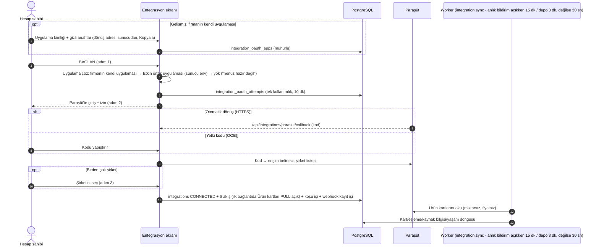

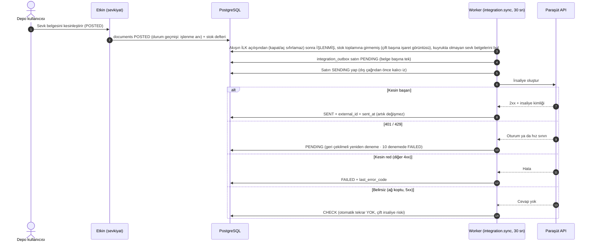

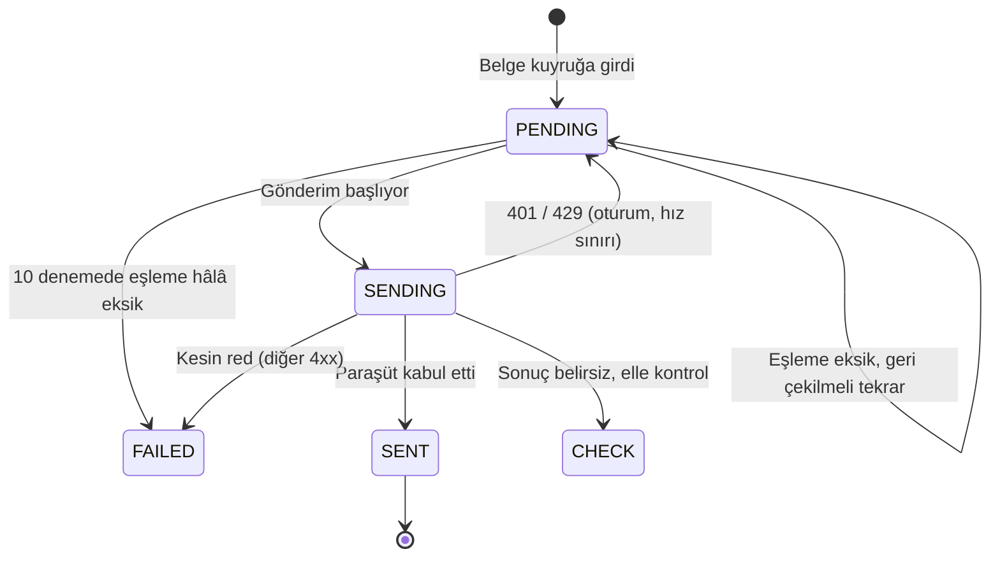

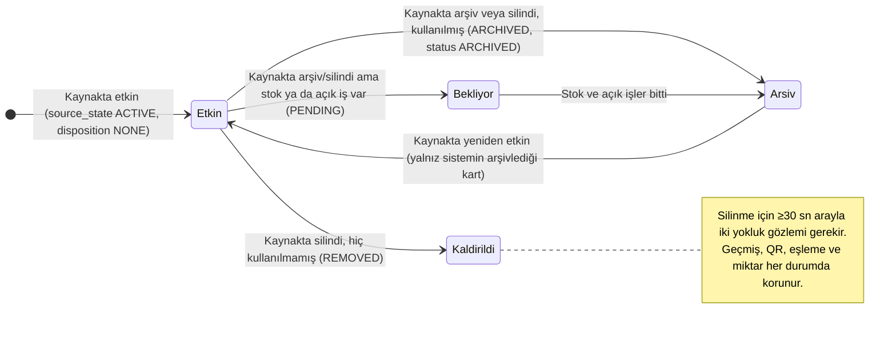

*Bağlantı durumu (`integrations.status`):* CONNECTED → ERROR (sınama/senkron hatası; bağlayan kişi artık etkin Yönetici değilse
`CONNECTOR_REVOKED`) → CONNECTED (başarılı sınama) ; her durumdan DISCONNECTED (bağlantıyı kes; şifreli bilgiler silinir, Paraşüt'teki
webhook kayıtları önce silinir). 0068 eski parola bağlantılarını DISCONNECTED + `LEGACY_METHOD_REMOVED` yaptı; OAuth ile yeniden bağlanınca
kod silinir ve DELETED satırdaki eski webhook kaydı Paraşüt'te de silinir. Anlık bildirim durumu (`integrations.webhook_status`): OFF →
ACTIVE (kayıt kuruldu) / FAILED (kurulamadı; 30 sn tarama sürer). Koşu durumu
(`integration_runs.status`): RUNNING → SUCCESS / PARTIAL / FAILED; 40 dk'yı aşan RUNNING → FAILED `TIMEOUT` (T-1135). Değişiklik getirmeyen
başarılı zamanlı koşu satır bırakmaz (son kontrol anı `integration_flows.last_run_at`); 7 günden eski biten satırlar koşu başında budanır.

*Stok toplamı ⟂ irsaliye (T-1135, kullanıcı kararı 30 Ekim — stok sahibi Etkin):* aynı bağlantıda STOCK ve SHIPMENTS birlikte açılamaz
(domain + 0066 tetikleyicisi; neden `INTEGRATION_FLOW_EXCLUSIVE`); tercih irsaliyedir. STOCK yalnız Devir tamamlanınca açılır
(`OPENING_STOCK_INCOMPLETE`). Gönderilen toplam yalnız `AVAILABLE` stok, `RECEIVING`/`STORAGE` raflar (karantina/hasarlı/bloke ve
TRANSIT/STAGING hariç). Kesin 4xx reddi stok işaretine yazılır, aynı toplam yeniden denenmez; 401/429 koşuyu durdurur, sonra yeniden denenir.
Miktarlar JSON'a ondalık metinden float aritmetiği olmadan sayı olarak yazılır (I-09). Gerçek Paraşüt'ün `new_total_inventory`/`quantity`
için kesirli sayı kabulü UNKNOWN (B-110).

*İki yönlü kart eşitleme (T-1140, kullanıcı kararı 31 Ekim):* bağlı her ürün / cari / depo için son eşitlemedeki iki tarafın kanonik
özeti `integration_card_states`'te tutulur (0069). Kanonik alanlar: ürün ve depoda ad; caride ad, vergi no, vergi dairesi, e-posta,
telefon, şehir, ilçe, adres, kısa ad. Değişen taraf bu özetle anlaşılır. Gönderim Paraşüt'e `PUT` ile gider (koşu başına en çok 50 kart,
aynı 10 istek / 10 sn sınırı); boş alan gönderilmez (Paraşüt'teki değer silinmez; B-236), cari türü gönderilmez. Kesin 4xx kartı
`UPDATE_REJECTED` ile bekletir ("Yeniden dene" Bekleyenler bölümünde). Ağ çağrıları veritabanı işlemi dışında, yazımlar kısa işlemde;
stok tablosuna yazılmaz (I-04, I-15). Her çakışma çözümü `integration.conflict_resolved` audit'i yazar (kazanan, dayanak, iki zaman;
değer ve dış kimlik yok). Gerçek Paraşüt'te PUT alanları, `updated_at` ve cari `archived` alanı UNKNOWN (B-235).

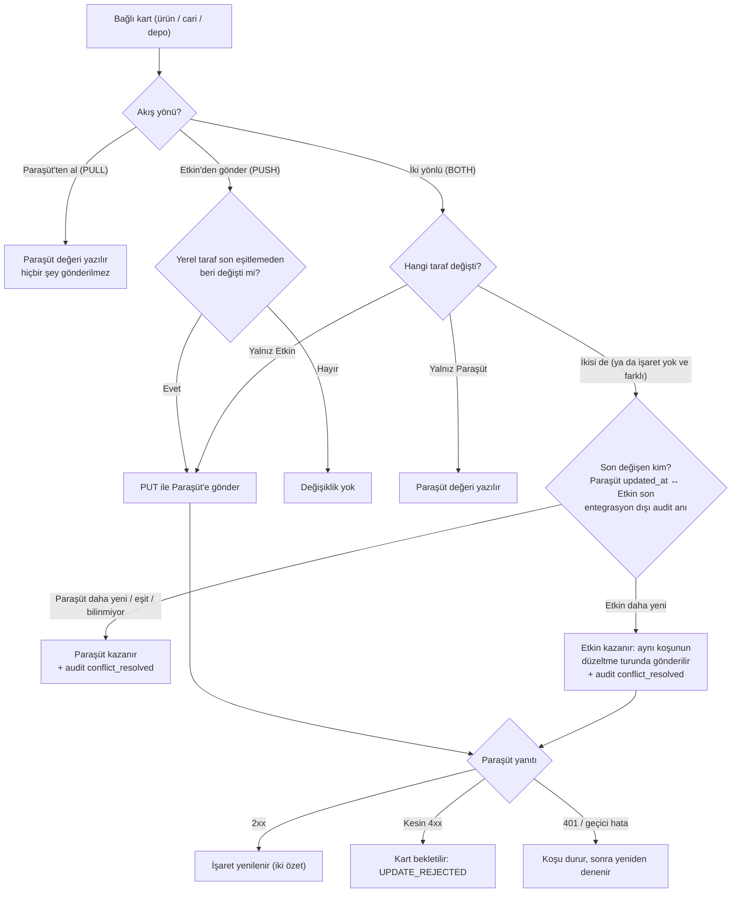

*Cari ve depo yaşam döngüsü (T-1140):* ürünle aynı kural (yukarıdaki durum şeması): yalnız OAuth bağlantısında ve ilgili akış Paraşüt'ten
alırken; ≥30 sn arayla iki kimlik yokluğu silinme sayılır; fiziksel silme yok; `REMOVED` durumu yok (cari/depo arşive alınır).
Kullanımdaysa PENDING: cari için açık sipariş, mal kabul ya da siparişten taslak/onaylı belge; depo için etkin raf yeri, sıfır olmayan
bakiye, açık belge / kabul / iade / görev / sayım. Yalnız sistemin arşivlediği kart Paraşüt'te yeniden etkinleşince açılır; kullanıcı
arşivden çıkarırsa ya da kendisi arşivlerse sistem sahipliği kalkar. Arşivli raf yerindeki stok Paraşüt'e giden toplama girmez.

*"Paraşüt'ten al" kaynak kilidi (T-1201, kullanıcı kararı 1 Kasım):* bölümün akışı açık, yönü PULL ve bağlantı kesilmemişken Etkin
kaynağı izler: yeni kart (ekran, `?new=1`, Excel, kurulum şablonu deposu) açılmaz; Paraşüt'e bağlı kartta Paraşüt'ün yazdığı alanlar ve
kod değişmez; bağlı kart arşivlenmez / geri açılmaz (arşiv yaşam döngüsünden gelir). Etkin'e özgü alanlar (raf yerleri, görsel, min/maks,
barkod, birim dönüşümü, toplama kuralı, takip, hassasiyet, kart türü, cari teslimat) ve bağsız yerel kartlar açık. Karar domain'de
(`source-guard.ts`, akış satırı `FOR SHARE`: yön değişikliğiyle yarış serileşir); entegrasyonun kendi yazımı engellenmez. PUSH / BOTH /
kapalı yönde kural yoktur.

*Anlık bildirim (webhook, T-1138):* Paraşüt'te ürün ya da cari kartı değişince Etkin beklemeden öğrenir. Bildirim içeriği karta yazılmaz;
kart Paraşüt'ten kimliğiyle yeniden okunur ve taramayla aynı kayıt yolundan (iki yönlü karar dahil) geçer.

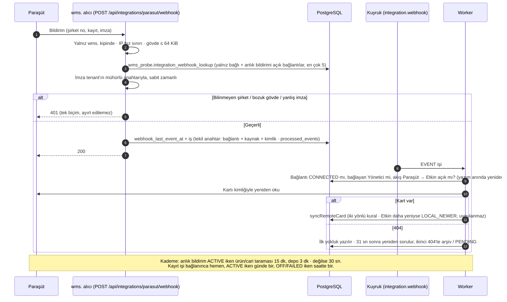

---

## Modül: wms.etkinyazilim.com / Destek talebi (müşteri tarafı)

- **Modül Durumu:** [TAMAMLANDI] (metin) · Ekran görüntüsü eki [PLANLANDI] (B-88)
- **Ekranın Amacı:** Her kullanıcı üst çubuktaki **Destek** (kulaklık) düğmesinden Etkin ekibine yazar; cevabı aynı pencereden okur.
  Yanındaki **Sorun bildir** (bayrak) düğmesi ayrıdır: firmanın kendi yöneticisine iç sorun kaydı açar.
- **Kod:** `apps/web/app/t/[slug]/support-actions.ts`, pencereler `apps/web/app/t/[slug]/pano/support-layer.tsx`, her kalıp ekranının üst
  çubuğundaki düğmeler `apps/web/app/t/[slug]/kalip/destek.tsx` (`KalipDestek`); domain `packages/domain/src/support/tickets.ts`;
  operatör tarafı yukarıda.

| UI Bileşeni / Buton / Alan | Tipi | Kullanıcı Aksiyonu | Tetiklenen API / Servis | Etkilenen DB Tablosu & Kolonu | İş Kuralı / Validasyon | Mevcut Durum |
| :--- | :--- | :--- | :--- | :--- | :--- | :--- |
| Destek düğmesi (her kalıp ekranının üst çubuğu ve Pano) | İkon | Tıklar | Destek penceresi; talep varsa Taleplerim | — | Talepler açılışta değil dokununca yüklenir (hız sınırı bütçesi); okunmamış yanıt rozeti (`countUnreadSupportReplies`); pencere açıkken perde alt çubuk dahil bütün ekranı örter (T-1081) | [TAMAMLANDI] |
| Konu (Hata / Nasıl yapılır / Öneri / Diğer) | Seçim | Seçer | — | `support_tickets.subject_kind` (BUG/HOWTO/IDEA/OTHER) | — | [TAMAMLANDI] |
| Kısa not | Textarea | Yazar | — | `support_tickets.body` | Uzunluk sınırı; loga yazılmaz | [TAMAMLANDI] |
| Otomatik bağlam (ekran, sürüm, tarayıcı) | Gizli | — | Sunucu istek başlığından alır | `support_tickets.context` | Tarayıcı bilgisi istemciden değil başlıktan | [TAMAMLANDI] |
| "Gönder" | Buton | Tıklar | `submitSupportTicketAction` → `createTicket` (+ aynı işlemde `support.notify` işi) | `support_tickets` (yeni, `status=OPEN`, `number` otomatik) | Her aktif üye açabilir; 10 dakikada en çok 5 talep (`RATE_LIMITED`); demo firmasında ve ACTIVE olmayan (ör. askıdaki) firmada red | [TAMAMLANDI] |
| Taleplerim listesi | Liste | Görüntüler | `listMySupportTicketsAction` → `listMyTickets` | `support_tickets` | Üye yalnız kendi talebini, hesap sahibi firmanın tümünü görür (veritabanı kuralı) | [TAMAMLANDI] |
| Yanıtla | Textarea + Buton | Gönderir | `replySupportTicketAction` → `replyAsCustomer` | `support_ticket_messages` (`author_kind=CUSTOMER`); ANSWERED → OPEN | 10 dakikada en çok 20 yanıt; kapalı talebe yazılamaz | [TAMAMLANDI] |
| Okundu | Otomatik | Pencere açılınca | `markSupportSeenAction` → `markMyTicketsSeen` | `support_tickets.customer_seen_at` | — | [TAMAMLANDI] |
| Ekran görüntüsü ekle | Düğme (gizli) | — | — | — | Depolama + boyut/tür sınırı + izolasyon gerekli | [PLANLANDI] (B-88) |

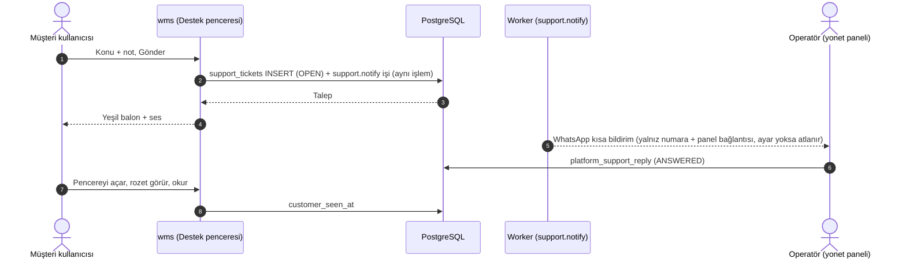

---

## Modül: wms.etkinyazilim.com / İlk kurulum yolculuğu ve örnek veri

- **Modül Durumu:** [TAMAMLANDI] (9 adımlı kurulum yolculuğu, odaklı "Rehber", Pano halkası) · Diğer ekranlar için otomatik ilk kullanım
  rehberi ve "görüldü" bilgisinin sunucuda tutulması [GELİŞTİRİLİYOR] (B-75)
- **Canlı notu:** 0056 (T-1006) ve 0058 (T-1054, Cariler adımı) canlı defterde (0062/62); T-1054 doğrulanan `6b2f81d` yayınında. Odaklı
  rehber T-1100 (PR #231), işlem rehberleri T-1105 (PR #239), sıralı odak ve katlı simge T-1124 (PR #260), kart yeri T-1130 (PR #266) bu
  yayından sonra birleşti → canlı UNKNOWN; gerçek iPhone kontrolü kullanıcıdan bekleniyor (B-197, B-210).
- **Ekranın Amacı:** Sıfırdan açılan firmanın kurulumu belge okumadan **yaparak** öğrenmesi. Yolculuk "Paraşüt var mı?" sorusuyla başlar
  (kart kaynağı) ve sırası: Ürün kartları (Excel ya da Paraşüt) → depo ve raflar → **Cariler** (Paraşüt bağlıysa eşitlemeyle kendiliğinden,
  değilse Excel) → stok → etiket → reçete → üretim → ekip QR → görev. Bir adımın "tamam" olması tıklamayla değil **gerçek veriden**
  hesaplanır (ör. ürün var mı, raf var mı, arşivlenmemiş cari var mı). Örnek veri sayılmaz.
- **Görünüm (T-1100):** "Başla" yazılı kart açmaz: ortak buzlu perde (`KalipPerdeKatman`) ekranı bulanıklaştırır, yalnız yapılacak yer
  (ör. DEPO EKLE, açılan form) delikte açık kalır, tek satır ipucu + "Söyle" (sesli okuma); iş yapılınca adım kendiliğinden ilerler
  (sunucu verisi, ~6 sn yoklama). Kartta İleri/Atla yok (atlama listede). Bulanık alana dokununca rehber serbest bırakır, yüzen
  "Kaldığın yerden" simgesi kalır. Adı **Rehber**; ana ekranda giriş "Merhaba" satırının sağındaki halka simgesi (bitmemişken), her
  ekranda ayrıca yüzen şimşek halkasındaki **Rehber** (T-1120). Eski Ürünler/Depolar "3 adımlı kurulum kutusu" kalktı (T-1054).
  **29 Ekim:** kurulum yolculuğu artık kapatılmaz, **katlanır**; işlem/aktarma rehberi açılınca yolculuk sunucuda kapanmaz (T-1124).
  Kartın yeri işlem rehberiyle aynı ortak hesaptan gelir ve yaptırdığı alanı (ör. Yeni depo formunda "Depo adı", alt çubukta KAYDET)
  hiçbir görünümde örtmez; telefonda görünen yükseklik ve klavye hesaba girer (T-1130, `kalip/kart-yeri.ts`).
- **Kod:** `apps/web/app/t/[slug]/yolculuk/{actions,yolculuk,steps,durum,spot,serialize}.ts|tsx`, `packages/domain/src/onboarding/journey.ts`,
  `onboarding/sample-data.ts`; işlem rehberleri `apps/web/app/t/[slug]/kalip/{rehber,rehber-plan,adim-rehber,adim-rehber-plan}.ts|tsx`.
- **Kim görür:** yalnız hesap sahibi (TENANT_ADMIN) ve depo yöneticisi (WAREHOUSE_MANAGER).

| UI Bileşeni / Buton / Alan | Tipi | Kullanıcı Aksiyonu | Tetiklenen API / Servis | Etkilenen DB Tablosu & Kolonu | İş Kuralı / Validasyon | Mevcut Durum |
| :--- | :--- | :--- | :--- | :--- | :--- | :--- |
| Odaklı rehber (buzlu perde, delikte yapılacak yer, tek satır) | Katman | İşi yapar / perdeye dokunur / Söyle | `getJourneyAction`, `setJourneyChoiceAction` | `setup_journeys.tour_state` (ACTIVE/CLOSED) | Yeni firmada kısa başlangıç adımları (kartlar, raflar, cariler, stok); perde gerçek formu engellemez (form ayrı delikle açık kalır) | [TAMAMLANDI] (T-1100) |
| "Paraşüt var mı?" / kart kaynağı (Excel / Paraşüt) | Seçim | Seçer | `setJourneyChoiceAction` → `setJourneyChoice` | `setup_journeys.card_source` (EXCEL/PARASUT) | Paraşüt seçilince kart adımı Entegrasyon ekranını açar (bağlı değilse BAĞLAN, bağlıysa eşitleme) | [TAMAMLANDI] (T-1054) |
| "Üretim yapıyor musunuz?" | Evet/Hayır | Seçer | Aynı | `setup_journeys.makes_production` | "Hayır" → reçete ve üretim adımları hiç görünmez | [TAMAMLANDI] |
| "Mevcut stok miktarlarını da alalım mı?" | Evet/Hayır | Seçer | Aynı (+ bağlanınca Paraşüt açılış stoku ayarı) | `setup_journeys.opening_stock_wanted`; `integrations.opening_stock_enabled` | Açılış stoku açık ve alınmamışsa stok adımı "Açılış stokunu al" düğmesini gösterir | [TAMAMLANDI] |
| Cariler adımı | Adım | — | `getSetupJourney` | `parties` (arşivlenmemiş sayım); 0058 atlanabilir adım listesine `parties` | Paraşüt bağlıysa eşitlemeyle kendiliğinden tamamlanır | [TAMAMLANDI] (T-1054) |
| "Bunu kullanmıyorum" (adımı atla) | Bağlantı | Tıklar | Aynı | `setup_journeys.skipped` (izinli adım listesi, en çok 9) | Geri alınabilir; atlanan adım sayaçtan düşer | [TAMAMLANDI] |
| Etiket basıldı işareti | Otomatik | İlk etiket baskısında | `markLabelsPrintedAction` → `markLabelsPrinted` | `setup_journeys.labels_printed_at` | Bir kez yazılır | [TAMAMLANDI] |
| Pano'daki halka (adım listesi, yeşil tikli şerit, geride kalan adıma dönüş) | Halka | Tıklar | `getSetupJourney` | Okuma: ürün, raf, cari, stok defteri, reçete, üretim, saha üyesi, görev/sayım tabloları | Örnek veri (`is_sample`) sayılmaz | [TAMAMLANDI] (T-1036, T-1100) |
| Kutlamayı kapat | Buton | Tıklar | Aynı | `setup_journeys.dismissed_at` | — | [TAMAMLANDI] |
| "Nasıl kullanırım?" adım adım rehber (ürün / depo / cari aktarma; Excel ya da Paraşüt) | Katman | Seçer, işi yapar | `kalip/adim-rehber.tsx` | — (durum yalnız bu cihazda) | Aynı odaklı motor; yüzen simge "Kaldığın yerden / Baştan" | [TAMAMLANDI] (T-1095) |
| İşlem rehberleri (Mal kabul, Yerleştirme, Çıkış, Transfer, Sayım) ve "?" ile tekrar | Katman | "?", şimşek halkasında Rehber veya Destek › Rehber | `kalip/rehber.tsx`, `rehber-durum.ts`, `rehber-hedef.ts` | — (ilerleme yalnız bu tarayıcıda) | Odaklı: yalnız yapılacak yer açık, sırayla odak, iş yapılınca ilerler; bölüm değişince katlı simge (devam · baştan · başka bölüm · kapat); görüldü bilgisi sunucuda değil | [GELİŞTİRİLİYOR] (T-1105, T-1124; B-75, B-208) |

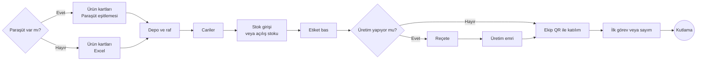

---

## Modül: wms.etkinyazilim.com / Yardım sayfası ve elle çalışma alanı açma

- **Yardım (`/help`) — [TAMAMLANDI]:** Oturum gerektirmeyen kısa, statik sayfa; "takılınca ne yapmalı". Sohbet, telefon, form içermez
  (`apps/web/app/help/page.tsx`). Uygulama içi destek talebi ayrı modüldür (yukarıda). Alt adres `/help/indir/<uygulama>` doğrulama
  uygulaması mağaza yönlendirmesidir (T-1043, yukarıda aktivasyon).
- **Elle çalışma alanı açma (`/onboarding`) — [TAMAMLANDI] ama yalnız yerel/test ortamında:** `createWorkspace` sihirbazı (firma adı →
  adres adı → kurulum adımları). Üretimde kapalıdır: yalnız `WMS_ENV=local|ci` ve `SIGNUP_ENABLED=true` iken açılır
  (`packages/domain/src/onboarding/workspace.ts` `workspaceCreationAllowed`). Canlıda müşteri yalnız **demo talebi → onay → aktivasyon**
  yoluyla açılır. Herkese açık "Kayıt ol" self-servis yolu için karar yok.
- **Demo firması ve günlük yeniden tohumlama — [TAMAMLANDI] (yalnız yerel/test):** `demo.reseed` işi her gün 03:00 UTC'de demo firmasının
  kullanıcı/üyelik/ayar/örnek stokunu onarır (`packages/domain/src/demo/seed.ts`). `DEMO_MODE=1` olmayan ortamda çalışmaz.

---

## Arka plan işleri (worker)

Worker, web sitesinden ayrı çalışan kalıcı bir süreçtir (`apps/worker/src/main.ts`). İş kuyruğu PostgreSQL içindedir (pg-boss); ayrı bir
Redis vb. yoktur. Bir iş yazıldığı veritabanı işlemiyle birlikte kaydolur — işlem geri alınırsa iş de kaybolur, "hayalet iş" oluşmaz.
Doğal Türkçe ses (`/tts`, T-1106) worker değil, ayrı ses servisidir.

| İş / Zamanlayıcı | Ne zaman çalışır | Ne yapar | Dokunduğu tablo | Kod | Durum |
| :--- | :--- | :--- | :--- | :--- | :--- |
| `email.send` | Kuyruğa yazıldığında | Şifreli (mühürlü) yükü açar, şablonu hazırlar, e-postayı gönderir (Resend; yerelde Mailpit) | — | `jobs/send-email.ts`, `mail/*` | [TAMAMLANDI] |
| `invitation.deliver` | Ekibe davet edilince | Davet bağlantısını üretir, özetini yazar, e-postayı işlem dışında gönderir | `invitations` | `jobs/deliver-invitation.ts` | [TAMAMLANDI] |
| `platform.activation.deliver` | Demo talebi onaylanınca | Aktivasyon belirteci üretir, özetini yazar, e-postayı gönderir | `wms_platform.demo_requests` | `jobs/trial-activation.ts` | [TAMAMLANDI] |
| `trial.welcome` | Aktivasyondan sonra | Hoş geldin e-postası | (okuma) | `jobs/trial-activation.ts` | [TAMAMLANDI] |
| `support.notify` | Yeni destek talebinde | Operatöre WhatsApp kısa mesajı (CallMeBot; ayar yoksa atlanır) | (bir kez gönderildi kaydı) | `jobs/support-notify.ts` | [TAMAMLANDI] |
| `stock.document.post` | Büyük (eşik üstü) stok belgesi kesinleştirilince | Belgeyi istek sahibi adına tek işlemde işler | `stock_documents`, `stock_ledger`, `stock_balances` | `jobs/post-stock-document.ts` | [TAMAMLANDI] |
| `stock.consistency.check` + zamanlayıcı | Açılışta bir + saatte bir, her aktif firma için | Stok defteri ile bakiye tutarlı mı denetler; sorun varsa alarm logu | (okuma) | `jobs/stock-consistency.ts` | [TAMAMLANDI] |
| `integration.sync` + zamanlayıcı | Zamanlayıcı **30 saniyede bir** uyanır (T-1066). Gönderen akışlar (stok, irsaliye, yalnız gönderen kart) her tik; Paraşüt'ten alan ürün/cari akışı anlık bildirim ACTIVE iken 15 dk'da bir, depo 3 dk'da bir (T-1138), değilse 30 sn. Ayrıca akış açılınca, ilk OAuth bağlantısında, "Şimdi çalıştır"da | ERP kart eşitlemesi (iki yönlü karar + düzeltme turu, T-1140), stok toplamı ya da irsaliye (ikisi birlikte değil, T-1135), ürün kaynak bilgisi, ürün/cari/depo yaşam döngüsü; koşu başında bakım (40 dk'yı aşan RUNNING → TIMEOUT, 7 günden eski biten koşular budanır); bağlantı başına tek iş (`singletonKey`), koşu başına sayfa/gönderim üst sınırları | `integration_*` (0069 `integration_card_states` dahil), `external_refs`, `items.source_*`, katalog tabloları | `jobs/integration-sync.ts` | [TAMAMLANDI] |
| `integration.webhook` (T-1138) | EVENT: Paraşüt bildirimi gelince · REGISTER: bağlanınca hemen, ACTIVE iken günde bir, OFF/FAILED iken saatte bir | EVENT: tek kartı Paraşüt'ten yeniden okuyup taramayla aynı yoldan yazar (yazım anında bağlantı + bağlayan + yön yeniden doğrulanır; tekrar teslim `processed_events` ile tek etki; geçici DB hatasında kuyruk yeniden dener). REGISTER: ürün/cari × create/update/delete kayıtlarını kurar/uzlaştırır, Paraşüt'te silineni yeniden kurar | `integration_webhooks`, `integrations.webhook_*`, `processed_events`, katalog tabloları | `jobs/integration-webhook.ts`, domain `webhook.ts`, `webhook-register.ts` | [TAMAMLANDI] (kod; gerçek hesapta anahtar/imza UNKNOWN, B-229) |
| Terk edilmiş sayım alarmı | Açılışta bir + saatte bir | Süresi (varsayılan 8 saat) aşan açık sayımları alarm olarak loglar; sayımı kapatmaz | (okuma) | `jobs/count-abandon.ts` | [TAMAMLANDI] |
| Kuyruk bakımı | Periyodik | Çöken işte asılı kalan işleri yeniden dener veya başarısız sayar; başarısız stok belgesini serbest bırakır | pg-boss tabloları | `jobs/queue-maintenance.ts` | [TAMAMLANDI] |
| Worker nabzı | Periyodik | Sağlık satırını günceller; `/api/health` buna bakar | `wms_health.worker_heartbeats` | `jobs/worker-heartbeat.ts` | [TAMAMLANDI] |
| Demo talebi içe alma (eski dosya yolu) | Sürekli | Satış sitesinin eski JSONL dosyasındaki talepleri DB'ye aktarır | `demo_requests` | `jobs/demo-leads.ts` | [TAMAMLANDI] (yeni yol T-1025 ile doğrudan DB) |
| Demo sahiplik postası | Periyodik | Bekleyen "talebini takip et" e-postalarını gönderir | `demo_status_deliveries` | `jobs/demo-status.ts` | [TAMAMLANDI] (T-1025) |
| `demo.reseed` | Açılışta + her gün 03:00 UTC (yalnız demo modu) | Demo firmasını onarır | demo tenant | `jobs/demo-reseed.ts` | [TAMAMLANDI] |

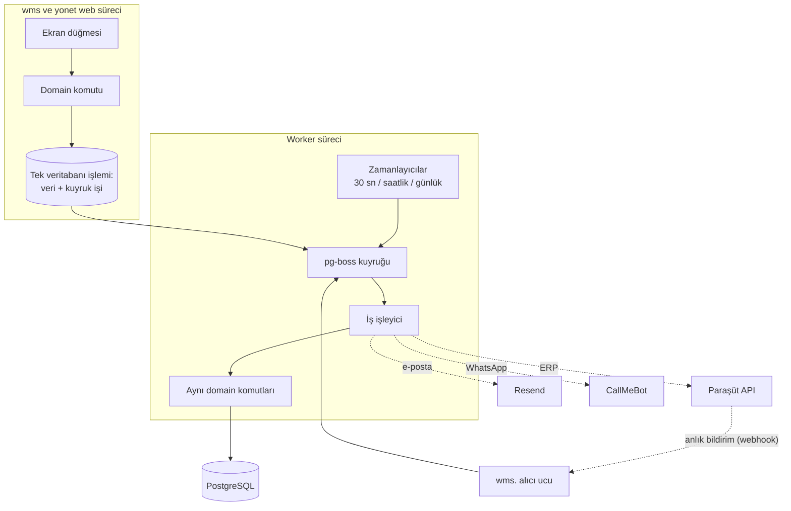

---

## Bu bölümün eksik ve bekleyen işleri (Gap)

**Onaylı tuvalle fark (29 Ekim güncellemesi, `Standart*.dc.html`)**
- Entegrasyon ekranının alt bölümlü düzeni, her zaman görünen yön seçimi, yönün sonuç cümlesi ve dolu katalogda onay **kodda** (T-1112,
  T-1134, T-1136, ortak `kalip/ayar.tsx`); Depolar için "iki yönlü" kullanıcı kararıyla gösteriliyor. Excel kaynak kartı Paraşüt'ün yanında
  (T-1137) ama aktarım hâlâ ayrı ekranda çalışır (B-196).
- "Alan sahipliği" (yalnız "YAKINDA"; B-200, B-238) ve "Pasif ve arşiv" (sayı, politika seçimi, PASİF durumu; B-200, B-170, B-172)
  bölümlerinin verisi yok. "Bekleyenler ve hatalar" kayıt bazlı listesi ve çözüm düğmeleri T-1137 ile geldi (B-113 BİTTİ); kalan:
  Paraşüt irsaliye numarasını bağlama (B-227), bekletilen kartın eşlemesini ekrandan düzeltme (B-228, B-224).
- "Gelişmiş: kendi Paraşüt uygulaman" kartı ve 0068 "Yeniden bağlan" bandı tuvalde yok (B-220, B-233); bilinçli farklar DESIGN-PARITY'de.
- Ayarlar'da "İş akışı" (teslimat yolu, iş adımları, teslim teyidi) ve "Etiket ve yazıcı" sekmeleri yok — ayar verisi yok (B-171, B-166).
  Mevcut iş akışı ayarları (kabul QC, sayım bırakma, vardiya, görev ayrılığı) İş akışı sekmesine taşınabilir (yalnız arayüz).
- Satış faturasından iş akışı yok (Paraşüt'te sipariş kaynağı yok; B-116).

**Arayüzde var, arkası bağlı değil**
- Destek penceresinde "Ekran görüntüsü ekle" düğmesi gizli; panelde "Erişim iste" düğmesi pasif (B-88, B-89).
- Ayarlar › Entegrasyonlar'da ve Entegrasyon ekranında Logo yalnız "YAKINDA" yer tutucusu (B-111).
- Ayarlar › Firma'da ad satırındaki mikrofon pasif ("sesle yakında").
- Satış sitesi başarı kutusunda "Hemen konuşalım" (WhatsApp) yok; herkese açık numara tanımlı değil (B-102).

**Veritabanında var, ekranda gösterilmiyor / kullanılmıyor**
- Paket özellik anahtarları (`plan_versions.feat_qr/feat_ship/feat_prod/feat_api`) kaydediliyor ve satış sitesinde gösteriliyor; müşteri
  uygulamasında bu anahtarlara göre ekran/komut kapatan bağlantı yok. Yalnız sayı sınırları (depo, ürün, kullanıcı) uygulanıyor (B-153).
- `tenants.status = CLOSING` değeri var; panelde müşteriyi kapatma/silme düğmesi yok (yalnız operatörün elle çalıştırdığı sıfırlama
  betiği, T-1005; canlıda çalıştırılması kullanıcı adımı, B-137).
- `charges.invoice_no` kolonu var; fatura kesme akışı yok (B-45, B-153).
- `integrations.provider = 'LOGO'` izinli, ama bağlanamıyor.
- `items.source_disposition` (0062) ürün listesinde "Kaldırıldı" süzgeci ve bekliyor etiketi olarak kullanılıyor; Entegrasyon ekranında
  sayısı gösterilmiyor.

**Eksik iş akışları**
- Online tahsilat yok: tahakkuk elle açılıyor, ödeme elle işaretleniyor; otomatik aylık tahakkuk, kartla abonelik ve "Hatırlat" yok
  (B-40).
- Deneme süresi bitince ne olacağı (otomatik askıya alma / uyarı e-postası) kodda yok; deneme bitişi panelde görünür ve elle uzatılır.
- Paraşüt: gerçek hesapla doğrulanan yalnız 28 Ekim'deki bağlantı + miktarsız ürün kartı alma ve yaşam döngüsü. Bekleyen doğrulamalar:
  ortak uygulama kaydı ve sunucu değerleri (sahipte; B-219), anlık bildirim anahtarı/imza biçimi (B-229), iki yönlü PUT alanları,
  `updated_at` ve cari `archived` (B-235), irsaliye deposu/cari türü, kesirli miktar, 429 (B-110); okutmalı Devir ve kalan ürün aktarım
  adımları B-182 planında.
- İki yönlü kural kart başınadır ("son değişen kazanır"); alan bazlı sahiplik ayarı yok (B-238). Ürün kartında Paraşüt sekmesi bilgi
  gösterir; son eşitleme, Tekrar dene, elle eşleştir yok (B-170). Etkin'de boşaltılan cari alanı Paraşüt'te silinmez (B-236); etkin raf
  yeri olan depo Paraşüt'te silinse de PENDING kalır (B-237); cari formunda "Paraşüt'e de gider" uyarısı yok (B-240).
- 0068 ile bağlantısı kesilen müşteriye ekran dışında haber yok (zil / e-posta; B-232). Webhook kaydı sürerken yeniden bağlanma durumu
  doğrulanmadı (B-234). Ortak uygulama sırrının bağlantı kutusuna kopyalanması ve yaşam döngüsü bağının zaman penceresiyle kurulması
  iyileştirilecek (B-221, B-222).
- Paraşüt açılış stoku tek rafa toplam yazar; depo bazlı miktar ve 200 satırdan büyük açılış yok (B-139).
- Panel hata kodları kullanıcı diline çevrilmemiş (ör. `FORBIDDEN/MFA_REQUIRED` gibi teknik kod görünebilir) (B-66).
- Kullanıcı başına dil tercihi yok; saat dilimi arayüzde sabit İstanbul gösteriliyor (B-105).
- İşlem rehberlerinin "görüldü" bilgisi sunucuda değil tarayıcıda; diğer ekranlar için otomatik ilk kullanım rehberi eksik (B-75).
- Aynı e-postadan gelen yeni demo talebi panelde görünmüyor (sessiz tekilleştirme); "tekrar talep etti" kullanıcı kararı bekliyor (B-157).
- Canlılık (STATE, 1 Kasım): canlı main `008070a`, şema 0070; bu bölümdeki işlerin hepsi o yayının içindedir. Gerçek iPhone Safari
  kontrolü kullanıcıdan bekleniyor (B-197, B-210); Entegrasyonlar ekranının telefon düzeni (T-1134, T-1136) yalnız Chromium'da sınandı.

**Yetki / güvenlik**
- Panel ve entegrasyon için ayrıntılı güvenlik bulguları bu herkese açık belgede yazılmaz; genel başlıklar BACKLOG'daki 🔒 satırlarındadır
  (ör. 🔒 B-10, 🔒 B-17, 🔒 B-67; entegrasyon için 🔒 B-231, 🔒 B-239).
