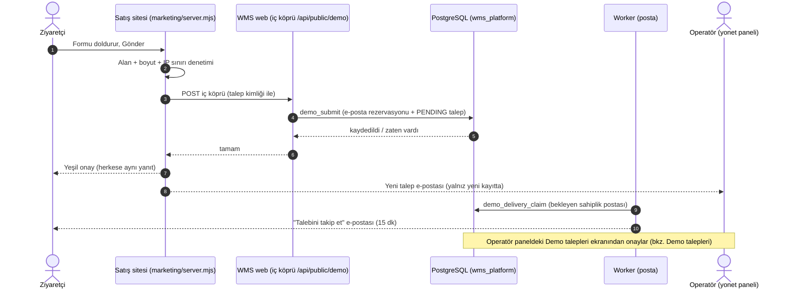
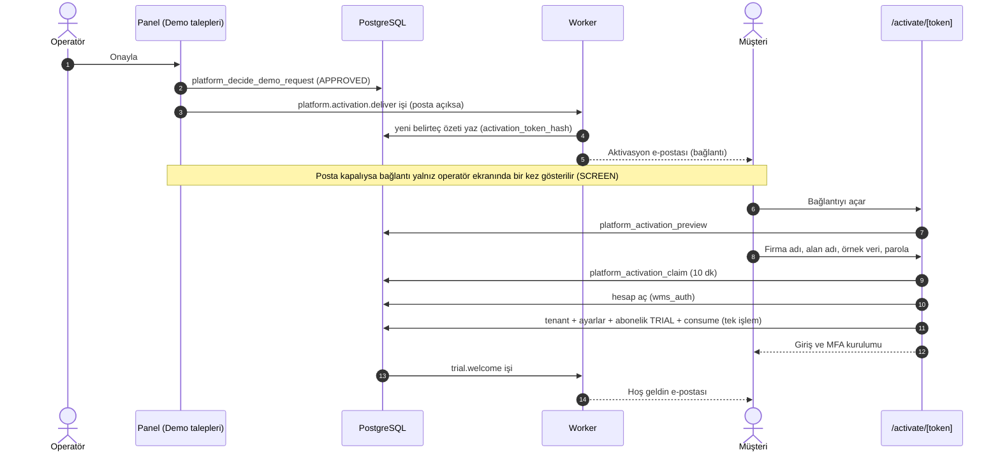
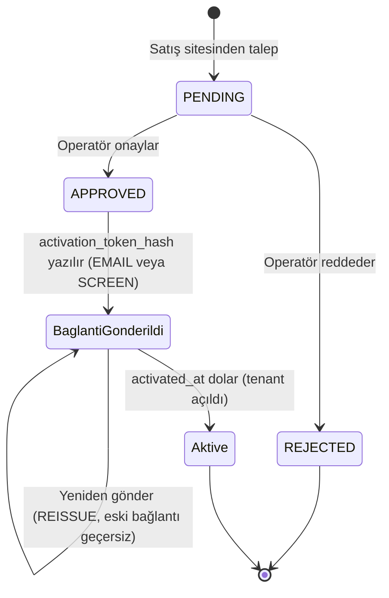
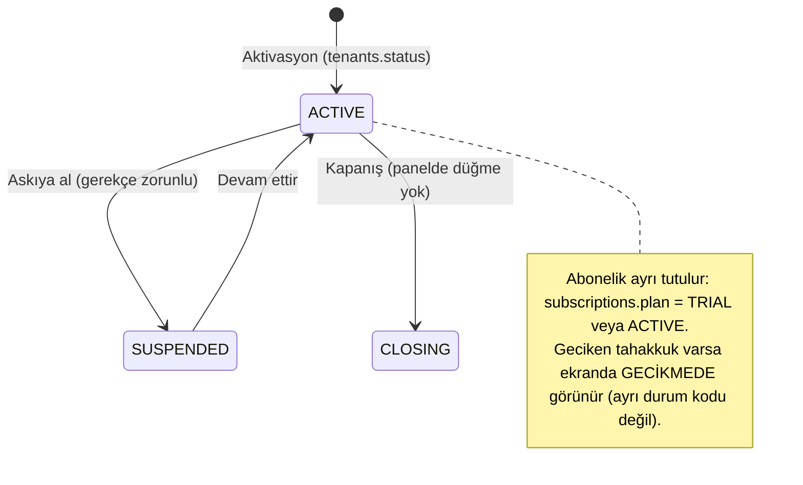
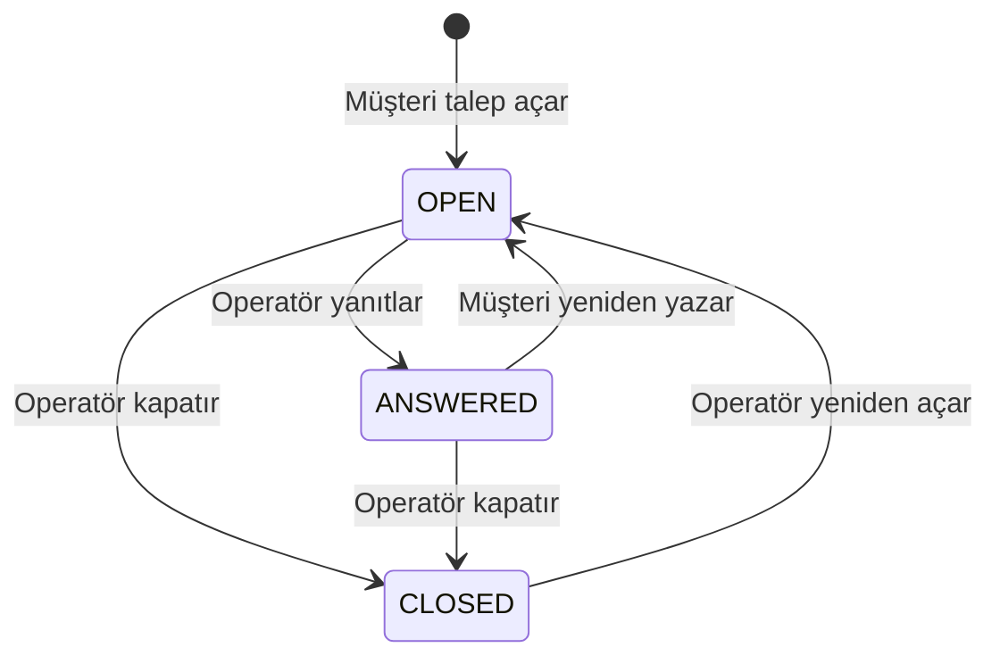
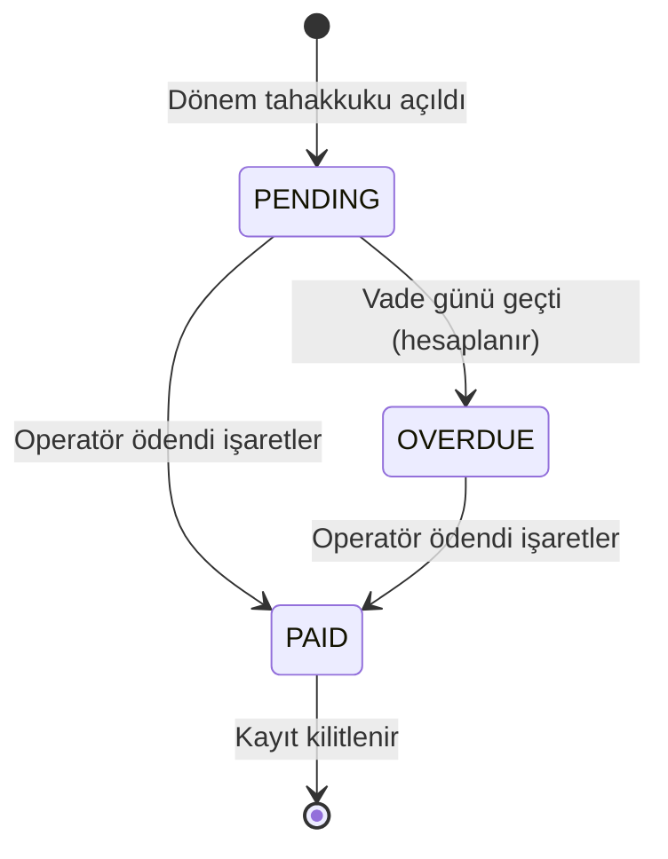
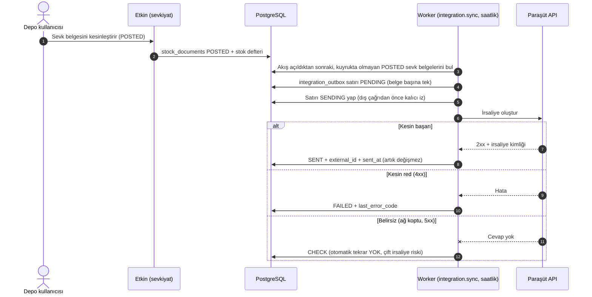
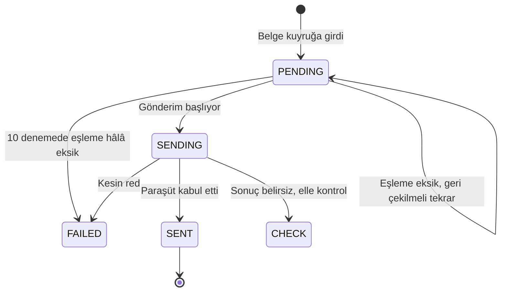
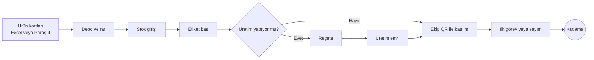
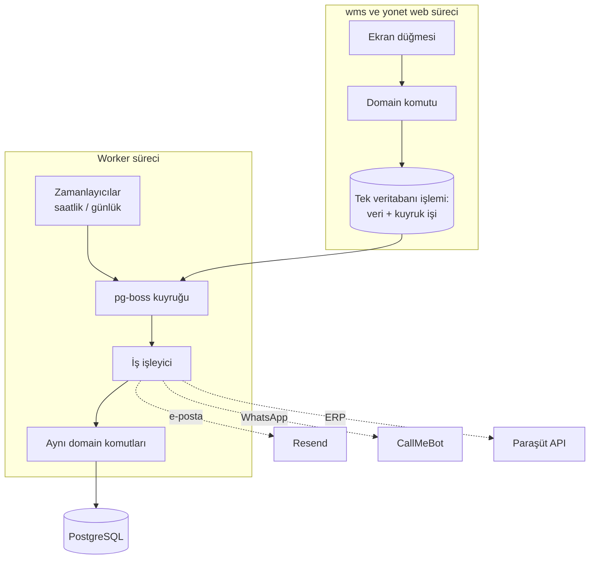

# 2D. Yönetim Paneli, Satış Sitesi, Ayarlar ve Entegrasyon

> Bu bölüm üç adresin "çevre" modüllerini anlatır: **etkinyazilim.com** (satış sitesi), **yonet.etkinyazilim.com** (bizim, yani Etkin
> ekibinin müşteri yönetim paneli) ve **wms.etkinyazilim.com** içindeki firma ayarları, ERP bağlantısı, destek talebi, kurulum
> rehberi. En sonda arka planda kendi kendine çalışan işler (worker) listelenir.
>
> Kaynak: 23 Ekim 2026 itibarıyla `main` dalındaki kod ve migration dosyaları (0038–0057). Tahmin yoktur; her satırın yanında dosya yolu
> verilmiştir. **Canlı (VPS) durumu ayrıdır:** "Canlı notu" satırları `docs/STATE.md` ve `docs/changes/` kayıtlarından alınmıştır;
> kodda olması canlıda olduğu anlamına gelmez.

**Etiketler:** [TAMAMLANDI] = kodda ekrandan veritabanına kadar bağlı · [GELİŞTİRİLİYOR] = bir kısmı var, bir kısmı eksik ya da
yayın bekliyor · [PLANLANDI] = yalnız yapılacaklar listesinde (BACKLOG) veya tasarımda.

**Önemli ortak kural (panelin tamamı için):** Panel tabloları (`wms_platform` şeması) müşteri verisinden ayrıdır. Uygulamanın bu
tablolara doğrudan okuma/yazma izni yoktur; her işlem veritabanındaki özel "kapı" işlevlerinden (`wms_probe.platform_*`) geçer. Bu kapı
her seferinde "bu kişi operatör listesinde mi?" diye bakar (`wms_platform.operators`). Panele girişte ayrıca iki adımlı doğrulama (MFA)
zorunludur; para, paket, müşteri durumu gibi yazma işlemlerinde "az önce şifreni tekrar gir" (yakın zamanda doğrulama) istenir.
Kapı kodu: `apps/web/app/panel/gate.ts`. Operatör değilseniz panel "sayfa yok" (404) gösterir — panelin varlığı bile belli edilmez.

---

## İçindekiler
1. [Satış sitesi ve demo talebi (etkinyazilim.com)](#modül-etkinyazilimcom--satış-sitesi-ve-demo-formu)
2. [Deneme aktivasyonu (bağlantıyla çalışma alanı açma)](#modül-wmsetkinyazilimcom--deneme-aktivasyonu-activatetoken)
3. [Panel · Özet](#modül-yonetetkinyazilimcom--özet-ana-sayfa)
4. [Panel · Müşteriler](#modül-yonetetkinyazilimcom--müşteriler)
5. [Panel · Destek gelen kutusu](#modül-yonetetkinyazilimcom--destek-gelen-kutusu)
6. [Panel · Paketler](#modül-yonetetkinyazilimcom--paketler)
7. [Panel · Ödemeler](#modül-yonetetkinyazilimcom--ödemeler)
8. [Panel · Demo talepleri](#modül-yonetetkinyazilimcom--demo-talepleri)
9. [Panel · Satış sayfası içeriği](#modül-yonetetkinyazilimcom--satış-sayfası)
10. [Panel · İşlem kaydı](#modül-yonetetkinyazilimcom--işlem-kaydı)
11. [Firma ayarları (Genel)](#modül-wmsetkinyazilimcom--ayarlar-genel)
12. [Ayarlar › Bağlantılar (Excel)](#modül-wmsetkinyazilimcom--ayarlar--bağlantılar)
13. [ERP entegrasyonu (Paraşüt)](#modül-wmsetkinyazilimcom--erp-entegrasyonu-paraşüt)
14. [Destek talebi (müşteri tarafı)](#modül-wmsetkinyazilimcom--destek-talebi-müşteri-tarafı)
15. [İlk kurulum yolculuğu ve örnek veri](#modül-wmsetkinyazilimcom--ilk-kurulum-yolculuğu-ve-örnek-veri)
16. [Yardım sayfası ve elle çalışma alanı açma](#modül-wmsetkinyazilimcom--yardım-sayfası-ve-elle-çalışma-alanı-açma)
17. [Arka plan işleri (worker)](#arka-plan-işleri-worker)
18. [Bu bölümün eksik/bekleyen işleri (Gap)](#bu-bölümün-eksik-ve-bekleyen-işleri-gap)

---

## Modül: etkinyazilim.com / Satış sitesi ve demo formu

- **Modül Durumu:** [TAMAMLANDI] (site + panelden yönetilen içerik) · Demo formunun yeni "kalıcı kayıt + sahiplik bağlantısı" sürümü
  [GELİŞTİRİLİYOR]
- **Canlı notu:** Site canlıda. T-1025 (yeni demo formu, migration 0057) PR #172 ve #173 ile `main`'e birleşti; ilk yayın denemesi
  migration aşamasında reddedildi, düzeltme birleşti. 0057'nin canlı veritabanına uygulandığı bu belgede doğrulanmadı (UNKNOWN).
- **Ekranın Amacı:** Ürünü tanıtır, fiyat kartlarını gösterir, ilgilenen firmanın "Demo istiyorum" formunu toplar.
- **Teknik yapı (sade):** Ayrı, küçük bir Node sunucusu (`marketing/server.mjs`). Sayfa tasarım dosyasından üretilir
  (`marketing/src/landing.dc.html` → `marketing/build.mjs` → `marketing/public/*`). Başlık/alt metin/fiyat kartları panelden yayınlanan
  içerikten gelir; site bu içeriği iç ağdan `GET /api/public/site` ile 30 sn önbellekle okur. Dışarıdan `/api/public/*` adreslerine
  erişim kapalıdır (yalnız iç ağ).

| UI Bileşeni / Buton / Alan | Tipi | Kullanıcı Aksiyonu | Tetiklenen API / Servis | Etkilenen DB Tablosu & Kolonu | İş Kuralı / Validasyon | Mevcut Durum |
| :--- | :--- | :--- | :--- | :--- | :--- | :--- |
| Ana başlık, vurgulu satır, alt metin | Metin | Sayfa açılır | `marketing/server.mjs` → iç `GET /api/public/site` (`apps/web/app/api/public/site/route.ts`) → `getPublicSite` (`packages/domain/src/platform/site-content.ts`) → `wms_probe.platform_site_public` | `wms_platform.site_content` (yalnız yayınlanmış sürüm: `title1`, `title2`, `subtitle`) | İçerik yoksa/uç cevap vermezse tasarımdaki sabit metin kalır | [TAMAMLANDI] |
| Fiyat kartları (Kiralama bölümü) | Kart listesi | Görüntülenir | Aynı uç | `site_content.plan_ids` + `wms_platform.plans`/`plan_versions` (`price_monthly`, sınırlar, özellikler) | Yalnız **yayında** olan paketler; içerik yoksa fiyat bölümü hiç görünmez | [TAMAMLANDI] |
| Önizleme bağlantısı `/?onizleme=…` | Bağlantı | Operatör panelden ürettiği bağlantıyı açar | `x-site-preview` başlığıyla aynı uç | `wms_platform.site_previews` (`token_hash`, `expires_at`) | 30 dk geçerli; arama motoruna kapalı; süresi geçmişse yayındaki içerik gösterilir | [TAMAMLANDI] |
| Demo formu: Ad, Firma, E-posta, Sektör (ikonlu seçim), Mesaj, iletişim onayı | Form | "Gönder" | `POST /api/demo` (`marketing/server.mjs`) → iç köprü `POST /api/public/demo` (`apps/web/app/api/public/demo/route.ts`) → `submitDemo` (`packages/domain/src/platform/demo-submit.ts`) → `wms_probe.demo_submit` | `wms_platform.demo_requests` (yeni satır, `status=PENDING`), `wms_platform.demo_email_reservations` (e-posta tekilliği), `wms_platform.demo_request_keys`, `wms_platform.demo_status_deliveries` (sahiplik postası) | Zorunlu alanlar; gövde ≤ 8 KB; IP başına saatte 5 deneme; aynı e-posta ikinci kez kayıt açmaz; yanıt herkese aynıdır (`{ok:true}`) — "bu adres zaten var" bilgisi sızdırılmaz; veritabanı yoksa 503 ve aynı anahtarla tekrar denenir | [GELİŞTİRİLİYOR] (T-1025; kod `main`'de, canlı UNKNOWN) |
| Başarı kutusu (yeşil onay) | Bilgi | Gönderim başarılı | — | — | Talep numarası/durumu gösterilmez | [TAMAMLANDI] |
| "Hemen konuşalım" (WhatsApp) | Bağlantı | — | — | — | Herkese açık WhatsApp numarası yok | [PLANLANDI] (B-102) |
| Sahiplik e-postasındaki bağlantı → `/demo-status` | Sayfa + düğme | E-postadaki bağlantıya tıklar, sayfadaki düğmeye basar | `POST /api/demo-status` → `consumeDemoStatus` → `wms_probe.demo_status_consume` | `demo_status_deliveries.consumed_at`; onaylıysa `demo_requests.activation_token_hash`, `activation_expires_at` (+15 dk), `owner_link_issued_at`; `security_events` (`platform.demo_owner.verified`) | Bağlantı 15 dk, tek kullanımlık; sonuç: `pending` (onay bekliyor) / `setup` (kurulum bağlantısı hazır) / `in_progress` / `ready` (zaten açılmış → giriş) / `invalid` | [GELİŞTİRİLİYOR] (T-1025) |
| Yöneticiye "yeni talep" e-postası | Arka plan | Yeni kayıtta | `marketing/notify.mjs` (Resend) | — | Saatte en çok 20; ayar yoksa gönderilmez; en iyi çaba | [TAMAMLANDI] |
| Gizlilik metni | Katman | "Gizlilik" bağlantısı | `marketing/src/form-ui.js` | — | Form verisi kaybolmadan aynı sayfada açılır | [TAMAMLANDI] |



---

## Modül: wms.etkinyazilim.com / Deneme aktivasyonu (`/activate/[token]`)

- **Modül Durumu:** [TAMAMLANDI]
- **Canlı notu:** 0039 16 Ekim'de canlıya çıktı (STATE).
- **Ekranın Amacı:** Onaylanan demo talebinin sahibi, kendisine gelen tek kullanımlık bağlantıyla kendi çalışma alanını (firma
  hesabını) açar: firma adı, adres adı (ör. `motive`), örnek veri isteyip istemediği ve parola. Sonunda giriş + zorunlu iki adımlı
  doğrulama (MFA) kurulumu gelir. Deneme süresi 3 aydır.
- **Kod:** `apps/web/app/activate/[token]/{page,flow,actions}.tsx|ts`, `packages/domain/src/platform/activation.ts`.

| UI Bileşeni / Buton / Alan | Tipi | Kullanıcı Aksiyonu | Tetiklenen API / Servis | Etkilenen DB Tablosu & Kolonu | İş Kuralı / Validasyon | Mevcut Durum |
| :--- | :--- | :--- | :--- | :--- | :--- | :--- |
| Bağlantı açılışı (ad/firma önizlemesi) | Sayfa | Bağlantıyı açar | `previewActivation` → `wms_probe.platform_activation_preview` | `demo_requests` (okuma: `activation_token_hash`, `activation_expires_at`) | Belirteç DB'de yalnız özetle (SHA-256) durur; süresi geçmiş/kullanılmış bağlantı "geçersiz" | [TAMAMLANDI] |
| Çalışma alanı adı | Input | Yazar | `checkWorkspaceNameAction` → `checkWorkspaceName` → `wms_probe.platform_workspace_name_taken` | `tenants.slug` (okuma) | Biçim kuralı (`isAllowedWorkspaceName`), ayrılmış adlar reddedilir; anlık "uygun / dolu" | [TAMAMLANDI] |
| Örnek veri: "Örnek verilerle / Boş" | Seçim | Seçer | (aktivasyonla birlikte) | `demo_requests.activation_sample` | "Örnek verilerle" seçilirse ayrı "Örnek depo" + örnek ürünler `is_sample=true` yazılır, stok hareketi yazılmaz | [TAMAMLANDI] |
| Parola (+ tekrar) | Input | Yazar | — | — | Parola politikası (`packages/auth`) | [TAMAMLANDI] |
| "Çalışma alanımı aç" | Buton | Tıklar | `activateTrialAction` → `activateTrial`: (1) `platform_activation_claim` (10 dk talep), (2) hesap açılır (`wms_auth`), (3) tek transaction'da tenant + ayarlar + `platform_activation_consume` | `demo_requests.activation_claim_id/…_expires_at`, `activated_at`; `tenants` (yeni satır), `tenant_memberships` (sahip), `tenant_settings`, `wms_platform.subscriptions` (`plan=TRIAL`, `trial_ends_at`=+3 ay, `demo_request_id`); varsayılan paket atanır (`platform_assign_default_plan`); `security_events` | Bağlantı tek kullanımlık; 3. adım başarısızsa talep serbest bırakılır, aynı bağlantıyla tekrar denenince aynı hesap kullanılır; e-posta/ad formdan değil talepten okunur | [TAMAMLANDI] |
| Hoş geldin e-postası | Arka plan | Aktivasyon sonrası | Kuyruk işi `trial.welcome` (`apps/worker/src/jobs/trial-activation.ts`) | (okuma) | E-posta sır taşımaz | [TAMAMLANDI] |





*Not:* Veritabanındaki `status` yalnız `PENDING / APPROVED / REJECTED` değerlerini alır (`demo_requests_status_chk`, 0038).
"Bağlantı gönderildi" ve "Aktive" ayrı durum kodu değil, `activation_*` ve `activated_at` kolonlarının dolu olmasıdır.

---

## Modül: yonet.etkinyazilim.com / Özet (ana sayfa)

- **Modül Durumu:** [TAMAMLANDI] · **Canlı notu:** 17 Ekim'de canlı (T-408).
- **Ekranın Amacı:** Operatörün sabah bakacağı tek ekran: kaç müşteri var, kimin denemesi bitiyor, kim paket sınırına yaklaştı, geciken
  ödeme, bekleyen demo talebi, açık destek talebi.
- **Kod:** `apps/web/app/panel/page.tsx`, `ozet-view.tsx`, `ozet-rules.ts`, menü `nav.ts`.

| UI Bileşeni / Buton / Alan | Tipi | Kullanıcı Aksiyonu | Tetiklenen API / Servis | Etkilenen DB Tablosu & Kolonu | İş Kuralı / Validasyon | Mevcut Durum |
| :--- | :--- | :--- | :--- | :--- | :--- | :--- |
| Sol menü sayaçları (Demo talepleri, Ödemeler, Destek) | Rozet | Görüntülenir | `panelNav` → `listDemoRequests`, `listCharges`, `countOpenSupportTickets` | `demo_requests.status=PENDING`, `charges` (geciken), `support_tickets.status=OPEN` | Sayılar gerçek veriden | [TAMAMLANDI] |
| "Sınıra yaklaşıyor" uyarıları | Kart | Görüntülenir | `listCustomers` + `nearLimit` (`ozet-rules.ts`) | `platform_list_customers` sayım kolonları | Sınır > 0 ve kalan ≤ sınırın %20'si; 0 = sınırsız | [TAMAMLANDI] |
| Otomatik yenileme | Arka plan | Sayfa açıkken | `auto-refresh.ts` | — | Açık ekran belli aralıkla tazelenir | [TAMAMLANDI] |
| Çıkış, tema | Buton | Tıklar | `shell.tsx` | — | — | [TAMAMLANDI] |

---

## Modül: yonet.etkinyazilim.com / Müşteriler

- **Modül Durumu:** [TAMAMLANDI] · **Canlı notu:** 17 Ekim'de canlı (T-403, 0042).
- **Ekranın Amacı:** Bütün müşteri firmaların listesi: durum (deneme / aktif / askıda / gecikmede), paket, kullanıcı-depo-ürün sayıları,
  son giriş, bu ayki hareket sayısı. **Müşterinin içeriği (ürün adı, stok miktarı, kişi) bu ekrana hiç gelmez — yalnız sayılar.**
- **Kod:** `apps/web/app/panel/musteriler/{page,view,actions}.tsx|ts`, `packages/domain/src/platform/customers.ts`.

| UI Bileşeni / Buton / Alan | Tipi | Kullanıcı Aksiyonu | Tetiklenen API / Servis | Etkilenen DB Tablosu & Kolonu | İş Kuralı / Validasyon | Mevcut Durum |
| :--- | :--- | :--- | :--- | :--- | :--- | :--- |
| Müşteri listesi | Tablo | Görüntülenir | `listCustomers` → `wms_probe.platform_list_customers` | `tenants` (`name`, `slug`, `status`), `subscriptions` (`plan`, `trial_ends_at`, `plan_id`), `warehouses`/`items` (yalnız sayım, `is_sample` hariç), `tenant_memberships`, `security_events` (son giriş), `charges` (gecikme) | Demo firması listede ayrı tutulur | [TAMAMLANDI] |
| Müşteri satırı → ayrıntı | Satır | Tıklar (`?m=<id>`) | `getCustomerActivity` → `platform_customer_activity` | `stock_ledger` (yalnız bu ayki **sayı**) | — | [TAMAMLANDI] |
| "Askıya al" + gerekçe | Buton + Input | Tıklar | `customerAction` (intent `SUSPEND`) → `setCustomerSuspended` → `platform_set_customer_status` | `tenants.status` ACTIVE → SUSPENDED; `security_events` (`platform.*`) | Gerekçe zorunlu; yakın zamanda doğrulama; yalnız ACTIVE ↔ SUSPENDED (demo ve kapanan firma hariç). **Veri silinmez**; askıdaki firmada kullanıcı işlemleri `TENANT_SUSPENDED` hatası alır | [TAMAMLANDI] |
| "Devam ettir" | Buton | Tıklar | intent `RESUME` → aynı işlev | `tenants.status` SUSPENDED → ACTIVE | Yakın zamanda doğrulama | [TAMAMLANDI] |
| "Denemeyi 30 gün uzat" | Buton | Tıklar | intent `EXTEND` → `extendCustomerTrial` → `platform_extend_trial` | `subscriptions.trial_ends_at` (+30 gün) | Yalnız deneme (TRIAL) aboneliğinde | [TAMAMLANDI] |
| "Paketi değiştir" | Select + Buton | Seçer, Kaydet | intent `PLAN` → `changeCustomerPlan` → `platform_change_customer_plan` | `subscriptions.plan_id`, `plan_version`, `plan` (ACTIVE) | Paketin **o anki sürümüne** bağlanır; sonradan pakette fiyat değişse müşteri eski sürümde kalır | [TAMAMLANDI] |
| Müşteriyi kalıcı silme | — | — | Panelde yok; yalnız operatörün elle çalıştırdığı sıfırlama betiği var (`deploy/vps/ops/reset-tenants.sql`, T-1005) | — | Kalıcı silmeden önce kullanıcıya haber verilir (proje kuralı) | [PLANLANDI] (panel düğmesi yok) |



---

## Modül: yonet.etkinyazilim.com / Destek gelen kutusu

- **Modül Durumu:** [TAMAMLANDI] (metin yazışma) · Ekran görüntüsü eki ve "erişim iste" [PLANLANDI] (B-88, B-89)
- **Canlı notu:** 0054, `int/21ekim-ekranlar` (PR #134) ile `main`'e girdi; 0055 canlıda olduğuna göre 0054 de uygulanmış olmalı —
  ayrıca doğrulanmadı.
- **Ekranın Amacı:** Müşterilerin uygulama içindeki "Destek" ikonundan yazdığı talepleri görmek, yanıtlamak, kapatmak.
- **Kod:** `apps/web/app/panel/support/{page,view,actions,format}.ts|tsx`, `packages/domain/src/platform/support.ts`.

| UI Bileşeni / Buton / Alan | Tipi | Kullanıcı Aksiyonu | Tetiklenen API / Servis | Etkilenen DB Tablosu & Kolonu | İş Kuralı / Validasyon | Mevcut Durum |
| :--- | :--- | :--- | :--- | :--- | :--- | :--- |
| Talep listesi + durum/firma süzgeci | Liste | Görüntüler, süzer | `listSupportInbox` → `wms_probe.platform_support_list` | `support_tickets` (`number`, `subject_kind`, `status`, `created_at`), `support_ticket_messages` (sayı, son yazan) | En çok 500 satır | [TAMAMLANDI] |
| Talep ayrıntısı | Panel | Satıra tıklar (`?t=<id>`) | `getSupportTicket`, `platform_support_messages` | `support_tickets.body`, `context` (ekran/sürüm bilgisi), mesajlar | Metin loga yazılmaz | [TAMAMLANDI] |
| "Yanıtla" | Textarea + Buton | Yazar, Gönder | `supportReplyAction` → `replySupportTicket` → `platform_support_reply` | `support_ticket_messages` (yeni, `author_kind=OPERATOR`); `support_tickets.status` → ANSWERED, `operator_replied_at`; `security_events` (`platform.support.*`) | Kapalı talebe yazılamaz | [TAMAMLANDI] |
| "Kapat" / "Yeniden aç" | Buton | Tıklar | `supportStatusAction` → `setSupportTicketStatus` → `platform_support_set_status` | `support_tickets.status` (OPEN/CLOSED) | Yalnız operatör kapatır | [TAMAMLANDI] |
| "Erişim iste" | Buton | — | — | — | Müşteri onaylı süreli destek erişimi akışı yok; düğme pasif | [PLANLANDI] (B-89) |



---

## Modül: yonet.etkinyazilim.com / Paketler

- **Modül Durumu:** [TAMAMLANDI] · **Canlı notu:** 17 Ekim'de canlı (T-404, 0041).
- **Ekranın Amacı:** Satılacak paketleri (ör. Başlangıç, Pro) tanımlamak: aylık fiyat, sınırlar (yönetici, saha kullanıcısı, depo, ürün
  sayısı; 0 = sınırsız) ve özellik anahtarları (QR, Sevkiyat, Üretim, API).
- **Kod:** `apps/web/app/panel/paketler/*`, `packages/domain/src/platform/plans.ts`.

| UI Bileşeni / Buton / Alan | Tipi | Kullanıcı Aksiyonu | Tetiklenen API / Servis | Etkilenen DB Tablosu & Kolonu | İş Kuralı / Validasyon | Mevcut Durum |
| :--- | :--- | :--- | :--- | :--- | :--- | :--- |
| Paket listesi (+ kaç müşteride kullanıldığı) | Kart | Görüntülenir | `listPlans` → `platform_list_plans` | `plans`, `plan_versions`, `subscriptions` (sayım) | — | [TAMAMLANDI] |
| Ad, Aylık fiyat | Input | Yazar | — | `plans.name`, `plan_versions.price_monthly` | Ad 1–60 karakter; fiyat 0–1.000.000; yalnız rakam (−5 veya 1.5 sessizce düzeltilmez, reddedilir) | [TAMAMLANDI] |
| Sınırlar: yönetici / saha / depo / ürün | Input (sayı) | Yazar | — | `plan_versions.max_admins/max_field/max_warehouses/max_items` | 0 = sınırsız | [TAMAMLANDI] |
| Özellikler: QR, Sevkiyat, Üretim, API | Anahtar | Açar/kapar | — | `plan_versions.feat_qr/feat_ship/feat_prod/feat_api` | — | [TAMAMLANDI] |
| "Önerilen" | Anahtar | İşaretler | — | `plans.recommended` | Yalnız yayındaki paket önerilen olabilir | [TAMAMLANDI] |
| "Taslak kaydet" / "Yayınla" | Buton | Tıklar | `savePlanAction` (intent `DRAFT`/`PUBLISH`) → `savePlan` → `platform_save_plan` | `plans.published`, `current_version`; değişiklikte **yeni** `plan_versions` satırı | Fiyat/sınır/özellik değişince yeni sürüm açılır; mevcut müşteriler eski sürümde kalır; yakın zamanda doğrulama | [TAMAMLANDI] |
| Sınırın uygulanması | (Arka) | Müşteri yeni depo/ürün/kullanıcı ekler | Veritabanı tetikleyicisi (0041) | `warehouses`, `items`, `tenant_memberships` INSERT öncesi sayım | Aşımda `PLAN_LIMIT` hatası; paketsiz firma sınırsız | [TAMAMLANDI] |
| Özellik anahtarlarının (QR/Sevkiyat/Üretim/API) uygulamada ekranı kapatması | — | — | — | — | Kodda bu bayrakların ekran/komut kapattığına dair bağlantı bulunmadı | [PLANLANDI] (doğrulanmadı) |

---

## Modül: yonet.etkinyazilim.com / Ödemeler

- **Modül Durumu:** [TAMAMLANDI] (elle tahakkuk + elle "ödendi") · Online tahsilat [PLANLANDI] (B-40 iyzico) · e-Fatura/e-Arşiv
  [PLANLANDI] (B-45)
- **Canlı notu:** 17 Ekim'de canlı (T-406, 0043).
- **Ekranın Amacı:** Her ay müşteri başına borç (tahakkuk) açmak ve havale/kart/nakit ile gelen ödemeyi elle "ödendi" işaretlemek.
  **Şu an sistemde kart çekimi yapan bir ödeme sağlayıcısı yoktur.**
- **Kod:** `apps/web/app/panel/odemeler/*`, `packages/domain/src/platform/charges.ts`.

| UI Bileşeni / Buton / Alan | Tipi | Kullanıcı Aksiyonu | Tetiklenen API / Servis | Etkilenen DB Tablosu & Kolonu | İş Kuralı / Validasyon | Mevcut Durum |
| :--- | :--- | :--- | :--- | :--- | :--- | :--- |
| Tahakkuk listesi | Tablo | Görüntülenir | `listCharges` → `platform_list_charges` | `charges` (`period`, `amount`, `due_on`, `paid_on`, `paid_method`, `invoice_no`), abonelik no `ABN-xxxx` | Durum hesaplanır: ödendiyse PAID, vadesi geçtiyse OVERDUE, değilse PENDING | [TAMAMLANDI] |
| "Dönem tahakkuku" | Buton | Tıklar | `paymentAction` (intent `ACCRUE`) → `accrueCharges` → `platform_accrue_charges` | `charges` (bu ay için her ücretli abonelikte yeni satır) | Dönem ayın 1'i; aynı ay ikinci kez açılmaz; tutar > 0; yakın zamanda doğrulama | [TAMAMLANDI] |
| "Ödendi" + tarih + yöntem + not | Form | Doldurur, Kaydet | intent `PAID` → `markChargePaid` → `platform_mark_charge_paid` | `charges.paid_on`, `paid_method` (HAVALE/KART/NAKIT), `paid_note`, `paid_by`, `paid_recorded_at` | Tarih gg.aa.yyyy; ödenmiş kayıt tetikleyiciyle değişmez | [TAMAMLANDI] |
| "Hatırlat" (müşteriye ödeme hatırlatması) | — | — | — | — | Yok | [PLANLANDI] (B-40) |
| Otomatik aylık tahakkuk | — | — | — | — | Elle düğmeyle yapılıyor | [PLANLANDI] (B-40) |



---

## Modül: yonet.etkinyazilim.com / Demo talepleri

- **Modül Durumu:** [TAMAMLANDI] · **Canlı notu:** 16 Ekim'de canlı (0038–0040).
- **Ekranın Amacı:** Satış sitesinden gelen talepleri görmek, onaylamak/reddetmek; onaylananlara aktivasyon bağlantısı göndermek.
- **Kod:** `apps/web/app/panel/talepler/*`, `packages/domain/src/platform/demo-requests.ts`.

| UI Bileşeni / Buton / Alan | Tipi | Kullanıcı Aksiyonu | Tetiklenen API / Servis | Etkilenen DB Tablosu & Kolonu | İş Kuralı / Validasyon | Mevcut Durum |
| :--- | :--- | :--- | :--- | :--- | :--- | :--- |
| Talep listesi (ad, firma, e-posta, sektör, mesaj, durum, bağlantı durumu) | Tablo | Görüntülenir | `listDemoRequests` → `platform_list_demo_requests` | `demo_requests` (`status`, `decided_at`, `activation_delivery`, `activation_expires_at`, `activated_at`) | Belirteç/özet asla dönmez | [TAMAMLANDI] |
| "Onayla" | Buton | Tıklar | `demoRequestAction` (intent `APPROVED`) → `decideDemoRequest` → `platform_decide_demo_request` + `platform_issue_activation` | `demo_requests.status=APPROVED`, `decided_at`, `decided_by`; aktivasyon kolonları | Yakın zamanda doğrulama; posta açıksa e-posta işi (`platform.activation.deliver`), kapalıysa bağlantı **yalnız bu yanıtta, bir kez** ekranda | [TAMAMLANDI] |
| "Reddet" | Buton | Tıklar | intent `REJECTED` | `demo_requests.status=REJECTED` | Karar geri alınmaz (`decided_*` dolu) | [TAMAMLANDI] |
| "Yeni bağlantı gönder" | Buton | Tıklar | intent `REISSUE` → `reissueActivation` | `activation_token_hash`, `activation_expires_at` (yenilenir) | Eski bağlantı geçersiz olur | [TAMAMLANDI] |

---

## Modül: yonet.etkinyazilim.com / Satış sayfası

- **Modül Durumu:** [TAMAMLANDI] · **Canlı notu:** 17 Ekim'de canlı (T-407, 0046).
- **Ekranın Amacı:** etkinyazilim.com ana başlığını, vurgulu satırı, alt metni ve fiyat bölümünde hangi paketlerin görüneceğini kod
  değiştirmeden güncellemek.
- **Kod:** `apps/web/app/panel/satis/*`, `packages/domain/src/platform/site-content.ts`.

| UI Bileşeni / Buton / Alan | Tipi | Kullanıcı Aksiyonu | Tetiklenen API / Servis | Etkilenen DB Tablosu & Kolonu | İş Kuralı / Validasyon | Mevcut Durum |
| :--- | :--- | :--- | :--- | :--- | :--- | :--- |
| Başlık 1, Başlık 2 (vurgulu), Alt metin | Input/Textarea | Yazar | — | `site_content.title1` (≤80), `title2` (≤60), `subtitle` (≤400) | Düz metin; `<` `>` ve denetim karakteri reddedilir | [TAMAMLANDI] |
| Gösterilecek paketler | Çoklu seçim | İşaretler | — | `site_content.plan_ids` (≤12) | Yalnız yayındaki paketler sitede çıkar | [TAMAMLANDI] |
| "Önizle" | Buton | Tıklar | `siteContentAction` (intent `PREVIEW`) → `createSitePreview` → `platform_site_save` + `platform_site_preview` | `site_content` (yeni sürüm, yayınlanmamış), `site_previews` | 30 dk geçerli bağlantı yalnız bu yanıtta gösterilir | [TAMAMLANDI] |
| "Yayınla" | Buton | Tıklar | intent `PUBLISH` → `saveSiteContent` → `platform_site_publish` | `site_content.published_at`, `published_by`; `security_events` | Yayınlanmış sürüm değişmez (yeni sürüm açılır); site ≤ 30 sn içinde görür | [TAMAMLANDI] |

---

## Modül: yonet.etkinyazilim.com / İşlem kaydı

- **Modül Durumu:** [TAMAMLANDI] · **Canlı notu:** 17 Ekim'de canlı (T-408, 0047).
- **Ekranın Amacı:** Panelde kim ne yaptı (onay, askıya alma, paket, ödeme, yayın, destek yanıtı) — silinemez kayıt.
- **Kod:** `apps/web/app/panel/kayit/*`, `packages/domain/src/platform/events.ts`.

| UI Bileşeni / Buton / Alan | Tipi | Kullanıcı Aksiyonu | Tetiklenen API / Servis | Etkilenen DB Tablosu & Kolonu | İş Kuralı / Validasyon | Mevcut Durum |
| :--- | :--- | :--- | :--- | :--- | :--- | :--- |
| Olay listesi | Liste | Görüntülenir | `listPanelEvents` → `platform_list_events` | `security_events` (`event_type` `platform.*`, `detail`) | IP, tarayıcı, istek kimliği gösterilmez; kişi yerine "operatör / sistem" | [TAMAMLANDI] |
| Olay açıklaması | Metin | — | `kayit/describe.ts` | — | Teknik olay adı sade cümleye çevrilir | [TAMAMLANDI] |

---

## Modül: wms.etkinyazilim.com / Ayarlar (Genel)

- **Modül Durumu:** [TAMAMLANDI]
- **Ekranın Amacı:** Firma yöneticisinin çalışma alanı adını, dilini, saat dilimini, görev ayrılığı kuralını, temayı ayarlaması; örnek
  verileri temizlemesi; parola sıfırlamaya gitmesi.
- **Kod:** `apps/web/app/t/[slug]/settings/{page,settings-view,form-actions,sample-actions,sod-actions,actions}.tsx|ts`;
  domain `packages/domain/src/onboarding/workspace.ts` (`updateTenantSettings`), `identity/separation.ts`, `onboarding/sample-data.ts`.
- **Yetki:** `settings.manage` (yalnız hesap sahibi / TENANT_ADMIN). Diğer rollerde satırlar kilitli görünür (tema ve parola hariç).

| UI Bileşeni / Buton / Alan | Tipi | Kullanıcı Aksiyonu | Tetiklenen API / Servis | Etkilenen DB Tablosu & Kolonu | İş Kuralı / Validasyon | Mevcut Durum |
| :--- | :--- | :--- | :--- | :--- | :--- | :--- |
| Çalışma alanı adı | Input | Değiştirir | Tek "Kaydet" → `saveSettingsFormAction` → `updateTenantSettings` | `tenants.name`; `audit_log` | ≤ 500 karakter; değişmediyse "değişiklik yok" | [TAMAMLANDI] |
| Dil (Türkçe/English) | Seçim | Seçer | Aynı | `tenant_settings.locale` | Kayıttan sonra tüm ekran yeni dille yeniden çizilir | [TAMAMLANDI] (kullanıcı başına dil yok: B-105) |
| Saat dilimi | Seçim | Seçer | Aynı | `tenant_settings.time_zone` | Yalnız izinli liste (İstanbul, Berlin, Londra …) | [TAMAMLANDI] (arayüzde gösterim sabit İstanbul: B-105) |
| Görev ayrılığı (aynı kişi hem yapıp hem onaylayamaz) | Anahtar | Açar/kapar | Aynı form → `setSeparationOfDuties` | `tenant_settings.separation_of_duties`; audit `tenant.settings_changed` | Yakın zamanda doğrulama ister; kural onay/sayım onayı/ters kayıt komutlarında uygulanır | [TAMAMLANDI] |
| Tema (açık/koyu/otomatik) | Seçim | Seçer | Tarayıcı çerezi (`design/theme.ts`) | — (sunucuya gitmez) | Cihaz tercihidir | [TAMAMLANDI] |
| "Örnek verileri temizle" + onay kutusu | Buton | Tıklar | `clearSampleDataAction` → `clearSampleData` | `items`, `warehouses`, `locations` (`is_sample=true`) silinir **ya da** bağlıysa `status=ARCHIVED`; audit `sample_data.cleared` | Onay kutusu zorunlu; yakın zamanda doğrulama; stoğu/rezervasyonu olan örnek kayıt pasife alınamaz (`IN_USE`); sonuç ekranda "silindi / pasife alındı / yok" | [TAMAMLANDI] |
| İki adımlı doğrulama (MFA) | Bilgi rozeti | — | — | — | Açık/kapalı gösterir (değiştirme ayrı akış) | [TAMAMLANDI] |
| "Parola sıfırlama bağlantısı gönder" | Bağlantı | Tıklar | `/reset-password` sayfası | (kimlik tabloları) | — | [TAMAMLANDI] |
| "Excel ile içeri al" | Bağlantı | Tıklar | `/t/<alan>/import` | — | Yalnız içe aktarma izni olana görünür | [TAMAMLANDI] |

---

## Modül: wms.etkinyazilim.com / Ayarlar › Bağlantılar

- **Modül Durumu:** [TAMAMLANDI] (Excel) · Logo [PLANLANDI] (B-111)
- **Canlı notu:** T-981b PR #146 `main`'e birleşti.
- **Ekranın Amacı:** Excel ile toplu içeri al / güncelle / dışarı aktar için tek giriş noktası; ERP bağlantılarına kısayol.
- **Kod:** `apps/web/app/t/[slug]/settings/baglantilar/*`; dışa aktarma `packages/domain/src/onboarding/data-export.ts`,
  `apps/web/app/api/t/[slug]/export/[kind]/route.ts`.

| UI Bileşeni / Buton / Alan | Tipi | Kullanıcı Aksiyonu | Tetiklenen API / Servis | Etkilenen DB Tablosu & Kolonu | İş Kuralı / Validasyon | Mevcut Durum |
| :--- | :--- | :--- | :--- | :--- | :--- | :--- |
| Sekme: Genel · Bağlantılar | Sekme | Tıklar | Sayfa geçişi | — | — | [TAMAMLANDI] |
| 1 · Alan (Ürünler, Cariler, Depolar, Raflar, Açılış stoku) | Büyük ikonlu seçim | Seçer | — | — | — | [TAMAMLANDI] |
| 2 · İşlem (İçeri al / Güncelle / Dışarı aktar) | Büyük ikonlu seçim | Seçer | — | — | Seçim tamamlanmadan alt düğme pasif | [TAMAMLANDI] |
| Alt düğme: AKTAR'A GEÇ / GÜNCELLE | Buton | Tıklar | `/import?tur=&kip=` ekranı açılır (bkz. içe aktarma modülü) | — | — | [TAMAMLANDI] |
| Alt düğme: İNDİR | Buton | Tıklar | `GET /api/t/<alan>/export/<tür>` → `exportData` | Okuma + `audit_log` (`data.exported`) | `data.import` izni; depo kapsamı dışındaki depolar görünmez; cari kişisel alanları yalnız `settings.manage` | [TAMAMLANDI] |
| Boş şablon indir | Bağlantı | Tıklar | Şablon dosyası | — | — | [TAMAMLANDI] |
| Paraşüt satırı | Bağlantı | Tıklar | `/t/<alan>/integrations` açılır | — | — | [TAMAMLANDI] |
| Logo satırı | Etiket "YAKINDA" | — | — | — | Bağlantı kurulamaz (`available: false`) | [PLANLANDI] (B-111) |

---

## Modül: wms.etkinyazilim.com / ERP entegrasyonu (Paraşüt)

- **Modül Durumu:** [TAMAMLANDI] (kod) · Canlı Paraşüt hesabıyla ilk gerçek bağlantı doğrulaması [GELİŞTİRİLİYOR] (B-110) · Logo
  [PLANLANDI] (B-111)
- **Canlı notu:** T-991 (0055) 21 Ekim'de canlı. "Açılış stokunu Paraşüt'ten al" (T-1006, 0056) PR #165 ile `main`'de; canlı durumu
  STATE'te ayrıca yazılmamış (UNKNOWN).
- **Ekranın Amacı:** Paraşüt muhasebe programıyla bağlantı: ürün/cari/depo kartlarını almak-göndermek, sevk irsaliyesini ve stok
  toplamını Etkin'den Paraşüt'e göndermek. **Altın kural:** ERP'den gelen kart Etkin'deki stok miktarını asla değiştirmez; stok ve
  irsaliye yalnız Etkin → ERP yönündedir. Tek istisna: bir kezlik "açılış stoku".
- **Kod:** `apps/web/app/t/[slug]/integrations/{page,integrations-view,actions}.tsx|ts`; domain
  `packages/domain/src/integrations/{connections,catalog,apply,sync,store,parasut,opening-stock,external-refs}.ts`; worker
  `apps/worker/src/jobs/integration-sync.ts`.
- **Yetki:** `settings.manage` (yalnız hesap sahibi). Demo alanında bağlantı kurulamaz.

| UI Bileşeni / Buton / Alan | Tipi | Kullanıcı Aksiyonu | Tetiklenen API / Servis | Etkilenen DB Tablosu & Kolonu | İş Kuralı / Validasyon | Mevcut Durum |
| :--- | :--- | :--- | :--- | :--- | :--- | :--- |
| Sağlayıcı kartları (Paraşüt, Logo) | Kart | Görüntülenir | `getIntegrationOverview` | `integrations` (`provider`, `status`, `account_label`, `last_error_code`) — `credentials` **hiç okunmaz** | Ekrana yalnız "bağlı · şirket adı" gider | [TAMAMLANDI] |
| Bağlantı formu: Şirket no, İstemci kimliği, İstemci sırrı, E-posta, Parola | Input | Doldurur, "Bağlan" | `connectParasutAction` → `connectParasut` (önce yetki, sonra Paraşüt'e giriş denemesi — ağ çağrısı transaction dışında — sonra kısa yazma) | `integrations` (yeni/güncel satır: `status=CONNECTED`, `credentials` = şifreli kutu, `connected_by`, `connected_at`); `integration_flows` (varsayılan akışlar); `audit_log` | Yakın zamanda doğrulama; **parola saklanmaz** (yalnız şifreli erişim belirteçleri); şirket no yalnız rakam | [TAMAMLANDI] |
| "Bağlantıyı sına" | Buton | Tıklar | `checkIntegrationAction` → `checkIntegration` | `integrations.last_checked_at`, `last_error_code`, `status` (CONNECTED/ERROR) | Belirteç süresi dolduysa tek yazarlı yenileme | [TAMAMLANDI] |
| "Bağlantıyı kes" | Buton | Tıklar | `disconnectIntegrationAction` → `disconnectIntegration` | `integrations.status=DISCONNECTED`, `credentials=NULL` | Yakın zamanda doğrulama; eşlemeler (`external_refs`) korunur | [TAMAMLANDI] |
| "Yeniden bağlan" | Buton | Tıklar | Bağlantı formunu açar | — | Belirteç kaybında (`REAUTH_REQUIRED`) | [TAMAMLANDI] |
| Akış satırları: Ürünler, Cariler, Depolar, Satış siparişleri, İrsaliye, Stok — aç/kapa + yön | Anahtar + seçim | Açar, yön seçer | `setIntegrationFlowAction` → `setIntegrationFlow` (açılınca hemen bir `integration.sync` işi kuyruğa) | `integration_flows.enabled`, `direction` (PULL/PUSH/BOTH), `enabled_at` | Stok ve İrsaliye **yalnız PUSH** (DB kuralı); Satış siparişleri yalnız PULL ve Paraşüt'te karşılığı yok → kilitli | [TAMAMLANDI] |
| "Şimdi çalıştır" | Buton | Tıklar | `runIntegrationAction` → `requestIntegrationRun` → kuyruk `integration.sync` (`trigger=MANUAL`) | `integration_runs` (yeni koşu) | Aynı bağlantı için kuyrukta/çalışan ikinci iş açılmaz | [TAMAMLANDI] |
| Son koşular / sayılar | Liste | Görüntülenir | Okuma | `integration_runs` (`status`, `created_count`, `updated_count`, `linked_count`, `skipped_count`, `failed_count`) | Biten koşu değiştirilemez | [TAMAMLANDI] |
| İrsaliye gönderim kuyruğu | Liste | Görüntülenir | Okuma | `integration_outbox` (`status`, `attempts`, `last_error_code`, `external_id`) | CHECK durumundakiler elle kontrol ister | [TAMAMLANDI] |
| "Açılış stokunu Paraşüt'ten al" | Anahtar | Açar/kapar | `setOpeningStockAction` → `setOpeningStockSetting` | `integrations.opening_stock_enabled` | Varsayılan KAPALI | [TAMAMLANDI] (canlı UNKNOWN) |
| Raf seçimi + "Açılış stokunu al" | Seçim + Buton | Seçer, tıklar | `pullOpeningStockAction` → `pullOpeningStock` → stok komutu (`postFieldDocument`, STOCK_IN) | `stock_documents`, `stock_ledger`, `stock_balances` (stok motoru üzerinden); `integrations.opening_stock_taken_at`, `opening_stock_document_id` | **Bir kez**: tekrar alınamaz (DB tetikleyicisi); tek belge ≤ 200 satır; kilit sırası stok motorunda; raf yoksa uyarı | [TAMAMLANDI] (canlı UNKNOWN) |
| Logo bağlantısı | — | — | — | `integrations.provider='LOGO'` izinli ama kullanılamaz | Ürün bilgisi bekleniyor | [PLANLANDI] (B-111) |





*Bağlantı durumu (`integrations.status`):* CONNECTED → ERROR (sınama/senkron hatası) → CONNECTED (başarılı sınama) ; her durumdan
DISCONNECTED (bağlantıyı kes; şifreli bilgiler silinir). Koşu durumu (`integration_runs.status`): RUNNING → SUCCESS / PARTIAL / FAILED.

---

## Modül: wms.etkinyazilim.com / Destek talebi (müşteri tarafı)

- **Modül Durumu:** [TAMAMLANDI] (metin) · Ekran görüntüsü eki [PLANLANDI] (B-88)
- **Ekranın Amacı:** Her kullanıcı üst çubuktaki **Destek** ikonundan Etkin ekibine yazar; cevabı aynı pencereden okur.
- **Kod:** `apps/web/app/t/[slug]/support-actions.ts`, `apps/web/app/t/[slug]/pano/support-layer.tsx`,
  `packages/domain/src/support/tickets.ts`; operatör tarafı yukarıda.

| UI Bileşeni / Buton / Alan | Tipi | Kullanıcı Aksiyonu | Tetiklenen API / Servis | Etkilenen DB Tablosu & Kolonu | İş Kuralı / Validasyon | Mevcut Durum |
| :--- | :--- | :--- | :--- | :--- | :--- | :--- |
| Destek ikonu (üst çubuk) | İkon | Tıklar | Destek penceresi açılır | — | Okunmamış yanıt varsa rozet (`countUnreadSupportReplies`) | [TAMAMLANDI] |
| Konu (Hata / Nasıl yapılır / Öneri / Diğer) | Seçim | Seçer | — | `support_tickets.subject_kind` (BUG/HOWTO/IDEA/OTHER) | — | [TAMAMLANDI] |
| Kısa not | Textarea | Yazar | — | `support_tickets.body` | Uzunluk sınırı; loga yazılmaz | [TAMAMLANDI] |
| Otomatik bağlam (ekran, sürüm, tarayıcı) | Gizli | — | Sunucu istek başlığından alır | `support_tickets.context` | Tarayıcı bilgisi istemciden değil başlıktan | [TAMAMLANDI] |
| "Gönder" | Buton | Tıklar | `submitSupportTicketAction` → `createTicket` (+ aynı işlemde `support.notify` işi) | `support_tickets` (yeni, `status=OPEN`, `number` otomatik) | Her aktif üye açabilir; 10 dakikada en çok 5 talep (`RATE_LIMITED`); demo firmasında ve ACTIVE olmayan (ör. askıdaki) firmada red | [TAMAMLANDI] |
| Taleplerim listesi | Liste | Görüntüler | `listMySupportTicketsAction` → `listMyTickets` | `support_tickets` | Üye yalnız kendi talebini, hesap sahibi firmanın tümünü görür (veritabanı kuralı) | [TAMAMLANDI] |
| Yanıtla | Textarea + Buton | Gönderir | `replySupportTicketAction` → `replyAsCustomer` | `support_ticket_messages` (`author_kind=CUSTOMER`); ANSWERED → OPEN | 10 dakikada en çok 20 yanıt; kapalı talebe yazılamaz | [TAMAMLANDI] |
| Okundu | Otomatik | Pencere açılınca | `markSupportSeenAction` → `markMyTicketsSeen` | `support_tickets.customer_seen_at` | — | [TAMAMLANDI] |
| Ekran görüntüsü ekle | Düğme (gizli) | — | — | — | Depolama + boyut/tür sınırı + izolasyon gerekli | [PLANLANDI] (B-88) |

```mermaid
sequenceDiagram
    autonumber
    actor U as Müşteri kullanıcısı
    participant W as wms (Destek penceresi)
    participant DB as PostgreSQL
    participant K as Worker (support.notify)
    actor O as Operatör (yonet paneli)
    U->>W: Konu + not, Gönder
    W->>DB: support_tickets INSERT (OPEN) + support.notify işi (aynı işlem)
    DB-->>W: Talep #numara
    W-->>U: Yeşil balon + ses
    K-->>O: WhatsApp kısa bildirim (yalnız numara + panel bağlantısı; ayar yoksa atlanır)
    O->>DB: platform_support_reply (ANSWERED)
    U->>W: Pencereyi açar, rozet görür, okur
    W->>DB: customer_seen_at
```

---

## Modül: wms.etkinyazilim.com / İlk kurulum yolculuğu ve örnek veri

- **Modül Durumu:** [TAMAMLANDI] (kurulum turu + 5 işlem rehberi) · Ekran başına otomatik ilk kullanım rehberi ve "görüldü" bilgisinin
  sunucuda tutulması [GELİŞTİRİLİYOR] (B-75 kalanı)
- **Canlı notu:** T-1006 (0056) PR #165, T-1026 PR #174 `main`'de; canlı durumu ayrıca doğrulanmadı.
- **Ekranın Amacı:** Sıfırdan açılan firmanın kurulumu belge okumadan **yaparak** öğrenmesi: Ürünler (Excel) → depo/raf → stok →
  etiket → reçete → üretim → ekip QR → görev. Bir adımın "tamam" olması tıklamayla değil **gerçek veriden** hesaplanır (ör. ürün var mı,
  raf var mı). Örnek veri sayılmaz.
- **Kod:** `apps/web/app/t/[slug]/yolculuk/{actions,yolculuk}.ts|tsx`, `packages/domain/src/onboarding/journey.ts`,
  `onboarding/sample-data.ts`.
- **Kim görür:** yalnız hesap sahibi (TENANT_ADMIN) ve depo yöneticisi (WAREHOUSE_MANAGER).

| UI Bileşeni / Buton / Alan | Tipi | Kullanıcı Aksiyonu | Tetiklenen API / Servis | Etkilenen DB Tablosu & Kolonu | İş Kuralı / Validasyon | Mevcut Durum |
| :--- | :--- | :--- | :--- | :--- | :--- | :--- |
| Spot ışıklı tur (karartılmış ekran, yalnız basılacak öğe açık) | Katman | İleri / Geri / Atla / Turu kapat / Söyle | `getJourneyAction`, `setJourneyChoiceAction` | `setup_journeys.tour_state` (ACTIVE/CLOSED) | Yeni firmada ilk girişte başlar; perde gerçek formu engellemez | [TAMAMLANDI] |
| "Üretim yapıyor musunuz?" | Evet/Hayır | Seçer | `setJourneyChoiceAction` → `setJourneyChoice` | `setup_journeys.makes_production` | "Hayır" → reçete ve üretim adımları hiç görünmez | [TAMAMLANDI] |
| Kart kaynağı (Excel / Paraşüt) | Seçim | Seçer | Aynı | `setup_journeys.card_source` (EXCEL/PARASUT) | — | [TAMAMLANDI] |
| "Mevcut stok miktarlarını da alalım mı?" | Evet/Hayır | Seçer | Aynı (+ Paraşüt açılış stoku ayarı) | `setup_journeys.opening_stock_wanted`; `integrations.opening_stock_enabled` | — | [TAMAMLANDI] |
| "Bunu kullanmıyorum" (adımı atla) | Bağlantı | Tıklar | Aynı | `setup_journeys.skipped` (izinli adım listesi) | Geri alınabilir; atlanan adım "3/8 tamam" sayacından düşer | [TAMAMLANDI] |
| Etiket basıldı işareti | Otomatik | İlk etiket baskısında | `markLabelsPrintedAction` → `markLabelsPrinted` | `setup_journeys.labels_printed_at` | Bir kez yazılır | [TAMAMLANDI] |
| Pano'daki halka (adım listesi) | Halka | Tıklar | `getSetupJourney` | Okuma: ürün, raf, stok defteri, reçete, üretim, saha üyesi, görev/sayım tabloları | Örnek veri (`is_sample`) sayılmaz | [TAMAMLANDI] |
| Kutlamayı kapat | Buton | Tıklar | Aynı | `setup_journeys.dismissed_at` | — | [TAMAMLANDI] |
| İşlem rehberleri (Mal kabul, Yerleştirme, Çıkış, Transfer, Sayım; beşer adım) ve "?" ile tekrar | Katman | "?" veya Destek › Rehber | `apps/web/app/t/[slug]/` rehber bileşenleri (T-1026) | — (ilerleme yalnız bu tarayıcıda) | Görüldü bilgisi sunucuda değil | [GELİŞTİRİLİYOR] (B-75) |



---

## Modül: wms.etkinyazilim.com / Yardım sayfası ve elle çalışma alanı açma

- **Yardım (`/help`) — [TAMAMLANDI]:** Oturum gerektirmeyen kısa, statik sayfa; "takılınca ne yapmalı". Sohbet, telefon, form içermez
  (`apps/web/app/help/page.tsx`). Uygulama içi destek talebi ayrı modüldür (yukarıda).
- **Elle çalışma alanı açma (`/onboarding`) — [TAMAMLANDI] ama yalnız yerel/test ortamında:** `createWorkspace` sihirbazı (firma adı →
  adres adı → kurulum adımları). Üretimde kapalıdır: yalnız `WMS_ENV=local|ci` ve `SIGNUP_ENABLED=true` iken açılır
  (`packages/domain/src/onboarding/workspace.ts` `workspaceCreationAllowed`). Canlıda müşteri yalnız **demo talebi → onay → aktivasyon**
  yoluyla açılır. Herkese açık "Kayıt ol" self-servis yolu [PLANLANDI] değildir (karar yok).
- **Demo firması ve günlük yeniden tohumlama — [TAMAMLANDI] (yalnız yerel/test):** `demo.reseed` işi her gün 03:00 UTC'de demo firmasının
  kullanıcı/üyelik/ayar/örnek stokunu onarır (`packages/domain/src/demo/seed.ts`). `DEMO_MODE=1` olmayan ortamda çalışmaz.

---

## Arka plan işleri (worker)

Worker, web sitesinden ayrı çalışan kalıcı bir süreçtir (`apps/worker/src/main.ts`). İş kuyruğu PostgreSQL içindedir (pg-boss); ayrı bir
Redis vb. yoktur. Bir iş yazıldığı veritabanı işlemiyle birlikte kaydolur — işlem geri alınırsa iş de kaybolur, "hayalet iş" oluşmaz.

| İş / Zamanlayıcı | Ne zaman çalışır | Ne yapar | Dokunduğu tablo | Kod | Durum |
| :--- | :--- | :--- | :--- | :--- | :--- |
| `email.send` | Kuyruğa yazıldığında | Şifreli (mühürlü) yükü açar, şablonu hazırlar, e-postayı gönderir (Resend; yerelde Mailpit) | — | `jobs/send-email.ts`, `mail/*` | [TAMAMLANDI] |
| `invitation.deliver` | Ekibe davet edilince | Davet bağlantısını üretir, özetini yazar, e-postayı işlem dışında gönderir | `invitations` | `jobs/deliver-invitation.ts` | [TAMAMLANDI] |
| `platform.activation.deliver` | Demo talebi onaylanınca | Aktivasyon belirteci üretir, özetini yazar, e-postayı gönderir | `wms_platform.demo_requests` | `jobs/trial-activation.ts` | [TAMAMLANDI] |
| `trial.welcome` | Aktivasyondan sonra | Hoş geldin e-postası | (okuma) | `jobs/trial-activation.ts` | [TAMAMLANDI] |
| `support.notify` | Yeni destek talebinde | Operatöre WhatsApp kısa mesajı (CallMeBot; ayar yoksa atlanır) | (bir kez gönderildi kaydı) | `jobs/support-notify.ts` | [TAMAMLANDI] |
| `stock.document.post` | Büyük (eşik üstü) stok belgesi kesinleştirilince | Belgeyi istek sahibi adına tek işlemde işler | `stock_documents`, `stock_ledger`, `stock_balances` | `jobs/post-stock-document.ts` | [TAMAMLANDI] |
| `stock.consistency.check` + zamanlayıcı | Açılışta bir + saatte bir, her aktif firma için | Stok defteri ile bakiye tutarlı mı denetler; sorun varsa alarm logu | (okuma) | `jobs/stock-consistency.ts` | [TAMAMLANDI] |
| `integration.sync` + zamanlayıcı | Açılışta bir + saatte bir; akış açılınca veya "Şimdi çalıştır" | ERP kart/stok/irsaliye eşitlemesi | `integration_*`, `external_refs`, katalog tabloları | `jobs/integration-sync.ts` | [TAMAMLANDI] |
| Terk edilmiş sayım alarmı | Açılışta bir + saatte bir | Süresi (varsayılan 8 saat) aşan açık sayımları alarm olarak loglar; sayımı kapatmaz | (okuma) | `jobs/count-abandon.ts` | [TAMAMLANDI] |
| Kuyruk bakımı | Periyodik | Çöken işte asılı kalan işleri yeniden dener veya başarısız sayar; başarısız stok belgesini serbest bırakır | pg-boss tabloları | `jobs/queue-maintenance.ts` | [TAMAMLANDI] |
| Worker nabzı | Periyodik | Sağlık satırını günceller; `/api/health` buna bakar | `wms_health.worker_heartbeats` | `jobs/worker-heartbeat.ts` | [TAMAMLANDI] |
| Demo talebi içe alma (eski dosya yolu) | Sürekli | Satış sitesinin eski JSONL dosyasındaki talepleri DB'ye aktarır | `demo_requests` | `jobs/demo-leads.ts` | [TAMAMLANDI] (yeni yol T-1025 ile doğrudan DB) |
| Demo sahiplik postası | Periyodik | Bekleyen "talebini takip et" e-postalarını gönderir | `demo_status_deliveries` | `jobs/demo-status.ts` | [GELİŞTİRİLİYOR] (T-1025) |
| `demo.reseed` | Açılışta + her gün 03:00 UTC (yalnız demo modu) | Demo firmasını onarır | demo tenant | `jobs/demo-reseed.ts` | [TAMAMLANDI] |



---

## Bu bölümün eksik ve bekleyen işleri (Gap)

**Arayüzde var, arkası bağlı değil**
- Destek penceresinde "Ekran görüntüsü ekle" düğmesi gizli; panelde "Erişim iste" düğmesi pasif (B-88, B-89).
- Ayarlar › Bağlantılar'da Logo satırı yalnız "YAKINDA" yer tutucusu (B-111).
- Satış sitesi başarı kutusunda "Hemen konuşalım" (WhatsApp) yok; herkese açık numara tanımlı değil (B-102).

**Veritabanında var, ekranda gösterilmiyor / kullanılmıyor**
- Paket özellik anahtarları (`plan_versions.feat_qr/feat_ship/feat_prod/feat_api`) kaydediliyor ve satış sitesinde gösteriliyor; ancak
  müşteri uygulamasında bu anahtarlara göre ekran/komut kapatan bir bağlantı kodda bulunmadı. Şu an yalnız sayı sınırları (depo, ürün,
  kullanıcı) gerçekten uygulanıyor.
- `tenants.status = CLOSING` değeri var; panelde müşteriyi kapatma/silme düğmesi yok (yalnız operatörün elle çalıştırdığı sıfırlama
  betiği, T-1005).
- `charges.invoice_no` kolonu var; fatura kesme akışı yok (B-45 e-Fatura/e-Arşiv).
- `integrations.provider = 'LOGO'` izinli, ama bağlanamıyor.

**Eksik iş akışları**
- Online tahsilat yok: tahakkuk elle açılıyor, ödeme elle işaretleniyor; otomatik aylık tahakkuk, kartla abonelik ve "Hatırlat" yok
  (B-40).
- Deneme süresi bitince ne olacağı (otomatik askıya alma / uyarı e-postası) kodda bulunmadı; deneme bitişi panelde görünür ve elle
  uzatılır.
- Paraşüt ile canlı, gerçek hesapla ilk bağlantı doğrulaması (token gövdesi, irsaliye deposu/cari türü, 429 hız sınırı) bekliyor (B-110).
- İrsaliye kuyruğunda "CHECK" (sonucu belirsiz) duruma düşen kayıt için ekranda "Paraşüt'te kontrol ettim, gönderildi / gönderilmedi"
  diye elle karar düğmesi kodda bulunmadı; satır yalnız listelenir.
- Panel hata kodları kullanıcı diline çevrilmemiş (ör. `FORBIDDEN/MFA_REQUIRED` gibi teknik kod görünebilir) (B-66).
- Kullanıcı başına dil tercihi yok; saat dilimi arayüzde sabit İstanbul gösteriliyor (B-105).
- İlk kullanım rehberinin "görüldü" bilgisi sunucuda değil tarayıcıda; diğer ekranlar için otomatik ilk kullanım rehberi eksik (B-75).
- Demo formu yeni sürümü (T-1025, 0057) `main`'de; canlı veritabanına uygulandığı doğrulanmadı.

**Yetki / güvenlik**
- Panel ve entegrasyon için ayrıntılı güvenlik bulguları bu herkese açık belgede yazılmaz; genel başlıklar BACKLOG'daki 🔒 satırlarındadır
  (ör. 🔒 B-10, 🔒 B-17, 🔒 B-67).
