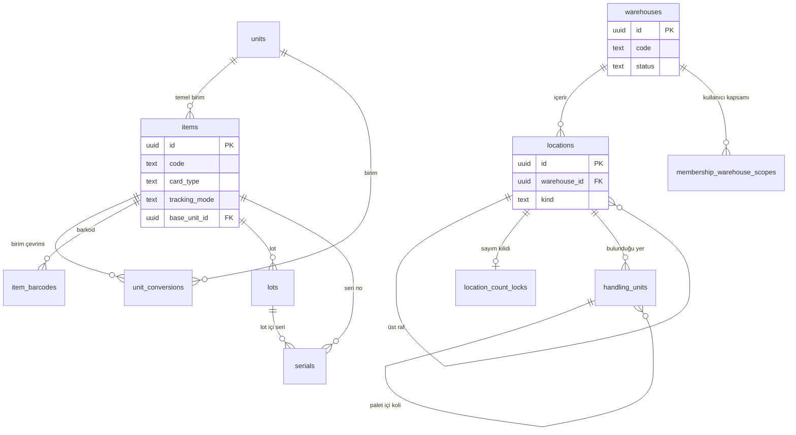
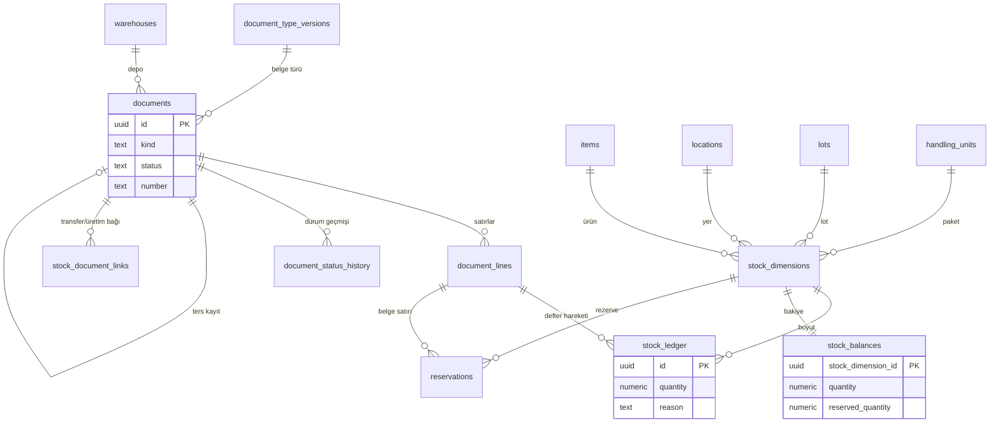
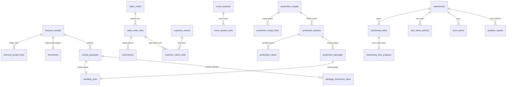

# 3A. Veri Sözlüğü — Depo, Katalog, Stok ve Operasyon Tabloları

> Kaynak: `packages/db/migrations/*.up.sql` (0010–0057). Her tablo **son hâliyle** yazıldı; sonradan gelen `ALTER TABLE` eklemeleri tabloya işlendi ve hangi migration'dan geldiği parantezle belirtildi.
> Bu dosya yalnız SQL'de olanı anlatır; tahmin yoktur. Kimlik, ekip, platform (yönetim paneli), destek ve entegrasyon tabloları ayrı dosyadadır.

## Okumadan önce: ortak kavramlar

| Kavram | Sade anlamı |
|---|---|
| `tenant_id` (uuid, NULL olamaz, `tenants.id`'ye bağlı) | Kaydın **hangi müşteri firmaya** ait olduğu. Her tabloda var. Veritabanı, oturumdaki firma dışındaki satırları hiç göstermez (RLS). |
| `id` (uuid, varsayılan rastgele) | Kaydın değişmez kimlik numarası. |
| `created_at` (timestamptz, varsayılan şimdi) | Kaydın oluştuğu an. |
| `version` (integer, ≥1) | "Aynı kaydı iki kişi aynı anda değiştirmesin" sayacı. Her güncellemede tetikleyici 1 artırır; eski sürümle gelen kayıt reddedilir. |
| `status` + `archived_at` | Silme yerine **arşivleme**: `ARCHIVED` ise `archived_at` dolu olmak zorundadır (CHECK). |
| Bileşik FK `(tenant_id, x_id)` | Başka tabloya bağlanırken firma numarası da eşleşmek zorundadır; bir firmanın kaydı başka firmanın kaydına **bağlanamaz**. |
| RLS ENABLE + FORCE | Satır düzeyi güvenlik açık ve tablo sahibine bile zorunlu: firma bağlamı yoksa tablo boş görünür. |
| Append-only | Kayıt yalnız eklenir; UPDATE/DELETE/TRUNCATE tetikleyiciyle reddedilir. |
| `numeric(20,6)` | Miktar tipi: ondalıklı, 6 haneye kadar hassas; kayan nokta (float) kullanılmaz. |

**Not:** Bu tablolarla ilgili firma ayarları (`tenant_settings.receiving_qc_enabled` 0016, `count_abandon_hours` 0017, `shift_start`/`shift_end` 0037) kimlik/firma sözlüğünde anlatılır. Ayrı bir "outbox" tablosu bu kapsamda yoktur; kuyruk işleri pg-boss kütüphanesinin kendi şemasındadır, tüketici tekilleştirmesi `processed_events` tablosundadır.

---

## İlişki diyagramları

### a) Depo ve katalog

### b) Stok motoru (belge → defter → bakiye)

### c) Operasyon, paket ve üretim

---

## 1. Depo ve raf (lokasyon) tabloları

### warehouses
Firmanın depoları (ör. Hammadde Deposu, Mamul Deposu). Her şey bir depoya bağlıdır.

| Alan Adı | Veri Tipi | Kısıtlar | İş Anlamı | Bağlı Olduğu Tablo/Alan |
|---|---|---|---|---|
| tenant_id | uuid | NULL olamaz, FK | Firma | tenants.id |
| id | uuid | PK, varsayılan rastgele | Depo kimliği | — |
| code | text | NULL olamaz, firma içinde tekil, boş olamaz | Depo kodu (ör. HMD) | — |
| name | text | NULL olamaz, boş olamaz | Depo adı | — |
| status | text | Varsayılan `ACTIVE`, CHECK | Kullanımda mı arşivde mi | — |
| created_at | timestamptz | Varsayılan şimdi | Oluşturulma anı | — |
| archived_at | timestamptz | NULL olabilir; ARCHIVED ⇔ dolu | Arşivlenme anı | — |
| is_sample | boolean | Varsayılan false (0040) | Deneme hesabındaki örnek veri mi | — |

- **Durum kodları:** `ACTIVE` = Kullanımda · `ARCHIVED` = Arşivlendi (yeni işlemde seçilemez, geçmiş korunur).
- **Koruma:** RLS ENABLE + FORCE.

### locations
Depo içindeki adresler: raf, göz, kabul alanı vb. Ağaç yapısındadır (bölge → raf → göz).

| Alan Adı | Veri Tipi | Kısıtlar | İş Anlamı | Bağlı Olduğu Tablo/Alan |
|---|---|---|---|---|
| tenant_id | uuid | NULL olamaz | Firma | tenants.id |
| id | uuid | PK | Lokasyon kimliği | — |
| warehouse_id | uuid | NULL olamaz, FK | Hangi depoda | warehouses.id |
| parent_id | uuid | NULL olabilir, FK (aynı depo), kendisi olamaz | Üst lokasyon (ör. rafın bölgesi) | locations.id |
| code | text | NULL olamaz, depo içinde tekil | Adres kodu (ör. A-01-03) | — |
| name | text | NULL olamaz | Adres adı | — |
| depth | smallint | Varsayılan 0; üstü yoksa 0, varsa >0 | Ağaçtaki derinlik | — |
| kind | text | NULL olamaz, CHECK | Lokasyonun işlevi | — |
| pick_blocked | boolean | Varsayılan false | Bu adresten toplama yapılamaz | — |
| status | text | Varsayılan `ACTIVE` | Kullanımda/arşiv | — |
| created_at / archived_at | timestamptz | — | Oluşma / arşiv anı | — |
| is_sample | boolean | Varsayılan false (0040) | Örnek veri mi | — |

- **Durum kodları (`kind`):** `RECEIVING` = Mal kabul alanı (gelen mal önce buraya girer) · `STORAGE` = Saklama rafı · `STAGING` = Sevkiyat hazırlık alanı · `TRANSIT` = Yolda/aktarmada.
- `status`: `ACTIVE` / `ARCHIVED`.
- **Koruma:** RLS ENABLE + FORCE.

### location_count_locks
Bir lokasyonda sayım sürerken başka işlemlerin o adresi değiştirmesini engelleyen kilit kaydı.

| Alan Adı | Veri Tipi | Kısıtlar | İş Anlamı | Bağlı Olduğu Tablo/Alan |
|---|---|---|---|---|
| tenant_id | uuid | NULL olamaz | Firma | tenants.id |
| location_id | uuid | PK, FK | Kilitlenen lokasyon | locations.id |
| status | text | Varsayılan `IDLE`, CHECK | Sayımda mı | — |
| count_session_id | uuid | COUNTING ise dolu, FK (0017) | Hangi sayım kilitledi | count_sessions.id |
| locked_at | timestamptz | COUNTING ise dolu | Kilit anı | — |
| locked_by | uuid | COUNTING ise dolu, FK | Kilitleyen kullanıcı (üyelik) | tenant_memberships.id |

- **Durum kodları:** `IDLE` = Serbest · `COUNTING` = Sayılıyor (dört alanın hepsi dolu olmak zorunda).
- **Koruma:** RLS ENABLE + FORCE.

### membership_warehouse_scopes
Bir kullanıcının **yalnız belirli depoları** görmesi isteniyorsa hangi depolara yetkili olduğunu tutar.

| Alan Adı | Veri Tipi | Kısıtlar | İş Anlamı | Bağlı Olduğu Tablo/Alan |
|---|---|---|---|---|
| tenant_id | uuid | PK parçası | Firma | tenants.id |
| membership_id | uuid | PK parçası, FK | Kullanıcının firmadaki üyeliği | tenant_memberships.id |
| warehouse_id | uuid | PK parçası, FK | İzin verilen depo | warehouses.id |
| created_at | timestamptz | Varsayılan şimdi | Yetkinin verildiği an | — |

- **Koruma:** RLS ENABLE + FORCE.

---

## 2. Katalog (ürün kartı) ve izlenebilirlik tabloları

### units
Ölçü birimleri (ADET, KG, MT, KOLI…). 0031 ile her firmaya standart 10 birim eklendi: ADET, KG, GR, MT, CM, LT, M2, M3, KOLI, PALET.

| Alan Adı | Veri Tipi | Kısıtlar | İş Anlamı | Bağlı Olduğu Tablo/Alan |
|---|---|---|---|---|
| tenant_id | uuid | NULL olamaz | Firma | tenants.id |
| id | uuid | PK | Birim kimliği | — |
| code | text | Firma içinde tekil | Birim kodu (KG) | — |
| name | text | NULL olamaz | Birim adı (Kilogram) | — |
| status | text | Varsayılan `ACTIVE` | `ACTIVE`/`ARCHIVED` | — |
| created_at / archived_at | timestamptz | — | Oluşma / arşiv | — |

- **Koruma:** RLS ENABLE + FORCE.

### items
Ürün (stok) kartı. Stokta tutulan her malzemenin ana kaydı.

| Alan Adı | Veri Tipi | Kısıtlar | İş Anlamı | Bağlı Olduğu Tablo/Alan |
|---|---|---|---|---|
| tenant_id | uuid | NULL olamaz | Firma | tenants.id |
| id | uuid | PK | Ürün kimliği | — |
| code | text | Firma içinde tekil, boş olamaz | Ürün kodu (ör. HM-000001) | — |
| name | text | Boş olamaz | Ürün adı | — |
| base_unit_id | uuid | NULL olamaz, FK | Stoğun tutulduğu temel birim | units.id |
| tracking_mode | text | Varsayılan `NONE`, CHECK | Lot/seri takibi | — |
| quantity_scale | smallint | Varsayılan 0, 0–6 arası | Miktarda kaç ondalık hane kullanılır | — |
| pick_policy | text | Varsayılan `FIFO`, CHECK | Toplamada hangi stok önce çıkar | — |
| status | text | Varsayılan `ACTIVE` | `ACTIVE`/`ARCHIVED` | — |
| card_type | text | Varsayılan `TM`, CHECK (0031) | Kart türü | — |
| created_at / archived_at | timestamptz | — | Oluşma / arşiv | — |
| is_sample | boolean | Varsayılan false (0040) | Örnek veri mi | — |

- **Durum kodları:**
  - `tracking_mode`: `NONE` = Takipsiz · `LOT` = Lot (parti) takipli · `SERIAL` = Her adet seri numaralı · `LOT_AND_SERIAL` = Hem lot hem seri.
  - `pick_policy`: `FIFO` = İlk giren ilk çıkar · `FEFO` = Son kullanma tarihi en yakın olan önce çıkar.
  - `card_type`: `HM` = Hammadde · `YM` = Yarı mamul · `MM` = Mamul · `TM` = Ticari mal (al-sat).
- **Koruma:** RLS ENABLE + FORCE. Stoğu olan ürünün takip modu tetikleyiciyle sessizce değiştirilemez (`items_guard_tracking_mode`).

### unit_conversions
Ürüne özel birim çevrimi (ör. 1 KOLI = 12 ADET).

| Alan Adı | Veri Tipi | Kısıtlar | İş Anlamı | Bağlı Olduğu Tablo/Alan |
|---|---|---|---|---|
| tenant_id | uuid | NULL olamaz | Firma | tenants.id |
| id | uuid | PK | Çevrim kimliği | — |
| item_id | uuid | FK; (ürün, birim) tekil | Hangi ürün | items.id |
| unit_id | uuid | FK | Alternatif birim | units.id |
| to_base_factor | numeric(20,6) | > 0 | 1 alternatif birim = kaç temel birim | — |
| created_at | timestamptz | — | Oluşma | — |

- **Koruma:** RLS ENABLE + FORCE.

### item_barcodes
Ürüne bağlı barkodlar. Bir barkod belli bir birimi ve paket içi miktarı da gösterebilir.

| Alan Adı | Veri Tipi | Kısıtlar | İş Anlamı | Bağlı Olduğu Tablo/Alan |
|---|---|---|---|---|
| tenant_id | uuid | NULL olamaz | Firma | tenants.id |
| id | uuid | PK | Barkod kaydı | — |
| item_id | uuid | FK | Ürün | items.id |
| unit_id | uuid | NULL olabilir, FK | Barkodun birimi (ör. koli barkodu) | units.id |
| barcode | text | Boş olamaz; (ürün, birim, barkod) tekil | Barkod değeri | — |
| quantity | numeric(20,6) | NULL olabilir, >0 | Barkod okununca gelen miktar | — |
| created_at | timestamptz | — | Oluşma | — |

- **Koruma:** RLS ENABLE + FORCE.

### inventory_owners
Stoğun **sahibi** (ör. emanet/konsinye mal başka firmaya aitse). Stok boyutlarında ayrı tutulur.

| Alan Adı | Veri Tipi | Kısıtlar | İş Anlamı | Bağlı Olduğu Tablo/Alan |
|---|---|---|---|---|
| tenant_id | uuid | NULL olamaz | Firma | tenants.id |
| id | uuid | PK | Sahip kimliği | — |
| code / name | text | Kod firma içinde tekil, boş olamaz | Sahip kodu / adı | — |
| created_at | timestamptz | — | Oluşma | — |

- **Koruma:** RLS ENABLE + FORCE.

### lots
Lot (parti) kaydı: aynı üretimden gelen malları birlikte izlemek için.

| Alan Adı | Veri Tipi | Kısıtlar | İş Anlamı | Bağlı Olduğu Tablo/Alan |
|---|---|---|---|---|
| tenant_id | uuid | NULL olamaz | Firma | tenants.id |
| id | uuid | PK | Lot kimliği | — |
| item_id | uuid | FK; (ürün, lot kodu) tekil | Hangi ürünün lotu | items.id |
| lot_code | text | Boş olamaz | Lot numarası | — |
| production_date | date | NULL olabilir | Üretim tarihi | — |
| expiry_date | date | NULL olabilir; üretimden önce olamaz | Son kullanma tarihi | — |
| supplier_lot | text | NULL olabilir | Tedarikçinin kendi lot numarası | — |
| package_dates | date[] | Hesaplanan [üretim, SKT], NULL olamaz (0032) | Paket kaydındaki tarihlerin lotla birebir eşleşmesi için yardımcı alan | receipt_packages / production_packages |
| created_at | timestamptz | — | Oluşma | — |

- **Koruma:** RLS ENABLE + FORCE. Pakete bağlı lotun tarihleri tetikleyiciyle değiştirilemez (0032).

### serials
Seri numarası (her biri tek adet).

| Alan Adı | Veri Tipi | Kısıtlar | İş Anlamı | Bağlı Olduğu Tablo/Alan |
|---|---|---|---|---|
| tenant_id | uuid | NULL olamaz | Firma | tenants.id |
| id | uuid | PK | Seri kaydı | — |
| item_id | uuid | FK; (ürün, seri no) tekil | Ürün | items.id |
| serial_no | text | Boş olamaz | Seri numarası | — |
| lot_id | uuid | NULL olabilir, FK (aynı ürünün lotu) | Serinin ait olduğu lot | lots.id |
| created_at | timestamptz | — | Oluşma | — |

- **Koruma:** RLS ENABLE + FORCE. Serinin lotu sonradan değiştirilemez (tetikleyici).

### handling_units
Fiziksel taşıma birimi: koli, palet, varil. Etiketteki **paket QR** bu kaydı gösterir.

| Alan Adı | Veri Tipi | Kısıtlar | İş Anlamı | Bağlı Olduğu Tablo/Alan |
|---|---|---|---|---|
| tenant_id | uuid | NULL olamaz | Firma | tenants.id |
| id | uuid | PK | Paket kimliği (QR'deki kimlik) | — |
| kind | text | CHECK (0032'de VARIL eklendi) | Paket türü | — |
| code | text | Firma içinde tekil | Paket kodu | — |
| parent_id | uuid | NULL olabilir, FK, kendisi olamaz | İçinde bulunduğu palet | handling_units.id |
| location_id | uuid | NULL olabilir, FK | Bulunduğu lokasyon | locations.id |
| status | text | Varsayılan `OPEN` | Paket durumu | — |
| package_receipt_id | uuid | NULL olabilir (0032) | Mal kabulde doğduysa hangi kabul | receipt_packages |
| package_production_id | uuid | NULL olabilir (0036); kabul ile birlikte dolu olamaz | Üretimde doğduysa hangi parti | production_packages |
| created_at | timestamptz | — | Oluşma | — |

- **Durum kodları:** `kind`: `KOLI` = Koli · `PALET` = Palet · `VARIL` = Varil. `status`: `OPEN` = Açık/dolu · `CLOSED` = Kapatıldı · `EMPTIED` = Boşaldı (kimlik tekrar kullanılmaz).
- **Koruma:** RLS ENABLE + FORCE. Paket kökeni (kabul/üretim işareti) yalnız oluşturulurken yazılır, sonra değiştirilemez (tetikleyici, 0032/0036).

### code_history
Ürün, depo veya lokasyon kodu değiştiğinde eski ve yeni kodu saklar (eski etiketler okunduğunda bulunabilsin diye).

| Alan Adı | Veri Tipi | Kısıtlar | İş Anlamı | Bağlı Olduğu Tablo/Alan |
|---|---|---|---|---|
| tenant_id | uuid | NULL olamaz | Firma | tenants.id |
| id | uuid | PK | Kayıt | — |
| entity_type | text | CHECK | Neyin kodu değişti | — |
| entity_id | uuid | NULL olamaz | Değişen kaydın kimliği | items / warehouses / locations (çok biçimli, FK yok) |
| old_code / new_code | text | Boş olamaz, birbirinden farklı | Eski / yeni kod | — |
| changed_at | timestamptz | Varsayılan şimdi | Değişiklik anı | — |
| changed_by | uuid | NULL olamaz | Değiştiren kullanıcı | — |

- **Durum kodları:** `item` = Ürün · `warehouse` = Depo · `location` = Lokasyon.
- **Koruma:** RLS ENABLE + FORCE.

### parties
Cari kartlar: müşteri ve tedarikçiler (0050).

| Alan Adı | Veri Tipi | Kısıtlar | İş Anlamı | Bağlı Olduğu Tablo/Alan |
|---|---|---|---|---|
| tenant_id | uuid | PK parçası, FK | Firma | tenants.id |
| id | uuid | PK parçası | Cari kimliği | — |
| code | text | 1–64 karakter | Cari kodu (yazıldığı gibi) | — |
| code_key | text | Büyük harf, firma içinde tekil | Karşılaştırma için büyük harfli kod | — |
| name | text | 1–200 karakter | Ünvan | — |
| kind | text | Varsayılan `CUSTOMER`, CHECK | Cari türü | — |
| tax_no | text | NULL olabilir, 1–20, harf/rakam | Vergi / TC no | — |
| tax_office | text | NULL olabilir, ≤100 | Vergi dairesi | — |
| phone | text | NULL olabilir, ≤40, telefon karakterleri | Telefon | — |
| email | text | NULL olabilir, e-posta biçimi | E-posta | — |
| city | text | NULL olabilir, ≤100 | Şehir | — |
| address | text | NULL olabilir, ≤500 | Adres | — |
| archived_at | timestamptz | NULL olabilir | Arşiv anı | — |
| created_by | uuid | NULL olamaz, FK | Oluşturan | tenant_memberships.id |
| created_at / updated_at | timestamptz | `updated_at` tetikleyiciyle güncellenir | Oluşma / son değişiklik | — |
| version | integer | ≥1 | Eşzamanlı düzenleme sayacı | — |

- **Durum kodları:** `CUSTOMER` = Müşteri · `SUPPLIER` = Tedarikçi · `BOTH` = İkisi de.
- **Koruma:** RLS ENABLE + FORCE.

---

## 3. Stok belgeleri (fiş) tabloları

### document_type_versions
Belge türü tanımlarının sürümlü listesi (sistem geneli veya firmaya özel). Her belge oluşturulduğu andaki tanıma bağlanır.

| Alan Adı | Veri Tipi | Kısıtlar | İş Anlamı | Bağlı Olduğu Tablo/Alan |
|---|---|---|---|---|
| id | uuid | PK | Tanım kimliği | — |
| tenant_id | uuid | **NULL olabilir** (NULL = tüm firmalar için sistem tanımı), FK | Firma | tenants.id |
| key | text | Boş olamaz | Belge türü anahtarı (STOCK_IN vb.) | documents.kind |
| version | integer | ≥1; (firma, anahtar, sürüm) tekil | Tanım sürümü | — |
| definition | jsonb | Varsayılan `{}`, nesne olmalı | Tür ayarları | — |
| created_at | timestamptz | — | Oluşma | — |

- **Koruma:** RLS ENABLE + FORCE.

### number_sequences
Belge numarası sayaçları: firma × belge türü × dönem (yıl) başına sıradaki numara.

| Alan Adı | Veri Tipi | Kısıtlar | İş Anlamı | Bağlı Olduğu Tablo/Alan |
|---|---|---|---|---|
| tenant_id | uuid | PK parçası | Firma | tenants.id |
| document_kind | text | PK parçası, CHECK | Hangi belge türünün sayacı | — |
| period | text | PK parçası, boş olamaz | Dönem (ör. 2026) | — |
| next_value | bigint | Varsayılan 1, ≥1 | Verilecek sıradaki numara | — |

- **Durum kodları:** `STOCK_IN`, `STOCK_OUT`, `STOCK_MOVE`, `REVERSAL`, `COUNT_ADJUSTMENT` (0017), `INBOUND_RECEIPT` (0022, mal kabul numarası `KBL-<yıl>-<n>`).
- **Koruma:** RLS ENABLE + FORCE.

### documents
**Stok fişinin başlığı.** Stoğa giren/çıkan/yer değiştiren her hareket önce bir fiş olarak açılır; fiş "işlendi" (POSTED) olunca deftere yazılır.

| Alan Adı | Veri Tipi | Kısıtlar | İş Anlamı | Bağlı Olduğu Tablo/Alan |
|---|---|---|---|---|
| tenant_id | uuid | NULL olamaz | Firma | tenants.id |
| id | uuid | PK | Fiş kimliği | — |
| kind | text | CHECK | Fiş türü | document_type_versions.key |
| type_version_id | uuid | NULL olamaz, FK | Oluşturulduğu tür tanımı | document_type_versions.id |
| number | text | NULL olabilir; POSTED ise zorunlu; (firma, tür, no) tekil | Fiş numarası (sunucu verir) | number_sequences |
| status | text | Varsayılan `DRAFT`, CHECK | Fiş durumu | — |
| version | integer | Varsayılan 1 | Eşzamanlı düzenleme sayacı | — |
| warehouse_id | uuid | NULL olamaz, FK | Fişin deposu | warehouses.id |
| business_date | date | NULL olamaz | İşlem (belge) tarihi | — |
| reversal_of_document_id | uuid | REVERSAL türünde zorunlu, diğerlerinde boş; kendisi olamaz | Ters kaydı yapılan asıl fiş | documents.id |
| posting_job_id | uuid | `posting_requested_by` ile birlikte dolar; yalnız APPROVED iken | Arka planda işleme işinin kimliği | — |
| posting_requested_by | uuid | Yukarıdakiyle çift | İşlemeyi isteyen kişi | — |
| reason | text | NULL olabilir, ≤500 | Açıklama/gerekçe | — |
| created_by | uuid | NULL olamaz | Oluşturan | — |
| created_at | timestamptz | — | Oluşma | — |
| source_kind | text | NULL olabilir, CHECK (0016); `source_id` ile çift | Fişi doğuran iş türü | — |
| source_id | uuid | NULL olabilir (0016) | Fişi doğuran kaydın kimliği | inbound_receipts / sales_orders / customer_returns / count_sessions / warehouse_tasks (çok biçimli) |
| posting_mfa_verified_at | timestamptz | NULL olabilir (0023); yalnız işleme kilidi doluyken | İşlemeyi isteyenin iki adımlı doğrulama anı | — |
| posting_idempotency_record_id | uuid | NULL olabilir (0023) | İşleme isteğinin tekrar-koruma kaydı | idempotency_records.id |

- **Durum kodları:**
  - `kind`: `STOCK_IN` = Stok girişi · `STOCK_OUT` = Stok çıkışı · `STOCK_MOVE` = Yer/durum değiştirme (transfer, rafa kaldırma, kalite onayı) · `REVERSAL` = Ters kayıt (iptal yerine) · `COUNT_ADJUSTMENT` = Sayım farkı düzeltmesi.
  - `status`: `DRAFT` = Taslak, stoka işlemedi · `APPROVED` = Onaylandı, işlenmeyi bekliyor · `POSTED` = İşlendi, stok değişti (artık silinemez/değiştirilemez) · `CANCELLED` = İptal (işlenmeden vazgeçildi).
  - `source_kind`: `INBOUND_RECEIPT` = Mal kabul · `SALES_ORDER` = Satış siparişi · `CUSTOMER_RETURN` = Müşteri iadesi · `COUNT_SESSION` = Sayım · `TASK` = Depo görevi.
- **Koruma:** RLS ENABLE + FORCE. İşleme damgaları yalnız işleme kilidiyle aynı anda yazılabilir (0024 tetikleyici). Pakete/üretime bağlı fişlerin içeriği tetikleyiciyle donuktur (0032, 0034, 0035, 0036).

### document_lines
Fişin satırları: hangi ürün, ne kadar, nereden nereye.

| Alan Adı | Veri Tipi | Kısıtlar | İş Anlamı | Bağlı Olduğu Tablo/Alan |
|---|---|---|---|---|
| tenant_id | uuid | NULL olamaz | Firma | tenants.id |
| id | uuid | PK | Satır kimliği | — |
| document_id | uuid | FK | Bağlı fiş | documents.id |
| line_no | integer | ≥1; fiş içinde tekil | Satır no | — |
| item_id | uuid | FK | Ürün | items.id |
| unit_id | uuid | FK | Girilen birim | units.id |
| quantity | numeric(20,6) | >0 | Girilen birimde miktar | — |
| conversion_factor | numeric(20,6) | >0 | O anki çevrim katsayısı (belgeye kopyalanır, sonradan değişmez) | unit_conversions |
| base_quantity | numeric(20,6) | >0 | Temel birimde miktar | — |
| source_location_id | uuid | NULL olabilir, FK; kaynak veya hedeften en az biri dolu | Çıkış yeri | locations.id |
| target_location_id | uuid | NULL olabilir, FK | Giriş yeri | locations.id |
| lot_id | uuid | NULL olabilir, FK (aynı ürünün lotu) | Lot | lots.id |
| serial_id | uuid | NULL olabilir, FK (aynı ürünün serisi) | Seri | serials.id |
| stock_status | text | Varsayılan `AVAILABLE`, CHECK | Stoğun durumu | — |
| inventory_owner_id | uuid | NULL olabilir, FK | Stok sahibi | inventory_owners.id |
| handling_unit_id | uuid | NULL olabilir, FK | Paket | handling_units.id |
| reversed_quantity | numeric(20,6) | Varsayılan 0, ≥0 | Ters kayıtla geri alınmış miktar | — |
| reversal_status | text | Varsayılan `NONE`; NONE ⇔ ters miktar 0 | Ters kayıt durumu | — |
| created_at | timestamptz | — | Oluşma | — |
| source_line_id | uuid | NULL olabilir (0016) | Satırı doğuran kaynak satır (kabul/sipariş satırı) | çok biçimli |
| target_stock_status | text | NULL olabilir, CHECK (0016); yalnız STOCK_MOVE'da ve izinli çiftlerde (0020) | Durum değiştirmede hedef durum | — |

- **Durum kodları:**
  - `stock_status` / `target_stock_status`: `AVAILABLE` = Kullanılabilir · `QUARANTINE` = Karantina (kalite onayı bekliyor) · `DAMAGED` = Hasarlı · `BLOCKED` = Bloke. İzinli durum değiştirme çiftleri yalnız `QUARANTINE→AVAILABLE` ve `AVAILABLE→QUARANTINE` (0020).
  - `reversal_status`: `NONE` = Geri alınmadı · `PARTIAL` = Kısmen geri alındı · `FULL` = Tamamen geri alındı.
- **Koruma:** RLS ENABLE + FORCE. İşlenmiş satırda yalnız `reversed_quantity` / `reversal_status` değişebilir (tetikleyici).

### document_status_history
Fişin her durum değişikliğinin tarihçesi (kim, ne zaman, neden).

| Alan Adı | Veri Tipi | Kısıtlar | İş Anlamı | Bağlı Olduğu Tablo/Alan |
|---|---|---|---|---|
| tenant_id | uuid | NULL olamaz | Firma | tenants.id |
| id | uuid | PK | Kayıt | — |
| document_id | uuid | FK | Fiş | documents.id |
| from_status | text | NULL olabilir (ilk kayıt), CHECK | Önceki durum | — |
| to_status | text | NULL olamaz, CHECK | Yeni durum | — |
| actor_user_id | uuid | NULL olabilir | Değiştiren kişi | — |
| reason | text | NULL olabilir, ≤500 | Gerekçe | — |
| occurred_at | timestamptz | Varsayılan şimdi | An | — |
| created_xid | xid8 | Varsayılan işlem kimliği | Veritabanı işlem sırası (tutarlı okuma için) | — |

- **Durum kodları:** `DRAFT`, `APPROVED`, `POSTED`, `CANCELLED` (documents ile aynı).
- **Koruma:** RLS ENABLE + FORCE.

### idempotency_records
"Aynı istek iki kez gelirse stok iki kez değişmesin" koruması. Bağlantı kopup tekrar gönderilen istek önceki sonucu alır.

| Alan Adı | Veri Tipi | Kısıtlar | İş Anlamı | Bağlı Olduğu Tablo/Alan |
|---|---|---|---|---|
| tenant_id | uuid | NULL olamaz | Firma | tenants.id |
| id | uuid | PK | Kayıt | — |
| command_type | text | Boş olamaz; (firma, komut, anahtar) tekil | Hangi komut (ör. belge işleme) | — |
| client_key | uuid | NULL olamaz | İstemcinin ürettiği tekrar anahtarı | — |
| actor_user_id | uuid | NULL olamaz | İsteyen kişi | — |
| request_hash | text | 64 hane onaltılık | İstek içeriğinin özeti (aynı anahtar + farklı içerik reddedilir) | — |
| status | text | Varsayılan `IN_PROGRESS`, CHECK | İsteğin sonucu | — |
| result | jsonb | NULL olabilir; yalnız izinli anahtarlar | Dönen sonuç (belge no, durum…) | — |
| error_code | text | REJECTED/FAILED ise dolu | Hata kodu | — |
| http_status | integer | NULL olabilir, 100–599 | Dönen HTTP kodu | — |
| created_at / completed_at | timestamptz | IN_PROGRESS ⇔ completed_at boş | Başlama / bitiş | — |

- **Durum kodları:** `IN_PROGRESS` = Sürüyor · `COMPLETED` = Başarılı · `REJECTED` = Kural gereği reddedildi · `FAILED` = Hata.
- **Koruma:** RLS ENABLE + FORCE.

### stock_document_links
İki fişi birbirine bağlar: transferde çıkış fişi ↔ giriş fişi, üretimde tüketim fişi ↔ mamul çıkış fişi.

| Alan Adı | Veri Tipi | Kısıtlar | İş Anlamı | Bağlı Olduğu Tablo/Alan |
|---|---|---|---|---|
| tenant_id | uuid | PK parçası, FK | Firma | tenants.id |
| source_document_id | uuid | PK parçası, FK; hedeften farklı | Kaynak fiş (çıkış/tüketim) | documents.id |
| target_document_id | uuid | NULL olamaz, FK (0029'dan sonra tekil değil: bir üretim çıktısına birden çok tüketim fişi bağlanabilir) | Hedef fiş (giriş/mamul) | documents.id |
| kind | text | CHECK | Bağ türü | — |
| created_at | timestamptz | — | Oluşma | — |
| recipe_id | uuid | PRODUCTION ⇔ dolu, FK (0029) | Kullanılan reçete | production_recipes.id |

- **Durum kodları:** `TRANSFER` = Depolar arası transfer · `PRODUCTION` = Üretim.
- **Koruma:** RLS ENABLE + FORCE. Paket transferine ait bağlar değiştirilemez/silinemez (0035 tetikleyici).

---

## 4. Stok motoru tabloları (asıl stok burada)

### stock_dimensions
Stoğun "adresi": ürün + lokasyon + lot + seri + durum + sahip + paket birleşimi. Her farklı birleşim bir satırdır.

| Alan Adı | Veri Tipi | Kısıtlar | İş Anlamı | Bağlı Olduğu Tablo/Alan |
|---|---|---|---|---|
| tenant_id | uuid | NULL olamaz | Firma | tenants.id |
| id | uuid | PK | Boyut kimliği | — |
| item_id | uuid | FK | Ürün | items.id |
| location_id | uuid | FK | Lokasyon | locations.id |
| lot_id | uuid | NULL olabilir, FK | Lot | lots.id |
| serial_id | uuid | NULL olabilir, FK | Seri | serials.id |
| stock_status | text | Varsayılan `AVAILABLE`, CHECK | Stok durumu | — |
| inventory_owner_id | uuid | NULL olabilir, FK | Stok sahibi | inventory_owners.id |
| handling_unit_id | uuid | NULL olabilir, FK | Paket | handling_units.id |
| serial_key | uuid | Hesaplanan (seri yoksa sıfır kimlik) | Seri bazlı tekillik yardımcı alanı | — |
| created_at | timestamptz | — | Oluşma | — |

- Tüm boyut birleşimi firma içinde tekildir.
- **Durum kodları:** `AVAILABLE`, `QUARANTINE`, `DAMAGED`, `BLOCKED` (yukarıdaki gibi).
- **Koruma:** RLS ENABLE + FORCE. **Değiştirilemez ve silinemez** (tetikleyici). Ürünün takip moduna uymayan boyut (ör. lot takipli üründe lotsuz) eklenemez.

### stock_balances
Her stok boyutundaki **anlık miktar**. Defterden türetilir, aynı işlemde güncellenir.

| Alan Adı | Veri Tipi | Kısıtlar | İş Anlamı | Bağlı Olduğu Tablo/Alan |
|---|---|---|---|---|
| tenant_id | uuid | PK parçası | Firma | tenants.id |
| stock_dimension_id | uuid | PK parçası, FK | Hangi boyut | stock_dimensions.id |
| quantity | numeric(20,6) | Varsayılan 0, **≥0 (eksi stok yok)** | Eldeki miktar | — |
| reserved_quantity | numeric(20,6) | Varsayılan 0, 0 ≤ rezerve ≤ eldeki | Ayrılmış (siparişe bağlanmış) miktar | reservations |
| version | bigint | ≥0 | Eşzamanlılık sayacı | — |
| serial_key | uuid | Seri varsa miktar yalnız 0 veya 1 | Seri boyutunda tek adet kuralı | stock_dimensions.serial_key |

- Kullanılabilir miktar = `quantity − reserved_quantity` (hesaplanır, kolon değildir).
- **Koruma:** RLS ENABLE + FORCE. Güncelleme tetikleyicilerle denetlenir; defter–bakiye tutarlılığı işlem sonunda doğrulanır (`stock_balances_assert`).

### stock_ledger
**Stok defteri.** Her stok değişikliği buraya + veya − satır olarak eklenir. Stoğun asıl ve tek doğruluk kaynağıdır.

| Alan Adı | Veri Tipi | Kısıtlar | İş Anlamı | Bağlı Olduğu Tablo/Alan |
|---|---|---|---|---|
| tenant_id | uuid | NULL olamaz | Firma | tenants.id |
| id | uuid | PK | Hareket kimliği | — |
| document_id | uuid | FK (fiş satırıyla birlikte) | Hareketi doğuran fiş | documents.id |
| document_line_id | uuid | FK | Fiş satırı | document_lines.id |
| stock_dimension_id | uuid | FK | Hangi stok adresi | stock_dimensions.id |
| item_id | uuid | Tetikleyici doldurur; boyut ve satırla aynı ürün | Ürün | items.id |
| quantity | numeric(20,6) | 0 olamaz | Artı = giriş, eksi = çıkış | — |
| reason | text | Boş olamaz | Hareket nedeni | — |
| business_date | date | NULL olamaz | İşlem tarihi | — |
| occurred_at | timestamptz | Varsayılan şimdi (sunucu yazar) | Kayıt anı | — |
| actor_user_id | uuid | NULL olabilir | İşlemi yapan | — |
| created_xid | xid8 | Varsayılan işlem kimliği | Veritabanı işlem sırası | — |

- **Koruma:** RLS ENABLE + FORCE. **Append-only**: güncelleme, silme ve toplu boşaltma her koşulda reddedilir. Sunucu alanları istemciden yazılamaz.

### reservations
Stok ayırma: siparişe veya çıkış fişine bağlanmış, henüz çıkmamış miktar.

| Alan Adı | Veri Tipi | Kısıtlar | İş Anlamı | Bağlı Olduğu Tablo/Alan |
|---|---|---|---|---|
| tenant_id | uuid | NULL olamaz | Firma | tenants.id |
| id | uuid | PK | Rezerv kimliği | — |
| stock_dimension_id | uuid | FK | Ayrılan stok adresi | stock_dimensions.id |
| document_line_id | uuid | NULL olabilir (0016); sipariş satırıyla **tam biri** dolu | Çıkış fişi satırı | document_lines.id |
| order_line_id | uuid | NULL olabilir (0016) | Sipariş satırı | sales_order_lines.id |
| item_id | uuid | Tetikleyici doldurur | Ürün | items.id |
| quantity | numeric(20,6) | >0 | Ayrılan miktar | — |
| status | text | Varsayılan `ACTIVE`, CHECK | Rezerv durumu | — |
| expires_at | timestamptz | NULL olabilir; oluşmadan sonra | Ayırmanın süresi | — |
| created_at | timestamptz | — | Oluşma | — |
| closed_at | timestamptz | ACTIVE ⇔ boş | Kapanış | — |

- **Durum kodları:** `ACTIVE` = Ayrılmış · `CONSUMED` = Sevk edilerek kullanıldı · `RELEASED` = Serbest bırakıldı.
- **Koruma:** RLS ENABLE + FORCE. Güncellemeler tetikleyiciyle denetlenir.

---

## 5. Güvenilirlik (arka plan doğrulama) tabloları

### processed_events
Kuyruktaki bir işin aynı tüketici tarafından iki kez işlenmesini önler.

| Alan Adı | Veri Tipi | Kısıtlar | İş Anlamı | Bağlı Olduğu Tablo/Alan |
|---|---|---|---|---|
| tenant_id | uuid | NULL olabilir, FK | Firma (sistem işlerinde boş) | tenants.id |
| consumer | text | Boş olamaz, ≤200 | İşi tüketen bileşen | — |
| event_id | uuid | NULL olamaz; (firma, tüketici, olay) tekil | Kuyruk iş kimliği | — |
| processed_at | timestamptz | Varsayılan şimdi | İşlenme anı | — |

- **Koruma:** RLS ENABLE + FORCE.

### stock_consistency_runs
Defter ile bakiyenin birbirini tutup tutmadığını denetleyen arka plan koşusunun sonucu (firma başına).

| Alan Adı | Veri Tipi | Kısıtlar | İş Anlamı | Bağlı Olduğu Tablo/Alan |
|---|---|---|---|---|
| tenant_id | uuid | NULL olamaz | Firma | tenants.id |
| id | uuid | PK | Koşu kimliği | — |
| job_id | uuid | (firma, iş) tekil | Kuyruk iş kimliği | — |
| started_at / finished_at | timestamptz | Bitiş ≥ başlangıç | Süre | — |
| status | text | CHECK; OK ⇔ fark 0 | Sonuç | — |
| checked_dimensions | bigint | ≥0 | Denetlenen stok adresi sayısı | — |
| mismatch_count | integer | ≥0 | Tutmayan adres sayısı | — |
| findings | jsonb | Varsayılan `[]` | Farkların listesi | — |
| created_xid | xid8 | — | İşlem sırası | — |

- **Durum kodları:** `OK` = Tutarlı · `MISMATCH` = Fark bulundu.
- **Koruma:** RLS ENABLE + FORCE; sunucu alanları tetikleyiciyle yazılır.

### stock_consistency_signals
Tutarlılık denetiminin firmadan bağımsız özet sinyali (izleme için; firma kimliği içermez).

| Alan Adı | Veri Tipi | Kısıtlar | İş Anlamı | Bağlı Olduğu Tablo/Alan |
|---|---|---|---|---|
| id | uuid | PK | Sinyal | — |
| occurred_at | timestamptz | Varsayılan şimdi | An | — |
| status | text | CHECK | Sonuç | — |
| mismatch_count | integer | Varsayılan 0, ≥0 | Fark sayısı | — |
| created_xid | xid8 | — | İşlem sırası | — |

- **Durum kodları:** `OK` = Tutarlı · `MISMATCH` = Fark var · `FAILED` = Denetim çalışamadı.
- **Koruma:** RLS ENABLE + FORCE. Append-only.

---

## 6. Saha belgeleri: mal kabul, sipariş, iade

### inbound_receipts
**Mal kabul başlığı** (gelen sevkiyat). Numara `KBL-<yıl>-<n>` biçiminde sunucudan gelir.

| Alan Adı | Veri Tipi | Kısıtlar | İş Anlamı | Bağlı Olduğu Tablo/Alan |
|---|---|---|---|---|
| tenant_id | uuid | NULL olamaz | Firma | tenants.id |
| id | uuid | PK | Kabul kimliği | — |
| warehouse_id | uuid | FK | Kabul deposu | warehouses.id |
| number | text | Firma içinde tekil | Kabul numarası | number_sequences (INBOUND_RECEIPT) |
| supplier_ref | text | NULL olabilir, ≤100 | Tedarikçi / irsaliye referansı (serbest metin) | — |
| status | text | Varsayılan `DRAFT`, CHECK | Kabul durumu | — |
| version | integer | Tetikleyiciyle artar | Eşzamanlılık sayacı | — |
| created_by | uuid | NULL olamaz | Oluşturan | — |
| created_at | timestamptz | — | Oluşma | — |
| package_document_id | uuid | NULL olabilir, tekil, FK (0032) | Paketli kabulün stok fişi | documents.id |

- **Durum kodları:** `DRAFT` = Taslak · `OPEN` = Açık (kabul sürüyor) · `CLOSED` = Kapandı (tamamı işlendi) · `CANCELLED` = İptal.
- **Koruma:** RLS ENABLE + FORCE. Anahtar alanlar değiştirilemez; paket bağlantısı sonradan değişmez (0032).

### inbound_receipt_lines
Mal kabul satırları: beklenen / gelen / hasarlı miktar.

| Alan Adı | Veri Tipi | Kısıtlar | İş Anlamı | Bağlı Olduğu Tablo/Alan |
|---|---|---|---|---|
| tenant_id | uuid | NULL olamaz | Firma | tenants.id |
| id | uuid | PK | Satır | — |
| receipt_id | uuid | FK; kabul içinde satır no tekil | Kabul | inbound_receipts.id |
| line_no | integer | ≥1 | Satır no | — |
| item_id | uuid | FK | Ürün | items.id |
| unit_id | uuid | FK | Birim | units.id |
| conversion_factor | numeric(20,6) | >0 | Çevrim katsayısı | — |
| expected_quantity | numeric(20,6) | Varsayılan 0, ≥0 | Beklenen | — |
| received_quantity | numeric(20,6) | Varsayılan 0, ≥0 | Gelen | — |
| damaged_quantity | numeric(20,6) | Varsayılan 0, ≤ gelen | Hasarlı gelen | — |
| created_at | timestamptz | — | Oluşma | — |

- **Koruma:** RLS ENABLE + FORCE. Kapalı kabulün satırı değiştirilemez.

### sales_orders
Satış (sevk) siparişi başlığı.

| Alan Adı | Veri Tipi | Kısıtlar | İş Anlamı | Bağlı Olduğu Tablo/Alan |
|---|---|---|---|---|
| tenant_id | uuid | NULL olamaz | Firma | tenants.id |
| id | uuid | PK | Sipariş | — |
| number | text | Firma içinde tekil | Sipariş no | — |
| customer_ref | text | NULL olabilir, ≤100 | Müşteri referansı (serbest metin) | — |
| status | text | Varsayılan `OPEN`, CHECK | Durum | — |
| version | integer | Tetikleyiciyle artar | Sayaç | — |
| created_by | uuid | NULL olamaz | Oluşturan | — |
| created_at | timestamptz | — | Oluşma | — |

- **Durum kodları:** `OPEN` = Açık · `CLOSED` = Kapandı · `CANCELLED` = İptal.
- **Koruma:** RLS ENABLE + FORCE.

### sales_order_lines
Sipariş satırları; istenen, sevk edilen, iade edilen ve iptal edilen miktar.

| Alan Adı | Veri Tipi | Kısıtlar | İş Anlamı | Bağlı Olduğu Tablo/Alan |
|---|---|---|---|---|
| tenant_id | uuid | NULL olamaz | Firma | tenants.id |
| id | uuid | PK | Satır | — |
| order_id | uuid | FK | Sipariş | sales_orders.id |
| line_no | integer | ≥1 | Satır no | — |
| item_id | uuid | FK | Ürün | items.id |
| requested_quantity | numeric(20,6) | ≥0 | İstenen | — |
| shipped_quantity | numeric(20,6) | Varsayılan 0 | Sevk edilen | — |
| returned_quantity | numeric(20,6) | Varsayılan 0 | İade gelen | — |
| cancelled_quantity | numeric(20,6) | Varsayılan 0; sevk + iptal ≤ istenen | İptal edilen | — |
| created_at | timestamptz | — | Oluşma | — |

- Açık miktar = istenen − sevk − iptal (hesaplanır).
- **Koruma:** RLS ENABLE + FORCE. Kapalı siparişin satırı değiştirilemez.

### customer_returns
Müşteri iadesi başlığı.

| Alan Adı | Veri Tipi | Kısıtlar | İş Anlamı | Bağlı Olduğu Tablo/Alan |
|---|---|---|---|---|
| tenant_id | uuid | NULL olamaz | Firma | tenants.id |
| id | uuid | PK | İade | — |
| warehouse_id | uuid | FK | İadenin deposu | warehouses.id |
| number | text | Firma içinde tekil | İade no | — |
| status | text | Varsayılan `DRAFT` | Durum | — |
| version | integer | — | Sayaç | — |
| created_by / created_at | uuid / timestamptz | — | Oluşturan / an | — |

- **Durum kodları:** `DRAFT`, `OPEN`, `CLOSED`, `CANCELLED` (mal kabul ile aynı).
- **Koruma:** RLS ENABLE + FORCE.

### customer_return_lines
İade satırları; her satır bir sipariş satırına bağlıdır.

| Alan Adı | Veri Tipi | Kısıtlar | İş Anlamı | Bağlı Olduğu Tablo/Alan |
|---|---|---|---|---|
| tenant_id | uuid | NULL olamaz | Firma | tenants.id |
| id | uuid | PK | Satır | — |
| return_id | uuid | FK | İade | customer_returns.id |
| line_no | integer | ≥1 | Satır no | — |
| sales_order_line_id | uuid | FK (aynı ürün) | İade edilen sipariş satırı | sales_order_lines.id |
| item_id | uuid | FK | Ürün | items.id |
| quantity | numeric(20,6) | >0 | İade miktarı | — |
| created_at | timestamptz | — | Oluşma | — |

- **Koruma:** RLS ENABLE + FORCE.

---

## 7. Görev, sayım ve stok uyarısı tabloları

### warehouse_tasks
Saha personeline düşen iş: rafa kaldır, topla, sayım.

| Alan Adı | Veri Tipi | Kısıtlar | İş Anlamı | Bağlı Olduğu Tablo/Alan |
|---|---|---|---|---|
| tenant_id | uuid | NULL olamaz | Firma | tenants.id |
| id | uuid | PK | Görev | — |
| warehouse_id | uuid | FK | Depo | warehouses.id |
| kind | text | CHECK | Görev türü | — |
| status | text | Varsayılan `OPEN`, CHECK | Durum | — |
| assigned_membership_id | uuid | NULL olabilir; ASSIGNED ise dolu | Atanan kişi | tenant_memberships.id |
| group_id | uuid | NULL olabilir | Görev grubu | — |
| source_kind / source_id / source_line_id | text / uuid / uuid | Çift olarak dolu veya boş | Görevi doğuran iş | çok biçimli |
| location_id | uuid | NULL olabilir; görevin deposunda olmalı | Yer | locations.id |
| item_id | uuid | NULL olabilir, FK | Ürün | items.id |
| quantity | numeric(20,6) | NULL olabilir; doluysa >0 ve ürün dolu | Miktar | — |
| version | integer | Tetikleyiciyle artar | Sayaç | — |
| completed_at | timestamptz | DONE ⇔ dolu | Bitiş | — |
| created_at | timestamptz | — | Oluşma | — |

- **Durum kodları:**
  - `kind`: `PUTAWAY` = Rafa kaldırma · `PICK` = Toplama · `REPUTAWAY` = Yeniden yerleştirme · `COUNT` = Sayım.
  - `status`: `OPEN` = Açık (kimseye atanmadı) · `ASSIGNED` = Atandı · `DONE` = Bitti · `CANCELLED` = İptal.
  - `source_kind`: `INBOUND_RECEIPT`, `SALES_ORDER`, `CUSTOMER_RETURN`, `COUNT_SESSION`.
- **Koruma:** RLS ENABLE + FORCE. Geçişler ve anahtar alanlar tetikleyiciyle denetlenir.

### warehouse_task_progress
Personelin yarıda bıraktığı görevin hangi adımda kaldığı (telefon kapanırsa kaldığı yerden devam).

| Alan Adı | Veri Tipi | Kısıtlar | İş Anlamı | Bağlı Olduğu Tablo/Alan |
|---|---|---|---|---|
| tenant_id | uuid | PK parçası | Firma | tenants.id |
| task_id | uuid | PK parçası, FK | Görev | warehouse_tasks.id |
| membership_id | uuid | FK | Görevi yapan | tenant_memberships.id |
| task_version | integer | ≥1 | Görevin o anki sürümü | warehouse_tasks.version |
| step | text | CHECK | Kalınan adım | — |
| location_id | uuid | SCAN_TARGET dışında dolu | Okutulan yer | locations.id |
| item_id | uuid | FK | Ürün | items.id |
| quantity | numeric(20,6) | CONFIRM/SAVING'de dolu ve >0 | Girilen miktar | — |
| save_client_key | uuid | SAVING ⇔ dolu | Kaydetme tekrar anahtarı | — |
| created_at / updated_at | timestamptz | — | Zamanlar | — |

- **Durum kodları:** `SCAN_TARGET` = Yer okutuluyor · `ENTER_QUANTITY` = Miktar giriliyor · `CONFIRM` = Onay bekliyor · `SAVING` = Kaydediliyor.
- **Koruma:** RLS ENABLE + FORCE.

### count_sessions
Sayım oturumu (depo sayımı).

| Alan Adı | Veri Tipi | Kısıtlar | İş Anlamı | Bağlı Olduğu Tablo/Alan |
|---|---|---|---|---|
| tenant_id | uuid | NULL olamaz | Firma | tenants.id |
| id | uuid | PK | Sayım | — |
| warehouse_id | uuid | FK | Depo | warehouses.id |
| status | text | Varsayılan `COUNTING`, CHECK | Durum | — |
| blind | boolean | Varsayılan false | Kör sayım: sayan kişi sistemdeki miktarı görmez | — |
| started_by / started_at | uuid / timestamptz | FK | Başlatan / an | tenant_memberships.id |
| approved_by / approved_at | uuid / timestamptz | APPROVED/POSTED'da dolu; COUNTING/SUBMITTED'da boş | Onaylayan / an | tenant_memberships.id |
| cancel_reason | text | CANCELLED ⇔ dolu, ≤500 | İptal gerekçesi | — |

- **Durum kodları:** `COUNTING` = Sayılıyor · `SUBMITTED` = Sayım bitti, onay bekliyor · `APPROVED` = Onaylandı · `POSTED` = Fark stoka işlendi · `CANCELLED` = İptal.
- **Koruma:** RLS ENABLE + FORCE. Durum geçişleri tetikleyiciyle denetlenir.

### count_session_lines
Sayım satırları: sistemdeki miktar (referans) ve sayılan miktar.

| Alan Adı | Veri Tipi | Kısıtlar | İş Anlamı | Bağlı Olduğu Tablo/Alan |
|---|---|---|---|---|
| tenant_id | uuid | NULL olamaz | Firma | tenants.id |
| id | uuid | PK | Satır | — |
| session_id | uuid | FK (aynı depo) | Sayım | count_sessions.id |
| warehouse_id | uuid | FK | Depo | warehouses.id |
| location_id | uuid | FK (aynı depo) | Sayılan yer | locations.id |
| stock_dimension_id | uuid | NULL olabilir (boşsa referans 0) | Stok adresi | stock_dimensions.id |
| item_id | uuid | FK | Ürün | items.id |
| reference_quantity | numeric(20,6) | ≥0 | Sayım başında sistemdeki miktar | — |
| counted_quantity | numeric(20,6) | NULL olabilir, ≥0 | Sayılan miktar | — |
| counted_by / counted_at | uuid / timestamptz | Sayılan miktarla birlikte dolar | Sayan / an | tenant_memberships.id |
| created_at | timestamptz | — | Oluşma | — |

- **Koruma:** RLS ENABLE + FORCE. Kapanmış sayıma satır eklenemez/değiştirilemez.

### item_stock_policies
Depo × ürün bazında minimum–maksimum stok seviyesi.

| Alan Adı | Veri Tipi | Kısıtlar | İş Anlamı | Bağlı Olduğu Tablo/Alan |
|---|---|---|---|---|
| tenant_id | uuid | NULL olamaz | Firma | tenants.id |
| id | uuid | PK | Kayıt | — |
| warehouse_id | uuid | FK; (depo, ürün) tekil | Depo | warehouses.id |
| item_id | uuid | FK | Ürün | items.id |
| min_quantity | numeric(20,6) | ≥0, ≤ maks | Altına düşünce uyarı/satın alma önerisi | — |
| max_quantity | numeric(20,6) | — | Hedef üst seviye | — |
| version | integer | — | Sayaç | — |
| created_at | timestamptz | — | Oluşma | — |

- **Koruma:** RLS ENABLE + FORCE.

### stock_alerts
Min–maks kuralından doğan stok uyarısı.

| Alan Adı | Veri Tipi | Kısıtlar | İş Anlamı | Bağlı Olduğu Tablo/Alan |
|---|---|---|---|---|
| tenant_id | uuid | NULL olamaz | Firma | tenants.id |
| id | uuid | PK | Uyarı | — |
| kind | text | CHECK | Uyarı türü | — |
| warehouse_id | uuid | FK | Depo | warehouses.id |
| item_id | uuid | FK | Ürün | items.id |
| status | text | Varsayılan `OPEN` | Durum | — |
| observed_quantity | numeric(20,6) | ≥0 | Uyarı anındaki miktar | — |
| threshold | numeric(20,6) | ≥0 | Eşik | — |
| opened_at / resolved_at | timestamptz | RESOLVED ⇔ çözülme dolu | Açılış / çözülme | — |

- **Durum kodları:** `kind`: `MIN_MAX` = Minimumun altına düştü. `status`: `OPEN` = Açık · `RESOLVED` = Çözüldü.
- **Koruma:** RLS ENABLE + FORCE.

---

## 8. Üretim tabloları

### production_recipes
Üretim reçetesi (ürün ağacı). Değiştirilmez; yeni sürüm olarak eklenir.

| Alan Adı | Veri Tipi | Kısıtlar | İş Anlamı | Bağlı Olduğu Tablo/Alan |
|---|---|---|---|---|
| tenant_id | uuid | PK parçası, FK | Firma | tenants.id |
| id | uuid | PK parçası | Reçete | — |
| code | text | 1–64; (kod, sürüm) tekil | Reçete kodu | — |
| version | integer | >0 | Sürüm | — |
| name | text | 1–200 | Reçete adı | — |
| output_item_id | uuid | FK | Üretilen mamul | items.id |
| output_quantity | numeric(20,6) | >0 | Bir reçeteden çıkan mamul (temel birim) | — |
| created_by / created_at | uuid / timestamptz | — | Oluşturan / an | — |
| created_xid | xid8 | (0030) | Reçete "mühürü": satırlar yalnız reçeteyle aynı işlemde eklenebilir | — |

- **Koruma:** RLS ENABLE + FORCE.

### production_recipe_lines
Reçete girdileri (hammaddeler).

| Alan Adı | Veri Tipi | Kısıtlar | İş Anlamı | Bağlı Olduğu Tablo/Alan |
|---|---|---|---|---|
| tenant_id | uuid | PK parçası | Firma | tenants.id |
| recipe_id | uuid | PK parçası, FK | Reçete | production_recipes.id |
| line_no | integer | PK parçası, 1–100 | Satır no | — |
| item_id | uuid | FK; reçetede tekil | Girdi ürünü | items.id |
| quantity | numeric(20,6) | >0 | Gereken miktar (temel birim) | — |

- **Koruma:** RLS ENABLE + FORCE. Sonradan satır eklenemez (0030 tetikleyici).

### production_batches
Paketli üretim partisi: hangi reçeteyle, nereye, kaç mamul üretildi.

| Alan Adı | Veri Tipi | Kısıtlar | İş Anlamı | Bağlı Olduğu Tablo/Alan |
|---|---|---|---|---|
| tenant_id | uuid | PK parçası | Firma | tenants.id |
| id | uuid | PK parçası | Parti | — |
| recipe_id | uuid | FK | Reçete | production_recipes.id |
| output_document_id | uuid | FK, tekil | Mamul giriş fişi | documents.id |
| target_location_id | uuid | FK | Mamulün konduğu yer | locations.id |
| output_quantity | numeric(20,6) | >0 | Üretilen miktar | — |
| output_unit_id | uuid | FK | Birim | units.id |
| created_at | timestamptz | — | Oluşma | — |

- **Koruma:** RLS ENABLE + FORCE. Ekleme/değişiklik/silme tetikleyiciyle denetlenir (yalnız kurallı ekleme).

### production_inputs
Partide tüketilen hammadde paketleri.

| Alan Adı | Veri Tipi | Kısıtlar | İş Anlamı | Bağlı Olduğu Tablo/Alan |
|---|---|---|---|---|
| tenant_id | uuid | PK parçası | Firma | tenants.id |
| production_batch_id | uuid | PK parçası, FK | Parti | production_batches.id |
| handling_unit_id | uuid | PK parçası, FK | Tüketilen paket | handling_units.id |
| previous_document_line_id | uuid | FK | Paketin son hareket satırı | document_lines.id |
| sequence_no | integer | >0 | Paketin hareket sırası | — |
| current_balance_version | bigint | ≥0 | Tüketim anındaki bakiye sürümü | stock_balances.version |
| base_quantity | numeric(20,6) | >0 | Tüketilen miktar | — |
| created_at | timestamptz | — | Oluşma | — |

- **Koruma:** RLS ENABLE + FORCE; tetikleyici denetimli, toplu silme yok.

### production_packages
Üretimden çıkan mamul paketleri (etiket QR'si bunlar).

| Alan Adı | Veri Tipi | Kısıtlar | İş Anlamı | Bağlı Olduğu Tablo/Alan |
|---|---|---|---|---|
| tenant_id | uuid | NULL olamaz | Firma | tenants.id |
| id | uuid | PK; paket kimliğiyle aynı | Paket | handling_units.id |
| production_batch_id | uuid | FK | Parti | production_batches.id |
| document_id / document_line_id | uuid | FK, satır tekil | Mamul fişi ve satırı | document_lines |
| package_no | integer | 1–200; parti içinde tekil | Paket sıra no | — |
| lot_code | text | NULL olabilir, boş olamaz | Lot | — |
| produced_on / expires_on | date | SKT ≥ üretim | Üretim / son kullanma | — |
| catalog_lot_id | uuid | NULL olabilir; doluysa lot kodu zorunlu | Katalogdaki lot | lots.id |
| package_dates | date[] | Hesaplanan | Lot tarih eşleşmesi | lots.package_dates |
| created_at | timestamptz | — | Oluşma | — |

- **Koruma:** RLS ENABLE + FORCE; tetikleyici denetimli.

---

## 9. Paket (QR) kabul ve hareket tabloları

### receipt_packages
Mal kabulde oluşturulan fiziksel paketlerin değişmez kimlik kartı (0032). Miktar burada tutulmaz; asıl miktar fiş satırındadır.

| Alan Adı | Veri Tipi | Kısıtlar | İş Anlamı | Bağlı Olduğu Tablo/Alan |
|---|---|---|---|---|
| tenant_id | uuid | NULL olamaz | Firma | tenants.id |
| id | uuid | PK; paket kimliğiyle aynı | Paket | handling_units.id |
| receipt_id | uuid | FK | Mal kabul | inbound_receipts.id |
| receipt_line_id | uuid | FK, tekil | Kabul satırı | inbound_receipt_lines.id |
| document_id / document_line_id | uuid | FK, satır tekil | Kabul stok fişi ve satırı | document_lines |
| package_no | integer | 1–200; kabul içinde tekil | Paket sıra no | — |
| lot_code | text | NULL olabilir | Lot | — |
| produced_on / expires_on | date | SKT ≥ üretim | Tarihler | — |
| catalog_lot_id | uuid | NULL olabilir | Katalog lotu | lots.id |
| package_dates | date[] | Hesaplanan | Lot tarih eşleşmesi | lots.package_dates |
| created_at | timestamptz | — | Oluşma | — |

- **Koruma:** RLS ENABLE + FORCE. Paket bilgisi taslak dahil **değiştirilemez/silinemez**; bağlı kabul, fiş, satır ve lot kayıtları da tetikleyicilerle korunur.

### package_movement_steps
Bir paketin kabulden sonraki her adımı: kalite onayı, rafa kaldırma, depolar arası transfer, üretimde tüketim.

| Alan Adı | Veri Tipi | Kısıtlar | İş Anlamı | Bağlı Olduğu Tablo/Alan |
|---|---|---|---|---|
| tenant_id | uuid | PK parçası | Firma | tenants.id |
| handling_unit_id | uuid | FK (0036'dan beri tüm paketler) | Paket | handling_units.id |
| document_id | uuid | FK | Adımın fişi | documents.id |
| document_line_id | uuid | PK parçası, FK | Adımın fiş satırı | document_lines.id |
| operation | text | CHECK | Adım türü | — |
| sequence_no | integer | >0; paket içinde tekil | Adım sırası | — |
| previous_document_line_id | uuid | FK; paket içinde tekil | Önceki adımın satırı (zincir) | document_lines.id |
| source_location_id / target_location_id | uuid | FK | Nereden / nereye | locations.id |
| source_stock_status / target_stock_status | text | NULL olamaz | Önceki / yeni stok durumu | — |
| base_quantity | numeric(20,6) | >0 | Taşınan miktar | — |
| created_at | timestamptz | — | Oluşma | — |
| source_document_id / source_document_line_id | uuid | Yalnız WAREHOUSE_TRANSFER'de dolu, tekil (0035) | Transferin çıkış fişi/satırı | documents / document_lines |
| production_batch_id | uuid | CONSUME ⇔ dolu, FK (0036) | Tüketildiği üretim partisi | production_batches.id |

- **Durum kodları (`operation`):** `QC_RELEASE` = Kalite onayı (karantinadan kullanılabilire) · `PUTAWAY` = Rafa kaldırma · `WAREHOUSE_TRANSFER` = Depolar arası transfer · `CONSUME` = Üretimde tüketim.
- **Koruma:** RLS ENABLE + FORCE. Adımlar değiştirilemez/silinemez; bağlı fiş ve satırlar donuktur.

---

## 10. Dış sistem eşleme tabloları

### external_refs
Etkin WMS kaydının dış sistemdeki (ör. Paraşüt) karşılığı.

| Alan Adı | Veri Tipi | Kısıtlar | İş Anlamı | Bağlı Olduğu Tablo/Alan |
|---|---|---|---|---|
| tenant_id | uuid | NULL olamaz | Firma | tenants.id |
| id | uuid | PK | Eşleme | — |
| system | text | Büyük harf kod (ör. PARASUT) | Dış sistem | — |
| entity_type | text | CHECK; (sistem, tür, kayıt) ve (sistem, tür, dış id) tekil | Eşlenen kayıt türü | — |
| entity_id | uuid | NULL olamaz | Bizim kaydın kimliği | çok biçimli |
| external_id | text | 1–200 | Dış sistemdeki kimlik | — |
| external_code | text | NULL olabilir, ≤200 | Dış sistemdeki kod | — |
| synced_at | timestamptz | Varsayılan şimdi | Son eşitleme | — |
| version | integer | — | Sayaç | — |

- **Durum kodları (`entity_type`):** `ITEM` = Ürün · `UNIT` = Birim · `WAREHOUSE` = Depo · `LOCATION` = Lokasyon · `PARTY` = Cari · `DOCUMENT` = Fiş · `LEDGER_ENTRY` = Defter hareketi.
- **Koruma:** RLS ENABLE + FORCE; güncelleme tetikleyiciyle denetlenir.

### sync_cursors
Dış sisteme gönderimde "en son nereye kadar gönderildi" işareti.

| Alan Adı | Veri Tipi | Kısıtlar | İş Anlamı | Bağlı Olduğu Tablo/Alan |
|---|---|---|---|---|
| tenant_id | uuid | NULL olamaz | Firma | tenants.id |
| id | uuid | PK | İmleç | — |
| system | text | Büyük harf kod | Dış sistem | — |
| stream | text | Büyük harf kod; (sistem, akış) tekil | Veri akışı | — |
| cursor_xid | bigint | Varsayılan 0, ≥0 | Son gönderilen işlem sırası | stock_ledger.created_xid |
| cursor_id | uuid | Varsayılan sıfır kimlik | Son gönderilen kayıt | — |
| updated_at | timestamptz | — | Güncelleme | — |

- **Koruma:** RLS ENABLE + FORCE; geri gitme tetikleyiciyle denetlenir.

---

## 11. İş sinyalleri (pano) tabloları

### work_priorities
Bir işin acil işaretlenmesi ve hedef saati (pano sıralaması için).

| Alan Adı | Veri Tipi | Kısıtlar | İş Anlamı | Bağlı Olduğu Tablo/Alan |
|---|---|---|---|---|
| tenant_id | uuid | PK parçası | Firma | tenants.id |
| subject_kind | text | PK parçası, CHECK | İşin türü | — |
| subject_id | uuid | PK parçası | İşin kimliği | çok biçimli |
| urgent | boolean | Varsayılan false | Acil mi | — |
| due_time | time | NULL olabilir | Hedef saat | — |
| updated_by | uuid | FK | Son değiştiren | tenant_memberships.id |
| updated_at | timestamptz | Tetikleyiciyle güncellenir | Son değişiklik | — |

- **Durum kodları (`subject_kind`):** `INBOUND_RECEIPT` = Mal kabul · `SALES_ORDER` = Sipariş · `DOCUMENT` = Fiş · `WAREHOUSE_TASK` = Görev.
- **Koruma:** RLS ENABLE + FORCE.

### problem_reports
Sahadan bildirilen sorun (hasarlı, eksik, yanlış ürün…).

| Alan Adı | Veri Tipi | Kısıtlar | İş Anlamı | Bağlı Olduğu Tablo/Alan |
|---|---|---|---|---|
| tenant_id | uuid | PK parçası | Firma | tenants.id |
| id | uuid | PK parçası | Bildirim | — |
| warehouse_id | uuid | NULL olabilir, FK | Depo | warehouses.id |
| subject_kind / subject_id | text / uuid | Çift olarak dolu veya boş | İlgili iş | çok biçimli |
| reason | text | CHECK | Sorun nedeni | — |
| note | text | NULL olabilir, 1–500 | Açıklama | — |
| status | text | Varsayılan `OPEN` | Durum | — |
| reported_by / reported_at | uuid / timestamptz | FK | Bildiren / an | tenant_memberships.id |
| resolved_by / resolved_at | uuid / timestamptz | RESOLVED ⇔ ikisi de dolu | Çözen / an | tenant_memberships.id |
| resolution_note | text | NULL olabilir, 1–500 | Çözüm notu | — |

- **Durum kodları:** `reason`: `DAMAGED` = Hasarlı · `MISSING` = Eksik · `WRONG_ITEM` = Yanlış ürün · `NO_LABEL` = Etiket yok · `LOCATION` = Yer sorunu · `OTHER` = Diğer. `status`: `OPEN` = Açık · `RESOLVED` = Çözüldü.
- **Koruma:** RLS ENABLE + FORCE; geçişler tetikleyiciyle denetlenir.

---

## Özet: bu dosyadaki tablo sayısı

51 tablo: depo 4 · katalog/cari 10 · belge 7 · stok motoru 4 · güvenilirlik 3 · saha belgeleri 6 · görev/sayım/uyarı 6 · üretim 5 · paket 2 · dış eşleme 2 · iş sinyalleri 2.
