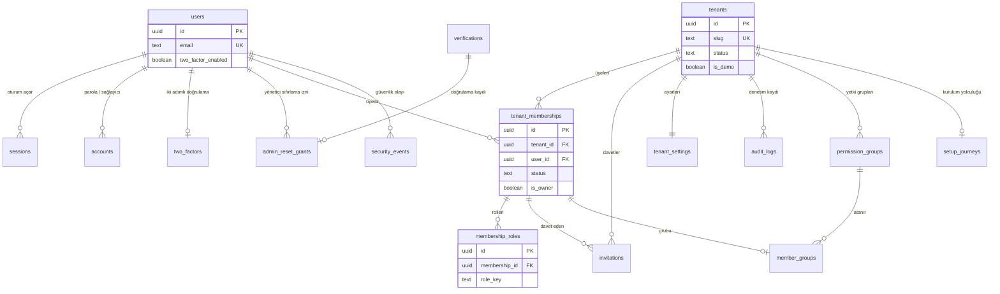
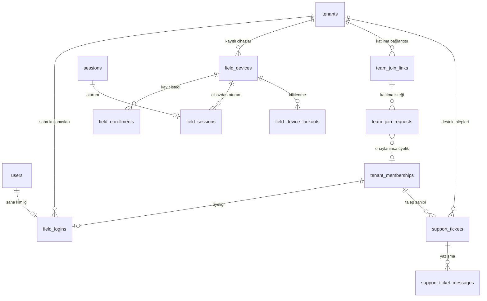
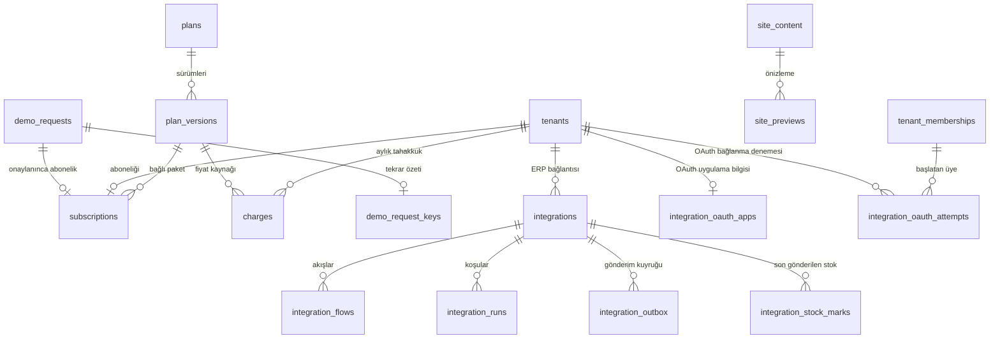
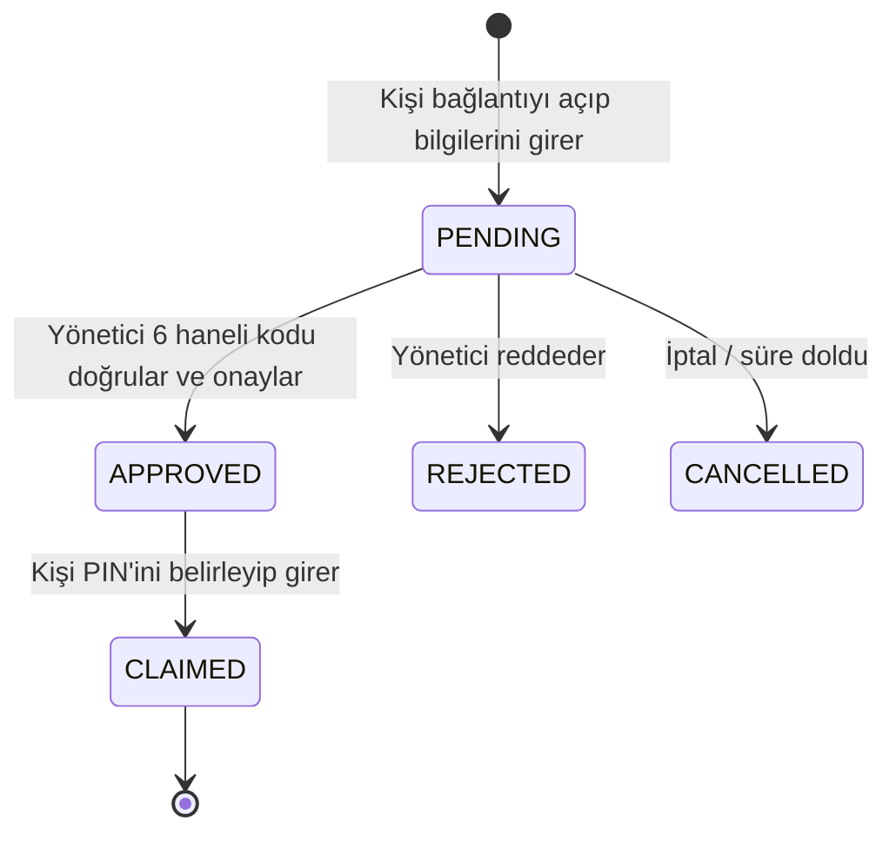
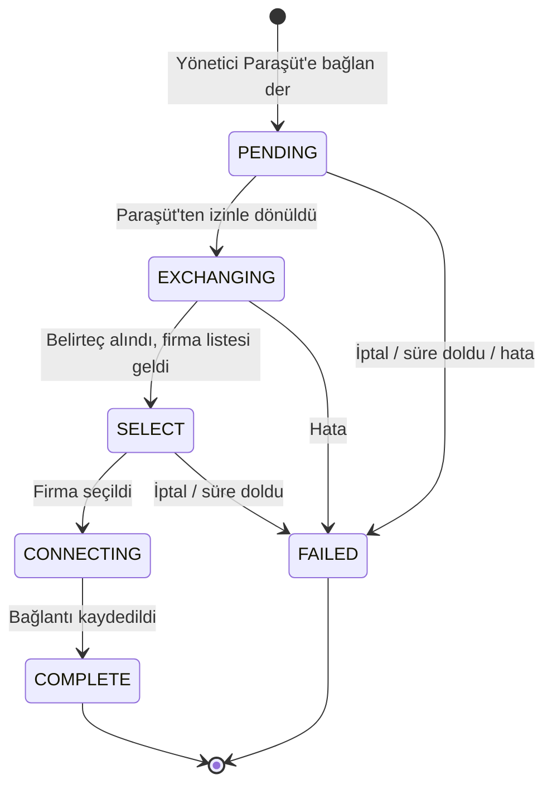
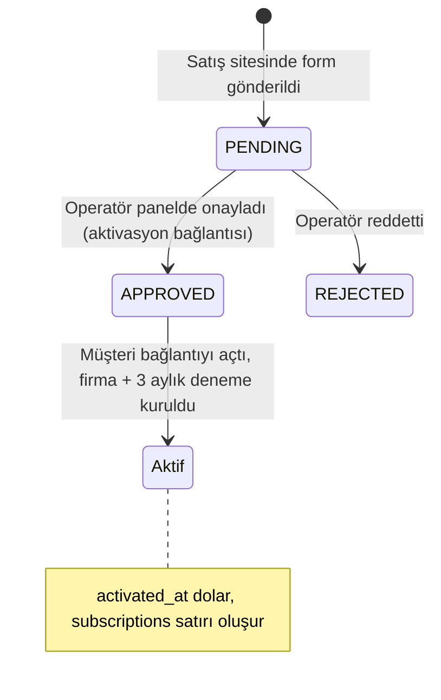

# 3b. Veri Sözlüğü — Kimlik, Kiracı, Denetim ve Platform Tabloları

> Durum: main 8e2710d · 28 Ekim 2026. Bu dosyada **47 tablo** anlatılır (`public` 34, `wms_platform` 11, `wms_health` 1, `wms_meta` 1).
> Kaynak: `packages/db/migrations/0001…0063_*.up.sql` (her tablonun **son** hali; sonradan eklenen sütunlar dahil), migration defteri için `packages/db/src/migrate.ts`, kuyruk şeması için `packages/queue-adapter/src/index.ts`. Tahmin yoktur; burada olmayan bir alan veritabanında da yoktur.
> Stok, depo, katalog, belge, görev, sayım, üretim ve paket tabloları **3a** dosyasındadır. `0014` güvenilirlik tabloları (`processed_events`, `stock_consistency_*`) ve `0037` iş sinyalleri (`work_priorities`, `problem_reports`) de oradadır.

## Bu bölümü okumak için kısa sözlük

| Terim | Sade anlamı |
| :--- | :--- |
| **PK** (birincil anahtar) | Satırın değişmez kimliği. Aynı değer iki kez olamaz. |
| **FK** (yabancı anahtar) | "Bu alan şu tablodaki bir satırı gösterir." Gösterilen satır yoksa kayıt reddedilir. |
| **UNIQUE** | Bu değer (ya da değer çifti) tabloda bir kez geçebilir. |
| **NOT NULL / NULL olabilir** | Alanın boş bırakılıp bırakılamayacağı. |
| **CHECK** | Veritabanının kendisinin uyguladığı kural (ör. "durum yalnız şu üç değerden biri olabilir"). Uygulama hata yapsa bile kural bozulmaz. |
| **RLS** (satır düzeyi güvenlik) | Her müşteri (kiracı / tenant) yalnız kendi satırlarını görür. Uygulama `app.current_tenant_id` bağlamını her işlemde kurar; bağlam yoksa hiçbir satır görünmez. "ENABLE + FORCE" = tablo sahibi dahil herkese uygulanır. |
| **Tetikleyici (trigger)** | Kayıt eklenirken/değişirken veritabanında otomatik çalışan bekçi. Ör. "ödenmiş tahakkuk değiştirilemez". |
| **Özet (hash)** | Bağlantı belirteci, PIN gibi gizli değerlerin geri çevrilemez parmak izi. Gizli değerin kendisi saklanmaz. |
| **uuid** | Rastgele, tahmin edilemez kimlik numarası. |
| **timestamptz** | Saat dilimi bilgili tarih-saat. |

## Veritabanı şemaları (klasörler)

| Şema | Ne tutar |
| :--- | :--- |
| `public` | Kimlik (kullanıcı, oturum) + bütün müşteri (tenant) verisi. Müşteri tablolarında RLS açıktır. |
| `wms_platform` | Etkin Yazılım'ın kendi işletme verisi: demo talepleri, abonelikler, paketler, tahakkuklar, satış sitesi içeriği. **Müşteri verisi değildir**; uygulama rolleri doğrudan erişemez, yalnız denetimli `wms_probe.platform_*` işlevleriyle (çağıranın platform operatörü olduğu her seferinde denetlenir). |
| `wms_probe` | Yalnız işlevler (tablo yok). Kimlik/platform tarafında dar, denetimli kapılar: davet önizleme, saha cihazı kaydı, panel işlemleri, plan sınırı okuma. |
| `wms_health` | Arka plan işçisinin (worker) "hayattayım" sinyali. |
| `wms_meta` | Migration defteri: hangi şema sürümü ne zaman, kim tarafından uygulandı. |
| `pgboss` | Kuyruk kütüphanesinin (pg-boss) kendi tabloları. Bizim migration'larımız değil, kütüphane kurar (`QUEUE_SCHEMA = "pgboss"`); iş kuyruğu stok kaynağı değildir. |

## Veritabanı rolleri — kim neye erişir

| Rol | Kimdir | Ne yapabilir (özet) |
| :--- | :--- | :--- |
| `wms_app` | Web uygulamasının günlük rolü | Müşteri tablolarını **yalnız kendi tenant bağlamında** (RLS) okur/yazar. Çoğu tabloda sütun bazlı izin; silme çoğu yerde yok. `wms_platform`'a doğrudan erişemez. Süper kullanıcı değil, RLS'i aşamaz, tablo sahibi değil. |
| `wms_auth` | Giriş/kimlik katmanı (Better Auth) | `users`, `sessions`, `accounts`, `verifications`, `two_factors`, `auth_rate_limits`, `field_sessions` ve güvenlik olayı ekleme. Müşteri stok verisine erişmez. |
| `wms_worker` | Arka plan işçisi | Kuyruk (`pgboss`) ve `wms_health.worker_heartbeats` yazma; belirli arka plan işleri. |
| `wms_identity_probe` | Giriş yapamayan (NOLOGIN) işlev sahibi | `wms_probe.*` işlevlerinin sahibi. Platform tablolarına yalnız bu işlevler üzerinden, işlevin ihtiyacı kadar sütunla erişilir. |
| `wms_ops` | Operasyon/destek rolü | Normalde kapalı (NOLOGIN, parolasız). Destek işinde geçici açılır, iş bitince kapatılır (`docs/RUNBOOK-ops.md`). |
| Migration rolü | Şema değiştiren yönetici bağlantısı | Tabloların sahibi; yalnız yayın sırasında migration çalıştırır. Uygulama bu rolü kullanmaz. |

---

## İlişki diyagramları

### A. Kimlik ve müşteri (tenant) çekirdeği

### B. Saha girişi, ekibe katılma ve destek

### C. Platform (yonet.etkinyazilim.com) ve entegrasyon

---

## 3b.1 Kimlik (giriş) tabloları — `0002_identity`

Bu tablolar tek bir kişiyi tanır; kişinin hangi firmada çalıştığı ayrı tutulur (`tenant_memberships`). Hepsi **küresel**dir (tenant'a bağlı değil), RLS yoktur; erişim yalnız kimlik rolü (`wms_auth`) ile ve sütun izinleriyle sınırlıdır.

### public.users
Sisteme giriş yapabilen her kişi (ofis kullanıcısı ya da e-postasız saha personelinin teknik kimliği).

| Alan Adı | Veri Tipi | Kısıtlar | İş Anlamı | Bağlı Olduğu Tablo/Alan |
| :--- | :--- | :--- | :--- | :--- |
| `id` | uuid | PK, varsayılan rastgele | Kişinin kimliği | — |
| `name` | text | NOT NULL | Görünen ad | — |
| `email` | text | NOT NULL, UNIQUE, CHECK küçük harf | Giriş e-postası; büyük/küçük harf farkı yok | — |
| `email_verified` | boolean | NOT NULL, varsayılan false | E-posta doğrulandı mı | — |
| `image` | text | NULL olabilir | Profil resmi adresi (kimlik kütüphanesinin alanı) | — |
| `created_at` / `updated_at` | timestamptz | NOT NULL, varsayılan şimdi | Oluşturma / son değişiklik | — |
| `two_factor_enabled` | boolean | NOT NULL, varsayılan false | İki adımlı doğrulama açık mı | `two_factors` |
| `invitation_claim_id` | uuid | NULL olabilir | Davetle kayıt sırasında daveti "sahiplenme" işareti | `invitations.claim_id` |

- **RLS / koruma:** RLS yok (küresel). Yazma yalnız kimlik katmanı.

### public.sessions
Açık oturumlar (tarayıcı girişleri).

| Alan Adı | Veri Tipi | Kısıtlar | İş Anlamı | Bağlı Olduğu Tablo/Alan |
| :--- | :--- | :--- | :--- | :--- |
| `id` | uuid | PK | Oturum kimliği | — |
| `expires_at` | timestamptz | NOT NULL | Oturumun bitiş anı | — |
| `token` | text | NOT NULL, UNIQUE | Tarayıcı çerezindeki oturum anahtarı | — |
| `created_at` / `updated_at` | timestamptz | NOT NULL | Açılış / son yenileme | — |
| `ip_address` / `user_agent` | text | NULL olabilir | Giriş yapılan adres ve tarayıcı | — |
| `user_id` | uuid | NOT NULL, FK (kullanıcı silinirse oturum da silinir) | Oturumun sahibi | `users.id` |
| `mfa_verified_at` | timestamptz | NULL olabilir | Bu oturumda iki adımlı doğrulamanın en son geçildiği an (hassas işlemlerde "yakın zamanda doğrulandı mı" kontrolü) | — |

- **RLS / koruma:** RLS yok; yalnız kimlik rolü.

### public.accounts
Kişinin giriş yöntemleri (parola özeti, ileride harici sağlayıcı).

| Alan Adı | Veri Tipi | Kısıtlar | İş Anlamı | Bağlı Olduğu Tablo/Alan |
| :--- | :--- | :--- | :--- | :--- |
| `id` | uuid | PK | Kayıt kimliği | — |
| `account_id` | text | NOT NULL | Sağlayıcıdaki hesap kimliği | — |
| `provider_id` | text | NOT NULL | Giriş yöntemi (ör. e-posta+parola) | — |
| `user_id` | uuid | NOT NULL, FK, silmede zincirleme | Hesabın sahibi | `users.id` |
| `access_token`, `refresh_token`, `id_token` | text | NULL olabilir | Harici sağlayıcı belirteçleri (şu an kullanılan yöntem e-posta+parola) | — |
| `access_token_expires_at`, `refresh_token_expires_at` | timestamptz | NULL olabilir | Belirteç süreleri | — |
| `scope` | text | NULL olabilir | Sağlayıcı izin kapsamı | — |
| `password` | text | NULL olabilir | Parolanın Argon2id özeti (parolanın kendisi saklanmaz) | — |
| `created_at` / `updated_at` | timestamptz | NOT NULL | — | — |

### public.verifications
Tek kullanımlık doğrulama kayıtları (parola sıfırlama vb.).

| Alan Adı | Veri Tipi | Kısıtlar | İş Anlamı | Bağlı Olduğu Tablo/Alan |
| :--- | :--- | :--- | :--- | :--- |
| `id` | uuid | PK | — | — |
| `identifier` | text | NOT NULL, indeksli | Neyin doğrulandığı | — |
| `value` | text | NOT NULL | Doğrulama değeri | — |
| `expires_at` | timestamptz | NOT NULL | Son geçerlilik | — |
| `created_at` / `updated_at` | timestamptz | NOT NULL | — | — |

### public.two_factors
İki adımlı doğrulama (TOTP uygulaması + yedek kodlar).

| Alan Adı | Veri Tipi | Kısıtlar | İş Anlamı | Bağlı Olduğu Tablo/Alan |
| :--- | :--- | :--- | :--- | :--- |
| `id` | uuid | PK | — | — |
| `secret` | text | NOT NULL | Doğrulayıcı uygulamanın gizli anahtarı (şifreli saklanır) | — |
| `backup_codes` | text | NOT NULL | Yedek kodlar (şifreli) | — |
| `user_id` | uuid | NOT NULL, FK, silmede zincirleme | Sahibi | `users.id` |
| `verified` | boolean | NOT NULL, varsayılan true | Kurulum doğrulandı mı | — |
| `failed_verification_count` | integer | NOT NULL, varsayılan 0 | Art arda yanlış kod sayısı | — |
| `locked_until` | timestamptz | NULL olabilir | Çok yanlış denemede geçici kilit bitişi | — |

### public.auth_rate_limits
Giriş denemelerinin hız sınırı sayacı (kaba kuvvet saldırısını yavaşlatır).

| Alan Adı | Veri Tipi | Kısıtlar | İş Anlamı | Bağlı Olduğu Tablo/Alan |
| :--- | :--- | :--- | :--- | :--- |
| `id` | uuid | PK | — | — |
| `key_hash` | text | NOT NULL, UNIQUE, CHECK 64 haneli özet | Sayılan kişi/adresin özeti (düz IP/e-posta yazılamaz) | — |
| `count` | integer | NOT NULL | Pencere içindeki deneme sayısı | — |
| `last_request` | bigint | NOT NULL | Son deneme zamanı (milisaniye) | — |

### public.security_events
Güvenlik olay günlüğü: giriş, çıkış, parola değişimi, iki adımlı doğrulama, platform (panel) işlemleri. **Yalnız ekleme**; değiştirilemez, silinemez.

| Alan Adı | Veri Tipi | Kısıtlar | İş Anlamı | Bağlı Olduğu Tablo/Alan |
| :--- | :--- | :--- | :--- | :--- |
| `id` | uuid | PK | Olay kimliği | — |
| `occurred_at` | timestamptz | NOT NULL, sunucu saati zorlanır | Olay anı (istemci gönderemez) | — |
| `user_id` | uuid | NULL olabilir | Olayı yapan kişi | `users.id` (FK yok) |
| `event_type` | text | NOT NULL, CHECK biçim `küçük.harf.nokta` | Olay türü, ör. `login_…`, `platform.support.…` | — |
| `ip` / `user_agent` / `request_id` | text | NULL olabilir | Ağ bilgisi ve istek izi | — |
| `detail` | jsonb | NOT NULL, varsayılan `{}` | Olaya özel ek bilgi | — |
| `created_xid` | xid8 | NOT NULL, sunucu zorlar | Veritabanı işlem numarası (sıralama/denetim) | — |

- **RLS / koruma:** RLS yok (küresel). Tetikleyici: güncelleme/silme reddedilir, zaman alanları sunucuya zorlanır. Kimlik olay türlerini yalnız kimlik rolü yazabilir (0005). Panel "İşlem kaydı" ekranı yalnız `platform.*` olaylarını, ağ bilgisi olmadan görür (0047).

---

## 3b.2 Müşteri (tenant) ve üyelik tabloları — `0003_tenancy` ve sonrası

**Çok kiracılık modeli:** tek PostgreSQL veritabanı, tek şema (`public`), her müşteri tablosunda `tenant_id` sütunu + RLS. Firma başına ayrı veritabanı ya da şema yoktur.

### public.tenants
Her müşteri firması (çalışma alanı). Adres çubuğundaki `/t/<slug>` buradan gelir.

| Alan Adı | Veri Tipi | Kısıtlar | İş Anlamı | Bağlı Olduğu Tablo/Alan |
| :--- | :--- | :--- | :--- | :--- |
| `id` | uuid | PK | Firma kimliği (tüm müşteri tablolarındaki `tenant_id`) | — |
| `slug` | text | NOT NULL, UNIQUE, CHECK küçük harf/rakam/tire 1–63; `demo` yalnız demo firmaya | Adreste görünen kısa ad | — |
| `name` | text | NOT NULL, boş olamaz | Firma adı | — |
| `status` | text | NOT NULL, varsayılan `ACTIVE`, CHECK | Firmanın durumu (aşağıda) | — |
| `is_demo` | boolean | NOT NULL, varsayılan false | Ortak demo firması mı (uygulama bu alanı yazamaz) | — |
| `created_by_user_id` | uuid | NULL olabilir, FK | Firmayı açan kişi | `users.id` |
| `creation_request_id` | uuid | NULL olabilir; (kişi, istek) çifti UNIQUE | Aynı "firma oluştur" isteği iki kez gelirse ikinci firma açılmasın diye | — |
| `created_at` | timestamptz | NOT NULL | — | — |

- **Durum kodları:** `ACTIVE` = çalışıyor · `SUSPENDED` = askıya alındı (ödeme vb.) · `CLOSING` = kapatılıyor.
- **RLS / koruma:** ENABLE + FORCE. Kullanıcı yalnız içinde bulunduğu firmayı görür; firma seçim ekranında yalnız kendi aktif üyelikleri listelenir.

### public.tenant_memberships
"Bu kişi bu firmada çalışır" kaydı. Bir kişi birden çok firmada olabilir.

| Alan Adı | Veri Tipi | Kısıtlar | İş Anlamı | Bağlı Olduğu Tablo/Alan |
| :--- | :--- | :--- | :--- | :--- |
| `tenant_id` | uuid | NOT NULL, FK | Firma | `tenants.id` |
| `id` | uuid | PK; (tenant_id, id) UNIQUE | Üyelik kimliği (birçok tablo "kim yaptı"yı bununla tutar) | — |
| `user_id` | uuid | NOT NULL, FK; (tenant_id, user_id) UNIQUE | Kişi | `users.id` |
| `status` | text | NOT NULL, varsayılan `ACTIVE`, CHECK | `ACTIVE` = çalışıyor · `REMOVED` = ekipten çıkarıldı | — |
| `is_owner` | boolean | NOT NULL, varsayılan false | Hesap sahibi mi (yöneticileri yalnız sahip yönetir) | — |
| `joined_at` | timestamptz | NOT NULL | Katılma anı | — |
| `removed_at` | timestamptz | NULL olabilir | Çıkarılma anı | — |
| `roles_version` | integer | NOT NULL, varsayılan 0 | Rol değiştikçe artan sayaç (eşzamanlı değişikliği yakalar) | — |
| `last_used_at` | timestamptz | NULL olabilir (0048) | Bu firmaya en son girildiği an; girişte "son kullanılan alana" yönlendirmek için. Yetki kararına girmez. | — |

- **RLS / koruma:** ENABLE + FORCE. Paket sınırı tetikleyicisi (0041): üye yeniden aktifleşirken paketteki kullanıcı sınırı aşılıyorsa `PLAN_LIMIT` hatası.

### public.membership_roles
Üyenin rolleri (bir üyede birden çok rol olabilir).

| Alan Adı | Veri Tipi | Kısıtlar | İş Anlamı | Bağlı Olduğu Tablo/Alan |
| :--- | :--- | :--- | :--- | :--- |
| `tenant_id` | uuid | NOT NULL | Firma | `tenants.id` |
| `id` | uuid | PK | — | — |
| `membership_id` | uuid | NOT NULL, FK (aynı firma içinde) | Rolün sahibi | `tenant_memberships.id` |
| `role_key` | text | NOT NULL, CHECK; (firma, üye, rol) UNIQUE | Rol kodu (aşağıda) | — |

- **Rol kodları:**

| Kod | Sade anlamı | Paket sınırında sayıldığı sınıf (0041) |
| :--- | :--- | :--- |
| `TENANT_ADMIN` | Firma yöneticisi: her şey, ekip ve ayarlar dahil | Yönetici |
| `WAREHOUSE_MANAGER` | Depo sorumlusu: stok, belge, onay işleri | Yönetici |
| `READ_ONLY` | Yalnız görüntüler | Yönetici (ofis kullanıcısı) |
| `PICKER` | Saha personeli: toplama, kabul, sevk gibi saha işleri | Saha |
| `COUNTER` | Sayım personeli | Saha |

- **RLS / koruma:** ENABLE + FORCE. Paket sınırı tetikleyicisi rol eklemede çalışır.

### public.invitations
E-postayla ya da ekranda gösterilen bağlantıyla ekibe davet.

| Alan Adı | Veri Tipi | Kısıtlar | İş Anlamı | Bağlı Olduğu Tablo/Alan |
| :--- | :--- | :--- | :--- | :--- |
| `tenant_id` | uuid | NOT NULL, FK | Davet eden firma | `tenants.id` |
| `id` | uuid | PK | — | — |
| `email_normalized` | text | NOT NULL, küçük harf; açık davet başına firma içinde tekil | Davet edilen e-posta | — |
| `role_key` | text | NOT NULL, CHECK (yukarıdaki 5 rol) | Kabul edince verilecek rol | — |
| `token_hash` | text | NOT NULL, UNIQUE, 64 haneli özet | Davet bağlantısının özeti (bağlantının kendisi saklanmaz) | — |
| `delivered_via` | text | NOT NULL, CHECK | `EMAIL` = e-postayla gönderildi · `SCREEN` = ekranda gösterildi/kopyalandı | — |
| `expires_at` | timestamptz | NOT NULL | Son geçerlilik | — |
| `accepted_at` | timestamptz | NULL olabilir | Kabul anı | — |
| `revoked_at` | timestamptz | NULL olabilir | İptal anı | — |
| `invited_by_membership_id` | uuid | NOT NULL, FK | Daveti gönderen | `tenant_memberships.id` |
| `claim_id` / `claim_expires_at` | uuid / timestamptz | NULL olabilir | Kayıt sırasında davetin geçici "sahiplenilmesi" | `users.invitation_claim_id` |

- **Durum (alanlardan türer):** açık = kabul ve iptal yok · kabul edildi = `accepted_at` dolu · iptal = `revoked_at` dolu · süresi doldu = `expires_at` geçmiş.
- **RLS / koruma:** ENABLE + FORCE. Davet önizlemesi (giriş yapmamış kişi) yalnız `wms_probe` işleviyle.

### public.tenant_settings
Firma başına tek satır ayarlar.

| Alan Adı | Veri Tipi | Kısıtlar | İş Anlamı | Bağlı Olduğu Tablo/Alan |
| :--- | :--- | :--- | :--- | :--- |
| `tenant_id` | uuid | PK, FK | Firma | `tenants.id` |
| `locale` | text | NOT NULL | Dil (ör. Türkçe) | — |
| `time_zone` | text | NOT NULL | Saat dilimi; "bugün" raporunun gün sınırı buna göre | — |
| `sector_template_key` / `sector_template_version` | text / integer | NULL olabilir | Kurulumda seçilen sektör şablonu ve sürümü | — |
| `terminology` | jsonb | NOT NULL, varsayılan `{}` | Sektöre özel kelimeler (ör. "ürün" yerine "malzeme") | — |
| `onboarding_status` | text | NOT NULL (CHECK yok; kodda değerler) | İlk kurulum durumu: `IN_PROGRESS` = sürüyor · `COMPLETED` = bitti | — |
| `onboarding_steps` | jsonb | NOT NULL, varsayılan `[]` | Kurulum adımları listesi | — |
| `receiving_qc_enabled` | boolean | NOT NULL, varsayılan **true** (0016) | Mal kabulde kalite kontrol adımı açık mı | — |
| `count_abandon_hours` | smallint | NOT NULL, varsayılan 8, CHECK 1–168 (0017) | Kaç saat dokunulmayan sayım "terk edilmiş" sayılır | — |
| `shift_start` / `shift_end` | time | NOT NULL, varsayılan 08:00 / 17:00, CHECK farklı olmalı (0037) | Çalışma vardiyası (Görevlerim ekranındaki vardiya satırı) | — |
| `separation_of_duties` | boolean | NOT NULL, varsayılan false (0049) | Görev ayrılığı: belgeyi hazırlayan kişi kendi belgesini onaylayamasın / ters kaydedemesin | — |
| `voice_reply` | boolean | NOT NULL, varsayılan false (0063) | Etkin sesli yanıt: açıksa sesli asistanın cevabı doğal sesle okunur. Yönetici Ayarlar'dan açar (`settings.manage`, `tenant.settings_changed` kaydı); her üye yalnız bu bayrağı okuyabilir. Kişinin cihazdaki "Sessiz" tercihi ayrıca kapatır. | — |

- **RLS / koruma:** ENABLE + FORCE. Uygulama yalnız belirli sütunları güncelleyebilir (ör. vardiya, görev ayrılığı, sesli yanıt). `voice_reply` sütununu `wms_auth` ve `wms_worker` yazamaz (0063 kendi içinde doğrular).

### public.admin_reset_grants
Yöneticinin bir ekip üyesi için başlattığı parola sıfırlama izni (kısa ömürlü).

| Alan Adı | Veri Tipi | Kısıtlar | İş Anlamı | Bağlı Olduğu Tablo/Alan |
| :--- | :--- | :--- | :--- | :--- |
| `id` | uuid | PK | — | — |
| `user_id` | uuid | NOT NULL, FK, silmede zincirleme | Parolası sıfırlanacak kişi | `users.id` |
| `issuing_tenant_id` / `issuing_membership_id` | uuid | NOT NULL (FK yok; tutarlılık işlevde denetlenir) | İzni veren firma ve yönetici | `tenants.id` / `tenant_memberships.id` |
| `verification_id` | uuid | NOT NULL, UNIQUE, FK | Bağlı tek kullanımlık doğrulama | `verifications.id` |
| `created_at` / `expires_at` | timestamptz | NOT NULL | Oluşturma / son geçerlilik | — |

- **RLS / koruma:** Küresel platform tablosu, RLS yok; yalnız denetimli işlevle tüketilir.

---

## 3b.3 Denetim ve sistem tabloları

### public.audit_logs
Firma içi işlem kaydı ("kim, ne zaman, neyi, neden değiştirdi"). **Yalnız ekleme**; değiştirilemez, silinemez, toplu boşaltılamaz.

| Alan Adı | Veri Tipi | Kısıtlar | İş Anlamı | Bağlı Olduğu Tablo/Alan |
| :--- | :--- | :--- | :--- | :--- |
| `tenant_id` | uuid | NOT NULL, FK, varsayılan geçerli firma bağlamı | Firma | `tenants.id` |
| `id` | uuid | PK | — | — |
| `occurred_at` | timestamptz | NOT NULL, sunucu zorlar | İşlem anı | — |
| `actor_user_id` | uuid | NULL olabilir | İşlemi yapan | `users.id` (FK yok) |
| `on_behalf_of_user_id` | uuid | NULL olabilir | Başkası adına yapıldıysa asıl kişi | `users.id` (FK yok) |
| `action` | text | NOT NULL, CHECK `alan.eylem` biçimi | İşlem türü (ör. `document.post`) | — |
| `entity_type` / `entity_id` | text | NULL olabilir | Etkilenen kayıt türü ve kimliği | — |
| `reason` | text | NULL olabilir | Gerekçe (ters kayıt, negatif stok istisnası vb.) | — |
| `ip` / `user_agent` | text | NULL olabilir; demo firmada her zaman boş | Ağ bilgisi | — |
| `request_id` | text | NULL olabilir | İstek izi | — |
| `change_summary` | jsonb | NOT NULL, nesne, en çok 16 KB | Değişikliğin özeti | — |
| `created_xid` | xid8 | NOT NULL, sunucu zorlar | İşlem numarası | — |

- **RLS / koruma:** ENABLE + FORCE (firma yalnız kendi kaydını görür). Üç tetikleyici her rol için açık (ENABLE ALWAYS): sunucu alanları, değişiklik/silme reddi, toplu boşaltma reddi. Ekranı: `/t/<slug>/audit`.

### public.request_rate_limits
Genel istek hız sınırı sayaçları (ör. davet önizleme, demo formu).

| Alan Adı | Veri Tipi | Kısıtlar | İş Anlamı | Bağlı Olduğu Tablo/Alan |
| :--- | :--- | :--- | :--- | :--- |
| `scope` | text | PK parçası, CHECK biçim | Hangi işlem için sınır | — |
| `key_hash` | text | PK parçası, 64 haneli özet | Sayılan kişi/adres özeti | — |
| `window_start` | timestamptz | PK parçası | Zaman penceresi başlangıcı | — |
| `count` | integer | NOT NULL, ≥ 0 | Pencere içindeki istek sayısı | — |

- **RLS / koruma:** Küresel, RLS yok; uygulama rolünün doğrudan yetkisi yok.

### wms_health.worker_heartbeats
Arka plan işçisinin canlılık sinyali; sağlık kontrolü bunu okur.

| Alan Adı | Veri Tipi | Kısıtlar | İş Anlamı | Bağlı Olduğu Tablo/Alan |
| :--- | :--- | :--- | :--- | :--- |
| `instance_id` | text | PK, CHECK biçim | Çalışan işçi kopyasının adı | — |
| `version` | text | NOT NULL, CHECK biçim | İşçinin sürümü | — |
| `started_at` | timestamptz | NOT NULL | Başlama anı | — |
| `last_seen_at` | timestamptz | NOT NULL | Son "hayattayım" anı | — |
| `oldest_waiting_age_s` | integer | NOT NULL, ≥ 0 | Kuyrukta en uzun bekleyen işin yaşı (saniye) | — |
| `expired_active` | integer | NOT NULL, ≥ 0 | Süresi aşılmış aktif iş sayısı | — |
| `failed_recent` | integer | NOT NULL, ≥ 0 | Son dönemde başarısız iş sayısı | — |

- **RLS / koruma:** RLS yok; uygulama yalnız okur, işçi yazar.

### wms_meta.schema_migrations
Migration defteri: canlı veritabanında hangi şema sürümlerinin uygulandığının tek otoritesi.

| Alan Adı | Veri Tipi | Kısıtlar | İş Anlamı | Bağlı Olduğu Tablo/Alan |
| :--- | :--- | :--- | :--- | :--- |
| `version` | text | PK, CHECK 4 hane | Migration numarası (ör. `0057`) | `packages/db/migrations/<sürüm>_*.sql` |
| `name` | text | NOT NULL | Migration adı | — |
| `checksum_sha256` | text | NOT NULL, 64 haneli özet | Dosyanın parmak izi; dosya sonradan değişirse yayın durur | — |
| `applied_at` | timestamptz | NOT NULL | Uygulanma anı | — |
| `applied_by` | text | NOT NULL | Uygulayan veritabanı rolü | — |

- **RLS / koruma:** Uygulama rolünün hiçbir yetkisi yok; yalnız migration rolü.

---

## 3b.4 Saha girişi ve cihazlar — `0044`, `0045`

E-postası olmayan saha personeli: kullanıcı adı + 6 haneli PIN, kayıtlı cihazdan giriş. Ortak cihaz (depodaki tablet) birden çok kişi tarafından kullanılabilir.

### public.field_logins
Saha personelinin giriş kimliği.

| Alan Adı | Veri Tipi | Kısıtlar | İş Anlamı | Bağlı Olduğu Tablo/Alan |
| :--- | :--- | :--- | :--- | :--- |
| `tenant_id` | uuid | NOT NULL, FK | Firma | `tenants.id` |
| `id` | uuid | PK | — | — |
| `user_id` | uuid | NOT NULL, FK, UNIQUE | Arkadaki teknik kullanıcı | `users.id` |
| `membership_id` | uuid | NOT NULL, FK | Firmadaki üyeliği | `tenant_memberships.id` |
| `username` | text | NOT NULL, firma içinde UNIQUE, CHECK 3–32 küçük harf/rakam/._- | Saha kullanıcı adı | — |
| `pin_hash` / `pin_set_at` | text / timestamptz | NULL olabilir, birlikte dolar; özet Argon2id | 6 haneli PIN'in özeti ve belirlenme anı | — |
| `activation_hash` / `activation_expires_at` | text / timestamptz | NULL olabilir, birlikte dolar | İlk PIN belirleme bağlantısının özeti ve süresi | — |
| `failed_count` | integer | NOT NULL, ≥ 0 | Art arda yanlış PIN | — |
| `activation_failed_count` | integer | NOT NULL, ≥ 0 | Aktivasyonda yanlış deneme | — |
| `lock_count` | integer | NOT NULL, ≥ 0 | Kaç kez kilitlendiği | — |
| `locked_until` | timestamptz | NULL olabilir | Geçici kilit bitişi | — |
| `created_at` / `created_by` | timestamptz / uuid | — | Oluşturma anı / oluşturan | — |

- **RLS / koruma:** ENABLE + FORCE. Uygulama PIN özetini okuyamaz; PIN denetimi yalnız `wms_probe.field_*` işlevlerinde.

### public.field_devices
Firmaya kayıtlı telefon/tabletler.

| Alan Adı | Veri Tipi | Kısıtlar | İş Anlamı | Bağlı Olduğu Tablo/Alan |
| :--- | :--- | :--- | :--- | :--- |
| `tenant_id` | uuid | NOT NULL, FK | Firma | `tenants.id` |
| `id` | uuid | PK | Cihaz kimliği | — |
| `token_hash` | text | NOT NULL, UNIQUE, 64 haneli özet | Cihazda saklı anahtarın özeti | — |
| `kind` | text | NOT NULL, CHECK | `PERSONAL` = kişisel cihaz (bir kişiye bağlı) · `SHARED` = ortak cihaz (kişi yok) | — |
| `user_id` | uuid | Kişisel cihazda dolu, ortakta boş (CHECK), FK | Cihazın sahibi | `users.id` |
| `name` | text | NOT NULL, 1–60 karakter | Cihaz adı (ör. "Kabul tableti") | — |
| `created_at` / `created_by` | timestamptz / uuid | — | — | — |
| `last_used_at` | timestamptz | NOT NULL | Son kullanım | — |
| `expires_at` | timestamptz | NOT NULL, varsayılan +180 gün | Kaydın süresi | — |
| `revoked_at` / `revoked_by` | timestamptz / uuid | NULL olabilir | İptal anı / iptal eden | — |
| `revoke_reason` | text | NULL olabilir, CHECK | `MANUAL` = yönetici iptal etti · `LOCK_SPREE` = kısa sürede çok kilitlenme nedeniyle sistem iptal etti | — |

- **RLS / koruma:** ENABLE + FORCE. Uygulama yalnız iptal alanlarını değiştirebilir.

### public.field_enrollments
Ortak cihaz kaydetme isteği: yönetici kısa ömürlü bir kod/QR üretir, cihaz okutur, yönetici 6 haneli onay koduyla onaylar.

| Alan Adı | Veri Tipi | Kısıtlar | İş Anlamı | Bağlı Olduğu Tablo/Alan |
| :--- | :--- | :--- | :--- | :--- |
| `tenant_id` | uuid | NOT NULL, FK | Firma | `tenants.id` |
| `id` | uuid | PK | — | — |
| `token_hash` | text | NOT NULL, UNIQUE | Kayıt bağlantısının özeti | — |
| `created_by` | uuid | NOT NULL, FK | Başlatan yönetici | `users.id` |
| `created_at` / `expires_at` | timestamptz | NOT NULL; süre varsayılan **5 dakika** | — | — |
| `claim_token_hash` / `claimed_at` / `device_name` | text / timestamptz / text | Birlikte dolar | Cihaz isteği "sahiplendiğinde" | — |
| `approved_at` / `device_id` | timestamptz / uuid | Birlikte dolar; onay için önce sahiplenme şart; FK | Onaylanınca oluşan cihaz | `field_devices.id` |
| `cancelled_at` | timestamptz | NULL olabilir | İptal | — |
| `confirm_code` | text | Sahiplenince dolar, CHECK 6 rakam | Yöneticinin ekranda girdiği onay kodu | — |
| `confirm_failed` | integer | NOT NULL, ≥ 0 | Yanlış onay kodu sayısı | — |

- **Durum (alanlardan türer):** Bekliyor → Cihaz sahiplendi (`claimed_at`) → Onaylandı (`approved_at`) ya da İptal (`cancelled_at`) / Süresi doldu.
- **RLS / koruma:** ENABLE + FORCE. Uygulama yalnız başlatır ve iptal eder; sahiplenme/onay `wms_probe` işlevlerinde.

### public.field_sessions
Hangi oturumun hangi kayıtlı cihazdan açıldığı.

| Alan Adı | Veri Tipi | Kısıtlar | İş Anlamı | Bağlı Olduğu Tablo/Alan |
| :--- | :--- | :--- | :--- | :--- |
| `session_id` | uuid | PK, FK, oturum silinirse silinir | Oturum | `sessions.id` |
| `device_id` | uuid | NOT NULL, FK | Cihaz | `field_devices.id` |
| `created_at` | timestamptz | NOT NULL | — | — |

- **RLS / koruma:** Küresel, RLS yok; yalnız kimlik rolü. Cihaz iptal edilince o cihazdan açılmış oturumlar kapatılabilir.

### public.field_device_lockouts
Ortak cihazda kişi kilitlenmelerinin kaydı (çok kilitlenme → cihaz otomatik iptal, `LOCK_SPREE`).

| Alan Adı | Veri Tipi | Kısıtlar | İş Anlamı | Bağlı Olduğu Tablo/Alan |
| :--- | :--- | :--- | :--- | :--- |
| `device_id` | uuid | NOT NULL, FK | Cihaz | `field_devices.id` |
| `user_id` | uuid | NOT NULL, FK | Kilitlenen kişi | `users.id` |
| `locked_at` | timestamptz | NOT NULL | Kilitlenme anı | — |

- **RLS / koruma:** Küresel, RLS yok; yalnız `wms_probe` işlevleri. (PK yok; yalnız ekleme yapılan olay listesi.)

---

## 3b.5 Yetki grupları ve ekibe katılma — `0051`, `0052`, `0053`

### public.permission_groups
Firma yöneticisinin tanımladığı yetki grupları ("Kabulcüler", "Sevkiyat ekibi" gibi): hangi ekranları görürler, hangi ek yetkileri vardır.

| Alan Adı | Veri Tipi | Kısıtlar | İş Anlamı | Bağlı Olduğu Tablo/Alan |
| :--- | :--- | :--- | :--- | :--- |
| `tenant_id` | uuid | PK parçası, FK | Firma | `tenants.id` |
| `id` | uuid | PK parçası | Grup kimliği | — |
| `name` | text | NOT NULL, 1–60 karakter; arşivlenmemiş gruplarda ad tekil (büyük/küçük harf farksız) | Grup adı | — |
| `color` | text | NOT NULL, varsayılan `#2F7D5B`, CHECK `#RRGGBB` | Grup rengi | — |
| `screens` | text[] | NOT NULL, CHECK izinli liste, en çok 8 | Açık saha ekranları (aşağıda) | — |
| `grants` | text[] | NOT NULL, CHECK izinli liste, en çok 6 | Ek yetkiler (aşağıda) | — |
| `archived_at` | timestamptz | NULL olabilir | Arşivlendiyse anı (silinmez) | — |
| `created_by` | uuid | NOT NULL, FK | Oluşturan üye | `tenant_memberships.id` |
| `created_at` / `updated_at` | timestamptz | NOT NULL, tetikleyici yönetir | — | — |
| `version` | integer | NOT NULL, ≥ 1, her güncellemede +1 | Eşzamanlı düzenleme denetimi | — |

- **Ekran kodları (`screens`):** `receive` Mal kabul · `pick` Toplama · `transfer` Transfer · `prod` Üretim · `count` Sayım · `labels` Etiket · `reports` Raporlar · `problem` Sorun bildir.
- **Yetki kodları (`grants`):** `stock.post` Stok hareketini işle · `document.create` Belge oluştur · `document.approve` Belge onayla · `count_diff.approve` Sayım farkını onayla · `reversal.create` Ters kayıt (iptal) yap · `data.import` Excel ile veri aktar.
- **RLS / koruma:** ENABLE + FORCE. Tetikleyici kimlik alanlarının değişmesini reddeder, sürümü artırır.

### public.member_groups
Üyenin hangi yetki grubunda olduğu (üye başına en çok bir grup).

| Alan Adı | Veri Tipi | Kısıtlar | İş Anlamı | Bağlı Olduğu Tablo/Alan |
| :--- | :--- | :--- | :--- | :--- |
| `tenant_id` | uuid | PK parçası, FK | Firma | `tenants.id` |
| `membership_id` | uuid | PK parçası, FK | Üye | `tenant_memberships.id` |
| `group_id` | uuid | NOT NULL, FK | Grup | `permission_groups.id` |
| `assigned_by` | uuid | NOT NULL, FK | Atayan üye | `tenant_memberships.id` |
| `assigned_at` | timestamptz | NOT NULL | Atama anı | — |

- **RLS / koruma:** ENABLE + FORCE.

### public.team_join_links
"Ekibe katıl" bağlantısı/QR'ı: saha personeli kendini kaydeder, yönetici onaylar. Firmada aynı anda **tek** açık bağlantı olabilir.

| Alan Adı | Veri Tipi | Kısıtlar | İş Anlamı | Bağlı Olduğu Tablo/Alan |
| :--- | :--- | :--- | :--- | :--- |
| `tenant_id` | uuid | NOT NULL, FK; açık bağlantı firma başına tekil | Firma | `tenants.id` |
| `id` | uuid | PK | — | — |
| `token_hash` | text | NOT NULL, UNIQUE, 64 haneli özet | Bağlantının özeti | — |
| `created_by` | uuid | NOT NULL, FK | Oluşturan yönetici | `users.id` |
| `created_at` / `expires_at` | timestamptz | NOT NULL; en çok **7 gün** | — | — |
| `revoked_at` | timestamptz | NULL olabilir | İptal/yenilenme anı | — |

### public.team_join_requests
Bağlantıyı açan kişinin katılma isteği.

| Alan Adı | Veri Tipi | Kısıtlar | İş Anlamı | Bağlı Olduğu Tablo/Alan |
| :--- | :--- | :--- | :--- | :--- |
| `tenant_id` | uuid | NOT NULL | Firma | `tenants.id` |
| `id` | uuid | PK | — | — |
| `link_id` | uuid | NOT NULL, FK | Hangi bağlantıdan geldi | `team_join_links.id` |
| `request_hash` | text | NOT NULL, UNIQUE | İsteği yapan cihazın özel anahtarının özeti | — |
| `name` | text | NOT NULL, 1–60 karakter | Kişinin adı | — |
| `username` | text | NOT NULL, CHECK kullanıcı adı biçimi | İstenen saha kullanıcı adı | — |
| `device_hint` | text | NULL olabilir, 1–80 karakter | Cihaz ipucu (ör. telefon modeli) | — |
| `confirm_code` | text | NOT NULL, 6 rakam | Yöneticinin karşılaştırdığı onay kodu | — |
| `confirm_failed` | integer | NOT NULL, ≥ 0 | Yanlış kod sayısı | — |
| `status` | text | NOT NULL, varsayılan `PENDING`, CHECK | Durum (aşağıda) | — |
| `created_at` / `expires_at` | timestamptz | NOT NULL; istek süresi **24 saat** | — | — |
| `decided_by` / `decided_at` | uuid / timestamptz | Karar verilince birlikte dolar (sunucu yazar) | Onaylayan/reddeden ve anı | `users.id` |
| `membership_id` | uuid | Onay/sahiplenmede zorunlu, FK | Oluşan üyelik | `tenant_memberships.id` |
| `claimed_at` | timestamptz | Yalnız `CLAIMED`'da dolu | Kişinin girişi tamamladığı an | — |
| `code_verified_by` / `code_verified_at` | uuid / timestamptz | Birlikte dolar (0053); yalnız veritabanı işlevi yazar | Onay kodunun doğrulandığı damga; onay bu damga olmadan geçmez | — |

- **Durum kodları:** `PENDING` Onay bekliyor → `APPROVED` Yönetici onayladı → `CLAIMED` Kişi girişi tamamladı · `REJECTED` Reddedildi · `CANCELLED` İptal edildi.

- **RLS / koruma (iki tablo):** ENABLE + FORCE. `team_join_requests_transition_guard` tetikleyicisi (her rol için açık) yalnız yukarıdaki geçişlere izin verir ve karar alanlarını sunucuya zorlar.

---

## 3b.6 Destek talepleri — `0054`

### public.support_tickets
Uygulama içinden açılan destek talebi (hata, nasıl yapılır, öneri).

| Alan Adı | Veri Tipi | Kısıtlar | İş Anlamı | Bağlı Olduğu Tablo/Alan |
| :--- | :--- | :--- | :--- | :--- |
| `tenant_id` | uuid | NOT NULL, FK | Firma | `tenants.id` |
| `id` | uuid | PK | — | — |
| `number` | bigint | Otomatik artan, küresel UNIQUE | Kullanıcıya gösterilen kısa talep numarası | — |
| `created_by` | uuid | NOT NULL, FK | Talebi açan kişi | `users.id` |
| `membership_id` | uuid | NOT NULL, FK | Talebi açan üyelik | `tenant_memberships.id` |
| `subject_kind` | text | NOT NULL, CHECK | Konu (aşağıda) | — |
| `body` | text | NOT NULL, 1–2000 karakter | Talep metni | — |
| `context` | jsonb | NOT NULL; yalnız `route`, `app_version`, `support_code`, `user_agent` metin alanları, en çok 1200 karakter | Talebin açıldığı ekran ve sürüm bilgisi | — |
| `status` | text | NOT NULL, varsayılan `OPEN`, CHECK | Durum (aşağıda) | — |
| `created_at` / `updated_at` | timestamptz | NOT NULL | — | — |
| `operator_replied_at` | timestamptz | NULL olabilir | Etkin ekibinin son yanıt anı | — |
| `customer_seen_at` | timestamptz | NULL olabilir | Müşterinin yanıtı gördüğü an ("okundu") | — |

- **Konu kodları:** `BUG` Hata · `HOWTO` Nasıl yapılır · `IDEA` Öneri · `OTHER` Diğer.
- **Durum kodları:** `OPEN` Açık (Etkin'den yanıt bekliyor) · `ANSWERED` Yanıtlandı (müşteri yazarsa tekrar `OPEN`) · `CLOSED` Kapandı (yazışma kapalı).
- **RLS / koruma:** ENABLE + FORCE + ek kısıtlayıcı politika: üye yalnız kendi talebini, firma yöneticisi firmanın tüm taleplerini görür. Tetikleyici: sunucu alanları, izinli geçişler, hız sınırı (10 dakikada en çok 5 talep), yalnız aktif/demo firmalar. Etkin ekibi (panel) yalnız `wms_probe.platform_support_*` işlevleriyle erişir.

### public.support_ticket_messages
Talep içindeki yazışma satırları. **Yalnız ekleme** (düzeltme/silme yok).

| Alan Adı | Veri Tipi | Kısıtlar | İş Anlamı | Bağlı Olduğu Tablo/Alan |
| :--- | :--- | :--- | :--- | :--- |
| `tenant_id` | uuid | NOT NULL, FK | Firma | `tenants.id` |
| `id` | uuid | PK | — | — |
| `ticket_id` | uuid | NOT NULL, FK | Talep | `support_tickets.id` |
| `author_kind` | text | NOT NULL, CHECK | `CUSTOMER` = müşteri yazdı · `OPERATOR` = Etkin ekibi yazdı | — |
| `author_user_id` | uuid | NOT NULL, FK | Yazan kişi | `users.id` |
| `body` | text | NOT NULL, 1–2000 karakter | Mesaj | — |
| `created_at` | timestamptz | NOT NULL | — | — |

- **RLS / koruma:** ENABLE + FORCE; görünürlük talepten türer. Tetikleyici: değişiklik/silme reddi, kapalı talebe yazma reddi, hız sınırı (10 dakikada 20 yanıt).

---

## 3b.7 ERP entegrasyonu (Paraşüt) — `0055`, `0056`, `0058`, `0059`, `0061`

### public.integrations
Firma başına, sağlayıcı başına tek ERP bağlantısı.

| Alan Adı | Veri Tipi | Kısıtlar | İş Anlamı | Bağlı Olduğu Tablo/Alan |
| :--- | :--- | :--- | :--- | :--- |
| `tenant_id` | uuid | NOT NULL, FK; (firma, sağlayıcı) UNIQUE | Firma | `tenants.id` |
| `id` | uuid | PK | — | — |
| `provider` | text | NOT NULL, CHECK | `PARASUT` = Paraşüt · `LOGO` = Logo (kodu ayrılmış) | — |
| `status` | text | NOT NULL, varsayılan `CONNECTED`, CHECK | `CONNECTED` Bağlı · `ERROR` Hata var · `DISCONNECTED` Bağlantı kesildi | — |
| `account_label` | text | NULL olabilir, en çok 120 karakter | Bağlı hesabın görünen adı | — |
| `account_ref` | text | NULL olabilir, CHECK biçim | ERP'deki firma numarası | — |
| `credentials` | jsonb | Bağlıyken dolu, kesikken boş; yalnız şifreli kutu biçimi kabul edilir | ERP erişim bilgisi, **şifreli**; parola saklanmaz | — |
| `connected_by` / `connected_membership_id` / `connected_at` | uuid / uuid / timestamptz | Bağlıyken zorunlu; FK | Bağlantıyı kuran ve anı | `users.id`, `tenant_memberships.id` |
| `last_checked_at` | timestamptz | NULL olabilir | Son bağlantı denetimi | — |
| `last_error_code` | text | NULL olabilir, CHECK biçim | Son hata kodu | — |
| `created_at` / `updated_at` / `version` | — | `version` her güncellemede +1 | — | — |
| `pull_product_barcodes` | boolean | NOT NULL, varsayılan false (0059) | Ürün çekerken ERP'deki barkodu da al ayarı (Bağlantılar ekranından; kapalıyken eski davranış sürer). Değişince denetim kaydı yazılır. | — |
| `opening_stock_enabled` | boolean | NOT NULL, varsayılan false (0056) | "ERP'den açılış stoku al" ayarı | — |
| `opening_stock_taken_at` / `opening_stock_document_id` | timestamptz / uuid | Birlikte dolar, **bir kez**; FK; firma başına tekil | Açılış stoku alındı mı, hangi stok giriş belgesiyle | `documents.id` |

- **RLS / koruma:** ENABLE + FORCE. Açılış stoku alanları bir kez yazılır, sonra değişmez; ayar kapalıyken ve işlenmiş (POSTED) bir stok giriş belgesi olmadan yazılamaz.

### public.integration_flows
Bağlantı içindeki veri akışları ve aç/kapa düğmeleri.

| Alan Adı | Veri Tipi | Kısıtlar | İş Anlamı | Bağlı Olduğu Tablo/Alan |
| :--- | :--- | :--- | :--- | :--- |
| `tenant_id` | uuid | NOT NULL, FK | Firma | `tenants.id` |
| `id` | uuid | PK; (firma, bağlantı, akış) UNIQUE | — | — |
| `integration_id` | uuid | NOT NULL, FK | Bağlantı | `integrations.id` |
| `flow` | text | NOT NULL, CHECK | Akış türü (aşağıda) | — |
| `enabled` / `enabled_at` | boolean / timestamptz | `enabled` varsayılan false; anı tetikleyici yazar | Akış açık mı, ne zaman açıldı | — |
| `direction` | text | NOT NULL, CHECK + akışa göre kural | `PULL` ERP'den al · `PUSH` ERP'ye gönder · `BOTH` iki yönlü | — |
| `cursor` | text | NULL olabilir, rakam | Sayfalı çekmede kalınan yer | — |
| `last_run_at` / `last_success_at` | timestamptz | NULL olabilir | Son koşu / son başarılı koşu | — |
| `last_status` | text | NULL olabilir, CHECK | `SUCCESS` · `PARTIAL` (kısmen) · `FAILED` | — |
| `error_count` / `last_error_code` | integer / text | — | Hata sayısı ve son hata | — |
| `updated_at` / `version` | — | — | — | — |

- **Akış kodları ve izinli yön:** `PRODUCTS` Ürünler · `CONTACTS` Cariler · `WAREHOUSES` Depolar (her yön) · `SALES_ORDERS` Satış siparişleri (**yalnız ERP'den al**) · `SHIPMENTS` Sevk irsaliyeleri (**yalnız ERP'ye gönder**) · `STOCK` Stok miktarları (**yalnız ERP'ye gönder**). Kural: stok miktarı ERP'den WMS'e yazılamaz; WMS'in stok defteri tek otoritedir.

### public.integration_runs
Her senkronizasyon koşusunun kaydı. Biten koşu değiştirilemez.

| Alan Adı | Veri Tipi | Kısıtlar | İş Anlamı | Bağlı Olduğu Tablo/Alan |
| :--- | :--- | :--- | :--- | :--- |
| `tenant_id` / `id` / `integration_id` | uuid | PK `id`; FK'ler | — | `integrations.id` |
| `flow` | text | CHECK (akış kodları) | Hangi akış | — |
| `trigger` | text | CHECK | `SCHEDULE` Zamanlanmış · `MANUAL` Elle başlatıldı | — |
| `status` | text | varsayılan `RUNNING`, CHECK | `RUNNING` Sürüyor · `SUCCESS` · `PARTIAL` · `FAILED` | — |
| `requested_by` | uuid | NULL olabilir | Elle başlatan | — |
| `started_at` / `finished_at` | timestamptz | — | Başlangıç / bitiş | — |
| `created_count`, `updated_count`, `linked_count`, `skipped_count`, `failed_count` | integer | ≥ 0 | Oluşturulan / güncellenen / eşleştirilen / atlanan / hatalı kayıt sayıları | — |
| `error_code` | text | NULL olabilir | Hata kodu | — |

### public.integration_outbox
ERP'ye gönderilecek sevk irsaliyeleri kuyruğu (belge başına tek kayıt).

| Alan Adı | Veri Tipi | Kısıtlar | İş Anlamı | Bağlı Olduğu Tablo/Alan |
| :--- | :--- | :--- | :--- | :--- |
| `tenant_id` / `id` / `integration_id` | uuid | PK `id`; FK'ler | — | `integrations.id` |
| `flow` | text | CHECK yalnız `SHIPMENTS` | — | — |
| `entity_type` / `entity_id` | text / uuid | `DOCUMENT`; (firma, bağlantı, akış, belge) UNIQUE | Gönderilecek sevk belgesi | `documents.id` |
| `status` | text | varsayılan `PENDING`, CHECK | Durum (aşağıda) | — |
| `attempts` | integer | 0–100 | Deneme sayısı | — |
| `next_attempt_at` | timestamptz | NOT NULL | Bir sonraki deneme zamanı | — |
| `last_error_code` | text | NULL olabilir | Son hata | — |
| `external_id` | text | `SENT` iken zorunlu | ERP'deki irsaliye numarası | — |
| `created_at` / `updated_at` / `sent_at` | timestamptz | `sent_at` yalnız `SENT`'te | — | — |

- **Durum kodları:** `PENDING` Gönderilmeyi bekliyor · `SENDING` Gönderiliyor · `SENT` Gönderildi (artık değişmez) · `FAILED` Gönderilemedi · `CHECK` Sonuç belirsiz, elle kontrol gerekli (kör yeniden gönderim yapılmaz; çift irsaliye önlenir).

### public.integration_stock_marks
ERP'ye en son gönderilen stok toplamı (ürün + depo başına). Stok kaynağı **değildir**; yalnız "değişti mi, tekrar göndereyim mi" karşılaştırması için.

| Alan Adı | Veri Tipi | Kısıtlar | İş Anlamı | Bağlı Olduğu Tablo/Alan |
| :--- | :--- | :--- | :--- | :--- |
| `tenant_id`, `integration_id`, `item_id`, `warehouse_id` | uuid | Dördü birlikte PK; FK'ler | Firma, bağlantı, ürün, depo | `integrations.id`, `items.id`, `warehouses.id` |
| `quantity` | numeric(20,6) | NOT NULL | Son gönderilen miktar | — |
| `sent_at` | timestamptz | NOT NULL | Gönderim anı | — |

- **RLS / koruma (0055 tabloları):** Hepsi ENABLE + FORCE RLS; uygulama sütun bazlı ekler/günceller, silme yok. ERP tarafındaki kayıt eşlemesi `external_refs` (`system = PARASUT`) tablosundadır (3a). Ürün kartındaki ERP kaynak bilgisi ve kaynak yaşam döngüsü alanları (`items.source_*`, 0060/0062) da 3a'dadır.

### public.integration_oauth_apps
Firmanın kendi Paraşüt OAuth uygulama bilgisi (istemci kimliği ve gizli değeri), firma başına tek satır (0061). Yönetici Bağlantılar ekranından girer; ekrana **geri okunmaz**.

| Alan Adı | Veri Tipi | Kısıtlar | İş Anlamı | Bağlı Olduğu Tablo/Alan |
| :--- | :--- | :--- | :--- | :--- |
| `tenant_id` | uuid | PK, FK | Firma | `tenants.id` |
| `version` | uuid | NOT NULL, varsayılan rastgele | Ayar her kaydedildiğinde yenilenen sürüm; açık bağlanma denemesi eski sürüme bağlıysa geçersiz olur | `integration_oauth_attempts.config_version` |
| `credentials` | jsonb | NOT NULL; yalnız şifreli kutu biçimi (`v`=2, `kid`, `iv`, `tag`, `ct`) | Uygulama bilgisi, **şifreli** | — |
| `updated_at` | timestamptz | NOT NULL | Son kaydetme | — |

- **RLS / koruma:** ENABLE + FORCE. `wms_app` okur, ekler, yalnız `version`/`credentials`/`updated_at` günceller; silme yok. Kaydetme `integration.oauth_configured` denetim kaydı yazar.

### public.integration_oauth_attempts
Paraşüt'e "izin ver" ile bağlanma denemesi: kısa ömürlü (en çok **10 dakika**) ve tek kullanımlık (0061). Parola istenmez; sağlayıcıdan gelen belirteç yalnız şifreli kutuda ve yalnız firma seçimi beklenirken durur.

| Alan Adı | Veri Tipi | Kısıtlar | İş Anlamı | Bağlı Olduğu Tablo/Alan |
| :--- | :--- | :--- | :--- | :--- |
| `tenant_id` | uuid | NOT NULL, FK; (firma, id) UNIQUE | Firma | `tenants.id` |
| `id` | uuid | PK | Deneme kimliği | — |
| `user_id` | uuid | NOT NULL, FK (aynı firmanın üyesi olmalı) | Başlatan kişi | `users.id`, `tenant_memberships.user_id` |
| `membership_id` | uuid | NOT NULL, FK (aynı firma) | Başlatan üyelik | `tenant_memberships.id` |
| `state_hash` / `nonce_hash` | text | NOT NULL, 64 haneli özet; `state_hash` UNIQUE | Dönüş bağlantısını ve tarayıcıyı denemeye bağlayan değerlerin özeti (kendileri saklanmaz) | — |
| `config_version` | uuid | NOT NULL | Denemenin başladığı uygulama bilgisi sürümü | `integration_oauth_apps.version` |
| `client_id` | text | NOT NULL, 1–200 karakter | Kullanılan istemci kimliği | — |
| `phase` | text | NOT NULL, varsayılan `PENDING`, CHECK | Aşama (aşağıda) | — |
| `token_box` | jsonb | Yalnız `SELECT` aşamasında dolu (CHECK); şifreli kutu biçimi | Sağlayıcı belirteci, **şifreli** | — |
| `companies` | jsonb | NOT NULL, varsayılan `[]`, dizi, en çok 100 | Kullanıcının seçebileceği ERP firmaları | — |
| `created_at` / `expires_at` | timestamptz | NOT NULL; süre en çok 10 dakika (CHECK) | Başlangıç / son geçerlilik | — |

- **Aşama kodları:** `PENDING` İzin bekleniyor → `EXCHANGING` Dönüş alındı, belirteç alınıyor → `SELECT` Firma seçimi bekleniyor (tek firma varsa kendiliğinden geçer) → `CONNECTING` Bağlantı kuruluyor → `COMPLETE` Bağlandı · `FAILED` Başarısız / iptal / süresi doldu (belirteç ve firma listesi silinir).
- **RLS / koruma:** ENABLE + FORCE. Kişi başına aynı anda tek açık deneme (kısmi UNIQUE indeks). `wms_app` okur, belirli sütunları ekler, yalnız `phase`/`token_box`/`companies` günceller; silme yok. Denetim kayıtları: `integration.oauth_started`, `integration.oauth_failed`, `integration.oauth_cancelled`, başarıda `integration.connected`.

### public.setup_journeys
İlk kullanım rehberinin ("kurulum yolculuğu") firma başına ilerlemesi.

| Alan Adı | Veri Tipi | Kısıtlar | İş Anlamı | Bağlı Olduğu Tablo/Alan |
| :--- | :--- | :--- | :--- | :--- |
| `tenant_id` | uuid | PK, FK | Firma | `tenants.id` |
| `makes_production` | boolean | NULL olabilir | "Üretim yapıyor musunuz?" cevabı (boş = sorulmadı) | — |
| `card_source` | text | NULL olabilir, CHECK | Ürün kartları nereden: `EXCEL` · `PARASUT` | — |
| `opening_stock_wanted` | boolean | NULL olabilir | Excel'den açılış stoku istendi mi | — |
| `skipped` | text[] | NOT NULL; izinli liste, tekrarsız, en çok 9 (0058) | Atlanan adımlar: `cards` kartlar · `shelves` raflar · `parties` cariler (0058) · `stock` stok · `labels` etiket · `bom` reçete · `order` sipariş · `people` ekip · `task` görev | — |
| `labels_printed_at` | timestamptz | NULL olabilir; bir kez yazılır, sonra değişmez | İlk etiket basıldı | — |
| `dismissed_at` | timestamptz | NULL olabilir | Kutlama/rehber kapatıldı | — |
| `tour_state` | text | NULL olabilir, CHECK | Ekran turu: `ACTIVE` açık · `CLOSED` kapalı | — |
| `updated_by` | uuid | FK | Son değiştiren | `users.id` |
| `created_at` / `updated_at` / `version` | — | Tetikleyici yönetir | — | — |

- **RLS / koruma:** ENABLE + FORCE; silme yok.

---

## 3b.8 Platform tabloları (`wms_platform`) — yonet.etkinyazilim.com

Bu tablolar Etkin Yazılım'ın kendi işletmesine aittir. Uygulama rolleri doğrudan dokunamaz; **RLS yerine** erişim tamamen `wms_probe.platform_*` işlevlerinden geçer ve her işlev çağıranın operatör olduğunu denetler.

### wms_platform.operators
Panele girebilen Etkin Yazılım çalışanlarının listesi (e-posta ile).

| Alan Adı | Veri Tipi | Kısıtlar | İş Anlamı | Bağlı Olduğu Tablo/Alan |
| :--- | :--- | :--- | :--- | :--- |
| `email_normalized` | text | PK, küçük harf, e-posta biçimi, en çok 254 | Operatör e-postası (giriş e-postasıyla eşleşir) | `users.email` (FK yok) |
| `added_at` | timestamptz | NOT NULL | Eklenme anı | — |

- Panelde operatör ekleme/çıkarma ekranı yok; liste migration ile yönetilir.

### wms_platform.demo_requests
Satış sitesindeki (etkinyazilim.com) "Demo iste" formundan gelen talepler ve onay sonrası aktivasyon bilgisi.

| Alan Adı | Veri Tipi | Kısıtlar | İş Anlamı | Bağlı Olduğu Tablo/Alan |
| :--- | :--- | :--- | :--- | :--- |
| `id` | uuid | PK | Talep kimliği (satış sitesi üretir) | — |
| `received_at` / `ingested_at` | timestamptz | NOT NULL | Formun gönderildiği an / panele alındığı an | — |
| `name` | text | 1–100 karakter | Ad soyad | — |
| `company` | text | 1–150 karakter | Firma | — |
| `email` | text | e-posta biçimi, küçük harf ve kırpılmış | E-posta | — |
| `sector` / `message` | text | en çok 100 / 2000 karakter | Sektör / mesaj | — |
| `status` | text | varsayılan `PENDING`, CHECK | Durum (aşağıda) | — |
| `decided_at` / `decided_by` | timestamptz / uuid | Karar verilince birlikte dolar; FK | Karar anı ve operatör | `users.id` |
| `activation_token_hash`, `activation_delivery`, `activation_expires_at` | text / text / timestamptz | Birlikte dolar; yalnız `APPROVED` talepte; teslim `EMAIL` / `SCREEN` | Deneme hesabını açma bağlantısının özeti, nasıl iletildiği ve süresi | — |
| `activation_claim_id` / `activation_claim_expires_at` | uuid / timestamptz | Birlikte dolar | Aktivasyon sırasında geçici sahiplenme | — |
| `activated_at` / `activation_sample` | timestamptz / boolean | Birlikte dolar | Hesap açıldı mı, örnek veriyle mi açıldı | — |
| `owner_link_issued_at` | timestamptz | NULL olabilir (0057) | Talep sahibine durum bağlantısı gönderilme anı | — |

- **Durum kodları:** `PENDING` Bekliyor · `APPROVED` Onaylandı (aktivasyon bağlantısı üretilir) · `REJECTED` Reddedildi.
- **Koruma (0057):** Aynı e-postayla ikinci demo talebi açılmaz (`demo_email_reservations`); aynı form iki kez gelirse tek kayıt olur (`demo_request_keys`).

### wms_platform.demo_email_reservations
Bir e-posta adresinin demo talebi için kalıcı olarak "kullanıldı" işareti (tekrar talep engeli).

| Alan Adı | Veri Tipi | Kısıtlar | İş Anlamı | Bağlı Olduğu Tablo/Alan |
| :--- | :--- | :--- | :--- | :--- |
| `email_normalized` | text | PK, küçük harf ve kırpılmış | Rezerve e-posta | `demo_requests.email` |

### wms_platform.demo_request_keys
Aynı form içeriğinin tekrar gönderimini tanımak için talep içeriğinin özeti.

| Alan Adı | Veri Tipi | Kısıtlar | İş Anlamı | Bağlı Olduğu Tablo/Alan |
| :--- | :--- | :--- | :--- | :--- |
| `id` | uuid | PK | Talep kimliği | `demo_requests.id` (FK yok) |
| `digest` | bytea | NOT NULL | Ad, firma, e-posta, sektör, mesajın birlikte özeti | — |

### wms_platform.demo_status_deliveries
Talep sahibine giden "talebinizin durumu" doğrulama bağlantısı gönderim kuyruğu (kısa ömürlü).

| Alan Adı | Veri Tipi | Kısıtlar | İş Anlamı | Bağlı Olduğu Tablo/Alan |
| :--- | :--- | :--- | :--- | :--- |
| `id` | uuid | PK | — | — |
| `email` | text | NOT NULL, indeksli | Alıcı | — |
| `token_hash` | text | NOT NULL, UNIQUE, 64 haneli özet | Bağlantının özeti | — |
| `sealed` | jsonb | NOT NULL | Gönderilecek içerik, şifreli | — |
| `created_at` / `expires_at` | timestamptz | süre varsayılan **15 dakika** | — | — |
| `consumed_at` / `sent_at` | timestamptz | NULL olabilir | Bağlantı kullanıldı / e-posta gönderildi | — |
| `lease_until` / `attempts` | timestamptz / integer | — | Gönderen işçinin geçici kilidi / deneme sayısı | — |

### wms_platform.subscriptions
Müşteri firmanın aboneliği (deneme veya ücretli paket).

| Alan Adı | Veri Tipi | Kısıtlar | İş Anlamı | Bağlı Olduğu Tablo/Alan |
| :--- | :--- | :--- | :--- | :--- |
| `tenant_id` | uuid | PK, FK | Firma (firma başına tek abonelik) | `tenants.id` |
| `number` | integer | NOT NULL, UNIQUE, sırayla artan | Panelde görünen müşteri numarası | — |
| `plan` | text | NOT NULL, CHECK | `TRIAL` Deneme · `ACTIVE` Ücretli (paket zorunlu) | — |
| `trial_ends_at` | timestamptz | Denemede zorunlu ve başlangıçtan sonra | Deneme bitişi (aktivasyonda başlangıç + 3 ay) | — |
| `started_at` | timestamptz | NOT NULL | Abonelik başlangıcı | — |
| `demo_request_id` | uuid | NULL olabilir, UNIQUE, FK | Hangi demo talebinden açıldı | `demo_requests.id` |
| `plan_id` / `plan_version` | uuid / integer | Birlikte dolar; FK | Bağlı paket ve fiyat sürümü | `plan_versions` |

### wms_platform.plans
Satılan paketler (ör. Başlangıç, Pro).

| Alan Adı | Veri Tipi | Kısıtlar | İş Anlamı | Bağlı Olduğu Tablo/Alan |
| :--- | :--- | :--- | :--- | :--- |
| `id` | uuid | PK | — | — |
| `name` | text | 1–60 karakter, baş/son boşluk yok | Paket adı | — |
| `sort_order` | integer | varsayılan 0 | Sıralama | — |
| `published` | boolean | varsayılan false | Satış sitesinde gösterilir mi | — |
| `recommended` | boolean | varsayılan false; yalnız yayındaysa; tüm paketlerde en çok bir tane | "Önerilen" rozeti | — |
| `current_version` | integer | ≥ 1 | Güncel fiyat/sınır sürümü | `plan_versions.version` |
| `created_at` / `updated_at` | timestamptz | — | — | — |

### wms_platform.plan_versions
Paketin fiyat ve sınırlarının sürümleri. Fiyat değişince yeni sürüm açılır; eski müşteriler eski sürümde kalabilir.

| Alan Adı | Veri Tipi | Kısıtlar | İş Anlamı | Bağlı Olduğu Tablo/Alan |
| :--- | :--- | :--- | :--- | :--- |
| `plan_id` / `version` | uuid / integer | Birlikte PK; FK | Paket ve sürüm no | `plans.id` |
| `price_monthly` | numeric(12,2) | 0–1.000.000 | Aylık fiyat | — |
| `max_admins` | integer | 0–100.000 (0 = sınırsız) | En çok ofis kullanıcısı (yönetici/depo sorumlusu/görüntüleyici) | — |
| `max_field` | integer | 0–100.000 (0 = sınırsız) | En çok saha kullanıcısı | — |
| `max_warehouses` | integer | 0–100.000 (0 = sınırsız) | En çok depo | — |
| `max_items` | integer | 0–10.000.000 (0 = sınırsız) | En çok ürün kartı | — |
| `feat_qr` / `feat_ship` / `feat_prod` / `feat_api` | boolean | NOT NULL | Özellikler: QR/paket · Sevkiyat · Üretim · API | — |
| `created_at` / `created_by` | timestamptz / uuid | — | — | — |

- **Paket sınırı nasıl uygulanır:** depolar, ürünler, üyelikler ve rollerdeki tetikleyiciler kayıt eklenirken firmanın paket sınırını okur; aşılırsa `PLAN_LIMIT` hatasıyla reddeder. Paketi olmayan firma sınırsızdır.

### wms_platform.charges
Aylık tahakkuklar (müşteriye çıkan aylık borç) ve ödeme kaydı. Ödenmiş tahakkuk **değiştirilemez**.

| Alan Adı | Veri Tipi | Kısıtlar | İş Anlamı | Bağlı Olduğu Tablo/Alan |
| :--- | :--- | :--- | :--- | :--- |
| `id` | uuid | PK | — | — |
| `tenant_id` | uuid | NOT NULL, FK; (firma, dönem) UNIQUE | Firma | `tenants.id` |
| `period` | date | Ayın ilk günü olmalı | Tahakkuk ayı | — |
| `plan_id` / `plan_version` | uuid / integer | NOT NULL, FK | Fiyatın alındığı paket sürümü | `plan_versions` |
| `amount` | numeric(12,2) | > 0, ≤ 1.000.000 | Tutar | — |
| `due_on` | date | Dönemden önce olamaz | Son ödeme günü | — |
| `paid_on` / `paid_method` / `paid_recorded_at` | date / text / timestamptz | Birlikte dolar | Ödeme tarihi, yöntemi, kaydın girildiği an | — |
| `paid_note` | text | Yalnız ödemeyle, 1–200 karakter | Ödeme notu | — |
| `paid_by` | uuid | NULL olabilir | Ödemeyi kaydeden operatör | — |
| `invoice_no` | text | NULL olabilir | Fatura numarası | — |
| `created_at` / `created_by` | timestamptz / uuid | — | — | — |

- **Ödeme yöntemi kodları:** `HAVALE` · `KART` · `NAKIT`.
- **Durum (alanlardan türer):** Bekliyor (`paid_on` boş, vadesi gelmedi) · Gecikti (vade geçti, ödenmedi) · Ödendi (`paid_on` dolu; değişmez).

### wms_platform.site_content
Satış sitesi ana sayfa içeriğinin sürümleri (başlık, alt başlık, gösterilecek paketler). Aynı anda tek taslak olur; yayınlanan sürüm değişmez.

| Alan Adı | Veri Tipi | Kısıtlar | İş Anlamı | Bağlı Olduğu Tablo/Alan |
| :--- | :--- | :--- | :--- | :--- |
| `version` | integer | PK, ≥ 1 | İçerik sürümü | — |
| `title1` / `title2` | text | 1–80 / 1–60 karakter; `<`, `>` ve kontrol karakteri yasak | Ana başlığın iki satırı | — |
| `subtitle` | text | 1–400 karakter, aynı yasaklar | Alt başlık | — |
| `plan_ids` | uuid[] | En çok 12, boş eleman yok | Sitede gösterilecek paketler | `plans.id` (FK yok) |
| `saved_at` / `saved_by` | timestamptz / uuid | — | Son kaydetme | — |
| `published_at` / `published_by` | timestamptz / uuid | Boşsa taslak | Yayınlanma | — |

### wms_platform.site_previews
Taslak içeriğin yayından önce görülmesi için kısa ömürlü önizleme bağlantısı.

| Alan Adı | Veri Tipi | Kısıtlar | İş Anlamı | Bağlı Olduğu Tablo/Alan |
| :--- | :--- | :--- | :--- | :--- |
| `token_hash` | text | PK, 64 haneli özet | Önizleme bağlantısının özeti | — |
| `version` | integer | NOT NULL, FK | Hangi içerik sürümü | `site_content.version` |
| `expires_at` | timestamptz | En çok **30 dakika** | Son geçerlilik | — |
| `created_at` / `created_by` | timestamptz / uuid | — | — | — |

---

## 3b.9 Kritik durum kodları — toplu özet

| Tablo.alan | Kodlar ve sade anlamları |
| :--- | :--- |
| `tenants.status` | `ACTIVE` çalışıyor · `SUSPENDED` askıda · `CLOSING` kapatılıyor |
| `tenant_memberships.status` | `ACTIVE` ekipte · `REMOVED` çıkarıldı |
| `membership_roles.role_key`, `invitations.role_key` | `TENANT_ADMIN` firma yöneticisi · `WAREHOUSE_MANAGER` depo sorumlusu · `PICKER` saha personeli · `COUNTER` sayımcı · `READ_ONLY` yalnız görüntüler |
| `invitations.delivered_via`, `demo_requests.activation_delivery` | `EMAIL` e-postayla · `SCREEN` ekranda gösterildi |
| `tenant_settings.onboarding_status` (kodda) | `IN_PROGRESS` kurulum sürüyor · `COMPLETED` bitti |
| `field_devices.kind` | `PERSONAL` kişisel · `SHARED` ortak |
| `field_devices.revoke_reason` | `MANUAL` elle iptal · `LOCK_SPREE` çok kilitlenme, otomatik iptal |
| `team_join_requests.status` | `PENDING` · `APPROVED` · `REJECTED` · `CANCELLED` · `CLAIMED` |
| `permission_groups.screens` | `receive` · `pick` · `transfer` · `prod` · `count` · `labels` · `reports` · `problem` |
| `permission_groups.grants` | `stock.post` · `document.create` · `document.approve` · `count_diff.approve` · `reversal.create` · `data.import` |
| `support_tickets.subject_kind` | `BUG` hata · `HOWTO` nasıl yapılır · `IDEA` öneri · `OTHER` diğer |
| `support_tickets.status` | `OPEN` açık · `ANSWERED` yanıtlandı · `CLOSED` kapandı |
| `support_ticket_messages.author_kind` | `CUSTOMER` müşteri · `OPERATOR` Etkin ekibi |
| `integrations.provider` | `PARASUT` Paraşüt · `LOGO` Logo (kod ayrılmış) |
| `integrations.status` | `CONNECTED` bağlı · `ERROR` hatalı · `DISCONNECTED` kesik |
| `integration_flows.flow` | `PRODUCTS` · `CONTACTS` · `WAREHOUSES` · `SALES_ORDERS` (yalnız al) · `SHIPMENTS` (yalnız gönder) · `STOCK` (yalnız gönder) |
| `integration_flows.direction` | `PULL` al · `PUSH` gönder · `BOTH` iki yönlü |
| `integration_flows.last_status`, `integration_runs.status` | `RUNNING` sürüyor (yalnız koşu) · `SUCCESS` başarılı · `PARTIAL` kısmen · `FAILED` başarısız |
| `integration_runs.trigger` | `SCHEDULE` zamanlanmış · `MANUAL` elle |
| `integration_outbox.status` | `PENDING` bekliyor · `SENDING` gönderiliyor · `SENT` gönderildi · `FAILED` başarısız · `CHECK` elle kontrol gerekli |
| `integration_oauth_attempts.phase` | `PENDING` izin bekleniyor · `EXCHANGING` belirteç alınıyor · `SELECT` firma seçimi · `CONNECTING` bağlanıyor · `COMPLETE` bağlandı · `FAILED` başarısız/iptal |
| `setup_journeys.card_source` | `EXCEL` · `PARASUT` |
| `setup_journeys.skipped` | `cards` · `shelves` · `parties` · `stock` · `labels` · `bom` · `order` · `people` · `task` |
| `setup_journeys.tour_state` | `ACTIVE` · `CLOSED` |
| `demo_requests.status` | `PENDING` bekliyor · `APPROVED` onaylandı · `REJECTED` reddedildi |
| `subscriptions.plan` | `TRIAL` deneme · `ACTIVE` ücretli |
| `charges.paid_method` | `HAVALE` · `KART` · `NAKIT` |
| `audit_logs.action`, `security_events.event_type` | Veritabanında biçim zorunlu (`alan.eylem`); uygulamanın yazabileceği denetim kodları `packages/db/src/audit.ts` `AUDIT_ACTIONS` listesindedir (ör. `integration.oauth_configured` · `integration.oauth_started` · `integration.oauth_failed` · `integration.oauth_cancelled`, T-1066). Güvenlik olaylarında ör. `platform.support.*` panel destek işlemleri |

## 3b.10 Veritabanında olup arayüzde kullanılmayan / eksik bağlı alanlar (adaylar)

Kanıt: `apps/web` ve `packages/domain` içinde `grep` (test dosyaları hariç). "Kullanılmıyor" = arayüzde gösterilmiyor ya da arayüzden değiştirilemiyor; alan yine de sistem içinde anlamlı olabilir.

| Alan | Durum | Kanıt |
| :--- | :--- | :--- |
| `wms_platform.charges.invoice_no` | Panel "Ödemeler" ekranı "fatura bekleyen" sayısını gösteriyor ama fatura numarasını yazan bir yol yok (platform işlevine bu sütun için güncelleme izni verilmemiş). Bu haliyle sayı hiç azalmaz. | `apps/web/app/panel/odemeler/page.tsx:78`; `0043_charges.up.sql:86` |
| `tenant_settings.shift_start/shift_end` | Domain'de `updateWorkShift` var ve `work-actions.ts` ona bağlı; Ayarlar ekranında vardiya düzenleme alanı bulunmadı. | `packages/domain/src/operations/work-signals.ts:192`, `apps/web/app/t/[slug]/work-actions.ts` |
| `tenant_settings.receiving_qc_enabled` | Kabul akışı okuyor; arayüzde aç/kapa düğmesi yok (varsayılan açık kalıyor). | `packages/domain/src/operations/receiving.ts:354`, `package-receiving.ts:98`; web'de eşleşme yok |
| `tenant_settings.count_abandon_hours` | Sayım "terk edildi" hesabında okunuyor; arayüzden değiştirilemiyor (varsayılan 8 saat). | `packages/domain/src/operations/counting.ts:858`; web'de eşleşme yok |
| `tenant_settings.sector_template_key/version`, `onboarding_steps` | Kurulum sihirbazı ve demo tohumu yazıyor; kurulumdan sonra hiçbir ekranda gösterilmiyor. | `packages/domain/src/onboarding/*.ts`; web'de eşleşme yok |
| `plan_versions.feat_api` | Panel paket düzenleyicide "API" özelliği seçilebiliyor; müşteri tarafında API özelliği yok, bu bayrağı okuyan bir kural da bulunmadı. | `apps/web/app/panel/paketler/view.tsx:99` |
| `integrations.provider = 'LOGO'` | Veritabanı kodu kabul ediyor (0060 ürün kaynak bilgisinde de `LOGO` anahtarı izinli); bağlantı ve OAuth akışı yalnız Paraşüt için yazılmış. | `packages/domain/src/integrations/parasut.ts`, `oauth.ts` |
| `tenants.status = SUSPENDED / CLOSING` | Kodda okunuyor; panelde bir müşteriyi askıya alma/kapatma ekranı ayrıca doğrulanmalı (bu turda doğrulanmadı = UNKNOWN). | `grep SUSPENDED`: domain 5, web 15 dosya |
| `users.image` | Kimlik kütüphanesinin alanı; profil resmi özelliği yok. | `grep`: 0 eşleşme |
| `integration_runs.linked_count` | Domain yazıyor; Bağlantılar ekranında ayrı gösterim bulunmadı. | `packages/domain/src/integrations/*`; web 0 |
| `support_tickets.customer_seen_at` | Domain yazıyor ("okundu"); web'de doğrudan alan adı yok, okundu rozeti domain'in döndürdüğü türetilmiş değerle olabilir (UNKNOWN). | `packages/domain/src/support/*` |
| `wms_platform.operators` | Panelde operatör ekleme/çıkarma ekranı yok; liste yalnız migration ile değişir. | `0038_demo_requests.up.sql` |
| `stock_consistency_runs/signals`, `wms_health.worker_heartbeats` | Sistem sağlığı için; müşteri arayüzünde değil (sağlık ucunda). Bilinçli. | `apps/web/app/api` |
