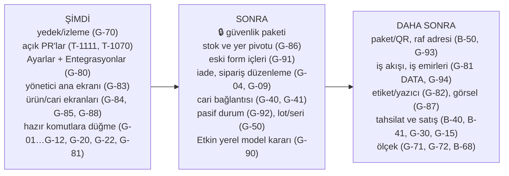

# 4. Gap analizi: eksik ve bekleyen işler

> **Bu bölüm neyi anlatır?** 01–03 bölümlerinde kod okunurken bulunan eksiklerin tek listesi ve önerilen geliştirme sırası.
>
> **Nasıl okunur?** Her satırda: ne eksik, iş açısından ne sonucu var, hangi bölümde ayrıntısı var, BACKLOG'daki kimliği ve **28 Ekim durumu** (Açık / Kısmen / Kapandı). 23 Ekim'de "Yeni" yazan satırlar T-1028 parçasıyla BACKLOG'a **B-149…B-154** olarak girdi; satırlarda artık o numara yazılıdır. "Yeni (28 Ekim)" yazan satırların BACKLOG'da henüz karşılığı yoktur; koordinatör bir değişiklik parçasıyla ekler.
>
> **Boyut (kaba tahmin, tek geliştirici):** **S** küçük (tek PR, yaklaşık 1 gün) · **M** orta (birkaç gün) · **L** büyük (bir hafta ve üstü). **UI** = mevcut veri yeter, yalnız ekran · **UI+R** = şema değişmez ama yeni okuma işlevi gerekir · **DATA** = migration (veritabanı değişikliği) + yeni iş kuralı gerekir.
>
> **Güvenlik satırları (🔒):** Depo herkese açık olduğundan güvenlik açıklarının ayrıntısı burada yazılmaz. Yalnız BACKLOG kimliği ve genel başlık verilir. Ayrıntı gizli danışma taslağındadır (GHSA-jxfh-5j2f-4mvg).
>
> **Kaynak:** ilk sürüm 23 Ekim 2026, main `36f3a13` kod okuması. **Bu güncelleme: main `8e2710d` · 28 Ekim 2026** — `36f3a13..8e2710d` arası commit'ler (T-1029…T-1109), BACKLOG satırları, `apps/web` içinde komut çağrıları için arama ve 26 Ekim onaylı masaüstü tuvali (`docs/design/source/Standart*.dc.html`) ile canlı kodun 28 Ekim karşılaştırması. Testler, canlı sistem ve veritabanı bu belge için çalıştırılmadı. "Kodda yok" ifadesi arama sonucudur.

### 23 Ekim'den bu yana ne değişti? (kısa)

Bu beş günde yapılan işlerin çoğu **görünüm ve kullanım kolaylığıydı**: masaüstü ekran standardı (ortak üst/alt çubuk, liste, kayıt kartı, form ve ayar kalıpları), ürün/depo/raf yeri/cari/belge kartları, listelerde kaydırmayla yükleme, odaklı adım adım rehberler, yüzen kısayol, Etkin bas-konuş düzeltmeleri ve doğal Türkçe sesle okuma (T-1106, T-1109), Paraşüt'e müşteri bazlı bağlanma ve ürün yaşam döngüsü (T-1066…T-1068, migration 0059–0063). Bu yüzden 23 Ekim listesindeki **arka uç hazır, ekranı yok** işlerinin hiçbiri tam kapanmadı; yalnız ikisi kısmen ilerledi (G-22, G-73). Yeni onaylı tasarımlardan doğan işler **G-80…G-89**, açık ürün işleri **G-90…G-94** olarak eklendi.

---

## 4.1 Arka ucu hazır, ekranı olmayan işlemler

Sunucuda komutu yazılmış ama hiçbir düğme çağırmıyor. Bu işler genellikle **ucuzdur**: iş kuralı ve veritabanı hazır, yalnız ekran (tuval → birebir aktarım, I-18) gerekir. 28 Ekim araması: `setWorkPriorityAction`, `updateWorkShiftAction`, `resolveProblemAction` (`apps/web/app/t/[slug]/work-actions.ts`) ve `leaveTenantAction` (`members/actions.ts`) tanımlı ama hiçbir ekran dosyası çağırmıyor; `reverseDocument`, `cancelInboundReceipt`, `createCustomerReturn`, `updateDraftOrder` web tarafında hiç geçmiyor.

| # | Eksik | İş sonucu (sade) | Ayrıntı | BACKLOG | Boyut | 28 Ekim |
| :--- | :--- | :--- | :--- | :--- | :--- | :--- |
| G-01 | **Ters kayıt düğmesi** (`reverseDocument`) | İşlenmiş bir fiş yanlışsa kullanıcı düzeltemiyor. Belge kartı artık kayıt kartı kalıbında (T-1091) ama "Ters kayıt" düğmesi yok. | 02b §2B.7 | B-149 | S · UI | Açık |
| G-02 | **Teslim iptali** (`cancelInboundReceipt`) ve **taslak fiş düzenleme** (`updateDraft`) | Yanlış açılmış beklenen teslim kapatılamıyor; taslak fiş düzeltilemiyor. | 02b §2B.1, §2B.7 | B-149 | S · UI | Açık |
| G-03 | **Eksik teslimi kapatma** komutu hiç yok | Kısmi kabulden sonra teslim süresiz "Açık" kalıyor; listeler kirleniyor. | 02b §2B.1 | B-149 | S–M · komut + UI | Açık |
| G-04 | **Müşteri iadesi** (`createCustomerReturn`) | İade işi yapılamıyor. Kural ve tablolar var; sunucu eylemi ve ekran yok. | 02c §12 | B-52 kalanı | M · UI+eylem | Açık |
| G-05 | **Görev ilerleme kaydı** (adım kaydet, kaydetmeye başla, sıfırla, sonraki görev) | Panodaki "OKUTUYOR" durumu pratikte hep boş görünür. | 02c §2 | B-149 | S–M · UI | Açık |
| G-06 | **ACİL önceliği** (`setWorkPriorityAction`) | Ana ekrandaki ACİL rozeti hiç yanmaz. | 02c §1 | B-149 | S · UI | Açık |
| G-07 | **Vardiya saatleri** (`updateWorkShiftAction`) | Vardiya hep 08:00–17:00 görünür. Ayarlar sekmeli oldu (T-1046) ama İş akışı sekmesi henüz yok (bkz. G-81). | 02c §1, 03b `tenant_settings` | B-149 | S · UI | Açık |
| G-08 | **Bildirilen sorunu çözme** (`resolveProblemAction`) | "Sorun bildir" ile gelen kayıtlar hep açık kalır. | 02c §1 | B-149 | S · UI | Açık |
| G-09 | **Sipariş düzenleme / satır iptali / yeniden ayırma** (`updateDraftOrder`, `cancelOrderLine`, `reallocateOrderLine`) | Sipariş açıldıktan sonra masa ekranından değiştirilemiyor. | 02c §7 | B-149 | M · UI | Açık |
| G-10 | **Paketli üretim** (4 eylem) | QR'lı paketten üretime tüketim ekranda yok. | 02c §11 | B-50 ile | M · UI | Açık |
| G-11 | **Yeniden yerleştirme görevi** sahada "Başla" yok | Görev doğuyor ama saha personeli başlatamıyor. | 02c §2 | B-149 | S · UI | Açık |
| G-12 | **Alandan ayrılma** (`leaveTenantAction`) | Kullanıcı bir firmadan kendisi çıkamıyor. | 02a | B-55 ile | S · UI | Açık |
| G-13 | **Paraşüt "CHECK" (sonucu belirsiz) irsaliyesi** için karar düğmesi | Belirsiz gönderim yalnız listede durur, çözülemez. | 02d ERP | B-113 | S–M · UI | Açık |
| G-14 | **Güvenilen cihaz listesi + tekil iptal** | "30 gün hatırla" cihazları tek tek kaldırılamıyor (toplu iptal var). | 02a Giriş | B-76 kalanı | S · UI+R | Açık |
| G-15 | **Müşteri kapatma** (`tenants.status = CLOSING`) | Panelde müşteri kapatma/silme düğmesi yok; yalnız operatör betiği (T-1005, canlıda çalıştırılmadı). ⚠️ Müşteri verisi kalıcı silinir, kullanıcıya önceden haber şartı var. | 02d Müşteriler | B-43, B-137 | M · UI + süreç | Açık |
| G-16 | **Destek: müşterinin "Çözüldü" demesi, ekran görüntüsü eki, "Erişim iste"** | Destek akışı yarım. | 02d Destek | B-88, B-89, B-90, B-44 | M–L · DATA (ek için G-43) | Açık |

### Onaylı masaüstü tuvali ile canlı arasındaki fark (Yeni, 28 Ekim)

26 Ekim'de onaylanan masaüstü tuvali (STANDART kalıpları) ile 28 Ekim canlı kodunun karşılaştırması. Bir satırda birden çok parça varsa her parçanın boyutu ve türü ayrı yazılır; **UI** parçaları migration'sız hemen yapılabilir, **DATA** parçaları ayrı iş olarak sonraya kalır.

| # | Eksik | İş sonucu (sade) | Parçalar ve boyut | BACKLOG | 28 Ekim |
| :--- | :--- | :--- | :--- | :--- | :--- |
| G-80 | **Ayarlar › Entegrasyonlar tek ekran**: solda alt bölüm listesi, sağda tek konu; her akış için her zaman görünen **4 seçenekli yön seçici** | Bugün Bağlantılar (Excel) ve entegrasyon grupları alt alta duruyor; kullanıcı neyin nereden geldiğini tek bakışta seçemiyor. | Sol alt bölüm listesi **M · UI** (ortak ayar bileşeni yok, önce kalıba eklenir) · 4 seçenekli yön seçici **S · UI** ("Yalnız Etkin WMS" = akış kapalı) · Bağlantı + Excel tek bölüm **S · UI** · Bekleyenler/hatalar sayıları **S · UI** · Pasif ve arşiv sayıları **S · UI+R** · kayıt bazlı hata listesi **M · DATA** · pasif/arşiv politika ayarı **M · DATA** · alan sahipliği **M–L · DATA** · satış faturasından iş başlatma **L · DATA**. Depolar için "iki yönlü" seçenek tuvalde gizli, katalog destekliyor → **ürün kararı** | B-196, B-171, B-170, B-169 | Açık (T-1104 ilk sadeleştirme yapıldı) |
| G-81 | **Ayarlar › İş akışı sekmesi** | Kabul kalite onayı, yarım sayım süresi, vardiya ve görev ayrılığı ayarları dağınık ya da hiç yok. | Mevcut ayarları bu sekmeye taşımak **S · UI** (G-07, G-28'i de kapatır) · teslimat yolu, iş adımları, teslim teyidi **L · DATA** | B-168, B-150 | Açık |
| G-82 | **Ayarlar › Etiket ve yazıcı sekmesi** | Etiket tasarımı ve yazıcı seçimi yapılamıyor; bugün tek sabit şablon. | **M · DATA** (ölçü, alanlar, varsayılan tasarım) | B-166 | Açık |
| G-83 | **Yönetici ana ekranı**: 3 bekleyen iş kutusu + 8'li İşler ızgarası + sürükle-bırak düzen | Yönetici açılışta "bugün ne bekliyor?" sorusunun cevabını göremiyor; canlıda eski Pano panosu. | **M · UI** (veri var) | B-173, T-1045 kalanı | Açık |
| G-84 | **Ürünler listesi sütunları** | Listede kullanılabilir miktar ve barkod görünmüyor. | Kullanılabilir + Barkod sütunu **S · UI+R** · Paraşüt durumu, ana raf, Pasif çipi, Görsel **DATA** (G-86, G-87, G-92'ye bağlı) | B-175 | Açık |
| G-85 | **Ürün kartı kutuları ve sekmeleri** | Kartta "ne kadar ayrılmış, ne kadar kullanılabilir" ve hareket/değişiklik geçmişi yok. | Kullanılabilir/Ayrılmış kutuları **S · UI+R** · Hareketler, Takip, Değişiklik geçmişi sekmeleri **M · UI+R** (G-26 `code_history` burada gösterilir) · ana raf, montaj **DATA** | B-176 | Açık (kart kalıbı T-1049 ile geldi) |
| G-86 | **Ürün kartı › Stok ve yer pivotu**: Depo › Raf › Lot › Paket katlanır görünüm + toplam şeridi | Bir ürünün nerede, hangi lotta, hangi pakette olduğu tek ekranda görülemiyor. | **M–L · UI+R** (veri var, migration yok) | B-176 | Açık |
| G-87 | **Ürün görseli** (kartta büyük görünüm, listede küçük resim) | Ürün fotoğrafı eklenemiyor. | **L · DATA + altyapı** (dosya deposu yok, bkz. G-43) | B-176 | Açık |
| G-88 | **Yeni cari formu**: tür seçimi üst şeritte büyük düğmeler + 3 sütun | Form tuvaldekinden uzun; tür seçimi küçük. | Düzen **S · UI** · kısa ad ve ilçe alanları **S · DATA** · varsayılan teslimat yöntemi **M · DATA** (G-81 iş akışına bağlı) | B-191 sonrası | Açık (otomatik kod T-1093 ile geldi) |
| G-89 | **Kişi tercihleri sunucuda**: Kart/Liste seçimi, sütunlar, yüzen kısayol düzeni | Bugün tercihler yalnız o cihazda hatırlanıyor; başka cihazda baştan seçilir. | **S–M · DATA** | B-175, B-174 | Açık |

## 4.2 Veritabanında olup ekranda görünmeyen veriler

Kolonu ya da tablosu var; kullanıcı göremiyor veya giremiyor.

| # | Veri | Sonuç | Ayrıntı | BACKLOG | Boyut | 28 Ekim |
| :--- | :--- | :--- | :--- | :--- | :--- | :--- |
| G-20 | **Min/maks stok** (`item_stock_policies`) | Pano ve ürün kartı okuyor ama **girilecek ekran yok**. Minimum altı uyarısı ve satın alma önerisi bu yüzden çalışamaz. | 03a, 02b §2B.6 | B-150, B-83 | S · UI | Açık |
| G-21 | **Stok uyarıları** (`stock_alerts`) | Tablo var, şema dışında hiçbir kod okumuyor ya da yazmıyor. | 03a | B-150, B-81 | M · kural + UI | Açık |
| G-22 | **Raf toplamaya kapalı** (`locations.pick_blocked`) | Raf yeri kartı (T-1082) artık "toplamaya kapalı" etiketini **gösteriyor**; işaretleyip kaldıracak düğme hâlâ yok. | 03a, 02b §2B.10 | B-150 | S · UI | **Kısmen** (gösterim T-1082) |
| G-23 | **Tedarikçi lot no** (`lots.supplier_lot`) | İzlenebilirlik raporunda kullanılamıyor. | 03a | Yeni | S · UI | Açık |
| G-24 | **Emanet (konsinye) stok sahibi** (`inventory_owners`) | Altyapı var, oluşturma ekranı ve komutu yok. | 03a | Yeni (ürün kararı) | L · DATA | Açık |
| G-25 | **Bloke stok** (`BLOCKED`) ve **palet içi koli** (`handling_units.parent_id`) | Ekranı yok. | 02b | B-50, B-165 ile | M · UI | Açık |
| G-26 | **Kod geçmişi** (`code_history`) | Ürün/raf kodu değişince kayıt tutuluyor ama gösterilmiyor. Ürün kartında "Değişiklik geçmişi" sekmesi (G-85) bunun yeri. | 03a | G-85 / B-176 | S · UI+R | Açık |
| G-27 | **Stok tutarlılık denetimi sonuçları** (`stock_consistency_runs/signals`) | Arka plan denetimi çalışıyor, sonucu kimse görmüyor. Defter-bakiye farkı olursa yalnız log'da kalır. | 03a, 02d Worker | B-03 / B-68 ile | S–M · UI | Açık |
| G-28 | **Kalite onayı aç/kapa** (`receiving_qc_enabled`), **yarım sayımı bırakma süresi** (`count_abandon_hours`) | Ayarlar ekranından değiştirilemiyor (Ayarlar'da yalnız Firma, Kullanıcılar ve yetki, Entegrasyonlar, Görünüm sekmesi var). | 03b | B-150 → G-81 | S · UI | Açık |
| G-29 | **Fatura no** (`charges.invoice_no`) | Panel "fatura bekleyen" sayısını gösteriyor ama bu alanı yazan yol yok; sayı hiç azalmaz. | 03b, 02d Ödemeler | B-153, B-45 | S · UI | Açık |
| G-30 | **Paket özellik bayrakları** (QR, sevkiyat, üretim, API) | Panelde seçiliyor, uygulamada hiçbir ekranı açıp kapatmıyor. Yalnız sayı sınırları uygulanıyor. | 01 §1.8.3, 02d Paketler | B-153 (ürün kararı) | M | Açık |
| G-31 | **Rezervasyon süresi** (`reservations.expires_at`) | Süre dolumunu yöneten ayar/ekran yok. | 03a | Yeni | M | Açık |
| G-32 | Küçükler: `users.image`, `integration_runs.linked_count`, `sector_template_*` / `onboarding_steps`, `wms_platform.operators` yönetimi | Düşük öncelik. `users.image` üst çubuktaki Hesap görseli için kullanılabilir (bugün baş harf). | 03b | — | S | Açık |

## 4.3 Veri bağlantısı eksikleri

| # | Eksik | Sonuç | BACKLOG | Boyut | 28 Ekim |
| :--- | :--- | :--- | :--- | :--- | :--- |
| G-40 | **Cariler hiçbir belgeye bağlı değil.** Teslimde tedarikçi (`supplier_ref`), siparişte müşteri (`customer_ref`) serbest metin. | "Bu tedarikçiden ne geldi?" ya da "Bu müşteriye ne gitti?" raporu güvenilir alınamaz. ERP eşlemesi zorlaşır. Cari kartı (T-1090) ve otomatik cari kodu (T-1093) geldi; belgeye bağ hâlâ yok. | B-151 | L · DATA | Açık |
| G-41 | Siparişte **teslim tarihi** ve **depo** kolonu yok | Geciken sipariş uyarısı (B-81) yapılamaz. | B-151 | M · DATA | Açık |
| G-42 | Paketsiz depolar arası transferde iki fiş arasına **bağ kaydı** (`stock_document_links`) yazılmıyor | Transferin giriş ve çıkış fişi listede eşleştirilemiyor. Stok doğru, iz zayıf. | B-151 | S–M | Açık |
| G-43 | **Dosya deposu** (`packages/storage`, S3) hiçbir ekrana bağlı değil; canlıda nesne deposu konteyneri yok | Ek, fotoğraf, belge saklama özellikleri bekliyor: destek ekran görüntüsü (B-88), ürün görseli (G-87), iş emri fotoğrafı (B-167). | B-88 ile | L · altyapı | Açık |

## 4.4 Eksik iş kuralları ve doğrulamalar

| # | Eksik | Sonuç | BACKLOG | Boyut | 28 Ekim |
| :--- | :--- | :--- | :--- | :--- | :--- |
| G-50 | **Lot / seri takipli ürün** normal saha kabulü, toplama, sevk ve sayımda reddediliyor; seri takipli ürünün hiç kabul yolu yok | Lotlu çalışan müşteri (gıda, kimya, ilaç) bugün saha akışlarını kullanamaz. Yalnız paketli kabul (kapalı) lotu destekliyor. | B-152, B-165 | L | Açık |
| G-51 | Toplamada **"ürün rafta hiç yok"** barkodsuz bildirilemiyor; eksikten doğan sayım görevi sahada açılamıyor | Saha personeli takılır. | B-96 | M | Açık |
| G-52 | **Fazla kabul** hatası "ne kadar fazla" demiyor | Kullanıcı neyi düzelteceğini anlamaz. | Yeni | S | Açık |
| G-53 | Ters kayıtta **kapalı dönem** denetimi yok (kod notu A-71) | Muhasebe dönemi kapandıktan sonra o döneme ait fiş geri alınabilir. | Yeni (ERP ile) | M · DATA | Açık |
| G-54 | **Taslak fiş düzenleme** satırları silip yeniden yazıyor | Paketli akışa bağlanınca satır kimliği kaybolur. Kalıcı satır kimliğiyle düzenleme gerekir. | Yeni (B-50 önkoşulu) | M | Açık |
| G-55 | **Deneme süresi bitince** ne olacağı tanımlı değil (otomatik askı/uyarı yok) | Ücretli satışa geçmeden karar gerekir. | B-41 (karar sizde) | M | Açık |
| G-56 | Panel ve uygulamada **teknik hata kodları** kullanıcıya görünebiliyor | Kullanıcı anlamaz. | B-66 | S–M | Açık |
| G-57 | **Kullanıcı başına dil**, saat dilimi sabit İstanbul | Yabancı müşteride sorun. | B-105 | M · DATA | Açık |
| G-58 | Etiket şablonu **gerçek yazıcıda** denenmedi | İlk sahada sürpriz olabilir. Ürün QR etiket önizlemesi (T-1064) geldi; fiziksel yazıcı kabulü yok. | B-56, B-166 | — (cihaz testi) | Açık |

### Açık ürün işleri (Yeni, 28 Ekim)

| # | Eksik | Sonuç | BACKLOG | Boyut | 28 Ekim |
| :--- | :--- | :--- | :--- | :--- | :--- |
| G-90 | **Etkin'e doğal dille konuşma** (serbest cümleden işi anlamak) | Bugün Etkin belirli kalıp cümleleri anlıyor; çoğu sesli komut yalnız ilgili ekranı açıyor (B-195). Kural tabanlı doğal komutlar ("bekleyen işim var mı", "ürünleri aç", "kullanıcı ayarlarına git") **T-1110** ile 28 Ekim'de main'e birleşti (PR 245; canlı: UNKNOWN). Daha serbest anlama için **sunucuda çalışan yerel küçük dil modeli** seçeneği var: veri sunucudan çıkmaz (gizlilik), ama VPS **2 çekirdek / 8 GB**; model hem belleği hem cevap süresini zorlar. **Karar sizde bekliyor.** | T-1110, B-195, B-131, B-132 | T-1110: S–M · migration yok; yerel model: M–L · migration yok, sunucu kaynağı gerekir | Kısmen (T-1110 birleşti) |
| G-91 | **Belge formlarının içi eski bileşenlerle** (mal kabul, sevk, üretim, stok belgeleri, sayım) | Bu formlarda satır eklenip çıkılınca "kaydedilmemiş iş" uyarısı çıkmayabilir; görünüm diğer formlardan farklı. | B-123, B-162 | M · UI | Açık |
| G-92 | **Pasif durum ve arşiv kalanı**: pasif kart yeni işlemde seçilemesin, arşivden çıkarma, arşiv engel listesi, kalıcı silme | Bugün yalnız "arşivli" var (T-1040); kullanılmayan kart pasife alınamıyor. | B-163, B-172 | M · DATA | Açık |
| G-93 | **Raf adresi ve tekil QR**: Koridor-Sütun-Kat-Göz adresleme, toplu göz oluşturucu, tek tek adet/kutu/palet QR | Büyük depoda raf kurulumu ve QR'lı izleme yavaş/eksik. | B-164, B-165 | L · DATA | Açık |
| G-94 | **İş emirleri ve sipariş kaynakları**: siparişten iş emri, kişi/ekip ataması, Excel/ERP'den sipariş, dış belge no | Sipariş sonrası iş takibi elle; sipariş yalnız elle açılıyor. | B-167, B-169 | L · DATA | Açık |

## 4.5 Transaction (hep-ya-da-hiç) durumu

Kod incelemesinde stok değiştiren bütün ana işlemler **tek veritabanı işleminde** çalışıyor: kabul, kalite onayı, yerleştirme, transferin iki bacağı, üretim (tüketim + çıktı), sevk, sayım fişi, paket kabulü, açılış stoku. Her biri audit kaydını aynı işlemde atıyor (I-04, I-07, I-12).

Deneme aktivasyonu bilinçli olarak iki aşamalıdır: kullanıcı hesabı önce ayrı oluşur, kiracı ve sahiplik sonra tek işlemde açılır. İkinci aşama başarısız olursa hesap korunur ve aynı bağlantıyla yeniden deneme o hesabı kullanır (`packages/domain/src/platform/activation.ts`).

Bilinçli tek istisna: toplamada eksik çıkınca **yeniden ayırma** ayrı işlemde çalışıyor. Arada hata olursa satır "ayrımsız açık" kalır ve ekranda görünür. Veri bozulmaz, yalnız elle tekrar gerekir.

28 Ekim notu: bu güncellemede stok yazan işlemler yeniden incelenmedi. 23 Ekim'den bu yana eklenen Paraşüt ürün yaşam döngüsü (T-1067/T-1068, migration 0062) kendi kaydında "mevcut stok ve açık işler korunur" kuralıyla canlıya çıktı; ayrıntısı 02d ERP bölümündedir.

Açık konu: G-54 (taslak düzenleme). Ölçek riski: defter-bakiye denetimi her yazımda tüm geçmişi toplar (B-68).

## 4.6 Yetki ve güvenlik (yalnız genel başlık)

Ayrıntılar gizli danışma taslağındadır. 28 Ekim itibarıyla BACKLOG'da hâlâ açık görünen başlıklar:

- 🔒 **B-10**: global kimlik tablolarında okuma yetkisini daraltma (kalan kısım)
- 🔒 **B-12**: saha girişi migration'larının geri alınmasına veri bekçisi
- 🔒 **B-17**: DB işlevlerinde aktör kimliğinin oturumdan alınması
- 🔒 **B-18**: kuyruk RLS politikası simetrisi
- 🔒 **B-20**: üyelik/rol/grup yazmalarında veritabanı düzeyi ikinci denetim
- 🔒 **B-21**: depo kapsamının RLS'e taşınması (bugün uygulama katmanında)
- 🔒 **B-23**, **B-24**, **B-26**: görev ayrılığı, tenant bağlamı güven sınırı, tablo yetkileri (DB ikinci savunma)
- 🔒 **B-30**, **B-32**, **B-37**, **B-38**: ağ ayrımı, proxy sıkılaştırma, satış sitesi formu, panel kimlik uçları (altyapı)
- 🔒 **B-67**: cari kişisel alanlarının görünürlüğü, `settings.manage` iznini bölme

23 Ekim'den bu yana güvenlik tarafında yapılanlar: haftalık otomatik güvenlik taraması (T-1030), bağımlılık güvenlik güncellemeleri (T-1029, T-1031). Yukarıdaki başlıkların hiçbiri bu dönemde kapanmadı.

Ürün kararı bekleyen (güvenlik açığı değil): **Yetki gruplarındaki "ekranlar" listesi** bugün yalnız menüyü gizliyor; işlemi rol ve izinler belirliyor. Ekran kısıtının sunucuda da uygulanması isteniyorsa ayrı iş açılmalı (G-60, Yeni). Etkin için ayrı yetki anahtarı da aynı kapsamdadır (B-131).

## 4.7 Altyapı ve süreklilik

| # | Eksik | Sonuç | BACKLOG | Boyut | 28 Ekim |
| :--- | :--- | :--- | :--- | :--- | :--- |
| G-70 | **Sunucu dışı şifreli yedek, PITR, dış izleme/alarm, hata izleme** | Tek VPS'te disk/sunucu kaybı = veri kaybı riski. **En büyük risk hâlâ budur.** Her yayında sunucu içi yedek alınıyor, sunucu dışı kopya yok. | B-01…B-04 (P0) | M · migration yok; depolama hesabı sizden | Açık |
| G-71 | **Canlıda PgBouncer yok**; süreç başına 10 bağlantı, DB sınırı 100 | Kullanıcı sayısı artınca ilk tıkanacak yer. | B-154 | M | Açık |
| G-72 | **Yük testi yok** | Kapasite rakamları (01 §1.8.4) tahmin. VPS 2 çekirdek / 8 GB; ses servisi ve olası yerel dil modeli (G-90) aynı makineyi paylaşır. | B-154 | M | Açık |
| G-73 | Ses servisi canlıda mı, VPS donanımı ne, Google/Microsoft girişi açık mı | VPS donanımı artık biliniyor: **2 çekirdek / 8 GB** (kullanıcı bilgisi, 28 Ekim). Doğal Türkçe ses (T-1106, T-1109, migration 0063) main'de; ses servisinin VPS kurulumu (B-130) BACKLOG'da hâlâ açık ve canlıda çalıştığı bu belge için doğrulanmadı (UNKNOWN). Google/Microsoft girişi UNKNOWN. | B-130 | — | **Kısmen** |
| G-74 | **Online tahsilat** (iyzico), otomatik aylık tahakkuk, e-Fatura | Bugün ödeme elle işaretleniyor. | B-40, B-45 | L · DATA | Açık |
| G-75 | **Hız sınırı okumaları da sayıyor** (Yeni, 28 Ekim) | Arka plan okumaları (son işlemler, rehber durumu, kaydırmayla yükleme) kullanıcının dakikalık işlem hakkını tüketir; yoğun kullanımda "Çok fazla işlem" uyarısı çıkabilir. | B-180 | S–M | Açık |
| G-76 | **Yayın sırasında kısa kesinti** (Yeni, 28 Ekim) | 28 Ekim yayınında birkaç saniyelik 502 görüldü; proxy tarafında kısa bekleme eklendi (T-1070, sürüyor). Migration'ı yazıcıları durdurmadan uygulama kuralı yok. | B-46, B-34, B-124 | M | Kısmen (T-1070 devam) |
| G-77 | **Proxy imajı sürümle sabit değil** (Yeni, 28 Ekim) | Haftalık tarama uyarı veriyor; habersiz sürüm değişebilir. | B-155, B-32 | S | Açık |

---

## 4.8 Önerilen geliştirme sırası

Kullanıcının 20 Ekim'de onayladığı sıra (BACKLOG başı) ve 26 Ekim masaüstü standardı kararı korunur. Aşağıdaki yol haritası 28 Ekim durumuna göre **Şimdi / Sonra / Daha sonra** diye ayrılmıştır. Her işin yanında **boyutu** (S/M/L) ve **migration gerekip gerekmediği** yazılıdır: migration'sız işler daha az risklidir ve hızlı canlıya çıkar; migration'lı işler yayında yedek + veritabanı değişikliği ister. Sıra sizin kararınızdır; bu yalnız öneridir.

### Şimdi (önümüzdeki 1–2 hafta)

| Sıra | İş | Gap / BACKLOG | Boyut | Migration? | Neden şimdi? |
| :--- | :--- | :--- | :--- | :--- | :--- |
| 1 | **Sunucu dışı yedek, izleme ve alarm** | G-70 · B-01…B-04 | M | Hayır | Veri kaybolursa geri dönüş yok. **Sizden bekleyen:** yedek için depolama hesabı. |
| 2 | **Açık PR'ları bitirip canlıya almak**: görsel düzeltmeler (T-1111), yayın 502 düzeltmesi (T-1070) | G-90 (ilk adım), G-76 | S–M | Hayır | Yarım iş birikmesin; kullanıcı bulguları hemen kapansın. |
| 3 | **Ayarlar sol alt bölümler + Entegrasyonlar tek ekran** (yön seçici, Bağlantı+Excel tek bölüm, bekleyen/hata sayıları) | G-80 UI parçaları · B-196 | M | Hayır | Onaylı tuvalde var; Paraşüt/Excel kurulumunu sadeleştirir. Ortak ayar bileşeni önce kalıba eklenir (T-1112). |
| 4 | **Ayarlar › İş akışı sekmesi (mevcut ayarlarla)**: kalite onayı, yarım sayım süresi, vardiya, görev ayrılığı | G-81 UI, G-07, G-28 · B-150 | S | Hayır | Ayarlar hazır, yalnız yerini bulur; G-07 ve G-28 birlikte kapanır. |
| 5 | **Yönetici ana ekranı** (bekleyen iş kutuları, İşler ızgarası, sürükle-bırak) | G-83 · B-173 | M | Hayır | Yöneticinin her gün ilk gördüğü ekran; veri hazır. |
| 6 | **Ürün listesi/kartı mevcut veriyle** (Kullanılabilir, Barkod, Ayrılmış kutuları, Hareketler/Takip/Değişiklik geçmişi) + **yeni cari 3 sütun** | G-84, G-85, G-26, G-88 UI · B-175, B-176 | M | Hayır | En sık açılan ekranlar; şema değişmez. |
| 7 | **Hazır komutlara düğme**: ters kayıt, teslim iptal/kapat, taslak düzenle, ACİL, sorun çöz, yeniden yerleştirme "Başla", firmadan ayrıl, min/maks girişi, raf toplamaya kapat | G-01, G-02, G-03, G-06, G-08, G-11, G-12, G-20, G-22 · B-149, B-150 | Her biri S (G-03 S–M) | Hayır | Sunucu tarafı hazır; az emekle çok değer. Kayıt kartlarına düğme olarak eklenir. |

### Sonra (yaklaşık 2–6 hafta)

| Sıra | İş | Gap / BACKLOG | Boyut | Migration? | Not |
| :--- | :--- | :--- | :--- | :--- | :--- |
| 8 | **🔒 P1 güvenlik paketi** | B-10…B-26, B-30…B-38, B-67 | L | **Evet** (bir kısmı) | 20 Ekim onaylı sırada 6. adım; bağımsız güvenlik incelemesi zorunlu. |
| 9 | **Stok ve yer pivotu** (Depo › Raf › Lot › Paket) | G-86 | M–L | Hayır | Veri var; yeni okuma işlevi gerekir. |
| 10 | **Eski belge formlarının içi** ortak kalıba | G-91 · B-123 | M | Hayır | Kaydedilmemiş iş uyarısı tutarlı olur. |
| 11 | **Müşteri iadesi**, **sipariş düzenleme / satır iptali**, görev ilerleme kaydı | G-04, G-09, G-05 | M + M + S–M | Hayır (tablolar var) | Günlük depo işinin eksik halkaları. |
| 12 | **Carileri belgelere bağlamak** + siparişte teslim tarihi ve depo | G-40, G-41, G-42 · B-151 | L | **Evet** | "Bu tedarikçiden ne geldi?" raporu ve geciken sipariş uyarısının önkoşulu. |
| 13 | **Pasif durum + arşiv kalanı** | G-92 · B-172 | M | **Evet** | Ürün listesindeki Pasif çipi (G-84) buna bağlı. |
| 14 | **Lot/seri takipli ürün saha akışları** | G-50 · B-152 | L | Muhtemelen hayır | Gıda/kimya/ilaç müşterisi için şart. |
| 15 | **Etkin yerel dil modeli** (kararınıza bağlı) | G-90 | M–L | Hayır | Önce 2 çekirdek / 8 GB VPS'te bellek ve cevap süresi ölçülür; yetmezse kural tabanlı yol (T-1110) genişletilir. |
| 16 | **Kişi tercihleri sunucuda**, Entegrasyonlar kayıt bazlı hata listesi, cari kısa ad/ilçe | G-89, G-80 DATA, G-88 DATA | S–M her biri | **Evet** | Küçük migration'lar; birlikte paketlenebilir. |

### Daha sonra (ilk ücretli müşteri öncesi ve ölçek)

| İş | Gap / BACKLOG | Boyut | Migration? |
| :--- | :--- | :--- | :--- |
| Paketli/QR akışını açmak + raf adresi + tekil QR (G-10, G-25, G-54 dahil) | B-50, G-93 · B-164, B-165 | L | **Evet** |
| İş akışı verisi (teslimat yolu, teslim teyidi), iş emirleri, sipariş kaynakları, Paraşüt alan sahipliği, faturadan iş başlatma | G-81 DATA, G-94, G-80 DATA · B-167…B-170 | L | **Evet** |
| Etiket tasarımı ve yazıcılar + gerçek yazıcı kabulü | G-82, G-58 · B-166, B-56 | M–L | **Evet** |
| Dosya deposu → ürün görseli, destek ekran görüntüsü, destek akışının kalanı | G-43, G-87, G-16 · B-88…B-90 | L | **Evet** + altyapı |
| Satılabilir SaaS: online tahsilat, deneme bitişi, paket bayrakları, fatura no, müşteri kapatma, sözleşmeler | G-74, G-55, G-30, G-29, G-15 · B-40…B-45, B-153 | L | **Evet** |
| Ölçek: PgBouncer, yük testi, defter denetimi ölçeği, hız sınırı ayrımı, kesintisiz yayın | G-71, G-72, G-75, G-76, G-27 · B-154, B-68, B-180, B-46 | M her biri | Kısmen |
| Küçükler: tedarikçi lot no, rezervasyon süresi, emanet stok (ürün kararı), dil/saat dilimi, hata kodlarının Türkçesi | G-23, G-31, G-24, G-57, G-56 | S–L | Kısmen |

### Sizden bekleyenler

- **Yedek için depolama hesabı** (G-70, B-01/B-02).
- **Etkin yerel dil modeli kararı** (G-90): "veri sunucudan çıkmasın" şartıyla 2 çekirdek / 8 GB sunucuda denensin mi?
- **Ürün kararları:** Entegrasyonlarda depolar için "iki yönlü" seçenek gösterilsin mi (G-80); deneme bitince ne olsun (G-55, B-41); paket bayrakları neyi kapatsın (G-30); emanet stok gerekli mi (G-24).
- **Sunucuda bir kez yapılacak root adımları:** ses servisi kurulumu (B-130), müşteri sıfırlama (B-137).
- **Gerçek iPhone Safari kontrolü:** yüzen kısayol, odaklı rehber, bas-konuş, doğal sesle okuma (B-197).

## 4.9 Yeni bir modül ya da değişiklik nasıl istenir?

Değişiklik isterken şu dört şeyi yazmanız yeterli; teknik dil gerekmez:

1. **Hangi ekran?** Bu belgedeki modül adı (ör. "02b — Mal Kabul, saha").
2. **Ne olsun?** "Şu düğmeye basınca … olsun" ya da tablodaki bir satırı gösterip "bu da olsun".
3. **Kim yapabilsin?** Rol (sahip, yönetici, saha personeli) ya da yetki grubu.
4. **Hangi gap?** Varsa bu bölümdeki numara (ör. "G-01'i yapalım" ya da "Şimdi listesinin 3. maddesi").

Masaüstü ekranlar 26 Ekim kararıyla `docs/design/STANDART.md` kalıplarından birine (liste, kayıt kartı, form, ayar, pencere) girer; kalıba uyan ekran için ayrıca tuval onayı istenmez. Kalıba sığmayan ya da tuvalde hiç olmayan ekran önce tasarım tuvaline eklenir ve sizin onayınızla kodlanır (I-18, ALTIN-KURAL). Migration gerektiren işler (yukarıdaki "Evet" satırları) canlıya çıkarken otomatik yedek alınır.
