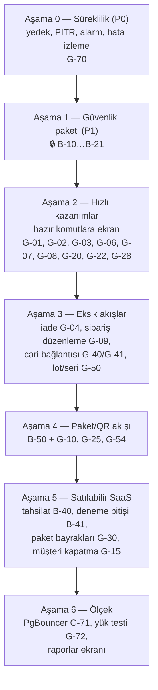

# 4. Gap analizi: eksik ve bekleyen işler

> **Bu bölüm neyi anlatır?** 01–03 bölümlerinde kod okunurken bulunan eksiklerin tek listesi ve önerilen geliştirme sırası.
>
> **Nasıl okunur?** Her satırda: ne eksik, iş açısından ne sonucu var, hangi bölümde ayrıntısı var, BACKLOG'daki kimliği (varsa). "Yeni" yazan satırların BACKLOG'da henüz karşılığı yoktur. Bu belgenin parçası (`docs/changes/T-1028.md`) birleşince bu satırlar BACKLOG'a eklenir.
>
> **Güvenlik satırları (🔒):** Depo herkese açık olduğundan güvenlik açıklarının ayrıntısı burada yazılmaz. Yalnız BACKLOG kimliği ve genel başlık verilir. Ayrıntı gizli danışma taslağındadır (GHSA-jxfh-5j2f-4mvg).
>
> **Kaynak:** 23 Ekim 2026'da main `36f3a13` üzerinde kod okuması. Testler, canlı sistem ve veritabanı bu belge için çalıştırılmadı. "Kodda yok" ifadesi arama sonucudur. Ekranda başka bir yoldan yapılıyor olabilecek durumlar "doğrulanmadı" diye işaretlidir.

---

## 4.1 Arka ucu hazır, ekranı olmayan işlemler

Sunucuda komutu yazılmış ama hiçbir düğme çağırmıyor. Bu işler genellikle **ucuzdur**: iş kuralı ve veritabanı hazır, yalnız ekran (tuval → birebir aktarım, I-18) gerekir.

| # | Eksik | İş sonucu (sade) | Ayrıntı | BACKLOG |
| :--- | :--- | :--- | :--- | :--- |
| G-01 | **Ters kayıt düğmesi** (`reverseDocument`) | İşlenmiş bir fiş yanlışsa kullanıcı düzeltemiyor. Komut hazır, fiş ayrıntısında düğme yok. | 02b §2B.7 | Yeni |
| G-02 | **Teslim iptali** (`cancelInboundReceipt`) ve **taslak fiş düzenleme** (`updateDraft`) | Yanlış açılmış beklenen teslim kapatılamıyor; taslak fiş düzeltilemiyor. | 02b §2B.1, §2B.7 | Yeni |
| G-03 | **Eksik teslimi kapatma** komutu hiç yok | Kısmi kabulden sonra teslim süresiz "Açık" kalıyor; listeler kirleniyor. | 02b §2B.1 | Yeni |
| G-04 | **Müşteri iadesi** (`createCustomerReturn`) | İade işi yapılamıyor. Kural ve tablolar var; sunucu eylemi ve ekran yok. | 02c §12 | B-52 kalanı |
| G-05 | **Görev ilerleme kaydı** (adım kaydet, kaydetmeye başla, sıfırla, sonraki görev) | Panodaki "OKUTUYOR" durumu pratikte hep boş görünür. | 02c §2 | Yeni |
| G-06 | **ACİL önceliği** (`setWorkPriorityAction`) | Ana ekrandaki ACİL rozeti hiç yanmaz. | 02c §1 | Yeni |
| G-07 | **Vardiya saatleri** (`updateWorkShiftAction`) | Vardiya hep 08:00–17:00 görünür; Ayarlar'da alan yok. | 02c §1, 03b `tenant_settings` | Yeni |
| G-08 | **Bildirilen sorunu çözme** (`resolveProblemAction`) | "Sorun bildir" ile gelen kayıtlar hep açık kalır. | 02c §1 | Yeni |
| G-09 | **Sipariş düzenleme / satır iptali / yeniden ayırma** (`updateDraftOrder`, `cancelOrderLine`, `reallocateOrderLine`) | Sipariş açıldıktan sonra masa ekranından değiştirilemiyor. | 02c §7 | Yeni |
| G-10 | **Paketli üretim** (4 eylem) | QR'lı paketten üretime tüketim ekranda yok. | 02c §11 | B-50 ile |
| G-11 | **Yeniden yerleştirme görevi** sahada "Başla" yok | Görev doğuyor ama saha personeli başlatamıyor. | 02c §2 | Yeni |
| G-12 | **Alandan ayrılma** (`leaveTenantAction`) | Kullanıcı bir firmadan kendisi çıkamıyor. | 02a | B-55 ile |
| G-13 | **Paraşüt "CHECK" (sonucu belirsiz) irsaliyesi** için karar düğmesi | Belirsiz gönderim yalnız listede durur, çözülemez. | 02d ERP | B-113 |
| G-14 | **Güvenilen cihaz listesi + tekil iptal** | "30 gün hatırla" cihazları tek tek kaldırılamıyor (toplu iptal var). | 02a Giriş | B-76 kalanı |
| G-15 | **Müşteri kapatma** (`tenants.status = CLOSING`) | Panelde müşteri kapatma/silme düğmesi yok; yalnız operatör betiği. ⚠️ Müşteri verisi kalıcı silinir, kullanıcıya önceden haber şartı var. | 02d Müşteriler | B-43, B-137 |
| G-16 | **Destek: müşterinin "Çözüldü" demesi, ekran görüntüsü eki, "Erişim iste"** | Destek akışı yarım. | 02d Destek | B-88, B-89, B-90 |

## 4.2 Veritabanında olup ekranda görünmeyen veriler

Kolonu ya da tablosu var; kullanıcı göremiyor veya giremiyor.

| # | Veri | Sonuç | Ayrıntı | BACKLOG |
| :--- | :--- | :--- | :--- | :--- |
| G-20 | **Min/maks stok** (`item_stock_policies`) | Pano ve ürün kartı okuyor ama **girilecek ekran yok**. Minimum altı uyarısı ve satın alma önerisi bu yüzden çalışamaz. | 03a, 02b §2B.6 | B-83 ile |
| G-21 | **Stok uyarıları** (`stock_alerts`) | Tablo var, hiçbir kod okumuyor ya da yazmıyor. | 03a | B-81 ile |
| G-22 | **Raf toplamaya kapalı** (`locations.pick_blocked`) | Toplama kuralı okuyor, işaretleyecek düğme yok. | 03a, 02b §2B.10 | Yeni |
| G-23 | **Tedarikçi lot no** (`lots.supplier_lot`) | İzlenebilirlik raporunda kullanılamıyor. | 03a | Yeni |
| G-24 | **Emanet (konsinye) stok sahibi** (`inventory_owners`) | Altyapı var, oluşturma ekranı ve komutu yok. | 03a | Yeni (ürün kararı) |
| G-25 | **Bloke stok** (`BLOCKED`) ve **palet içi koli** (`handling_units.parent_id`) | Ekranı yok. | 02b | B-50 ile |
| G-26 | **Kod geçmişi** (`code_history`) | Ürün/raf kodu değişince kayıt tutuluyor ama gösterilmiyor. | 03a | Yeni |
| G-27 | **Stok tutarlılık denetimi sonuçları** (`stock_consistency_runs/signals`) | Arka plan denetimi çalışıyor, sonucu kimse görmüyor. Defter-bakiye farkı olursa yalnız log'da kalır. | 03a, 02d Worker | B-03 / B-68 ile |
| G-28 | **Kalite onayı aç/kapa** (`receiving_qc_enabled`), **yarım sayımı bırakma süresi** (`count_abandon_hours`) | Ayarlar ekranından değiştirilemiyor. | 03b | Yeni |
| G-29 | **Fatura no** (`charges.invoice_no`) | Panel "fatura bekleyen" sayısını gösteriyor ama bu alanı yazan yol yok; sayı hiç azalmaz. | 03b, 02d Ödemeler | B-45 ile |
| G-30 | **Paket özellik bayrakları** (QR, sevkiyat, üretim, API) | Panelde seçiliyor, uygulamada hiçbir ekranı açıp kapatmıyor. Yalnız sayı sınırları uygulanıyor. | 01 §1.8.3, 02d Paketler | Yeni (ürün kararı) |
| G-31 | **Rezervasyon süresi** (`reservations.expires_at`) | Süre dolumunu yöneten ayar/ekran yok. | 03a | Yeni |
| G-32 | Küçükler: `users.image`, `integration_runs.linked_count`, `sector_template_*` / `onboarding_steps`, `wms_platform.operators` yönetimi | Düşük öncelik. | 03b | — |

## 4.3 Veri bağlantısı eksikleri

| # | Eksik | Sonuç | BACKLOG |
| :--- | :--- | :--- | :--- |
| G-40 | **Cariler hiçbir belgeye bağlı değil.** Teslimde tedarikçi (`supplier_ref`), siparişte müşteri (`customer_ref`) serbest metin. | "Bu tedarikçiden ne geldi?" ya da "Bu müşteriye ne gitti?" raporu güvenilir alınamaz. ERP eşlemesi zorlaşır. | Yeni |
| G-41 | Siparişte **teslim tarihi** ve **depo** kolonu yok | Geciken sipariş uyarısı (B-81) yapılamaz. | Yeni |
| G-42 | Paketsiz depolar arası transferde iki fiş arasına **bağ kaydı** (`stock_document_links`) yazılmıyor | Transferin giriş ve çıkış fişi listede eşleştirilemiyor. Stok doğru, iz zayıf. | Yeni |
| G-43 | **Dosya deposu** (`packages/storage`, S3) hiçbir ekrana bağlı değil; canlıda nesne deposu konteyneri yok | Ek, fotoğraf, belge saklama özellikleri (ör. destek ekran görüntüsü B-88) bekliyor. | B-88 ile |

## 4.4 Eksik iş kuralları ve doğrulamalar

| # | Eksik | Sonuç | BACKLOG |
| :--- | :--- | :--- | :--- |
| G-50 | **Lot / seri takipli ürün** normal saha kabulü, toplama, sevk ve sayımda reddediliyor; seri takipli ürünün hiç kabul yolu yok | Lotlu çalışan müşteri (gıda, kimya, ilaç) bugün saha akışlarını kullanamaz. Yalnız paketli kabul (kapalı) lotu destekliyor. | B-50 ile / Yeni |
| G-51 | Toplamada **"ürün rafta hiç yok"** barkodsuz bildirilemiyor; eksikten doğan sayım görevi sahada açılamıyor | Saha personeli takılır. | B-96 |
| G-52 | **Fazla kabul** hatası "ne kadar fazla" demiyor | Kullanıcı neyi düzelteceğini anlamaz. | Yeni |
| G-53 | Ters kayıtta **kapalı dönem** denetimi yok (kod notu A-71) | Muhasebe dönemi kapandıktan sonra o döneme ait fiş geri alınabilir. | Yeni (ERP ile) |
| G-54 | **Taslak fiş düzenleme** satırları silip yeniden yazıyor | Paketli akışa bağlanınca satır kimliği kaybolur. Kalıcı satır kimliğiyle düzenleme gerekir. | Yeni (B-50 önkoşulu) |
| G-55 | **Deneme süresi bitince** ne olacağı tanımlı değil (otomatik askı/uyarı yok) | Ücretli satışa geçmeden karar gerekir. | B-41 |
| G-56 | Panel ve uygulamada **teknik hata kodları** kullanıcıya görünebiliyor | Kullanıcı anlamaz. | B-66 |
| G-57 | **Kullanıcı başına dil**, saat dilimi sabit İstanbul | Yabancı müşteride sorun. | B-105 |
| G-58 | Etiket şablonu **gerçek yazıcıda** denenmedi | İlk sahada sürpriz olabilir. | B-56 |

## 4.5 Transaction (hep-ya-da-hiç) durumu

Kod incelemesinde stok değiştiren bütün ana işlemler **tek veritabanı işleminde** çalışıyor: kabul, kalite onayı, yerleştirme, transferin iki bacağı, üretim (tüketim + çıktı), sevk, sayım fişi, paket kabulü, açılış stoku, deneme aktivasyonu. Her biri audit kaydını aynı işlemde atıyor (I-04, I-07, I-12).

Bilinçli tek istisna: toplamada eksik çıkınca **yeniden ayırma** ayrı işlemde çalışıyor. Arada hata olursa satır "ayrımsız açık" kalır ve ekranda görünür. Veri bozulmaz, yalnız elle tekrar gerekir.

Açık konu: G-54 (taslak düzenleme). Ölçek riski: defter-bakiye denetimi her yazımda tüm geçmişi toplar (B-68).

## 4.6 Yetki ve güvenlik (yalnız genel başlık)

Ayrıntılar gizli danışma taslağındadır. Bu bölümlerin kod okumasında anılan açık başlıklar:

- 🔒 **B-10**: global kimlik tablolarında okuma yetkisini daraltma (kalan kısım)
- 🔒 **B-12**: saha girişi migration'larının geri alınmasına veri bekçisi
- 🔒 **B-17**: DB işlevlerinde aktör kimliğinin oturumdan alınması
- 🔒 **B-18**: kuyruk RLS politikası simetrisi
- 🔒 **B-20**: üyelik/rol/grup yazmalarında veritabanı düzeyi ikinci denetim
- 🔒 **B-21**: depo kapsamının RLS'e taşınması (bugün uygulama katmanında)
- 🔒 **B-67**: cari kişisel alanlarının görünürlüğü, `settings.manage` iznini bölme

Ürün kararı bekleyen (güvenlik açığı değil): **Yetki gruplarındaki "ekranlar" listesi** bugün yalnız menüyü gizliyor; işlemi rol ve izinler belirliyor. Ekran kısıtının sunucuda da uygulanması isteniyorsa ayrı iş açılmalı (G-60, Yeni).

## 4.7 Altyapı ve süreklilik

| # | Eksik | Sonuç | BACKLOG |
| :--- | :--- | :--- | :--- |
| G-70 | **Sunucu dışı şifreli yedek, PITR, dış izleme/alarm, hata izleme** | Tek VPS'te disk/sunucu kaybı = veri kaybı riski. **En büyük risk budur.** | B-01…B-04 (P0) |
| G-71 | **Canlıda PgBouncer yok**; süreç başına 10 bağlantı, DB sınırı 100 | Kullanıcı sayısı artınca ilk tıkanacak yer. | Yeni |
| G-72 | **Yük testi yok** | Kapasite rakamları (01 §1.8.4) tahmin. | Yeni |
| G-73 | Ses servisi canlıda mı, VPS donanımı ne, Google/Microsoft girişi açık mı | Canlıda doğrulanmadı (UNKNOWN). | B-130 |
| G-74 | **Online tahsilat** (iyzico), otomatik aylık tahakkuk, e-Fatura | Bugün ödeme elle işaretleniyor. | B-40, B-45 |

---

## 4.8 Önerilen geliştirme sırası

Kullanıcının 20 Ekim'de onayladığı sıra (BACKLOG başı) korunur. Aşağıdaki öneri, bu belgede bulunan yeni eksikleri o sıraya **nereye girmeleri gerektiğiyle** birlikte gösterir. Sıra kullanıcı kararıdır; bu yalnız öneridir.

| Aşama | İçerik | Neden bu sırada? |
| :--- | :--- | :--- |
| **0** | B-01…B-04 (yedek, PITR, izleme, hata izleme) | Gerçek müşteri verisi kaybolursa geri dönüşü yok. Kullanıcının depolama hesabını bekliyor. |
| **1** | 🔒 P1 güvenlik paketi | Çok kiracılı sistemde kiracılar arası sızıntı riski ürünü bitirir. |
| **2** | G-01 ters kayıt, G-02/G-03 teslim iptal/kapat, G-06 ACİL, G-07 vardiya, G-08 sorun çöz, G-20 min/maks girişi, G-22 raf kapat, G-28 ayarlar | Sunucu tarafı hazır; yalnız tuval + ekran. Kısa sürede kullanıcıya çok değer. |
| **3** | G-04 iade, G-09 sipariş düzenleme, G-40/G-41 cari bağlantısı + teslim tarihi, G-50 lot/seri saha akışları | Gerçek depo işinin günlük ihtiyaçları. Cari bağlantısı migration ister. |
| **4** | B-50 paketli/QR akışını aç + G-10, G-25, G-54 | Büyük iş; altyapı hazır, anahtar kapalı. |
| **5** | B-40 tahsilat, B-41 deneme bitişi, G-30 paket bayrakları, G-15 müşteri kapatma, B-42 sözleşmeler | İlk ücretli müşteriden önce şart. |
| **6** | G-71 PgBouncer, G-72 yük testi, raporlar ekranı (02c §14), B-68 defter denetimi ölçeği | Müşteri sayısı arttıkça. |

## 4.9 Yeni bir modül ya da değişiklik nasıl istenir?

Değişiklik isterken şu dört şeyi yazmanız yeterli; teknik dil gerekmez:

1. **Hangi ekran?** Bu belgedeki modül adı (ör. "02b — Mal Kabul, saha").
2. **Ne olsun?** "Şu düğmeye basınca … olsun" ya da tablodaki bir satırı gösterip "bu da olsun".
3. **Kim yapabilsin?** Rol (sahip, yönetici, saha personeli) ya da yetki grubu.
4. **Hangi gap?** Varsa bu bölümdeki numara (ör. "G-01'i yapalım").

Ekran işi önce tasarım tuvaline eklenir ve sizin onayınızla kodlanır (I-18, ALTIN-KURAL).
