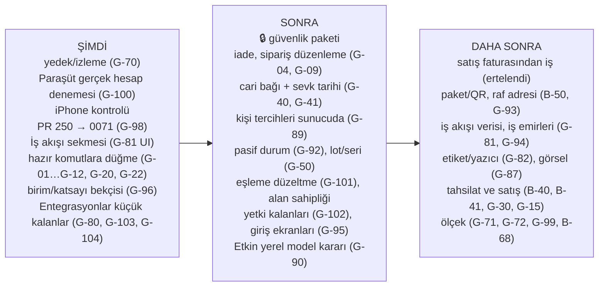

# 4. Gap analizi: eksik ve bekleyen işler

> **Bu bölüm neyi anlatır?** 01–03 bölümlerinde kod okunurken bulunan eksiklerin tek listesi ve önerilen geliştirme sırası.
>
> **Nasıl okunur?** Her satırda: ne eksik, iş açısından ne sonucu var, hangi bölümde ayrıntısı var, BACKLOG'daki kimliği ve **1 Kasım durumu** (Açık / Kısmen / Kapandı). 23 Ekim'de "Yeni" yazan satırlar T-1028 parçasıyla BACKLOG'a **B-149…B-154**, 28 Ekim'de yeni yazanlar T-1113 ile **B-199…B-206**, 29 Ekim'de eklenen **G-95…G-99** T-1132 ile **B-214…B-218** olarak girdi (kararlar B-212, B-213). 1 Kasım'da eklenen **G-100…G-105** satırları T-1133…T-1142 işlerinin kendi bulgularıdır ve BACKLOG'da zaten numaralıdır (**B-219…B-246**); satırlarda o numara yazılıdır.
>
> **Boyut (kaba tahmin, tek geliştirici):** **S** küçük (tek PR, yaklaşık 1 gün) · **M** orta (birkaç gün) · **L** büyük (bir hafta ve üstü). **UI** = mevcut veri yeter, yalnız ekran · **UI+R** = şema değişmez ama yeni okuma işlevi gerekir · **DATA** = migration (veritabanı değişikliği) + yeni iş kuralı gerekir.
>
> **Güvenlik satırları (🔒):** Depo herkese açık olduğundan güvenlik açıklarının ayrıntısı burada yazılmaz. Yalnız BACKLOG kimliği ve genel başlık verilir. Ayrıntı gizli danışma taslağındadır (GHSA-jxfh-5j2f-4mvg).
>
> **Kaynak:** ilk sürüm 23 Ekim 2026, main `36f3a13` kod okuması; ikinci sürüm main `8e2710d` · 28 Ekim (T-1029…T-1110); üçüncü sürüm main `2022915` · 29 Ekim (T-1111…T-1131). **Bu güncelleme: main `008070a` · 1 Kasım 2026** — `3620f31..008070a` arası birleşmeler (T-1133…T-1142, PR 270–279), görev kartları `docs/tasks/T-1133…T-1142`, katlanmış STATE/BACKLOG satırları, migration 0066–0070 ve kod araması. Testler, canlı sistem ve veritabanı bu belge için çalıştırılmadı. "Kodda yok" ifadesi arama sonucudur; canlılık yalnız STATE'e göre yazılır (STATE 1 Kasım: canlı main `008070a`, şema 0070).

### 29 Ekim'den bu yana ne değişti? (kısa, 31 Ekim – 1 Kasım)

İki günün işi neredeyse tümüyle **Paraşüt entegrasyonu** ve **yetki**ydi: on PR (T-1133…T-1142), beş migration (0066–0070). STATE'e göre hepsi canlıda (canlı main `008070a`, 1 Kasım; deploy-vps: yedek → migration → kuyruk → derin sağlık). Gerçek Paraşüt hesabıyla deneme henüz yapılmadı; aşağıdaki "UNKNOWN"lar oradan doğar.

| Tarih | İş | Ne değişti (sade) | Migration |
| :--- | :--- | :--- | :--- |
| 31 Ekim | T-1133 (PR 271) | Paraşüt'e bağlanmak **3 adım**: BAĞLAN → Paraşüt'te giriş + izin → şirket seç. Müşteri anahtar girmez; Etkin'in ortak uygulaması sunucuda. Firmanın kendi uygulaması "Gelişmiş" altında kalır ve önceliklidir. | — |
| 31 Ekim | T-1134 (PR 272) | Entegrasyonlar ekranı düzeltmeleri: biçimli boş durum, telefonda 2×2 yön düğmeleri, Alan sahipliği "YAKINDA", "Muhasebe programı" metni, 44 px "Şimdi çalıştır", rehber deliği akış satırında, kapalı pencere klavyeden kapalı. | — |
| 31 Ekim | T-1135 (PR 270) | **Güvenlik kilitleri** (kullanıcı kararı 30 Ekim — stok sahibi Etkin): stok toplamı ile irsaliye birlikte açılamaz, stok Devir tamamlanmadan açılamaz, miktar ondalık metin (I-09), kapat/aç irsaliye kaçırmaz, kesin red tekrar denenmez, 40 dk takılan koşu TIMEOUT, koşu günlüğü budanır, vergi numarasız cari ad + şehirle eşlenir. | **0066** |
| 31 Ekim | T-1136 (PR 274) | Yön seçiminin sonucu satır altında tek cümle; dolu katalogda yeni "al" / "gönder" önce onay ister (Vazgeç eski yönü korur). | — |
| 31 Ekim | T-1137 (PR 275) | **Sağlık bandı** (koptu / takıldı / yarıda kaldı / eşitlenmedi → tek düğme); "Bekleyenler ve hatalar"da irsaliye ve kart satırı **çözüm düğmeleri** (Yeniden gönder · Gönderildi say · Gönderme · Yeniden dene); Excel kaynak kartı Paraşüt'ün yanında. | — |
| 31 Ekim | T-1138 (PR 273) | Paraşüt **anlık bildirim** (webhook): ürün/cari değişikliği beklemeden gelir; açıkken tam tarama 15 dk'ya, depo 3 dk'ya düşer. | **0067** |
| 31 Ekim | T-1139 (PR 276) | **E-posta + parola ile bağlanma kalktı** (kullanıcı kararı "eski yöntem olmasın"); o yolla kurulmuş bağlantılar kesildi, ekranda tek "Yeniden bağlan". Veri silinmedi. | **0068** (yalnız veri) |
| 31 Ekim | T-1140 (PR 278) | **Gerçek iki yönlü**: değişen taraf öbürüne yansır, ikisi de değiştiyse son değişen kazanır (zamanı bilinmiyorsa Paraşüt); "Etkin'den gönder" düzeltmeleri de gönderir; cari ve depo Paraşüt'te silinince/arşivlenince ürün gibi arşive alınır; arşivli raftaki stok toplama girmez. | **0069** |
| 31 Ekim | T-1141 (PR 277) | **Kart yetkileri**: ürün / cari / depo / raf yeri yazmaları bölüm × işlem anahtarına bağlandı; yetkisiz kullanıcı kilitli düğme + sarı "yetkin yok · yöneticine sor" balonu görür. Rol erişimi değişmedi. | — |
| 1 Kasım | T-1142 (PR 279) | Yeni **Yetkiler** ekranı: her yetki aç/kapa, anında kayıt, hazır şablonlar, kişi görünümünde her yetkinin kaynağı; 12 kart anahtarı gruba verilebilir; ürün/cari/depo anahtarları iki adımlı doğrulama ister; paylaşılan birim adı yalnız Yönetici. | **0070** |

Kapanan ya da kısmen kapanan satırlar: **G-13 Kapandı** (T-1137), G-80 (kısmen, daha ileri), G-92 (kısmen: cari/depo kaynak arşivi), 🔒 B-67 (kısmen: kart yazmaları `settings.manage`'den ayrıldı). G-98 değişti: açık PR 250'nin migration'ı artık **0071** olmalı. Yeni satırlar: **G-100…G-105**. 4.10 yenilendi.

### 28 Ekim'den 29 Ekim'e ne değişti? (kısa)

Onaylı tuvaldeki ekranların çoğu koda geçti (Entegrasyonlar alt bölümleri T-1112, yönetici ana ekranı T-1115/T-1128, ürün kartı T-1116, yeni cari T-1117), eski tasarım öğeleri temizlendi (T-1119, T-1121, T-1122), rehber ve kısayol düzeltildi (T-1120, T-1123, T-1124, T-1130, T-1131), ses servisi belleği sabitlendi (T-1114, T-1125, T-1126). İki migration: 0064 cari ayrıntıları, 0065 ürün sabit alanları (STATE'e göre artık canlı şemada). O gün kapananlar: G-83, G-85, G-86, G-88, G-91; yeni satırlar G-95…G-99.

### 23 Ekim'den bu yana ne değişti? (kısa)

Bu beş günde yapılan işlerin çoğu **görünüm ve kullanım kolaylığıydı**: masaüstü ekran standardı (ortak üst/alt çubuk, liste, kayıt kartı, form ve ayar kalıpları), ürün/depo/raf yeri/cari/belge kartları, listelerde kaydırmayla yükleme, odaklı adım adım rehberler, yüzen kısayol, Etkin bas-konuş düzeltmeleri ve doğal Türkçe sesle okuma (T-1106, T-1109), Paraşüt'e müşteri bazlı bağlanma ve ürün yaşam döngüsü (T-1066…T-1068, migration 0059–0063). Bu yüzden 23 Ekim listesindeki **arka uç hazır, ekranı yok** işlerinin hiçbiri tam kapanmadı; yalnız ikisi kısmen ilerledi (G-22, G-73). Yeni onaylı tasarımlardan doğan işler **G-80…G-89**, açık ürün işleri **G-90…G-94** olarak eklendi.

---

## 4.1 Arka ucu hazır, ekranı olmayan işlemler

Sunucuda komutu yazılmış ama hiçbir düğme çağırmıyor. Bu işler genellikle **ucuzdur**: iş kuralı ve veritabanı hazır, yalnız ekran (tuval → birebir aktarım, I-18) gerekir. 28 Ekim araması: `setWorkPriorityAction`, `updateWorkShiftAction`, `resolveProblemAction` (`apps/web/app/t/[slug]/work-actions.ts`) ve `leaveTenantAction` (`members/actions.ts`) tanımlı ama hiçbir ekran dosyası çağırmıyor; `reverseDocument`, `cancelInboundReceipt`, `createCustomerReturn`, `updateDraftOrder` web tarafında hiç geçmiyor.

| # | Eksik | İş sonucu (sade) | Ayrıntı | BACKLOG | Boyut | 1 Kasım |
| :--- | :--- | :--- | :--- | :--- | :--- | :--- |
| G-01 | **Ters kayıt düğmesi** (`reverseDocument`) | İşlenmiş bir fiş yanlışsa kullanıcı düzeltemiyor. Belge kartı artık kayıt kartı kalıbında (T-1091) ama "Ters kayıt" düğmesi yok. | 02b §2B.7 | B-149 | S · UI | Açık |
| G-02 | **Teslim iptali** (`cancelInboundReceipt`) ve **taslak fiş düzenleme** (`updateDraft`) | Yanlış açılmış beklenen teslim kapatılamıyor; taslak fiş düzeltilemiyor. | 02b §2B.1, §2B.7 | B-149 | S · UI | Açık |
| G-03 | **Eksik teslimi kapatma** komutu hiç yok | Kısmi kabulden sonra teslim süresiz "Açık" kalıyor; listeler kirleniyor. | 02b §2B.1 | B-149 | S–M · komut + UI | Açık |
| G-04 | **Müşteri iadesi** (`createCustomerReturn`) | İade işi yapılamıyor. Kural ve tablolar var; sunucu eylemi ve ekran yok. | 02c §12 | B-52 kalanı | M · UI+eylem | Açık |
| G-05 | **Görev ilerleme kaydı** (adım kaydet, kaydetmeye başla, sıfırla, sonraki görev) | Panodaki "OKUTUYOR" durumu pratikte hep boş görünür. | 02c §2 | B-149 | S–M · UI | Açık |
| G-06 | **ACİL önceliği** (`setWorkPriorityAction`) | Ana ekrandaki ACİL rozeti hiç yanmaz. | 02c §1 | B-149 | S · UI | Açık |
| G-07 | **Vardiya saatleri** (`updateWorkShiftAction`) | Vardiya hep 08:00–17:00 görünür. Ayarlar sekmeli oldu (T-1046) ama İş akışı sekmesi henüz yok (bkz. G-81). | 02c §1, 03b `tenant_settings` | B-149 | S · UI | Açık |
| G-08 | **Bildirilen sorunu çözme** (`resolveProblemAction`) | "Sorun bildir" ile gelen kayıtlar hep açık kalır. | 02c §1 | B-149 | S · UI | Açık |
| G-09 | **Sipariş düzenleme / satır iptali / yeniden ayırma** (`updateDraftOrder`, `cancelOrderLine`, `reallocateOrderLine`) | Sipariş açıldıktan sonra masa ekranından değiştirilemiyor. | 02c §7 | B-149 | M · UI | Açık |
| G-10 | **Paketli üretim** (4 eylem) | QR'lı paketten üretime tüketim ekranda yok. | 02c §11 | B-50 ile | M · UI | Açık |
| G-11 | **Yeniden yerleştirme görevi** sahada "Başla" yok | Görev doğuyor ama saha personeli başlatamıyor. | 02c §2 | B-149 | S · UI | Açık |
| G-12 | **Alandan ayrılma** (`leaveTenantAction`) | Kullanıcı bir firmadan kendisi çıkamıyor. | 02a | B-55 ile | S · UI | Açık |
| G-13 | **Paraşüt "CHECK" (sonucu belirsiz) irsaliyesi** için karar düğmesi | T-1137 ile ekranda satır satır: Yeniden gönder (onaylı) · Gönderildi say · Gönderme; bekletilen kart için Yeniden dene. Kalan: Paraşüt irsaliye numarasını bağlama ve eşlemeyi ekrandan düzeltme (G-101). | 02d ERP | B-113 | S–M · UI | **Kapandı** (T-1137) |
| G-14 | **Güvenilen cihaz listesi + tekil iptal** | "30 gün hatırla" cihazları tek tek kaldırılamıyor (toplu iptal var). | 02a Giriş | B-76 kalanı | S · UI+R | Açık |
| G-15 | **Müşteri kapatma** (`tenants.status = CLOSING`) | Panelde müşteri kapatma/silme düğmesi yok; yalnız operatör betiği (T-1005, canlıda çalıştırılmadı). ⚠️ Müşteri verisi kalıcı silinir, kullanıcıya önceden haber şartı var. | 02d Müşteriler | B-43, B-137 | M · UI + süreç | Açık |
| G-16 | **Destek: müşterinin "Çözüldü" demesi, ekran görüntüsü eki, "Erişim iste"** | Destek akışı yarım. | 02d Destek | B-88, B-89, B-90, B-44 | M–L · DATA (ek için G-43) | Açık |

### Onaylı masaüstü tuvali ile kod arasındaki fark (28 Ekim; 1 Kasım durumu)

26 Ekim'de onaylanan masaüstü tuvali (STANDART kalıpları) ile kodun karşılaştırması; son sütun 1 Kasım durumudur. Bir satırda birden çok parça varsa her parçanın boyutu ve türü ayrı yazılır; **UI** parçaları migration'sız hemen yapılabilir, **DATA** parçaları ayrı iş olarak sonraya kalır.

| # | Eksik | İş sonucu (sade) | Parçalar ve boyut | BACKLOG | 1 Kasım |
| :--- | :--- | :--- | :--- | :--- | :--- |
| G-80 | **Ayarlar › Entegrasyonlar tek ekran**: solda alt bölüm listesi, sağda tek konu; her akış için her zaman görünen **4 seçenekli yön seçici** | Bugün Bağlantılar (Excel) ve entegrasyon grupları alt alta duruyor; kullanıcı neyin nereden geldiğini tek bakışta seçemiyor. | Sol alt bölüm listesi **M · UI** (ortak ayar bileşeni yok, önce kalıba eklenir) · 4 seçenekli yön seçici **S · UI** ("Yalnız Etkin WMS" = akış kapalı) · Bağlantı + Excel tek bölüm **S · UI** · Bekleyenler/hatalar sayıları **S · UI** · Pasif ve arşiv sayıları **S · UI+R** · kayıt bazlı hata listesi **M · DATA** · pasif/arşiv politika ayarı **M · DATA** · alan sahipliği **M–L · DATA** · satış faturasından iş başlatma **L · DATA**. Depolar için "iki yönlü" seçenek tuvalde gizli, katalog destekliyor → **ürün kararı** | B-196, B-199, B-200, B-171, B-170, B-169 | **Kısmen** — T-1112: sol alt bölümler (`kalip/ayar.tsx`), her zaman görünen yön seçimi, bekleyen/hata sayıları ve rozet; Depolar "iki yönlü" gösteriliyor (kullanıcı kararı 28 Ekim). 1 Kasım: yön sonucu cümlesi + onay (T-1136), kayıt bazlı hata listesi + çözüm düğmeleri (T-1137), Excel kaynak kartı (T-1137), sağlık bandı (T-1137), iki yönlü kural (T-1140). Kalan: Excel toplu işlemin Bağlantı bölümünde çalışması (S · UI), pasif/arşiv sayıları (S · UI+R), alan sahipliği (alan bazlı, M–L · DATA; B-238), satış faturasından iş (L · DATA, ertelendi) |
| G-81 | **Ayarlar › İş akışı sekmesi** | Kabul kalite onayı, yarım sayım süresi, vardiya ve görev ayrılığı ayarları dağınık ya da hiç yok. | Mevcut ayarları bu sekmeye taşımak **S · UI** (G-07, G-28'i de kapatır) · teslimat yolu, iş adımları, teslim teyidi **L · DATA** | B-168, B-150 | Açık |
| G-82 | **Ayarlar › Etiket ve yazıcı sekmesi** | Etiket tasarımı ve yazıcı seçimi yapılamıyor; bugün tek sabit şablon. | **M · DATA** (ölçü, alanlar, varsayılan tasarım) | B-166 | Açık |
| G-83 | **Yönetici ana ekranı**: 3 bekleyen iş kutusu + 8'li İşler ızgarası + sürükle-bırak düzen | Yönetici açılışta "bugün ne bekliyor?" sorusunun cevabını göremiyor; canlıda eski Pano panosu. | **M · UI** (veri var) | B-173, B-201, B-205 | **Kapandı** (T-1115, T-1128; canlı UNKNOWN). Kalan veri: siparişte sevk tarihi, sayım kutusunda raf/koridor, İşler seçimi sunucuda (B-205) |
| G-84 | **Ürünler listesi sütunları** | Listede kullanılabilir miktar ve barkod görünmüyor. | Kullanılabilir + Barkod sütunu **S · UI+R** · Paraşüt durumu, ana raf, Pasif çipi, Görsel **DATA** (G-86, G-87, G-92'ye bağlı) | B-175, B-206 | **Kısmen** — Kullanılabilir + Barkod sütunları T-1117. Kalan: Görsel, Raf, Paraşüt durumu, Pasif (B-206, DATA) |
| G-85 | **Ürün kartı kutuları ve sekmeleri** | Kartta "ne kadar ayrılmış, ne kadar kullanılabilir" ve hareket/değişiklik geçmişi yok. | Kullanılabilir/Ayrılmış kutuları **S · UI+R** · Hareketler, Takip, Değişiklik geçmişi sekmeleri **M · UI+R** (G-26 `code_history` burada gösterilir) · ana raf, montaj **DATA** | B-176, B-202 | **Kapandı** (T-1116). Kalan veri: ana raf, montaj |
| G-86 | **Ürün kartı › Stok ve yer pivotu**: Depo › Raf › Lot › Paket katlanır görünüm + toplam şeridi | Bir ürünün nerede, hangi lotta, hangi pakette olduğu tek ekranda görülemiyor. | **M–L · UI+R** (veri var, migration yok) | B-176, B-202 | **Kapandı** (T-1116, ortak `KalipPivot`). Kalan sunum: sürükleyerek gruplama, "+ Seri", Tam ekran |
| G-87 | **Ürün görseli** (kartta büyük görünüm, listede küçük resim) | Ürün fotoğrafı eklenemiyor. | **L · DATA + altyapı** (dosya deposu yok, bkz. G-43) | B-176 | Açık |
| G-88 | **Yeni cari formu**: tür seçimi üst şeritte büyük düğmeler + 3 sütun | Form tuvaldekinden uzun; tür seçimi küçük. | Düzen **S · UI** · kısa ad ve ilçe alanları **S · DATA** · varsayılan teslimat yöntemi **M · DATA** (G-81 iş akışına bağlı) | B-191, B-203 | **Kapandı** (T-1117, migration 0064). Kalan: tür etiketi "İkisi de" / "Müşteri ve tedarikçi" — karar gerekli |
| G-89 | **Kişi tercihleri sunucuda**: Kart/Liste seçimi, sütunlar, yüzen kısayol düzeni | Bugün tercihler yalnız o cihazda hatırlanıyor; başka cihazda baştan seçilir. | **S–M · DATA** | B-175, B-174, B-205 | Açık (T-1128 ile ana ekran İşler seçimi de cihazda tutuluyor) |

## 4.2 Veritabanında olup ekranda görünmeyen veriler

Kolonu ya da tablosu var; kullanıcı göremiyor veya giremiyor.

| # | Veri | Sonuç | Ayrıntı | BACKLOG | Boyut | 1 Kasım |
| :--- | :--- | :--- | :--- | :--- | :--- | :--- |
| G-20 | **Min/maks stok** (`item_stock_policies`) | Pano ve ürün kartı okuyor ama **girilecek ekran yok**. Minimum altı uyarısı ve satın alma önerisi bu yüzden çalışamaz. | 03a, 02b §2B.6 | B-150, B-83 | S · UI | Açık |
| G-21 | **Stok uyarıları** (`stock_alerts`) | Tablo var, şema dışında hiçbir kod okumuyor ya da yazmıyor. | 03a | B-150, B-81 | M · kural + UI | Açık |
| G-22 | **Raf toplamaya kapalı** (`locations.pick_blocked`) | Raf yeri kartı (T-1082) artık "toplamaya kapalı" etiketini **gösteriyor**; işaretleyip kaldıracak düğme hâlâ yok. | 03a, 02b §2B.10 | B-150 | S · UI | **Kısmen** (gösterim T-1082) |
| G-23 | **Tedarikçi lot no** (`lots.supplier_lot`) | İzlenebilirlik raporunda kullanılamıyor. | 03a | Yeni | S · UI | Açık |
| G-24 | **Emanet (konsinye) stok sahibi** (`inventory_owners`) | Altyapı var, oluşturma ekranı ve komutu yok. | 03a | Yeni (ürün kararı) | L · DATA | Açık |
| G-25 | **Bloke stok** (`BLOCKED`) ve **palet içi koli** (`handling_units.parent_id`) | Ekranı yok. | 02b | B-50, B-165 ile | M · UI | Açık |
| G-26 | **Kod geçmişi** (`code_history`) | Ürün kartının "Değişiklik geçmişi" sekmesi (T-1116) kod değişikliklerini denetim kaydından gösteriyor; `code_history` tablosu ayrıca gösterilmiyor (raf kodu için yer yok). | 03a | G-85 / B-176 | S · UI+R | **Kısmen** |
| G-27 | **Stok tutarlılık denetimi sonuçları** (`stock_consistency_runs/signals`) | Arka plan denetimi çalışıyor, sonucu kimse görmüyor. Defter-bakiye farkı olursa yalnız log'da kalır. | 03a, 02d Worker | B-03 / B-68 ile | S–M · UI | Açık |
| G-28 | **Kalite onayı aç/kapa** (`receiving_qc_enabled`), **yarım sayımı bırakma süresi** (`count_abandon_hours`) | Ayarlar ekranından değiştirilemiyor (Ayarlar'da yalnız Firma, Kullanıcılar ve yetki, Entegrasyonlar, Görünüm sekmesi var). | 03b | B-150 → G-81 | S · UI | Açık |
| G-29 | **Fatura no** (`charges.invoice_no`) | Panel "fatura bekleyen" sayısını gösteriyor ama bu alanı yazan yol yok; sayı hiç azalmaz. | 03b, 02d Ödemeler | B-153, B-45 | S · UI | Açık |
| G-30 | **Paket özellik bayrakları** (QR, sevkiyat, üretim, API) | Panelde seçiliyor, uygulamada hiçbir ekranı açıp kapatmıyor. Yalnız sayı sınırları uygulanıyor. | 01 §1.8.3, 02d Paketler | B-153 (ürün kararı) | M | Açık |
| G-31 | **Rezervasyon süresi** (`reservations.expires_at`) | Süre dolumunu yöneten ayar/ekran yok. | 03a | Yeni | M | Açık |
| G-32 | Küçükler: `users.image`, `integration_runs.linked_count`, `sector_template_*` / `onboarding_steps`, `wms_platform.operators` yönetimi | Düşük öncelik. `users.image` üst çubuktaki Hesap görseli için kullanılabilir (bugün baş harf). | 03b | — | S | Açık |

## 4.3 Veri bağlantısı eksikleri

| # | Eksik | Sonuç | BACKLOG | Boyut | 1 Kasım |
| :--- | :--- | :--- | :--- | :--- | :--- |
| G-40 | **Cariler hiçbir belgeye bağlı değil.** Teslimde tedarikçi (`supplier_ref`), siparişte müşteri (`customer_ref`) serbest metin. | "Bu tedarikçiden ne geldi?" ya da "Bu müşteriye ne gitti?" raporu güvenilir alınamaz. ERP eşlemesi zorlaşır. Cari kartı (T-1090) ve otomatik cari kodu (T-1093) geldi; belgeye bağ hâlâ yok. | B-151 | L · DATA | Açık |
| G-41 | Siparişte **teslim tarihi** ve **depo** kolonu yok | Geciken sipariş uyarısı (B-81) yapılamaz. | B-151 | M · DATA | Açık |
| G-42 | Paketsiz depolar arası transferde iki fiş arasına **bağ kaydı** (`stock_document_links`) yazılmıyor | Transferin giriş ve çıkış fişi listede eşleştirilemiyor. Stok doğru, iz zayıf. | B-151 | S–M | Açık |
| G-43 | **Dosya deposu** (`packages/storage`, S3) hiçbir ekrana bağlı değil; canlıda nesne deposu konteyneri yok | Ek, fotoğraf, belge saklama özellikleri bekliyor: destek ekran görüntüsü (B-88), ürün görseli (G-87), iş emri fotoğrafı (B-167). | B-88 ile | L · altyapı | Açık |

## 4.4 Eksik iş kuralları ve doğrulamalar

| # | Eksik | Sonuç | BACKLOG | Boyut | 1 Kasım |
| :--- | :--- | :--- | :--- | :--- | :--- |
| G-50 | **Lot / seri takipli ürün** normal saha kabulü, toplama, sevk ve sayımda reddediliyor; seri takipli ürünün hiç kabul yolu yok | Lotlu çalışan müşteri (gıda, kimya, ilaç) bugün saha akışlarını kullanamaz. Yalnız paketli kabul (kapalı) lotu destekliyor. | B-152, B-165 | L | Açık |
| G-51 | Toplamada **"ürün rafta hiç yok"** barkodsuz bildirilemiyor; eksikten doğan sayım görevi sahada açılamıyor | Saha personeli takılır. | B-96 | M | Açık |
| G-52 | **Fazla kabul** hatası "ne kadar fazla" demiyor | Kullanıcı neyi düzelteceğini anlamaz. | Yeni | S | Açık |
| G-53 | Ters kayıtta **kapalı dönem** denetimi yok (kod notu A-71) | Muhasebe dönemi kapandıktan sonra o döneme ait fiş geri alınabilir. | Yeni (ERP ile) | M · DATA | Açık |
| G-54 | **Taslak fiş düzenleme** satırları silip yeniden yazıyor | Paketli akışa bağlanınca satır kimliği kaybolur. Kalıcı satır kimliğiyle düzenleme gerekir. | Yeni (B-50 önkoşulu) | M | Açık |
| G-55 | **Deneme süresi bitince** ne olacağı tanımlı değil (otomatik askı/uyarı yok) | Ücretli satışa geçmeden karar gerekir. | B-41 (karar sizde) | M | Açık |
| G-56 | Panel ve uygulamada **teknik hata kodları** kullanıcıya görünebiliyor | Kullanıcı anlamaz. | B-66 | S–M | Açık |
| G-57 | **Kullanıcı başına dil**, saat dilimi sabit İstanbul | Yabancı müşteride sorun. | B-105 | M · DATA | Açık |
| G-58 | Etiket şablonu **gerçek yazıcıda** denenmedi | İlk sahada sürpriz olabilir. Ürün QR etiket önizlemesi (T-1064) geldi; fiziksel yazıcı kabulü yok. | B-56, B-166 | — (cihaz testi) | Açık |

### Açık ürün işleri (Yeni, 28 Ekim)

| # | Eksik | Sonuç | BACKLOG | Boyut | 1 Kasım |
| :--- | :--- | :--- | :--- | :--- | :--- |
| G-90 | **Etkin'e doğal dille konuşma** (serbest cümleden işi anlamak) | Bugün Etkin belirli kalıp cümleleri anlıyor; çoğu sesli komut yalnız ilgili ekranı açıyor (B-195). Kural tabanlı doğal komutlar ("bekleyen işim var mı", "ürünleri aç", "kullanıcı ayarlarına git") **T-1110** ile 28 Ekim'de main'e birleşti (PR 245; canlı: UNKNOWN); "entegrasyon" komutu yeni Entegrasyonlar ekranını açıyor (T-1118). Daha serbest anlama için **sunucuda çalışan yerel küçük dil modeli** seçeneği var: veri sunucudan çıkmaz (gizlilik), ama VPS **2 çekirdek / 8 GB**; model hem belleği hem cevap süresini zorlar. **Karar sizde bekliyor.** | T-1110, B-195, B-198, B-204, B-131, B-132 | T-1110: S–M · migration yok; yerel model: M–L · migration yok, sunucu kaynağı gerekir | Kısmen (T-1110 birleşti) |
| G-91 | **Belge formlarının içi eski bileşenlerle** (mal kabul, sevk, üretim, stok belgeleri, sayım) | T-1119 ile kalıba geçti; satır/seçim değişikliği çıkış korumasını tetikliyor. Pencere/uyarı (T-1121) ve saha ekranları (T-1122) da temizlendi. Küçük kalanlar B-207. | B-123, B-162, B-207 | M · UI | **Kapandı** (T-1119) |
| G-95 | **Kiracı dışı ekranlar eski bileşenlerle** (Yeni, 29 Ekim): giriş, iki adımlı doğrulama, parola sıfırlama, deneme aktivasyonu, çalışma alanı seçimi, saha katılımı | Uygulamaya girmeden önceki ekranlar diğerlerinden farklı görünür; ortak bildirim/ses/odak davranışı yok. Tuval `Giris.dc.html` var. | B-214 (B-159 ile) | M · UI | Açık |
| G-96 | **Belge ve mal kabul satırında birim/katsayı veritabanında doğrulanmıyor** (Yeni, 29 Ekim; T-1129 bağımsız incelemesi) | Ürünün temel birimi artık ilk kullanıma kadar değişebildiği için, eski birimle açık kalmış bir formdan gelen satır reddedilmeli. Etki tek ürün, ters kayıtla düzeltilir. | B-209 | S–M · DATA | Açık |
| G-92 | **Pasif durum ve arşiv kalanı**: pasif kart yeni işlemde seçilemesin, arşivden çıkarma, arşiv engel listesi, kalıcı silme | Bugün yalnız "arşivli" var (T-1040); kullanılmayan kart pasife alınamıyor. T-1140: Paraşüt'e bağlı cari ve depo da kaynakta silinince/arşivlenince arşive alınır, kullanımdaysa bekler (engel listesi cari/depo için domain'de). | B-163, B-172 | M · DATA | **Kısmen** (kaynak arşivi T-1140) |
| G-93 | **Raf adresi ve tekil QR**: Koridor-Sütun-Kat-Göz adresleme, toplu göz oluşturucu, tek tek adet/kutu/palet QR | Büyük depoda raf kurulumu ve QR'lı izleme yavaş/eksik. | B-164, B-165 | L · DATA | Açık |
| G-94 | **İş emirleri ve sipariş kaynakları**: siparişten iş emri, kişi/ekip ataması, Excel/ERP'den sipariş, dış belge no | Sipariş sonrası iş takibi elle; sipariş yalnız elle açılıyor. | B-167, B-169 | L · DATA | Açık |

### Entegrasyon ve yetki işlerinden doğanlar (Yeni, 1 Kasım)

| # | Eksik | Sonuç | BACKLOG | Boyut | 1 Kasım |
| :--- | :--- | :--- | :--- | :--- | :--- |
| G-100 | **Paraşüt gerçek hesap denemesi** (Yeni, 1 Kasım): ortak uygulama kaydı, anlık bildirim anahtarı ve imza biçimi, iki yönlü `PUT` alanları, `updated_at`, cari `archived`, irsaliye deposu/cari türü, kesirli miktar, 429 | Kod sahte Paraşüt'le sınandı; gerçek hesapta bir alan farklıysa iki yönlü çakışmalar hep "Paraşüt kazanır"a düşer ya da anlık bildirim kurulamaz (30 sn tarama sürer, veri kaybı yok). **Sahibin yapacağı:** Paraşüt'te uygulama kaydı + sunucuya iki değer + web yeniden başlatma (OPERATIONS). | B-219, B-229, B-235, B-110 | S (deneme) · sizden | Açık |
| G-101 | **Entegrasyon kuyruğunda eşleme düzeltme** (Yeni): "Gönderildi say" denen irsaliyeye Paraşüt irsaliye numarasını bağlama; "dış kayıt başka karta bağlı" kartın eşlemesini ekrandan taşıma | Bugün yalnız "bir daha gönderme" ve "yeniden dene" var; yanlış eşleme ekrandan düzeltilemez. | B-227, B-228, B-224 | M · UI+R (dış kimlik girişi) | Açık |
| G-102 | **Yetki kalanları** (Yeni): depo/raf Excel içe aktarımı hâlâ `settings.manage`; kişiye özel istisna yok (rol + en çok bir grup); Yetkiler ekranı tuvalde ve ilk kullanım rehberinde yok | Depo sorumlusuna raf aktarımı ayrı veremezsiniz; tek kişiye istisna için ayrı grup açmak gerekir. | B-243 (B-244 aynı), B-245, B-246 | S (Excel) · M–L · DATA (kişiye özel) · S (tuval) | Açık |
| G-103 | **Bağlantısı kesilen müşteriye ekran dışı haber** (Yeni): 0068 eski yöntem bağlantılarını kesti; haber yalnız Entegrasyonlar bandı ve sol rozette | Müşteri ekranı açmazsa eşitlemenin durduğunu fark etmez. Sağlık bandının zil / e-posta karşılığı da yok. | B-232 | S–M | Açık |
| G-104 | **İki yönlü eşitlemenin kenar durumları** (Yeni): Etkin'de boşaltılan cari alanı Paraşüt'te silinmez; etkin raf yeri olan depo Paraşüt'te silinse de bekler; cari formu ve cari Excel'i "Paraşüt'e de gider" demiyor; yerel değişiklik anı denetim kaydından dizinsiz okunur | Kullanıcı neyin Paraşüt'e gittiğini formda görmez; büyük firmada çakışma kararı yavaşlayabilir. | B-236, B-237, B-240, B-241 (B-216 ile) | S her biri (B-241: S · migration) | Açık |
| G-105 | **Ortak uygulama ve webhook sağlamlaştırması** (Yeni): ortak sırrın bağlantı kutusuna kopyalanmaması, yaşam döngüsü bağının açık deneme kimliğiyle kurulması, webhook kaydı sürerken yeniden bağlanma durumu | Sır döndürmede eski değer kutularda kalır; kenar durumda anlık bildirim saatlik denemeye düşebilir. | B-221, B-222, B-234 | S–M | Açık |

**Not (BACKLOG temizliği):** B-226 ("iki yönlü gerçek iki yönlü değil") T-1140 ile karşılandı; kalan alan bazlı kural B-238'dedir. B-242 BİTTİ (#279).

## 4.5 Transaction (hep-ya-da-hiç) durumu

Kod incelemesinde stok değiştiren bütün ana işlemler **tek veritabanı işleminde** çalışıyor: kabul, kalite onayı, yerleştirme, transferin iki bacağı, üretim (tüketim + çıktı), sevk, sayım fişi, paket kabulü, açılış stoku. Her biri audit kaydını aynı işlemde atıyor (I-04, I-07, I-12).

Deneme aktivasyonu bilinçli olarak iki aşamalıdır: kullanıcı hesabı önce ayrı oluşur, kiracı ve sahiplik sonra tek işlemde açılır. İkinci aşama başarısız olursa hesap korunur ve aynı bağlantıyla yeniden deneme o hesabı kullanır (`packages/domain/src/platform/activation.ts`).

Bilinçli tek istisna: toplamada eksik çıkınca **yeniden ayırma** ayrı işlemde çalışıyor. Arada hata olursa satır "ayrımsız açık" kalır ve ekranda görünür. Veri bozulmaz, yalnız elle tekrar gerekir.

1 Kasım notu: T-1133…T-1142 stok yazan işlemlere dokunmadı. Entegrasyon tarafında ağ çağrıları veritabanı işleminin dışında, yazımlar kısa işlemde yapılır (I-14); iki yönlü eşitleme ve cari/depo yaşam döngüsü stok tablosuna yazmaz, kilit almaz (I-04, I-15); kart akışında yön her işlem başında ve her dış yazımdan önce yeniden doğrulanır. Kuyruk çözüm eylemleri ve yetki ekranı satır kilidi altında, audit'i aynı işlemde atar ve idempotenttir (I-07, I-12). Webhook işi geçici veritabanı hatasında işlemi ve `processed_events` kaydını geri alır, kuyruk yeniden dener. 0068 tek işlemde bağlantıyı keser ve audit yazar.

29 Ekim notu: T-1111…T-1131 stok yazan işlemlere dokunmadı (yalnız sunum ve iki veri genişletmesi). 0065 ürün sabit alanı değişikliği tek işlemde, ürün satırı kilitliyken karar verir ve denetim kaydını aynı işlemde atar; yarış güvencesi değişiklik tarafındadır, kalan sınır G-96'dadır. 28 Ekim notu: o güncellemede stok yazan işlemler yeniden incelenmedi. 23 Ekim'den bu yana eklenen Paraşüt ürün yaşam döngüsü (T-1067/T-1068, migration 0062) kendi kaydında "mevcut stok ve açık işler korunur" kuralıyla canlıya çıktı; ayrıntısı 02d ERP bölümündedir.

Açık konu: G-54 (taslak düzenleme). Ölçek riski: defter-bakiye denetimi her yazımda tüm geçmişi toplar (B-68).

## 4.6 Yetki ve güvenlik (yalnız genel başlık)

Ayrıntılar gizli danışma taslağındadır. 1 Kasım itibarıyla BACKLOG'da hâlâ açık görünen başlıklar:

- 🔒 **B-10**: global kimlik tablolarında okuma yetkisini daraltma (kalan kısım)
- 🔒 **B-12**: saha girişi migration'larının geri alınmasına veri bekçisi
- 🔒 **B-17**: DB işlevlerinde aktör kimliğinin oturumdan alınması
- 🔒 **B-18**: kuyruk RLS politikası simetrisi
- 🔒 **B-20**: üyelik/rol/grup yazmalarında veritabanı düzeyi ikinci denetim
- 🔒 **B-21**: depo kapsamının RLS'e taşınması (bugün uygulama katmanında)
- 🔒 **B-23**, **B-24**, **B-26**: görev ayrılığı, tenant bağlamı güven sınırı, tablo yetkileri (DB ikinci savunma)
- 🔒 **B-30**, **B-32**, **B-37**, **B-38**: ağ ayrımı, proxy sıkılaştırma, satış sitesi formu, panel kimlik uçları (altyapı)
- 🔒 **B-67**: cari kişisel alanlarının görünürlüğü, `settings.manage` iznini bölme (kısmen: T-1141 kart yazmalarını ayrı anahtarlara ayırdı; başlığın kalanı açık)
- 🔒 **B-231**: Paraşüt anlık bildirim alıcısında doğrulama maliyeti ve yanıt süresi (T-1138 inceleme notu)
- 🔒 **B-239**: Paraşüt'e düzeltme gönderiminde ön koşul / eşzamanlılık (T-1140 inceleme notu)

23 Ekim'den bu yana güvenlik tarafında yapılanlar: haftalık otomatik güvenlik taraması (T-1030), bağımlılık güvenlik güncellemeleri (T-1029, T-1031); korunan dosyaya ya da yetki/entegrasyon sırlarına dokunan bütün işler (0064…0070, T-1133…T-1142) bağımsız güvenlik incelemesinden BLOCKER/MAJOR 0 ile geçti (raporlar PR'larda; kalan MINOR'lar BACKLOG'da). 31 Ekim – 1 Kasım'da güvenliği artıran ürün değişiklikleri: e-posta + parola ile ERP bağlantısı kalktı (kimlik kutuları silindi, T-1139); kart yazmaları bölüm × işlem anahtarına bağlandı ve ürün/cari/depo anahtarları iki adımlı doğrulama ister (T-1141, T-1142); paylaşılan birim adı yalnız Yönetici. Yukarıdaki eski başlıklardan tam kapanan yok.

Ürün kararı bekleyen (güvenlik açığı değil): **kişiye özel yetki istisnası** (bugün rol + en çok bir grup; B-245). **Yetki gruplarındaki "ekranlar" listesi** bugün yalnız menüyü gizliyor; işlemi rol ve izinler belirliyor. Ekran kısıtının sunucuda da uygulanması isteniyorsa ayrı iş açılmalı (G-60, Yeni). Etkin için ayrı yetki anahtarı da aynı kapsamdadır (B-131).

## 4.7 Altyapı ve süreklilik

| # | Eksik | Sonuç | BACKLOG | Boyut | 1 Kasım |
| :--- | :--- | :--- | :--- | :--- | :--- |
| G-70 | **Sunucu dışı şifreli yedek, PITR, dış izleme/alarm, hata izleme** | Tek VPS'te disk/sunucu kaybı = veri kaybı riski. **En büyük risk hâlâ budur.** Her yayında sunucu içi yedek alınıyor, sunucu dışı kopya yok. | B-01…B-04 (P0) | M · migration yok; depolama hesabı sizden | Açık |
| G-71 | **Canlıda PgBouncer yok**; süreç başına 10 bağlantı, DB sınırı 100 | Kullanıcı sayısı artınca ilk tıkanacak yer. | B-154 | M | Açık |
| G-72 | **Yük testi yok** | Kapasite rakamları (01 §1.8.4) tahmin. VPS 2 çekirdek / 8 GB; ses servisi ve olası yerel dil modeli (G-90) aynı makineyi paylaşır. | B-154 | M | Açık |
| G-73 | Ses servisi canlıda mı, VPS donanımı ne, Google/Microsoft girişi açık mı | VPS donanımı artık biliniyor: **2 çekirdek / 8 GB** (kullanıcı bilgisi, 28 Ekim). Doğal Türkçe ses (T-1106, T-1109, migration 0063) main'de; ses servisinin VPS kurulumu (B-130) BACKLOG'da hâlâ açık ve canlıda çalıştığı bu belge için doğrulanmadı (UNKNOWN). Google/Microsoft girişi UNKNOWN. | B-130 | — | **Kısmen** |
| G-97 | **Ses servisi belleği canlıda izlenmiyor** (Yeni, 29 Ekim) | CI'da bellek makineye göre değişiyordu (çekirdek sayısı, büyük sayfalar, Intel/AMD); T-1114/T-1125/T-1126 sabitledi ve 1100 MiB sınırı korundu. Canlı sunucuda bellek ölçümü ve Intel işlemcili makinede gerçek ölçüm yok; tavan 1.280 MB aşılırsa servis yeniden başlar. | B-215 (B-130 ile) | S | Açık |
| G-98 | **Açık PR 250 (T-1071) migration numarası çakışıyor** (Yeni, 29 Ekim) | PR 250 (1 Kasım'da hâlâ açık) `0064_product_recreate` kullanıyor; main'de artık 0064…0070 var. Numaralar boşluksuz olmalı → birleşmeden önce **0071**'e kaydırılmalı; T-1140'ın ürün yaşam döngüsü değişiklikleriyle de yeniden karşılaştırılmalı. | B-218 (T-1071) | S | Açık |
| G-99 | **Denetim kaydında kayıt türü/kimliği dizini yok** (Yeni, 29 Ekim) | Ürün kartının "Değişiklik geçmişi" sekmesi denetim kaydını firma + zaman dizini ve süre sınırıyla tarar; kayıt arttıkça yavaşlar. | B-216 | S · migration | Açık |
| G-74 | **Online tahsilat** (iyzico), otomatik aylık tahakkuk, e-Fatura | Bugün ödeme elle işaretleniyor. | B-40, B-45 | L · DATA | Açık |
| G-75 | **Hız sınırı okumaları da sayıyor** (28 Ekim) | Arka plan okumaları (son işlemler, rehber durumu, kaydırmayla yükleme) kullanıcının dakikalık işlem hakkını tüketir; yoğun kullanımda "Çok fazla işlem" uyarısı çıkabilir. | B-180 | S–M | Açık |
| G-76 | **Yayın sırasında kısa kesinti** (28 Ekim) | 28 Ekim yayınında birkaç saniyelik 502 görüldü; proxy tarafında sınırlı bekleme eklendi (T-1070, PR 244 birleşti; canlı etkisi UNKNOWN). Migration'ı yazıcıları durdurmadan uygulama kuralı yok. | B-46, B-34, B-124 | M | Kısmen (T-1070 kodda) |
| G-77 | **Proxy imajı sürümle sabit değil** (28 Ekim) | Haftalık tarama uyarı veriyor; habersiz sürüm değişebilir. | B-155, B-32 | S | Açık |

---

## 4.8 Önerilen geliştirme sırası

Kullanıcının 20 Ekim'de onayladığı sıra (BACKLOG başı) ve 26 Ekim masaüstü standardı kararı korunur. Aşağıdaki yol haritası **1 Kasım** durumuna göre **Şimdi / Sonra / Daha sonra** diye ayrılmıştır. 29 Ekim "Şimdi" listesinden çıkanlar: 0064/0065 canlı doğrulaması (STATE: şema 0070 canlı), Entegrasyonlar kayıt bazlı hata listesi ve CHECK kararı (T-1137), iki yönlü eşitleme (T-1140), kart yetkileri ve yetki ekranı (T-1141, T-1142). STATE'teki sıradaki iş: **Paraşüt gerçek hesap denemesi**; satış akışı kullanıcı kararıyla ertelendi (30 Ekim). Her işin yanında **boyutu** (S/M/L) ve **migration gerekip gerekmediği** yazılıdır: migration'sız işler daha az risklidir ve hızlı canlıya çıkar; migration'lı işler yayında yedek + veritabanı değişikliği ister. Sıra sizin kararınızdır; bu yalnız öneridir.

### Şimdi (önümüzdeki 1–2 hafta)

| Sıra | İş | Gap / BACKLOG | Boyut | Migration? | Neden şimdi? |
| :--- | :--- | :--- | :--- | :--- | :--- |
| 1 | **Sunucu dışı yedek, izleme ve alarm** | G-70 · B-01…B-04 | M | Hayır | Veri kaybolursa geri dönüş yok. **Sizden bekleyen:** yedek için depolama hesabı. |
| 2 | **Paraşüt gerçek hesap denemesi**: ortak uygulama ile bağlan, anlık bildirim kuruldu mu, İki yönlü seçip Etkin'de cari adını değiştir → Paraşüt'te görünüyor mu, Paraşüt'te ürün adı değişince birkaç saniyede geliyor mu, irsaliye/stok | G-100 · B-219, B-229, B-235, B-110 | S (deneme) + düzeltme | Hayır (beklenmez) | Son iki günün bütün kodu sahte Paraşüt'le sınandı; STATE'te sıradaki iş. **Sizden bekleyen:** Paraşüt'te uygulama kaydı + `PARASUT_OAUTH_CLIENT_ID/SECRET` (web.env) + web yeniden başlatma. |
| 3 | **Gerçek iPhone Safari kontrolü**: kısa ekran (~660 pt), klavye açıkken rehber kartı, şimşek halkası, ana ekran Düzenle, bas-konuş; Entegrasyonlar ve Yetkiler ekranının telefon düzeni | B-197, B-210 | — (sizden) | Hayır | T-1123…T-1142 yalnız Chromium'da sınandı. |
| 4 | **PR 250'nin migration numarasını 0071'e kaydırmak** | G-98 · B-218 | S | Numara | Açık PR; main'de 0064…0070 var, aynı numara yayını durdurur. |
| 5 | **Ayarlar › İş akışı sekmesi (mevcut ayarlarla)**: kalite onayı, yarım sayım süresi, vardiya, görev ayrılığı | G-81 UI, G-07, G-28 · B-150, B-171 | S | Hayır | Ayarlar hazır, yalnız yerini bulur; G-07 ve G-28 birlikte kapanır. |
| 6 | **Hazır komutlara düğme**: ters kayıt, teslim iptal/kapat, taslak düzenle, ACİL, sorun çöz, yeniden yerleştirme "Başla", firmadan ayrıl, min/maks girişi, raf toplamaya kapat | G-01, G-02, G-03, G-06, G-08, G-11, G-12, G-20, G-22 · B-149, B-150 | Her biri S (G-03 S–M) | Hayır | Sunucu tarafı hazır; az emekle çok değer. |
| 7 | **Belge/kabul satırı birim–katsayı veritabanı bekçisi** + 0065 kullanım dallarının davranış testi | G-96 · B-209, B-217 | S–M | **Evet** | Temel birim ilk kullanıma kadar değişebiliyor; eski birimle satır yazılmasın. |
| 8 | **Entegrasyonlar küçük kalanları**: cari formu ve Excel'de "Paraşüt'e de gider" satırı, kesilen bağlantıya zil/e-posta haberi, ana ekran Excel kutusu gerçek bağlantıdan, depo/raf Excel yetkisi kart anahtarına, Pasif ve arşiv sayıları | G-104, G-103, G-102, G-80 · B-240, B-232, B-223, B-243, B-200 | S her biri | Hayır | Kullanıcı neyin Paraşüt'e gittiğini ve bağlantının durduğunu ekranı açmadan da bilsin. |

### Sonra (yaklaşık 2–6 hafta)

| Sıra | İş | Gap / BACKLOG | Boyut | Migration? | Not |
| :--- | :--- | :--- | :--- | :--- | :--- |
| 9 | **🔒 P1 güvenlik paketi** | B-10…B-26, B-30…B-38, B-67, B-231, B-239 | L | **Evet** (bir kısmı) | 20 Ekim onaylı sırada 6. adım; bağımsız güvenlik incelemesi zorunlu. |
| 10 | **Müşteri iadesi**, **sipariş düzenleme / satır iptali**, görev ilerleme kaydı | G-04, G-09, G-05 | M + M + S–M | Hayır (tablolar var) | Günlük depo işinin eksik halkaları. |
| 11 | **Carileri belgelere bağlamak** + siparişte **sevk tarihi** ve depo | G-40, G-41, G-42 · B-151, B-205 | L | **Evet** | "Bu tedarikçiden ne geldi?" raporu, geciken sipariş uyarısı ve ileride satış faturasından işin önkoşulu. |
| 12 | **Kişi tercihleri sunucuda** (ana ekran İşler seçimi, kart/liste, sütunlar, kısayollar) | G-89 · B-205, B-175, B-174 | S–M | **Evet** | Bugün hepsi yalnız o cihazda. |
| 13 | **Pasif durum + arşiv kalanı** | G-92 · B-172 | M | **Evet** | Ürün listesindeki Pasif çipi (G-84) buna bağlı. |
| 14 | **Lot/seri takipli ürün saha akışları** | G-50 · B-152 | L | Muhtemelen hayır | Gıda/kimya/ilaç müşterisi için şart. |
| 15 | **Entegrasyon veri parçaları**: eşleme düzeltme + irsaliye no bağlama, alan bazlı sahiplik, ürün kartı Paraşüt sekmesinde son eşitleme + Tekrar dene, ortak uygulama/webhook sağlamlaştırması | G-101, G-80 DATA, G-105 · B-227, B-228, B-238, B-170, B-221, B-222, B-234 | M her biri | Kısmen | Ekran bölümleri hazır; gerçek hesap denemesi (sıra 2) sonrası yapılmalı. |
| 16 | **Giriş ailesini kalıba almak** (giriş, iki adımlı doğrulama, parola sıfırlama, aktivasyon) | G-95 · B-214, B-159 | M | Hayır | Müşterinin ilk gördüğü ekranlar; tuval (`Giris.dc.html`) hazır. |
| 17 | **Yetki kalanları**: Yetkiler ekranını tuvale ve rehbere eklemek; kişiye özel istisna (kararınıza bağlı) | G-102 · B-246, B-245 | S + M–L | Kişiye özel: **Evet** | Ekran kodda; tuval ve rehber eksik. |
| 18 | **Etkin yerel dil modeli** (kararınıza bağlı), ses servisi belleğini canlıda izlemek, denetim kaydına kayıt dizini | G-90, G-97, G-99 · B-204, B-215, B-216, B-241 | M–L / S / S | Dizin: evet | Küçük işler birlikte paketlenebilir; dizin iki yönlü çakışma okumasını da hızlandırır. |

### Daha sonra (ilk ücretli müşteri öncesi ve ölçek)

| İş | Gap / BACKLOG | Boyut | Migration? |
| :--- | :--- | :--- | :--- |
| **Satış faturasından iş** + Paraşüt satış faturası/irsaliye anlık bildirimi (kullanıcı 30 Ekim: ertelendi) | G-80 DATA · B-200, B-169, B-116, B-230 | L | **Evet** |
| Paketli/QR akışını açmak + raf adresi + tekil QR (G-10, G-25, G-54 dahil) | B-50, G-93 · B-164, B-165 | L | **Evet** |
| İş akışı verisi (teslimat yolu, teslim teyidi), iş emirleri, sipariş kaynakları | G-81 DATA, G-94 · B-167…B-169 | L | **Evet** |
| Etiket tasarımı ve yazıcılar + gerçek yazıcı kabulü | G-82, G-58 · B-166, B-56 | M–L | **Evet** |
| Dosya deposu → ürün görseli, destek ekran görüntüsü, destek akışının kalanı | G-43, G-87, G-16 · B-88…B-90, B-206 | L | **Evet** + altyapı |
| Satılabilir SaaS: online tahsilat, deneme bitişi, paket bayrakları, fatura no, müşteri kapatma, sözleşmeler | G-74, G-55, G-30, G-29, G-15 · B-40…B-45, B-153 | L | **Evet** |
| Ölçek: PgBouncer, yük testi, defter denetimi ölçeği, hız sınırı ayrımı, kesintisiz yayın | G-71, G-72, G-75, G-76, G-27 · B-154, B-68, B-180, B-46 | M her biri | Kısmen |
| Küçükler: tedarikçi lot no, rezervasyon süresi, emanet stok (ürün kararı), dil/saat dilimi, hata kodlarının Türkçesi, pivotta sürükleme/+Seri/Tam ekran | G-23, G-31, G-24, G-57, G-56 · B-211 | S–L | Kısmen |

### Sizden bekleyenler

- **Paraşüt uygulama kaydı ve sunucu değerleri** (G-100, B-219): Paraşüt'te Etkin'in ortak uygulamasını kaydedip `PARASUT_OAUTH_CLIENT_ID/SECRET` değerlerini sunucuya (`web.env`) girmek ve web'i yeniden başlatmak; ardından gerçek hesap denemesi. Değerler sohbete/belgeye yazılmaz.
- **Yedek için depolama hesabı** (G-70, B-01/B-02).
- **Gerçek iPhone Safari kontrolü** (B-197, B-210): kısa ekranda ve klavye açıkken rehber kartı, şimşek halkası, ana ekran Düzenle, bas-konuş, doğal sesle okuma; Entegrasyonlar ve Yetkiler ekranı.
- **Kararlar** (ayrıntı 4.10): kişiye özel yetki istisnası gerekli mi (B-245); Paraşüt'te silinen depoda boş raf yerleri de arşivlensin mi (B-237); Etkin yerel dil modeli (B-204); cari tür etiketi (B-213); başka depodaki lot/seri kodlarının görünürlüğü (B-212); deneme bitince ne olsun (G-55, B-41); paket bayrakları neyi kapatsın (G-30); emanet stok gerekli mi (G-24).
- **Sunucuda bir kez yapılacak root adımları:** ses servisi kurulumu (B-130), müşteri sıfırlama (B-137).

## 4.9 Yeni bir modül ya da değişiklik nasıl istenir?

Değişiklik isterken şu dört şeyi yazmanız yeterli; teknik dil gerekmez:

1. **Hangi ekran?** Bu belgedeki modül adı (ör. "02b — Mal Kabul, saha").
2. **Ne olsun?** "Şu düğmeye basınca … olsun" ya da tablodaki bir satırı gösterip "bu da olsun".
3. **Kim yapabilsin?** Rol (sahip, yönetici, saha personeli) ya da yetki grubu.
4. **Hangi gap?** Varsa bu bölümdeki numara (ör. "G-01'i yapalım" ya da "Şimdi listesinin 3. maddesi").

Masaüstü ekranlar 26 Ekim kararıyla `docs/design/STANDART.md` kalıplarından birine (liste, kayıt kartı, form, ayar, pencere) girer; kalıba uyan ekran için ayrıca tuval onayı istenmez. Kalıba sığmayan ya da tuvalde hiç olmayan ekran önce tasarım tuvaline eklenir ve sizin onayınızla kodlanır (I-18, ALTIN-KURAL). Migration gerektiren işler (yukarıdaki "Evet" satırları) canlıya çıkarken otomatik yedek alınır.

---

## 4.10 Geliştirme önerileri ve yeni fikirler

> **Bu bölüm neyi anlatır?** Yukarıdaki eksiklerin dışında, kullanıcının dile getirdiği ya da işler sırasında ortaya çıkan **geliştirme önerileri ve yeni fikirler**. Öncelik sırasıyla yazıldı; **karar gerekli** yazanlar sizin cevabınızı bekler, diğerleri hazır olunca sıraya girer. Yapılmış olanlar listeden çıkarıldı: 29 Ekim listesinden Entegrasyonlar kayıt bazlı hata listesi (T-1137) ve "Paraşüt'te arşivlenen kart Etkin'de ne olsun" sorusu (kullanıcı kararı 31 Ekim: ürün gibi cari ve depo da arşive alınır, T-1140) kapandı; önceki listelerden ortak bildirim bandı (T-1119), yönetici ana ekranı (T-1115/T-1128), ürün kartı sekmeleri ve pivot (T-1116), yeni cari formu (T-1117), Entegrasyonlar alt bölümleri (T-1112). Son güncelleme: 1 Kasım 2026, main `008070a`.

### Öncelik 1 — hemen yapılabilir, küçük ve güvenli

| # | Öneri | Neden / fayda | Boyut · migration | Durum | BACKLOG |
| :--- | :--- | :--- | :--- | :--- | :--- |
| 1 | **Paraşüt gerçek hesap denemesi** (ortak uygulama, anlık bildirim, iki yönlü, irsaliye/stok) | Son on PR'ın gerçek dünyadaki karşılığı; bir alan farklıysa küçük düzeltme yeter. | S · hayır | Bekliyor (uygulama kaydı sizde) | B-219, B-229, B-235, B-110 |
| 2 | **Gerçek iPhone Safari kontrolü** (rehber kartı, şimşek halkası, Düzenle; Entegrasyonlar ve Yetkiler telefon düzeni) | Son düzeltmeler yalnız masaüstü tarayıcı motorunda sınandı. | — · sizden | Bekliyor (sizde) | B-197, B-210 |
| 3 | **PR 250'nin migration numarasını 0071'e kaydırmak** | Main'de 0064…0070 var; aynı numara yayını durdurur. | S · numara | Açık | B-218 |
| 4 | **Cari formu ve cari Excel'inde "Paraşüt'e de gider" satırı** | Cari akışı "Etkin'den gönder" / "İki yönlü" iken değişiklik Paraşüt'teki kaydı da değiştirir; kullanıcı bunu formda görsün. | S · hayır | Açık | B-240 |
| 5 | **Bağlantı koptuğunda zil ve e-posta** (sağlık bandının ekran dışı karşılığı; 0068 ile kesilenler dahil) | Ekranı açmayan yönetici eşitlemenin durduğunu bilmez. | S–M · hayır | Açık | B-232 |
| 6 | **Belge / mal kabul satırında birim–katsayı veritabanı bekçisi** + 0065 kullanım dallarının davranış testi | Temel birim ilk kullanıma kadar değişebiliyor; eski birimle açık kalmış formdan satır gelmesin. | S–M · **evet** | Açık | B-209, B-217 |
| 7 | **Depo / raf Excel içe aktarımını kart anahtarına bağlamak** | Yetkiler ekranında "Raf yeri ekle" verilen kişi Excel'le de ekleyebilsin. | S · hayır | Açık | B-243 |
| 8 | **Ana ekran "Excel'den aktar" kutusu gerçek Paraşüt bağlantısından** | Bugün kurulum yolculuğundaki seçimi gösteriyor. | S · okuma işlevi | Açık | B-223 |

### Öncelik 2 — orta boy, iş değeri yüksek

| # | Öneri | Neden / fayda | Boyut · migration | Durum | BACKLOG |
| :--- | :--- | :--- | :--- | :--- | :--- |
| 9 | **Entegrasyon eşleme düzeltme**: irsaliyeye Paraşüt numarası bağlama, "başka karta bağlı" eşlemeyi taşıma | "Gönderildi say" ve bekletilen kart bugün yalnız işaretlenir; doğru eşleme ekrandan kurulsun. | M · okuma + yazma işlevi | Açık | B-227, B-228, B-224 |
| 10 | **Alan bazlı sahiplik** ("Alan sahipliği" bölümü): örn. ad Paraşüt'ten, kısa ad Etkin'den | Bugün kart başına "son değişen kazanır"; bazı alanların hep tek taraftan gelmesi istenebilir. | M–L · **evet** | Açık ("YAKINDA" bölümü) | B-238, B-200, B-170 |
| 11 | **Ürün kartı Paraşüt sekmesi**: son eşitleme anı, son kazanan taraf, Tekrar dene | Kart başına eşitleme durumu (`integration_card_states`) artık veritabanında; yalnız gösterim gerekir. | S–M · okuma işlevi | Açık | B-170 |
| 12 | **Siparişe "sevk tarihi"** + kişi tercihleri sunucuda (tek migration paketi) | Ana ekranda "bugün çıkacak" gerçek tarihten gelir; kişi her cihazda aynı düzeni görür. | M · **evet** | Açık | B-205, B-151, B-175, B-174 |
| 13 | **Ayarlar › İş akışı sekmesi** (önce mevcut ayarlar; sonra teslimat yolu, teslim teyidi) | Dağınık ayarlar tek yerde. | S (mevcut) + L (veri) | Açık | B-168, B-171, B-150 |
| 14 | **Yetkiler ekranını tuvale ve ilk kullanım rehberine eklemek** | Ekran kalıptan türetildi; tasarım kaynağı ve "nasıl kullanırım?" adımları eksik. | S · hayır | Açık | B-246 |
| 15 | **Denetim kaydına kayıt türü / kimliği dizini** | Ürün kartı "Değişiklik geçmişi" ve iki yönlü çakışmadaki "Etkin'de son değişiklik anı" okuması büyük firmada yavaşlamasın. | S · **evet** | Açık | B-216, B-241 |
| 16 | **Giriş ailesini kalıba almak** + Standart* tuvallerin CSS üretecine bağlanması | İlk görülen ekranlar diğerleriyle aynı görünsün; birebirlik (I-18) mekanik korunsun. | M + M · hayır | Açık | B-214, B-159, B-177 |
| 17 | **Pivotta sürükleyerek gruplama, "+ Seri", tam ekran** | Tuvaldeki esnek stok görünümü. | M · hayır | Açık | B-211 |

### Öncelik 3 — büyük işler ve yeni fikirler

| # | Öneri | Neden / fayda | Boyut · migration | Durum | BACKLOG |
| :--- | :--- | :--- | :--- | :--- | :--- |
| 18 | **Satış faturasından iş**: Paraşüt satış faturası → sevk görevi (anlık bildirimle) | Paraşüt'te sipariş yok; satış faturası depoda işi kendiliğinden başlatır. Webhook altyapısı artık hazır. | L · **evet** | **Ertelendi** (kullanıcı 30 Ekim) | B-200, B-169, B-230 |
| 19 | **Entegrasyon olay günlüğü ekranı** (yeni fikir): "Paraşüt'ten ne geldi, Etkin'den ne gitti, hangi çakışmada kim kazandı" tek zaman çizgisinde | `integration.conflict_resolved`, `outbox_*`, kart arşiv audit'leri zaten yazılıyor; yönetici güveni için tek bakış. | M · okuma işlevi | Yeni | — |
| 20 | **Yetki değişikliği özeti** (yeni fikir): Yetkiler ekranında "bu hafta kim, kime, ne verdi" listesi ve geri al | Anında kayıtla hızlandı; geri dönüş ve iz tek dokunuşta görünsün. `group.updated` audit'i önceki/yeni listeyi taşıyor. | S–M · okuma işlevi | Yeni | — |
| 21 | **Ürün kartında İş akışı ve Etiket/yazıcı sekmeleri**, **ürün görseli** | Ürün başına adımlar ve etiket; depocu ürünü resminden tanır. | M–L · **evet** + altyapı | Açık | B-168, B-166, B-176, B-206, B-88 |
| 22 | **Etkin: sunucuda yerel küçük dil modeli** (veri dışarı çıkmaz) | Serbest cümleden işi anlamak. VPS 2 çekirdek / 8 GB — önce ölçüm. Kullanıcı: "ileride". | M–L · hayır | **İleride** (kullanıcı kararı) | B-204 |

### Karar gerekli (sizden)

| # | Konu | Seçenekler | BACKLOG |
| :--- | :--- | :--- | :--- |
| 23 | **Kişiye özel yetki istisnası** gerekli mi? | (a) bugünkü gibi rol + en çok bir grup (istisna için ayrı grup); (b) kişiye özel aç/kapa (yeni tablo, güvenlik incelemesi) | B-245 |
| 24 | **Paraşüt'te silinen depoda boş raf yerleri** de otomatik arşivlensin mi? | (a) hayır, depo bekler (bugün); (b) stoksuz/işsiz raf yerleri arşivlenir, depo da arşive geçer | B-237 |
| 25 | **Etkin'de boşaltılan cari alanı** Paraşüt'te de silinsin mi? | (a) hayır, boş alan gönderilmez (bugün); (b) "alan temizle" kuralı (Paraşüt'ün boş değer kabulü önce denenmeli) | B-236 |
| 26 | **Depo yetkisi sınırlı kullanıcının başka depodaki lot/seri kodlarını görmesi** (ürün kartı Takip sekmesi) | (a) yalnız kendi depolarındaki; (b) bütün depolarınki | B-212 |
| 27 | **Cari tür etiketi**: "İkisi de" mi, "Müşteri ve tedarikçi" mi? | Tuval "İkisi de", uygulama "Müşteri ve tedarikçi" | B-213 |
| 28 | **Etkin yerel dil modeli** ne zaman denensin? | Şimdi ölçüm / ileride (bugünkü cevap: ileride) | B-204 |

**Kısaca sıra önerisi:** 1 → 2 → 3 → 4–5 (birlikte) → 6–8 → 9–11 (gerçek hesap denemesinden sonra) → 12–13 (tek migration paketi) → 14–17 → büyük işler (18–21, satış akışı kararınıza göre) → 22 (kararınıza göre).
