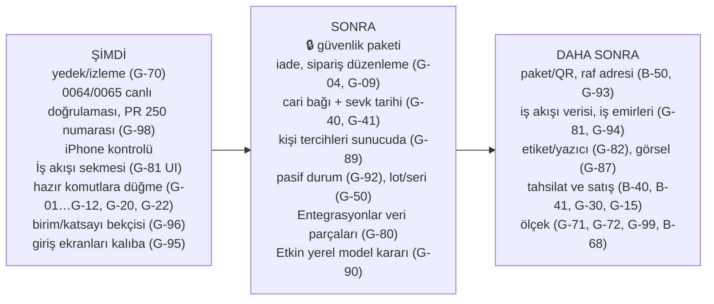

# 4. Gap analizi: eksik ve bekleyen işler

> **Bu bölüm neyi anlatır?** 01–03 bölümlerinde kod okunurken bulunan eksiklerin tek listesi ve önerilen geliştirme sırası.
>
> **Nasıl okunur?** Her satırda: ne eksik, iş açısından ne sonucu var, hangi bölümde ayrıntısı var, BACKLOG'daki kimliği ve **29 Ekim durumu** (Açık / Kısmen / Kapandı). 23 Ekim'de "Yeni" yazan satırlar T-1028 parçasıyla BACKLOG'a **B-149…B-154**, 28 Ekim'de yeni yazanlar T-1113 ile **B-199…B-206** olarak girdi; satırlarda artık o numara yazılıdır. 29 Ekim'de eklenen **G-95…G-99** satırları T-1132 ile BACKLOG'a **B-214…B-218** olarak girdi (kararlar B-212, B-213).
>
> **Boyut (kaba tahmin, tek geliştirici):** **S** küçük (tek PR, yaklaşık 1 gün) · **M** orta (birkaç gün) · **L** büyük (bir hafta ve üstü). **UI** = mevcut veri yeter, yalnız ekran · **UI+R** = şema değişmez ama yeni okuma işlevi gerekir · **DATA** = migration (veritabanı değişikliği) + yeni iş kuralı gerekir.
>
> **Güvenlik satırları (🔒):** Depo herkese açık olduğundan güvenlik açıklarının ayrıntısı burada yazılmaz. Yalnız BACKLOG kimliği ve genel başlık verilir. Ayrıntı gizli danışma taslağındadır (GHSA-jxfh-5j2f-4mvg).
>
> **Kaynak:** ilk sürüm 23 Ekim 2026, main `36f3a13` kod okuması; ikinci sürüm main `8e2710d` · 28 Ekim (T-1029…T-1110). **Bu güncelleme: main `2022915` · 29 Ekim 2026** — `0f2d5c0..2022915` arası commit'ler (T-1111…T-1131, PR 246–268), görev kartları `docs/tasks/T-1111…T-1131`, katlanmış STATE/BACKLOG satırları ve `apps/web` içinde arama. Testler, canlı sistem ve veritabanı bu belge için çalıştırılmadı. "Kodda yok" ifadesi arama sonucudur; canlılık yalnız STATE'e göre yazılır.

### 28 Ekim'den bu yana ne değişti? (kısa, 29 Ekim)

İki günde **onaylı tuvaldeki ekranların çoğu koda geçti** ve eski tasarım öğeleri temizlendi; hepsi migration'sız, ikisi hariç:

- **Ekranlar tuvale:** Ayarlar › Entegrasyonlar alt bölümler + her zaman görünen yön seçimi (T-1112) · yönetici ana ekranı: Bekleyen işler + İşler ızgarası (T-1115), Düzenle'de yetkili her işi ekle/kaldır (T-1128) · ürün kartı: Kullanılabilir/Ayrılmış kutuları, Stok ve yer pivotu, Hareketler · Takip · Değişiklik geçmişi (T-1116) · yeni cari formu 3 sütun + ürün listesinde Kullanılabilir/Barkod (T-1117).
- **Veritabanı (2 migration):** **0064** cari kısa ad, ilçe, varsayılan teslimat (T-1117) · **0065** ürünün temel birimi, miktar hassasiyeti ve takip modu ilk kullanıma kadar değişebilir (T-1129; tek "kullanılmış" tanımı veritabanında, A-87/A-107 güncellendi). İkisinin de canlıda olduğu bu belge için doğrulanmadı (UNKNOWN).
- **Eski tasarım kalmadı:** belge formlarının içi (T-1119; G-91 kapandı), pencere/uyarı/kilitli durumlar (T-1121), saha ekranları (T-1122). Ortak `KalipBildirim`, `KalipDugme`, `KalipSecimAra` + sunucu aramalı seçim sayfası.
- **Rehber ve kısayol:** Rehber her ekranda şimşek halkasında (T-1120), telefonda halka açılıp kapanmıyor (T-1123), halka ekrana sığıyor (T-1131); rehber sırayla odaklanır, bölüm değişince katlanır, kaldığı yerden sürer (T-1124); kart yapılacak yeri hiçbir görünümde örtmez (T-1130).
- **Etkin ve ses servisi:** "entegrasyon" komutu yeni ekranı açar (T-1118); ses servisi belleği makineden bağımsız (T-1114, T-1125 THP kapalı, T-1126 `CT2_USE_MKL=0`).
- **Açık PR'lar kapandı:** T-1111 (PR 246) ve T-1070 (PR 244) birleşti. Açık kalan tek PR: 250 (T-1071, başka oturum) — migration numarası çakışıyor (G-98).

Kapanan ya da kısmen kapanan satırlar: G-26 (kısmen), G-80 (kısmen), G-83, G-84 (kısmen), G-85, G-86, G-88, G-90 (kısmen), G-91. Yeni satırlar: **G-95…G-99**. Sonda yeni bölüm: **4.10 Geliştirme önerileri ve yeni fikirler**.

### 23 Ekim'den bu yana ne değişti? (kısa)

Bu beş günde yapılan işlerin çoğu **görünüm ve kullanım kolaylığıydı**: masaüstü ekran standardı (ortak üst/alt çubuk, liste, kayıt kartı, form ve ayar kalıpları), ürün/depo/raf yeri/cari/belge kartları, listelerde kaydırmayla yükleme, odaklı adım adım rehberler, yüzen kısayol, Etkin bas-konuş düzeltmeleri ve doğal Türkçe sesle okuma (T-1106, T-1109), Paraşüt'e müşteri bazlı bağlanma ve ürün yaşam döngüsü (T-1066…T-1068, migration 0059–0063). Bu yüzden 23 Ekim listesindeki **arka uç hazır, ekranı yok** işlerinin hiçbiri tam kapanmadı; yalnız ikisi kısmen ilerledi (G-22, G-73). Yeni onaylı tasarımlardan doğan işler **G-80…G-89**, açık ürün işleri **G-90…G-94** olarak eklendi.

---

## 4.1 Arka ucu hazır, ekranı olmayan işlemler

Sunucuda komutu yazılmış ama hiçbir düğme çağırmıyor. Bu işler genellikle **ucuzdur**: iş kuralı ve veritabanı hazır, yalnız ekran (tuval → birebir aktarım, I-18) gerekir. 28 Ekim araması: `setWorkPriorityAction`, `updateWorkShiftAction`, `resolveProblemAction` (`apps/web/app/t/[slug]/work-actions.ts`) ve `leaveTenantAction` (`members/actions.ts`) tanımlı ama hiçbir ekran dosyası çağırmıyor; `reverseDocument`, `cancelInboundReceipt`, `createCustomerReturn`, `updateDraftOrder` web tarafında hiç geçmiyor.

| # | Eksik | İş sonucu (sade) | Ayrıntı | BACKLOG | Boyut | 29 Ekim |
| :--- | :--- | :--- | :--- | :--- | :--- | :--- |
| G-01 | **Ters kayıt düğmesi** (`reverseDocument`) | İşlenmiş bir fiş yanlışsa kullanıcı düzeltemiyor. Belge kartı artık kayıt kartı kalıbında (T-1091) ama "Ters kayıt" düğmesi yok. | 02b §2B.7 | B-149 | S · UI | Açık |
| G-02 | **Teslim iptali** (`cancelInboundReceipt`) ve **taslak fiş düzenleme** (`updateDraft`) | Yanlış açılmış beklenen teslim kapatılamıyor; taslak fiş düzeltilemiyor. | 02b §2B.1, §2B.7 | B-149 | S · UI | Açık |
| G-03 | **Eksik teslimi kapatma** komutu hiç yok | Kısmi kabulden sonra teslim süresiz "Açık" kalıyor; listeler kirleniyor. | 02b §2B.1 | B-149 | S–M · komut + UI | Açık |
| G-04 | **Müşteri iadesi** (`createCustomerReturn`) | İade işi yapılamıyor. Kural ve tablolar var; sunucu eylemi ve ekran yok. | 02c §12 | B-52 kalanı | M · UI+eylem | Açık |
| G-05 | **Görev ilerleme kaydı** (adım kaydet, kaydetmeye başla, sıfırla, sonraki görev) | Panodaki "OKUTUYOR" durumu pratikte hep boş görünür. | 02c §2 | B-149 | S–M · UI | Açık |
| G-06 | **ACİL önceliği** (`setWorkPriorityAction`) | Ana ekrandaki ACİL rozeti hiç yanmaz. | 02c §1 | B-149 | S · UI | Açık |
| G-07 | **Vardiya saatleri** (`updateWorkShiftAction`) | Vardiya hep 08:00–17:00 görünür. Ayarlar sekmeli oldu (T-1046) ama İş akışı sekmesi henüz yok (bkz. G-81). | 02c §1, 03b `tenant_settings` | B-149 | S · UI | Açık |
| G-08 | **Bildirilen sorunu çözme** (`resolveProblemAction`) | "Sorun bildir" ile gelen kayıtlar hep açık kalır. | 02c §1 | B-149 | S · UI | Açık |
| G-09 | **Sipariş düzenleme / satır iptali / yeniden ayırma** (`updateDraftOrder`, `cancelOrderLine`, `reallocateOrderLine`) | Sipariş açıldıktan sonra masa ekranından değiştirilemiyor. | 02c §7 | B-149 | M · UI | Açık |
| G-10 | **Paketli üretim** (4 eylem) | QR'lı paketten üretime tüketim ekranda yok. | 02c §11 | B-50 ile | M · UI | Açık |
| G-11 | **Yeniden yerleştirme görevi** sahada "Başla" yok | Görev doğuyor ama saha personeli başlatamıyor. | 02c §2 | B-149 | S · UI | Açık |
| G-12 | **Alandan ayrılma** (`leaveTenantAction`) | Kullanıcı bir firmadan kendisi çıkamıyor. | 02a | B-55 ile | S · UI | Açık |
| G-13 | **Paraşüt "CHECK" (sonucu belirsiz) irsaliyesi** için karar düğmesi | Belirsiz gönderim yalnız listede durur, çözülemez. | 02d ERP | B-113 | S–M · UI | Açık |
| G-14 | **Güvenilen cihaz listesi + tekil iptal** | "30 gün hatırla" cihazları tek tek kaldırılamıyor (toplu iptal var). | 02a Giriş | B-76 kalanı | S · UI+R | Açık |
| G-15 | **Müşteri kapatma** (`tenants.status = CLOSING`) | Panelde müşteri kapatma/silme düğmesi yok; yalnız operatör betiği (T-1005, canlıda çalıştırılmadı). ⚠️ Müşteri verisi kalıcı silinir, kullanıcıya önceden haber şartı var. | 02d Müşteriler | B-43, B-137 | M · UI + süreç | Açık |
| G-16 | **Destek: müşterinin "Çözüldü" demesi, ekran görüntüsü eki, "Erişim iste"** | Destek akışı yarım. | 02d Destek | B-88, B-89, B-90, B-44 | M–L · DATA (ek için G-43) | Açık |

### Onaylı masaüstü tuvali ile kod arasındaki fark (28 Ekim; 29 Ekim durumu)

26 Ekim'de onaylanan masaüstü tuvali (STANDART kalıpları) ile kodun karşılaştırması; son sütun 29 Ekim durumudur. Bir satırda birden çok parça varsa her parçanın boyutu ve türü ayrı yazılır; **UI** parçaları migration'sız hemen yapılabilir, **DATA** parçaları ayrı iş olarak sonraya kalır.

| # | Eksik | İş sonucu (sade) | Parçalar ve boyut | BACKLOG | 29 Ekim |
| :--- | :--- | :--- | :--- | :--- | :--- |
| G-80 | **Ayarlar › Entegrasyonlar tek ekran**: solda alt bölüm listesi, sağda tek konu; her akış için her zaman görünen **4 seçenekli yön seçici** | Bugün Bağlantılar (Excel) ve entegrasyon grupları alt alta duruyor; kullanıcı neyin nereden geldiğini tek bakışta seçemiyor. | Sol alt bölüm listesi **M · UI** (ortak ayar bileşeni yok, önce kalıba eklenir) · 4 seçenekli yön seçici **S · UI** ("Yalnız Etkin WMS" = akış kapalı) · Bağlantı + Excel tek bölüm **S · UI** · Bekleyenler/hatalar sayıları **S · UI** · Pasif ve arşiv sayıları **S · UI+R** · kayıt bazlı hata listesi **M · DATA** · pasif/arşiv politika ayarı **M · DATA** · alan sahipliği **M–L · DATA** · satış faturasından iş başlatma **L · DATA**. Depolar için "iki yönlü" seçenek tuvalde gizli, katalog destekliyor → **ürün kararı** | B-196, B-199, B-200, B-171, B-170, B-169 | **Kısmen** — T-1112: sol alt bölümler (`kalip/ayar.tsx`), her zaman görünen yön seçimi, bekleyen/hata sayıları ve rozet; Depolar "iki yönlü" gösteriliyor (kullanıcı kararı 28 Ekim). Kalan: Excel toplu işlemin Bağlantı bölümüne alınması (S · UI), pasif/arşiv sayıları (S · UI+R), DATA parçaları |
| G-81 | **Ayarlar › İş akışı sekmesi** | Kabul kalite onayı, yarım sayım süresi, vardiya ve görev ayrılığı ayarları dağınık ya da hiç yok. | Mevcut ayarları bu sekmeye taşımak **S · UI** (G-07, G-28'i de kapatır) · teslimat yolu, iş adımları, teslim teyidi **L · DATA** | B-168, B-150 | Açık |
| G-82 | **Ayarlar › Etiket ve yazıcı sekmesi** | Etiket tasarımı ve yazıcı seçimi yapılamıyor; bugün tek sabit şablon. | **M · DATA** (ölçü, alanlar, varsayılan tasarım) | B-166 | Açık |
| G-83 | **Yönetici ana ekranı**: 3 bekleyen iş kutusu + 8'li İşler ızgarası + sürükle-bırak düzen | Yönetici açılışta "bugün ne bekliyor?" sorusunun cevabını göremiyor; canlıda eski Pano panosu. | **M · UI** (veri var) | B-173, B-201, B-205 | **Kapandı** (T-1115, T-1128; canlı UNKNOWN). Kalan veri: siparişte sevk tarihi, sayım kutusunda raf/koridor, İşler seçimi sunucuda (B-205) |
| G-84 | **Ürünler listesi sütunları** | Listede kullanılabilir miktar ve barkod görünmüyor. | Kullanılabilir + Barkod sütunu **S · UI+R** · Paraşüt durumu, ana raf, Pasif çipi, Görsel **DATA** (G-86, G-87, G-92'ye bağlı) | B-175, B-206 | **Kısmen** — Kullanılabilir + Barkod sütunları T-1117. Kalan: Görsel, Raf, Paraşüt durumu, Pasif (B-206, DATA) |
| G-85 | **Ürün kartı kutuları ve sekmeleri** | Kartta "ne kadar ayrılmış, ne kadar kullanılabilir" ve hareket/değişiklik geçmişi yok. | Kullanılabilir/Ayrılmış kutuları **S · UI+R** · Hareketler, Takip, Değişiklik geçmişi sekmeleri **M · UI+R** (G-26 `code_history` burada gösterilir) · ana raf, montaj **DATA** | B-176, B-202 | **Kapandı** (T-1116). Kalan veri: ana raf, montaj |
| G-86 | **Ürün kartı › Stok ve yer pivotu**: Depo › Raf › Lot › Paket katlanır görünüm + toplam şeridi | Bir ürünün nerede, hangi lotta, hangi pakette olduğu tek ekranda görülemiyor. | **M–L · UI+R** (veri var, migration yok) | B-176, B-202 | **Kapandı** (T-1116, ortak `KalipPivot`). Kalan sunum: sürükleyerek gruplama, "+ Seri", Tam ekran |
| G-87 | **Ürün görseli** (kartta büyük görünüm, listede küçük resim) | Ürün fotoğrafı eklenemiyor. | **L · DATA + altyapı** (dosya deposu yok, bkz. G-43) | B-176 | Açık |
| G-88 | **Yeni cari formu**: tür seçimi üst şeritte büyük düğmeler + 3 sütun | Form tuvaldekinden uzun; tür seçimi küçük. | Düzen **S · UI** · kısa ad ve ilçe alanları **S · DATA** · varsayılan teslimat yöntemi **M · DATA** (G-81 iş akışına bağlı) | B-191, B-203 | **Kapandı** (T-1117, migration 0064). Kalan: tür etiketi "İkisi de" / "Müşteri ve tedarikçi" — karar gerekli |
| G-89 | **Kişi tercihleri sunucuda**: Kart/Liste seçimi, sütunlar, yüzen kısayol düzeni | Bugün tercihler yalnız o cihazda hatırlanıyor; başka cihazda baştan seçilir. | **S–M · DATA** | B-175, B-174, B-205 | Açık (T-1128 ile ana ekran İşler seçimi de cihazda tutuluyor) |

## 4.2 Veritabanında olup ekranda görünmeyen veriler

Kolonu ya da tablosu var; kullanıcı göremiyor veya giremiyor.

| # | Veri | Sonuç | Ayrıntı | BACKLOG | Boyut | 29 Ekim |
| :--- | :--- | :--- | :--- | :--- | :--- | :--- |
| G-20 | **Min/maks stok** (`item_stock_policies`) | Pano ve ürün kartı okuyor ama **girilecek ekran yok**. Minimum altı uyarısı ve satın alma önerisi bu yüzden çalışamaz. | 03a, 02b §2B.6 | B-150, B-83 | S · UI | Açık |
| G-21 | **Stok uyarıları** (`stock_alerts`) | Tablo var, şema dışında hiçbir kod okumuyor ya da yazmıyor. | 03a | B-150, B-81 | M · kural + UI | Açık |
| G-22 | **Raf toplamaya kapalı** (`locations.pick_blocked`) | Raf yeri kartı (T-1082) artık "toplamaya kapalı" etiketini **gösteriyor**; işaretleyip kaldıracak düğme hâlâ yok. | 03a, 02b §2B.10 | B-150 | S · UI | **Kısmen** (gösterim T-1082) |
| G-23 | **Tedarikçi lot no** (`lots.supplier_lot`) | İzlenebilirlik raporunda kullanılamıyor. | 03a | Yeni | S · UI | Açık |
| G-24 | **Emanet (konsinye) stok sahibi** (`inventory_owners`) | Altyapı var, oluşturma ekranı ve komutu yok. | 03a | Yeni (ürün kararı) | L · DATA | Açık |
| G-25 | **Bloke stok** (`BLOCKED`) ve **palet içi koli** (`handling_units.parent_id`) | Ekranı yok. | 02b | B-50, B-165 ile | M · UI | Açık |
| G-26 | **Kod geçmişi** (`code_history`) | Ürün kartının "Değişiklik geçmişi" sekmesi (T-1116) kod değişikliklerini denetim kaydından gösteriyor; `code_history` tablosu ayrıca gösterilmiyor (raf kodu için yer yok). | 03a | G-85 / B-176 | S · UI+R | **Kısmen** |
| G-27 | **Stok tutarlılık denetimi sonuçları** (`stock_consistency_runs/signals`) | Arka plan denetimi çalışıyor, sonucu kimse görmüyor. Defter-bakiye farkı olursa yalnız log'da kalır. | 03a, 02d Worker | B-03 / B-68 ile | S–M · UI | Açık |
| G-28 | **Kalite onayı aç/kapa** (`receiving_qc_enabled`), **yarım sayımı bırakma süresi** (`count_abandon_hours`) | Ayarlar ekranından değiştirilemiyor (Ayarlar'da yalnız Firma, Kullanıcılar ve yetki, Entegrasyonlar, Görünüm sekmesi var). | 03b | B-150 → G-81 | S · UI | Açık |
| G-29 | **Fatura no** (`charges.invoice_no`) | Panel "fatura bekleyen" sayısını gösteriyor ama bu alanı yazan yol yok; sayı hiç azalmaz. | 03b, 02d Ödemeler | B-153, B-45 | S · UI | Açık |
| G-30 | **Paket özellik bayrakları** (QR, sevkiyat, üretim, API) | Panelde seçiliyor, uygulamada hiçbir ekranı açıp kapatmıyor. Yalnız sayı sınırları uygulanıyor. | 01 §1.8.3, 02d Paketler | B-153 (ürün kararı) | M | Açık |
| G-31 | **Rezervasyon süresi** (`reservations.expires_at`) | Süre dolumunu yöneten ayar/ekran yok. | 03a | Yeni | M | Açık |
| G-32 | Küçükler: `users.image`, `integration_runs.linked_count`, `sector_template_*` / `onboarding_steps`, `wms_platform.operators` yönetimi | Düşük öncelik. `users.image` üst çubuktaki Hesap görseli için kullanılabilir (bugün baş harf). | 03b | — | S | Açık |

## 4.3 Veri bağlantısı eksikleri

| # | Eksik | Sonuç | BACKLOG | Boyut | 29 Ekim |
| :--- | :--- | :--- | :--- | :--- | :--- |
| G-40 | **Cariler hiçbir belgeye bağlı değil.** Teslimde tedarikçi (`supplier_ref`), siparişte müşteri (`customer_ref`) serbest metin. | "Bu tedarikçiden ne geldi?" ya da "Bu müşteriye ne gitti?" raporu güvenilir alınamaz. ERP eşlemesi zorlaşır. Cari kartı (T-1090) ve otomatik cari kodu (T-1093) geldi; belgeye bağ hâlâ yok. | B-151 | L · DATA | Açık |
| G-41 | Siparişte **teslim tarihi** ve **depo** kolonu yok | Geciken sipariş uyarısı (B-81) yapılamaz. | B-151 | M · DATA | Açık |
| G-42 | Paketsiz depolar arası transferde iki fiş arasına **bağ kaydı** (`stock_document_links`) yazılmıyor | Transferin giriş ve çıkış fişi listede eşleştirilemiyor. Stok doğru, iz zayıf. | B-151 | S–M | Açık |
| G-43 | **Dosya deposu** (`packages/storage`, S3) hiçbir ekrana bağlı değil; canlıda nesne deposu konteyneri yok | Ek, fotoğraf, belge saklama özellikleri bekliyor: destek ekran görüntüsü (B-88), ürün görseli (G-87), iş emri fotoğrafı (B-167). | B-88 ile | L · altyapı | Açık |

## 4.4 Eksik iş kuralları ve doğrulamalar

| # | Eksik | Sonuç | BACKLOG | Boyut | 29 Ekim |
| :--- | :--- | :--- | :--- | :--- | :--- |
| G-50 | **Lot / seri takipli ürün** normal saha kabulü, toplama, sevk ve sayımda reddediliyor; seri takipli ürünün hiç kabul yolu yok | Lotlu çalışan müşteri (gıda, kimya, ilaç) bugün saha akışlarını kullanamaz. Yalnız paketli kabul (kapalı) lotu destekliyor. | B-152, B-165 | L | Açık |
| G-51 | Toplamada **"ürün rafta hiç yok"** barkodsuz bildirilemiyor; eksikten doğan sayım görevi sahada açılamıyor | Saha personeli takılır. | B-96 | M | Açık |
| G-52 | **Fazla kabul** hatası "ne kadar fazla" demiyor | Kullanıcı neyi düzelteceğini anlamaz. | Yeni | S | Açık |
| G-53 | Ters kayıtta **kapalı dönem** denetimi yok (kod notu A-71) | Muhasebe dönemi kapandıktan sonra o döneme ait fiş geri alınabilir. | Yeni (ERP ile) | M · DATA | Açık |
| G-54 | **Taslak fiş düzenleme** satırları silip yeniden yazıyor | Paketli akışa bağlanınca satır kimliği kaybolur. Kalıcı satır kimliğiyle düzenleme gerekir. | Yeni (B-50 önkoşulu) | M | Açık |
| G-55 | **Deneme süresi bitince** ne olacağı tanımlı değil (otomatik askı/uyarı yok) | Ücretli satışa geçmeden karar gerekir. | B-41 (karar sizde) | M | Açık |
| G-56 | Panel ve uygulamada **teknik hata kodları** kullanıcıya görünebiliyor | Kullanıcı anlamaz. | B-66 | S–M | Açık |
| G-57 | **Kullanıcı başına dil**, saat dilimi sabit İstanbul | Yabancı müşteride sorun. | B-105 | M · DATA | Açık |
| G-58 | Etiket şablonu **gerçek yazıcıda** denenmedi | İlk sahada sürpriz olabilir. Ürün QR etiket önizlemesi (T-1064) geldi; fiziksel yazıcı kabulü yok. | B-56, B-166 | — (cihaz testi) | Açık |

### Açık ürün işleri (Yeni, 28 Ekim)

| # | Eksik | Sonuç | BACKLOG | Boyut | 29 Ekim |
| :--- | :--- | :--- | :--- | :--- | :--- |
| G-90 | **Etkin'e doğal dille konuşma** (serbest cümleden işi anlamak) | Bugün Etkin belirli kalıp cümleleri anlıyor; çoğu sesli komut yalnız ilgili ekranı açıyor (B-195). Kural tabanlı doğal komutlar ("bekleyen işim var mı", "ürünleri aç", "kullanıcı ayarlarına git") **T-1110** ile 28 Ekim'de main'e birleşti (PR 245; canlı: UNKNOWN); "entegrasyon" komutu yeni Entegrasyonlar ekranını açıyor (T-1118). Daha serbest anlama için **sunucuda çalışan yerel küçük dil modeli** seçeneği var: veri sunucudan çıkmaz (gizlilik), ama VPS **2 çekirdek / 8 GB**; model hem belleği hem cevap süresini zorlar. **Karar sizde bekliyor.** | T-1110, B-195, B-198, B-204, B-131, B-132 | T-1110: S–M · migration yok; yerel model: M–L · migration yok, sunucu kaynağı gerekir | Kısmen (T-1110 birleşti) |
| G-91 | **Belge formlarının içi eski bileşenlerle** (mal kabul, sevk, üretim, stok belgeleri, sayım) | T-1119 ile kalıba geçti; satır/seçim değişikliği çıkış korumasını tetikliyor. Pencere/uyarı (T-1121) ve saha ekranları (T-1122) da temizlendi. Küçük kalanlar B-207. | B-123, B-162, B-207 | M · UI | **Kapandı** (T-1119) |
| G-95 | **Kiracı dışı ekranlar eski bileşenlerle** (Yeni, 29 Ekim): giriş, iki adımlı doğrulama, parola sıfırlama, deneme aktivasyonu, çalışma alanı seçimi, saha katılımı | Uygulamaya girmeden önceki ekranlar diğerlerinden farklı görünür; ortak bildirim/ses/odak davranışı yok. Tuval `Giris.dc.html` var. | B-214 (B-159 ile) | M · UI | Açık |
| G-96 | **Belge ve mal kabul satırında birim/katsayı veritabanında doğrulanmıyor** (Yeni, 29 Ekim; T-1129 bağımsız incelemesi) | Ürünün temel birimi artık ilk kullanıma kadar değişebildiği için, eski birimle açık kalmış bir formdan gelen satır reddedilmeli. Etki tek ürün, ters kayıtla düzeltilir. | B-209 | S–M · DATA | Açık |
| G-92 | **Pasif durum ve arşiv kalanı**: pasif kart yeni işlemde seçilemesin, arşivden çıkarma, arşiv engel listesi, kalıcı silme | Bugün yalnız "arşivli" var (T-1040); kullanılmayan kart pasife alınamıyor. | B-163, B-172 | M · DATA | Açık |
| G-93 | **Raf adresi ve tekil QR**: Koridor-Sütun-Kat-Göz adresleme, toplu göz oluşturucu, tek tek adet/kutu/palet QR | Büyük depoda raf kurulumu ve QR'lı izleme yavaş/eksik. | B-164, B-165 | L · DATA | Açık |
| G-94 | **İş emirleri ve sipariş kaynakları**: siparişten iş emri, kişi/ekip ataması, Excel/ERP'den sipariş, dış belge no | Sipariş sonrası iş takibi elle; sipariş yalnız elle açılıyor. | B-167, B-169 | L · DATA | Açık |

## 4.5 Transaction (hep-ya-da-hiç) durumu

Kod incelemesinde stok değiştiren bütün ana işlemler **tek veritabanı işleminde** çalışıyor: kabul, kalite onayı, yerleştirme, transferin iki bacağı, üretim (tüketim + çıktı), sevk, sayım fişi, paket kabulü, açılış stoku. Her biri audit kaydını aynı işlemde atıyor (I-04, I-07, I-12).

Deneme aktivasyonu bilinçli olarak iki aşamalıdır: kullanıcı hesabı önce ayrı oluşur, kiracı ve sahiplik sonra tek işlemde açılır. İkinci aşama başarısız olursa hesap korunur ve aynı bağlantıyla yeniden deneme o hesabı kullanır (`packages/domain/src/platform/activation.ts`).

Bilinçli tek istisna: toplamada eksik çıkınca **yeniden ayırma** ayrı işlemde çalışıyor. Arada hata olursa satır "ayrımsız açık" kalır ve ekranda görünür. Veri bozulmaz, yalnız elle tekrar gerekir.

29 Ekim notu: T-1111…T-1131 stok yazan işlemlere dokunmadı (yalnız sunum ve iki veri genişletmesi). 0065 ürün sabit alanı değişikliği tek işlemde, ürün satırı kilitliyken karar verir ve denetim kaydını aynı işlemde atar; yarış güvencesi değişiklik tarafındadır, kalan sınır G-96'dadır. 28 Ekim notu: o güncellemede stok yazan işlemler yeniden incelenmedi. 23 Ekim'den bu yana eklenen Paraşüt ürün yaşam döngüsü (T-1067/T-1068, migration 0062) kendi kaydında "mevcut stok ve açık işler korunur" kuralıyla canlıya çıktı; ayrıntısı 02d ERP bölümündedir.

Açık konu: G-54 (taslak düzenleme). Ölçek riski: defter-bakiye denetimi her yazımda tüm geçmişi toplar (B-68).

## 4.6 Yetki ve güvenlik (yalnız genel başlık)

Ayrıntılar gizli danışma taslağındadır. 28 Ekim itibarıyla BACKLOG'da hâlâ açık görünen başlıklar:

- 🔒 **B-10**: global kimlik tablolarında okuma yetkisini daraltma (kalan kısım)
- 🔒 **B-12**: saha girişi migration'larının geri alınmasına veri bekçisi
- 🔒 **B-17**: DB işlevlerinde aktör kimliğinin oturumdan alınması
- 🔒 **B-18**: kuyruk RLS politikası simetrisi
- 🔒 **B-20**: üyelik/rol/grup yazmalarında veritabanı düzeyi ikinci denetim
- 🔒 **B-21**: depo kapsamının RLS'e taşınması (bugün uygulama katmanında)
- 🔒 **B-23**, **B-24**, **B-26**: görev ayrılığı, tenant bağlamı güven sınırı, tablo yetkileri (DB ikinci savunma)
- 🔒 **B-30**, **B-32**, **B-37**, **B-38**: ağ ayrımı, proxy sıkılaştırma, satış sitesi formu, panel kimlik uçları (altyapı)
- 🔒 **B-67**: cari kişisel alanlarının görünürlüğü, `settings.manage` iznini bölme

23 Ekim'den bu yana güvenlik tarafında yapılanlar: haftalık otomatik güvenlik taraması (T-1030), bağımlılık güvenlik güncellemeleri (T-1029, T-1031); 29 Ekim'e kadar korunan dosyaya dokunan işler (0064, 0065) bağımsız güvenlik incelemesinden geçti (raporlar PR'larda). Yukarıdaki başlıkların hiçbiri bu dönemde kapanmadı.

Ürün kararı bekleyen (güvenlik açığı değil): **Yetki gruplarındaki "ekranlar" listesi** bugün yalnız menüyü gizliyor; işlemi rol ve izinler belirliyor. Ekran kısıtının sunucuda da uygulanması isteniyorsa ayrı iş açılmalı (G-60, Yeni). Etkin için ayrı yetki anahtarı da aynı kapsamdadır (B-131).

## 4.7 Altyapı ve süreklilik

| # | Eksik | Sonuç | BACKLOG | Boyut | 29 Ekim |
| :--- | :--- | :--- | :--- | :--- | :--- |
| G-70 | **Sunucu dışı şifreli yedek, PITR, dış izleme/alarm, hata izleme** | Tek VPS'te disk/sunucu kaybı = veri kaybı riski. **En büyük risk hâlâ budur.** Her yayında sunucu içi yedek alınıyor, sunucu dışı kopya yok. | B-01…B-04 (P0) | M · migration yok; depolama hesabı sizden | Açık |
| G-71 | **Canlıda PgBouncer yok**; süreç başına 10 bağlantı, DB sınırı 100 | Kullanıcı sayısı artınca ilk tıkanacak yer. | B-154 | M | Açık |
| G-72 | **Yük testi yok** | Kapasite rakamları (01 §1.8.4) tahmin. VPS 2 çekirdek / 8 GB; ses servisi ve olası yerel dil modeli (G-90) aynı makineyi paylaşır. | B-154 | M | Açık |
| G-73 | Ses servisi canlıda mı, VPS donanımı ne, Google/Microsoft girişi açık mı | VPS donanımı artık biliniyor: **2 çekirdek / 8 GB** (kullanıcı bilgisi, 28 Ekim). Doğal Türkçe ses (T-1106, T-1109, migration 0063) main'de; ses servisinin VPS kurulumu (B-130) BACKLOG'da hâlâ açık ve canlıda çalıştığı bu belge için doğrulanmadı (UNKNOWN). Google/Microsoft girişi UNKNOWN. | B-130 | — | **Kısmen** |
| G-97 | **Ses servisi belleği canlıda izlenmiyor** (Yeni, 29 Ekim) | CI'da bellek makineye göre değişiyordu (çekirdek sayısı, büyük sayfalar, Intel/AMD); T-1114/T-1125/T-1126 sabitledi ve 1100 MiB sınırı korundu. Canlı sunucuda bellek ölçümü ve Intel işlemcili makinede gerçek ölçüm yok; tavan 1.280 MB aşılırsa servis yeniden başlar. | B-215 (B-130 ile) | S | Açık |
| G-98 | **Açık PR 250 (T-1071) migration numarası çakışıyor** (Yeni, 29 Ekim) | PR 250 `0064_product_recreate` kullanıyor; 0064 (T-1117) ve 0065 (T-1129) main'de. Numaralar boşluksuz olmalı → birleşmeden önce **0066**'ya kaydırılmalı. | B-218 (T-1071) | S | Açık |
| G-99 | **Denetim kaydında kayıt türü/kimliği dizini yok** (Yeni, 29 Ekim) | Ürün kartının "Değişiklik geçmişi" sekmesi denetim kaydını firma + zaman dizini ve süre sınırıyla tarar; kayıt arttıkça yavaşlar. | B-216 | S · migration | Açık |
| G-74 | **Online tahsilat** (iyzico), otomatik aylık tahakkuk, e-Fatura | Bugün ödeme elle işaretleniyor. | B-40, B-45 | L · DATA | Açık |
| G-75 | **Hız sınırı okumaları da sayıyor** (28 Ekim) | Arka plan okumaları (son işlemler, rehber durumu, kaydırmayla yükleme) kullanıcının dakikalık işlem hakkını tüketir; yoğun kullanımda "Çok fazla işlem" uyarısı çıkabilir. | B-180 | S–M | Açık |
| G-76 | **Yayın sırasında kısa kesinti** (28 Ekim) | 28 Ekim yayınında birkaç saniyelik 502 görüldü; proxy tarafında sınırlı bekleme eklendi (T-1070, PR 244 birleşti; canlı etkisi UNKNOWN). Migration'ı yazıcıları durdurmadan uygulama kuralı yok. | B-46, B-34, B-124 | M | Kısmen (T-1070 kodda) |
| G-77 | **Proxy imajı sürümle sabit değil** (28 Ekim) | Haftalık tarama uyarı veriyor; habersiz sürüm değişebilir. | B-155, B-32 | S | Açık |

---

## 4.8 Önerilen geliştirme sırası

Kullanıcının 20 Ekim'de onayladığı sıra (BACKLOG başı) ve 26 Ekim masaüstü standardı kararı korunur. Aşağıdaki yol haritası **29 Ekim** durumuna göre **Şimdi / Sonra / Daha sonra** diye ayrılmıştır. 28 Ekim "Şimdi" listesinden kodda kapananlar çıkarıldı: açık PR'lar (T-1111, T-1070), Entegrasyonlar tek ekran (T-1112, arayüz kısmı), yönetici ana ekranı (T-1115, T-1128), ürün listesi/kartı ve yeni cari (T-1116, T-1117), eski belge formları (T-1119), stok ve yer pivotu (T-1116). Her işin yanında **boyutu** (S/M/L) ve **migration gerekip gerekmediği** yazılıdır: migration'sız işler daha az risklidir ve hızlı canlıya çıkar; migration'lı işler yayında yedek + veritabanı değişikliği ister. Sıra sizin kararınızdır; bu yalnız öneridir.

### Şimdi (önümüzdeki 1–2 hafta)

| Sıra | İş | Gap / BACKLOG | Boyut | Migration? | Neden şimdi? |
| :--- | :--- | :--- | :--- | :--- | :--- |
| 1 | **Sunucu dışı yedek, izleme ve alarm** | G-70 · B-01…B-04 | M | Hayır | Veri kaybolursa geri dönüş yok. **Sizden bekleyen:** yedek için depolama hesabı. |
| 2 | **29 Ekim yayınını canlıda doğrulamak** (0064 cari ayrıntıları, 0065 ürün sabit alanları: DB defteri, sağlık, ekran) + **PR 250'nin migration numarasını 0066'ya kaydırmak** | G-98 · B-218 | S | Doğrulama | İki migration birleşti; canlı durumu bu belge için UNKNOWN. Numara çakışması yayını durdurur. |
| 3 | **Gerçek iPhone Safari kontrolü**: kısa ekran (~660 pt), klavye açıkken rehber kartı, şimşek halkası, ana ekran Düzenle, bas-konuş | B-197, B-210 | — (sizden) | Hayır | T-1123/T-1124/T-1128/T-1130/T-1131 yalnız Chromium'da sınandı. |
| 4 | **Ayarlar › İş akışı sekmesi (mevcut ayarlarla)**: kalite onayı, yarım sayım süresi, vardiya, görev ayrılığı | G-81 UI, G-07, G-28 · B-150, B-171 | S | Hayır | Ayarlar hazır, yalnız yerini bulur; G-07 ve G-28 birlikte kapanır. Ürün kartındaki İş akışı bağlantısının da önkoşulu. |
| 5 | **Hazır komutlara düğme**: ters kayıt, teslim iptal/kapat, taslak düzenle, ACİL, sorun çöz, yeniden yerleştirme "Başla", firmadan ayrıl, min/maks girişi, raf toplamaya kapat | G-01, G-02, G-03, G-06, G-08, G-11, G-12, G-20, G-22 · B-149, B-150 | Her biri S (G-03 S–M) | Hayır | Sunucu tarafı hazır; az emekle çok değer. Kayıt kartlarına düğme olarak eklenir. |
| 6 | **Belge/kabul satırı birim–katsayı veritabanı bekçisi** + 0065 kullanım dallarının davranış testi | G-96 · B-209, B-217 | S–M | **Evet** | Temel birim artık ilk kullanıma kadar değişebiliyor; eski birimle satır yazılmasın. |
| 7 | **Giriş ailesini kalıba almak** (giriş, iki adımlı doğrulama, parola sıfırlama, aktivasyon) | G-95 · B-214, B-159 | M | Hayır | Müşterinin ilk gördüğü ekranlar; tuval (`Giris.dc.html`) hazır. |
| 8 | **Entegrasyonlar arayüz kalanı**: Excel toplu işlemi Bağlantı bölümüne almak, Pasif ve arşiv sayıları | G-80 · B-196, B-200 | S | Hayır | Tuvalin kalan arayüz farkı; okuma işleviyle sayılar gösterilir. |

### Sonra (yaklaşık 2–6 hafta)

| Sıra | İş | Gap / BACKLOG | Boyut | Migration? | Not |
| :--- | :--- | :--- | :--- | :--- | :--- |
| 9 | **🔒 P1 güvenlik paketi** | B-10…B-26, B-30…B-38, B-67 | L | **Evet** (bir kısmı) | 20 Ekim onaylı sırada 6. adım; bağımsız güvenlik incelemesi zorunlu. |
| 10 | **Müşteri iadesi**, **sipariş düzenleme / satır iptali**, görev ilerleme kaydı | G-04, G-09, G-05 | M + M + S–M | Hayır (tablolar var) | Günlük depo işinin eksik halkaları. |
| 11 | **Carileri belgelere bağlamak** + siparişte **sevk tarihi** ve depo | G-40, G-41, G-42 · B-151, B-205 | L | **Evet** | Ana ekranda "bugün çıkacak" gerçek tarihten gelir; "bu tedarikçiden ne geldi?" raporu ve geciken sipariş uyarısının önkoşulu. |
| 12 | **Kişi tercihleri sunucuda** (ana ekran İşler seçimi, kart/liste, sütunlar, kısayollar) | G-89 · B-205, B-175, B-174 | S–M | **Evet** | Bugün hepsi yalnız o cihazda; her cihazda aynı görünmeli. |
| 13 | **Pasif durum + arşiv kalanı** | G-92 · B-172 | M | **Evet** | Ürün listesindeki Pasif çipi (G-84) buna bağlı. |
| 14 | **Lot/seri takipli ürün saha akışları** | G-50 · B-152 | L | Muhtemelen hayır | Gıda/kimya/ilaç müşterisi için şart. |
| 15 | **Entegrasyonlar veri parçaları**: kayıt bazlı eşitleme hata listesi + CHECK kararı, pasif/arşiv politika seçimi | G-80 DATA, G-13 · B-113, B-170, B-200 | M her biri | **Evet** | Bölümler ekranda hazır; veri gelince dolar. |
| 16 | **Etkin yerel dil modeli** (kararınıza bağlı) | G-90 · B-204 | M–L | Hayır | Önce 2 çekirdek / 8 GB VPS'te bellek ve cevap süresi ölçülür; yetmezse kural tabanlı yol (T-1110) genişletilir. |
| 17 | **Ses servisi belleğini canlıda izlemek**, denetim kaydına kayıt dizini | G-97, G-99 · B-215, B-216 | S her biri | Kısmen (dizin: evet) | Küçük işler; birlikte paketlenebilir. |

### Daha sonra (ilk ücretli müşteri öncesi ve ölçek)

| İş | Gap / BACKLOG | Boyut | Migration? |
| :--- | :--- | :--- | :--- |
| Paketli/QR akışını açmak + raf adresi + tekil QR (G-10, G-25, G-54 dahil) | B-50, G-93 · B-164, B-165 | L | **Evet** |
| İş akışı verisi (teslimat yolu, teslim teyidi), iş emirleri, sipariş kaynakları, Paraşüt alan sahipliği, **satış faturasından iş** | G-81 DATA, G-94, G-80 DATA · B-167…B-170, B-200 | L | **Evet** |
| Etiket tasarımı ve yazıcılar + gerçek yazıcı kabulü | G-82, G-58 · B-166, B-56 | M–L | **Evet** |
| Dosya deposu → ürün görseli, destek ekran görüntüsü, destek akışının kalanı | G-43, G-87, G-16 · B-88…B-90, B-206 | L | **Evet** + altyapı |
| Satılabilir SaaS: online tahsilat, deneme bitişi, paket bayrakları, fatura no, müşteri kapatma, sözleşmeler | G-74, G-55, G-30, G-29, G-15 · B-40…B-45, B-153 | L | **Evet** |
| Ölçek: PgBouncer, yük testi, defter denetimi ölçeği, hız sınırı ayrımı, kesintisiz yayın | G-71, G-72, G-75, G-76, G-27 · B-154, B-68, B-180, B-46 | M her biri | Kısmen |
| Küçükler: tedarikçi lot no, rezervasyon süresi, emanet stok (ürün kararı), dil/saat dilimi, hata kodlarının Türkçesi, pivotta sürükleme/+Seri/Tam ekran | G-23, G-31, G-24, G-57, G-56 · B-211 | S–L | Kısmen |

### Sizden bekleyenler

- **Yedek için depolama hesabı** (G-70, B-01/B-02).
- **Gerçek iPhone Safari kontrolü** (B-197, B-210): kısa ekranda ve klavye açıkken rehber kartı, şimşek halkası (Rehber + Düzenle görünüyor mu), ana ekran Düzenle, bas-konuş, doğal sesle okuma.
- **Kararlar** (ayrıntı 4.10): Etkin yerel dil modeli (B-204); cari tür etiketi "İkisi de" mi "Müşteri ve tedarikçi" mi (B-213); depo yetkisi sınırlı kullanıcının başka depodaki lot/seri kodlarını görmesi (B-212); deneme bitince ne olsun (G-55, B-41); paket bayrakları neyi kapatsın (G-30); emanet stok gerekli mi (G-24).
- **Sunucuda bir kez yapılacak root adımları:** ses servisi kurulumu (B-130), müşteri sıfırlama (B-137).

## 4.9 Yeni bir modül ya da değişiklik nasıl istenir?

Değişiklik isterken şu dört şeyi yazmanız yeterli; teknik dil gerekmez:

1. **Hangi ekran?** Bu belgedeki modül adı (ör. "02b — Mal Kabul, saha").
2. **Ne olsun?** "Şu düğmeye basınca … olsun" ya da tablodaki bir satırı gösterip "bu da olsun".
3. **Kim yapabilsin?** Rol (sahip, yönetici, saha personeli) ya da yetki grubu.
4. **Hangi gap?** Varsa bu bölümdeki numara (ör. "G-01'i yapalım" ya da "Şimdi listesinin 3. maddesi").

Masaüstü ekranlar 26 Ekim kararıyla `docs/design/STANDART.md` kalıplarından birine (liste, kayıt kartı, form, ayar, pencere) girer; kalıba uyan ekran için ayrıca tuval onayı istenmez. Kalıba sığmayan ya da tuvalde hiç olmayan ekran önce tasarım tuvaline eklenir ve sizin onayınızla kodlanır (I-18, ALTIN-KURAL). Migration gerektiren işler (yukarıdaki "Evet" satırları) canlıya çıkarken otomatik yedek alınır.

---

## 4.10 Geliştirme önerileri ve yeni fikirler

> **Bu bölüm neyi anlatır?** Yukarıdaki eksiklerin dışında, kullanıcının dile getirdiği ya da işler sırasında ortaya çıkan **geliştirme önerileri ve yeni fikirler**. Öncelik sırasıyla yazıldı; **karar gerekli** yazanlar sizin cevabınızı bekler, diğerleri hazır olunca sıraya girer. Yapılmış olanlar listeden çıkarıldı (ör. ortak bildirim bandı `KalipBildirim` birleşmesi T-1119 ile, yönetici ana ekranı T-1115/T-1128 ile, ürün kartı sekmeleri ve pivot T-1116 ile, yeni cari formu T-1117 ile, Entegrasyonlar alt bölümleri T-1112 ile bitti). Son güncelleme: 29 Ekim 2026, main `2022915`.

### Öncelik 1 — hemen yapılabilir, küçük ve güvenli

| # | Öneri | Neden / fayda | Boyut · migration | Durum | BACKLOG |
| :--- | :--- | :--- | :--- | :--- | :--- |
| 1 | **PR 250'nin (T-1071, başka oturum) migration numarasını 0066'ya kaydırmak** | 0064 ve 0065 main'de; aynı numara yayını durdurur. | S · numara değişikliği | Açık | B-218 |
| 2 | **Gerçek iPhone Safari kontrolü**: kısa ekran (Safari çubukları açık, ~660 pt) ve klavye açıkken rehber kartı; şimşek halkası; ana ekran Düzenle | Son rehber/kısayol düzeltmeleri yalnız masaüstü tarayıcı motorunda sınandı. | — · sizden | Bekliyor (sizde) | B-197, B-210 |
| 3 | **Belge / mal kabul satırında birim–katsayı veritabanı bekçisi** | Ürünün temel birimi artık ilk kullanıma kadar değişebiliyor (T-1129); eski birimle açık kalmış formdan satır gelmesin. | S–M · **evet** | Açık | B-209 |
| 4 | **0065 "kullanılmış ürün" tanımındaki yedi kullanım dalı için davranış testi** | Bugün yalnız tanımda oldukları denetleniyor; her dalın gerçekten kilitlediği sınanmalı. | S · hayır | Açık | B-217 |
| 5 | **Giriş, iki adımlı doğrulama, parola sıfırlama ve aktivasyon ekranlarını kalıba almak** (tuval `Giris.dc.html`) | Uygulamaya girmeden önceki ekranlar hâlâ eski bileşenlerle; görünüm, ses ve odak davranışı diğer ekranlardan farklı. | M · hayır | Açık | B-214, B-159 |
| 6 | **Ana ekran "farkları incele" (sayım onayı) kutusunda raf/koridor bilgisi** | Yönetici hangi rafta fark olduğunu kutuya bakarak görsün. | S · okuma işlevi | Açık | B-205 |
| 7 | **Ses servisi belleğinin canlıda izlenmesi; Intel işlemcide doğrulama** | Bellek CI'da makineye göre değişiyordu; düzeltmeler yalnız CI'da doğrulandı. Tavan aşılırsa servis yeniden başlar. | S · hayır | Açık | B-215, B-130 |

### Öncelik 2 — orta boy, iş değeri yüksek

| # | Öneri | Neden / fayda | Boyut · migration | Durum | BACKLOG |
| :--- | :--- | :--- | :--- | :--- | :--- |
| 8 | **Siparişe "sevk tarihi"** | Ana ekranda "bugün çıkacak" gerçek tarihten gelir (bugün en eski siparişin günü gösteriliyor); geciken sipariş uyarısının da önkoşulu. | M · **evet** | Açık | B-205, B-151 |
| 9 | **Kişi tercihleri sunucuda**: ana ekran İşler seçimi, kart/liste görünümü, sütunlar, kısayollar | Kişi hangi cihazdan girerse girsin aynı düzeni görür (bugün yalnız o cihazda). | S–M · **evet** | Açık | B-205, B-175, B-174 |
| 10 | **Entegrasyonlar — kayıt bazlı eşitleme hata listesi** | "Hangi ürün neden gönderilemedi?" sorusu tek tek cevaplanır, belirsiz (CHECK) irsaliye ekrandan çözülür. | M · **evet** | Açık (bölüm ekranda hazır) | B-113, B-170 |
| 11 | **Entegrasyonlar — pasif/arşiv politika seçimi** (Paraşüt'te arşivlenen kart Etkin'de ne olsun; varsayılan "hiçbir şey yapma") + sayılar | Kullanıcı yansıma kuralını kendisi seçer. | M · **evet** | Açık (bölüm ekranda hazır) | B-170, B-172, B-200 |
| 12 | **Entegrasyonlar — alan sahipliği** (alan başına Paraşüt mü depo mu değiştirir; Paraşüt alanı kartta kilitli) | Bugün eşitleme ürün adını sessizce geri yazabiliyor. | M–L · **evet** | Açık ("Yakında" bölümü) | B-170, B-200 |
| 13 | **Ayarlar › İş akışı sekmesi** (önce mevcut ayarlar: kalite onayı, yarım sayım süresi, vardiya, görev ayrılığı; sonra teslimat yolu, teslim teyidi) | Dağınık ayarlar tek yerde; ürün kartındaki İş akışı bağlantısı da buraya gider. | S (mevcut) + L (veri) | Açık | B-168, B-171, B-150 |
| 14 | **Stok ve yer pivotunda sürükleyerek gruplama, "+ Seri", tam ekran** | Tuvaldeki esnek görünüm; büyük depoda ürünün dağılımı istenen sırayla incelenir. | M · hayır | Açık | B-211 |
| 15 | **Denetim kaydına kayıt türü / kimliği dizini** | Ürün kartı "Değişiklik geçmişi" kayıt arttıkça yavaşlamasın. | S · **evet** | Açık | B-216 |
| 16 | **Standart* tuval kaynaklarının CSS üretecine (`port.mjs`) bağlanması** | Masaüstü CSS'i bugün elle aktarılıyor; birebirlik (I-18) mekanik olarak korunur. | M · hayır | Açık | B-177 |

### Öncelik 3 — büyük işler ve yeni fikirler

| # | Öneri | Neden / fayda | Boyut · migration | Durum | BACKLOG |
| :--- | :--- | :--- | :--- | :--- | :--- |
| 17 | **Satış faturasından iş**: Paraşüt satış faturası → sevk görevi | Paraşüt'te sipariş yok; satış faturası depoda işi kendiliğinden başlatır. | L · **evet** | Açık (Paraşüt API doğrulaması gerekir) | B-200, B-169 |
| 18 | **Ürün kartında İş akışı sekmesi ve Etiket/yazıcı sekmesi** | Ürün başına montaj/paketleme gibi adımlar ve varsayılan etiket tasarımı. | M–L · **evet** | Açık | B-168, B-166 |
| 19 | **Ürün görseli** (kartta büyük, listede küçük resim) | Depocu ürünü resminden tanır. Dosya deposu (S3) altyapısı gerekir. | L · **evet** + altyapı | Açık | B-176, B-206, B-88 |
| 20 | **Etkin: sunucuda yerel küçük dil modeli** (veri dışarı çıkmaz) | Serbest cümleden işi anlamak; gizlilik korunur. VPS 2 çekirdek / 8 GB — bellek ve cevap süresi önce ölçülmeli. Kullanıcı: "ileride". | M–L · hayır | **İleride** (kullanıcı kararı) | B-204 |

### Karar gerekli (sizden)

| # | Konu | Seçenekler | BACKLOG |
| :--- | :--- | :--- | :--- |
| 21 | **Depo yetkisi sınırlı kullanıcının başka depodaki lot/seri kodlarını görmesi** (ürün kartı Takip sekmesi) | (a) yalnız kendi depolarındaki lot/seri; (b) bütün depolarınki | B-212 |
| 22 | **Cari tür etiketi**: "İkisi de" mi, "Müşteri ve tedarikçi" mi? | Tuval "İkisi de", uygulama "Müşteri ve tedarikçi" | B-213 |
| 23 | **Etkin yerel dil modeli** ne zaman denensin? | Şimdi ölçüm / ileride (bugünkü cevap: ileride) | B-204 |
| 24 | **Entegrasyonlar pasif/arşiv varsayılanı** | "Hiçbir şey yapma" (tuval önerisi) / Etkin'de de arşivle / Etkin'de pasife al | B-170 |

**Kısaca sıra önerisi:** 1 → 2 → 3–4 → 5 → 8–9 (birlikte, tek migration paketi) → 10–12 (Entegrasyonlar verisi) → 13 → 14–16 → büyük işler (17–19) → 20 (kararınıza göre).
