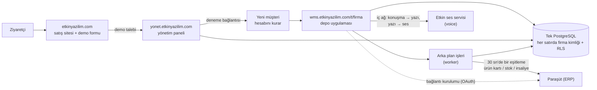

# Etkin WMS — İşlevsel mimari, ekran-veri eşleme ve yol haritası

> **Kimin için?** Ürün sahibi ve yeni katılan herkes. Yazılımcı olmayan biri için sade Türkçe yazıldı; teknik terimler parantez içinde açıklanır.
>
> **Neye dayanır?** 28 Ekim 2026'da main `8e2710d` üzerindeki koda (ilk sürüm: 23 Ekim, main `36f3a13`; aradaki T-1029…T-1110 işleri işlendi): ekranlar (`apps/web/app`), sunucu işlemleri (`actions.ts`), iş kuralları (`packages/domain/src`) ve veritabanı (`packages/db/migrations`). Tahmin yok; tek istisna kapasite rakamları (01 §1.8.4). Onlar açıkça "tahmin" diye işaretli.
>
> **Güncellik:** Bu belge bir **anlık görüntüdür**. Canlı durum için [STATE](../STATE.md), açık işler için [BACKLOG](../BACKLOG.md) esastır. Bir modül değiştiğinde ilgili dosyanın güncellenmesi önerilir.

## Etiketler

| Etiket | Anlamı |
| :--- | :--- |
| **[TAMAMLANDI]** | Kod main dalında; ekran → sunucu işlemi → veritabanı uçtan uca bağlı. |
| **[GELİŞTİRİLİYOR]** | Bir kısmı yapıldı; ekranı eksik, ayarla kapalı ya da yarım. |
| **[PLANLANDI]** | Yalnız yapılacaklar listesinde, şartnamede ya da tasarım tuvalinde. Kod yok. |

**Kodda olmak canlıda çalışmak demek değildir.** main'e birleşen kod otomatik yayına çıkar ama yayının başarısı ve veritabanı geçişi ayrı doğrulanır. Canlılık bilgisi STATE'tedir. Bu belgede "canlı: UNKNOWN" görüyorsanız o modülün canlıda çalıştığı bu belge için doğrulanmamıştır.

## Bölümler

| # | Dosya | İçerik |
| :--- | :--- | :--- |
| 1 | [01 — Genel mimari](01-genel-mimari.md) | Üç adres (etkinyazilim.com, yonet., wms.), giriş, müşteri verisinin ayrılması, oturum, ortak servisler (Paraşüt OAuth + 30 sn eşitleme, Etkin ses servisi: konuşma → yazı ve doğal Türkçe sesli yanıt), **sunucu gereksinimleri ve kapasite** |
| 2a | [02a — Kimlik, ekip, yetki](02a-kimlik-ekip-yetki.md) | Giriş/2FA, alan seçimi, deneme aktivasyonu, davet, saha girişi (PIN), Ekip, Kullanıcılar, cihazlar, katılma QR'ı, yetki grupları, **rol × izin matrisi** |
| 2b | [02b — Mal kabul, stok, katalog](02b-mal-kabul-stok-katalog.md) | Beklenen teslimler, saha kabulü, paketli/QR kabul, stok durumu, stok fişleri, ürün kartları, cariler, depolar/raflar, etiket, Excel |
| 2c | [02c — Depo operasyonları](02c-depo-operasyonlari.md) | Ana ekran, görevler, OKUT, yerleştirme, transfer, sipariş/sevkiyat, toplama, sayım, üretim, iade, işlem kaydı, raporlar, sesli komut |
| 2d | [02d — Yönetim paneli, satış sitesi, entegrasyon](02d-yonetim-paneli-site-entegrasyon.md) | Satış sitesi ve demo formu, panel (müşteriler, paketler, ödemeler, destek, satış sayfası), Ayarlar, Paraşüt, destek talebi, kurulum yolculuğu, **arka plan işleri** |
| 3a | [03a — Veri sözlüğü: depo ve stok](03a-veri-sozlugu-depo-stok.md) | Yaklaşık 51 tablo: depo, katalog, fiş, stok defteri, saha belgeleri, görev/sayım, üretim, paket |
| 3b | [03b — Veri sözlüğü: kimlik ve platform](03b-veri-sozlugu-kimlik-platform.md) | Yaklaşık 47 tablo (0061 ile gelen iki Paraşüt OAuth tablosu dahil): kullanıcı, müşteri/üyelik, denetim, saha girişi, yetki grupları, destek, entegrasyon, panel; DB rolleri |
| 4 | [04 — Gap analizi ve yol haritası](04-gap-analizi.md) | Eksikler (G-xx), yetki/güvenlik başlıkları, transaction durumu, **önerilen geliştirme sırası**, değişiklik nasıl istenir |

## Bir bakışta sistem

## Bu belgede yazılmayanlar

- **Güvenlik açığı ayrıntısı:** Depo herkese açık. Açıklar yalnız 🔒 B-xx başlığıyla anılır; ayrıntı gizli danışma taslağındadır.
- **Sır, parola, bağlantı adresi:** Hiçbir yerde yer almaz.
- **Ölçülmüş performans:** Yük testi henüz yok. Kapasite tablosu tahmindir.
