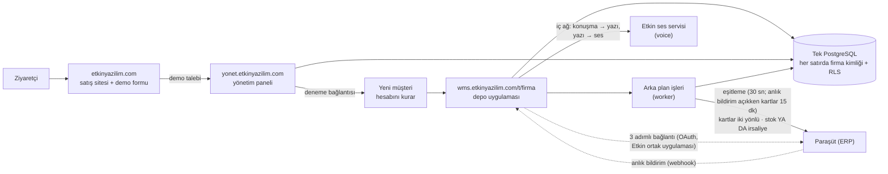

# Etkin WMS — İşlevsel mimari, ekran-veri eşleme ve yol haritası

> **Kimin için?** Ürün sahibi ve yeni katılan herkes. Yazılımcı olmayan biri için sade Türkçe yazıldı; teknik terimler parantez içinde açıklanır.
>
> **Neye dayanır?** 1 Kasım 2026'da main `008070a` üzerindeki koda (ilk sürüm: 23 Ekim, main `36f3a13`; 28 Ekim sürümü main `8e2710d` T-1029…T-1110'u, 29 Ekim sürümü main `2022915` T-1111…T-1131'i, bu sürüm T-1133…T-1142'yi işler): ekranlar (`apps/web/app`), sunucu işlemleri (`actions.ts`), iş kuralları (`packages/domain/src`) ve veritabanı (`packages/db/migrations`). Tahmin yok; tek istisna kapasite rakamları (01 §1.8.4). Onlar açıkça "tahmin" diye işaretli.
>
> **Güncellik:** Bu belge bir **anlık görüntüdür**. Canlı durum için [STATE](../STATE.md), açık işler için [BACKLOG](../BACKLOG.md) esastır. Bir modül değiştiğinde ilgili dosyanın güncellenmesi önerilir.

## Etiketler

| Etiket | Anlamı |
| :--- | :--- |
| **[TAMAMLANDI]** | Kod main dalında; ekran → sunucu işlemi → veritabanı uçtan uca bağlı. |
| **[GELİŞTİRİLİYOR]** | Bir kısmı yapıldı; ekranı eksik, ayarla kapalı ya da yarım. |
| **[PLANLANDI]** | Yalnız yapılacaklar listesinde, şartnamede ya da tasarım tuvalinde. Kod yok. |

**Kodda olmak canlıda çalışmak demek değildir.** main'e birleşen kod otomatik yayına çıkar ama yayının başarısı ve veritabanı geçişi ayrı doğrulanır. Canlılık bilgisi STATE'tedir. Bu belgede "canlı: UNKNOWN" görüyorsanız o modülün canlıda çalıştığı bu belge için doğrulanmamıştır.

## Bölümler

| # | Dosya | İçerik |
| :--- | :--- | :--- |
| 1 | [01 — Genel mimari](01-genel-mimari.md) | Üç adres (etkinyazilim.com, yonet., wms.), giriş, müşteri verisinin ayrılması, oturum, ortak servisler (Paraşüt: tek yol OAuth + ortak uygulama, kademeli eşitleme, anlık bildirim ucu; Etkin ses servisi: konuşma → yazı ve doğal Türkçe sesli yanıt), **sunucu gereksinimleri ve kapasite** |
| 2a | [02a — Kimlik, ekip, yetki](02a-kimlik-ekip-yetki.md) | Giriş/2FA, alan seçimi, deneme aktivasyonu, davet, saha girişi (PIN), Ekip, Kullanıcılar, cihazlar, katılma QR'ı, yetki grupları, **Yetkiler ekranı** (her yetki aç/kapa), **rol × izin matrisi + kart yetkileri** |
| 2b | [02b — Mal kabul, stok, katalog](02b-mal-kabul-stok-katalog.md) | Beklenen teslimler, saha kabulü, paketli/QR kabul, stok durumu, stok fişleri, ürün kartları (kutular, Stok ve yer pivotu, Hareketler · Takip · Değişiklik geçmişi; sabit alanlar ilk kullanıma kadar), cariler (kısa ad, ilçe, varsayılan teslimat), depolar/raflar, etiket, Excel; kart yazmalarında bölüm × işlem yetkisi |
| 2c | [02c — Depo operasyonları](02c-depo-operasyonlari.md) | Ortak kabuk (yüzen şimşek + Rehber, sıralı odaklı rehber), yönetici ana ekranı (Bekleyen işler + İşler, Düzenle), görevler, OKUT, yerleştirme, transfer, sipariş/sevkiyat, toplama, sayım, üretim, iade, işlem kaydı, raporlar, sesli komut |
| 2d | [02d — Yönetim paneli, satış sitesi, entegrasyon](02d-yonetim-paneli-site-entegrasyon.md) | Satış sitesi ve demo formu, panel (müşteriler, paketler, ödemeler, destek, satış sayfası), Ayarlar, Entegrasyonlar (alt bölümler, yön seçimi + sonuç cümlesi, sağlık bandı, kuyruk çözümü) ve Paraşüt (3 adımlı bağlanma, iki yönlü eşitleme, anlık bildirim, güvenlik kilitleri), destek talebi, kurulum yolculuğu, **arka plan işleri** |
| 3a | [03a — Veri sözlüğü: depo ve stok](03a-veri-sozlugu-depo-stok.md) | Yaklaşık 52 tablo: depo, katalog, fiş, stok defteri, saha belgeleri, görev/sayım, üretim, paket, dış eşleme; 0064 (`parties` kısa ad / ilçe / teslimat), 0065 (`items` sabit alanları, `item_fixed_usage`) ve 0069 (`integration_card_states`) dahil |
| 3b | [03b — Veri sözlüğü: kimlik ve platform](03b-veri-sozlugu-kimlik-platform.md) | Yaklaşık 48 tablo (0061 Paraşüt OAuth tabloları ve 0067 `integration_webhooks` dahil; 0066/0068 entegrasyon kilitleri, 0070 grup yetkileri): kullanıcı, müşteri/üyelik, denetim, saha girişi, yetki grupları, destek, entegrasyon, panel; DB rolleri |
| 4 | [04 — Gap analizi ve yol haritası](04-gap-analizi.md) | Eksikler (G-xx), yetki/güvenlik başlıkları, transaction durumu, **önerilen geliştirme sırası** (Şimdi / Sonra / Daha sonra), değişiklik nasıl istenir |
| 5 | [04 §4.10 — Geliştirme önerileri ve yeni fikirler](04-gap-analizi.md#410-geliştirme-önerileri-ve-yeni-fikirler) | **En son bölüm:** öncelik sırasıyla öneriler, büyük işler ve sizden **karar gerekli** konular |

## Bir bakışta sistem

## Bu belgede yazılmayanlar

- **Güvenlik açığı ayrıntısı:** Depo herkese açık. Açıklar yalnız 🔒 B-xx başlığıyla anılır; ayrıntı gizli danışma taslağındadır.
- **Sır, parola, bağlantı adresi:** Hiçbir yerde yer almaz.
- **Ölçülmüş performans:** Yük testi henüz yok. Kapasite tablosu tahmindir.

## 1 Kasım güncellemesinde ne değişti?

Ayrıntılı tarihli özet: [04 — Gap analizi › 29 Ekim'den bu yana ne değişti?](04-gap-analizi.md). Kısaca (31 Ekim – 1 Kasım, T-1133…T-1142, migration 0066–0070; STATE'e göre hepsi canlı, canlı main `008070a`):

- **Paraşüt bağlantısı:** 3 adım, müşteri anahtar girmez (Etkin'in ortak uygulaması; T-1133); e-posta + parola yolu kalktı, eski bağlantılar kesildi, tek "Yeniden bağlan" (T-1139, 0068).
- **Paraşüt eşitlemesi:** güvenlik kilitleri — stok toplamı ile irsaliye birlikte açılmaz, Devir kapısı, ondalık miktar, kaçmayan irsaliye (T-1135, 0066); anlık bildirim (T-1138, 0067); **gerçek iki yönlü**, son değişen kazanır, cari ve depo da Paraşüt'te silinince arşive alınır, arşivli raf stok toplamında yok (T-1140, 0069).
- **Entegrasyonlar ekranı:** UX düzeltmeleri (T-1134), yön seçiminin sonucu + dolu katalogda onay (T-1136), sağlık bandı, kuyruk çözüm düğmeleri, Excel kaynak kartı (T-1137).
- **Yetki:** kart yazmaları bölüm × işlem anahtarına bağlı, yetkisizde kilitli düğme + sarı balon (T-1141); yeni **Yetkiler** ekranı, kart anahtarları gruba verilebilir, ürün/cari/depo anahtarları iki adımlı doğrulama ister (T-1142, 0070).
- Yeni eksikler **G-100…G-105** ve yenilenen öneriler: [04 — Gap analizi](04-gap-analizi.md). Sıradaki iş (STATE): Paraşüt gerçek hesap denemesi.

29 Ekim güncellemesi (T-1111…T-1131: onaylı tuval ekranları, 0064/0065, eski tasarım temizliği, rehber ve ses servisi) 04'teki kısa özette.

## Geliştirme önerileri ve yeni fikirler

Öncelik sıralı öneri listesi ve sizden **karar gerekli** konular belgenin en son bölümündedir: [04 §4.10 — Geliştirme önerileri ve yeni fikirler](04-gap-analizi.md#410-geliştirme-önerileri-ve-yeni-fikirler). Kısa özet:

1. **Hemen:** Paraşüt gerçek hesap denemesi (uygulama kaydı sizde), gerçek iPhone kontrolü, PR 250 migration numarası (0071), cari formunda "Paraşüt'e de gider" satırı, bağlantı koptuğunda zil/e-posta, birim–katsayı veritabanı bekçisi, depo/raf Excel yetkisi.
2. **Orta boy:** entegrasyon eşleme düzeltme, alan bazlı sahiplik, ürün kartı Paraşüt sekmesinde eşitleme durumu, siparişe sevk tarihi + kişi tercihleri sunucuda, İş akışı sekmesi, Yetkiler ekranının tuvale eklenmesi, denetim kaydı dizini, giriş ekranlarının kalıba alınması.
3. **Büyük / yeni fikir:** satış faturasından iş (ertelendi), entegrasyon olay günlüğü ekranı, yetki değişikliği özeti, ürün kartında İş akışı/Etiket sekmeleri ve görsel, Etkin için yerel dil modeli (ileride).
4. **Karar gerekli:** kişiye özel yetki istisnası, Paraşüt'te silinen depoda boş raf yerleri, boşaltılan cari alanının Paraşüt'te silinmesi, başka depodaki lot/seri görünürlüğü, cari tür etiketi, yerel dil modelinin zamanı.
