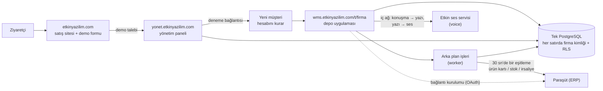

# Etkin WMS — İşlevsel mimari, ekran-veri eşleme ve yol haritası

> **Kimin için?** Ürün sahibi ve yeni katılan herkes. Yazılımcı olmayan biri için sade Türkçe yazıldı; teknik terimler parantez içinde açıklanır.
>
> **Neye dayanır?** 29 Ekim 2026'da main `2022915` üzerindeki koda (ilk sürüm: 23 Ekim, main `36f3a13`; 28 Ekim sürümü main `8e2710d` T-1029…T-1110'u, bu sürüm T-1111…T-1131'i işler): ekranlar (`apps/web/app`), sunucu işlemleri (`actions.ts`), iş kuralları (`packages/domain/src`) ve veritabanı (`packages/db/migrations`). Tahmin yok; tek istisna kapasite rakamları (01 §1.8.4). Onlar açıkça "tahmin" diye işaretli.
>
> **Güncellik:** Bu belge bir **anlık görüntüdür**. Canlı durum için [STATE](../STATE.md), açık işler için [BACKLOG](../BACKLOG.md) esastır. Bir modül değiştiğinde ilgili dosyanın güncellenmesi önerilir.

## Etiketler

| Etiket | Anlamı |
| :--- | :--- |
| **[TAMAMLANDI]** | Kod main dalında; ekran → sunucu işlemi → veritabanı uçtan uca bağlı. |
| **[GELİŞTİRİLİYOR]** | Bir kısmı yapıldı; ekranı eksik, ayarla kapalı ya da yarım. |
| **[PLANLANDI]** | Yalnız yapılacaklar listesinde, şartnamede ya da tasarım tuvalinde. Kod yok. |

**Kodda olmak canlıda çalışmak demek değildir.** main'e birleşen kod otomatik yayına çıkar ama yayının başarısı ve veritabanı geçişi ayrı doğrulanır. Canlılık bilgisi STATE'tedir. Bu belgede "canlı: UNKNOWN" görüyorsanız o modülün canlıda çalıştığı bu belge için doğrulanmamıştır.

## Bölümler

| # | Dosya | İçerik |
| :--- | :--- | :--- |
| 1 | [01 — Genel mimari](01-genel-mimari.md) | Üç adres (etkinyazilim.com, yonet., wms.), giriş, müşteri verisinin ayrılması, oturum, ortak servisler (Paraşüt OAuth + 30 sn eşitleme, Etkin ses servisi: konuşma → yazı ve doğal Türkçe sesli yanıt), **sunucu gereksinimleri ve kapasite** |
| 2a | [02a — Kimlik, ekip, yetki](02a-kimlik-ekip-yetki.md) | Giriş/2FA, alan seçimi, deneme aktivasyonu, davet, saha girişi (PIN), Ekip, Kullanıcılar, cihazlar, katılma QR'ı, yetki grupları, **rol × izin matrisi** |
| 2b | [02b — Mal kabul, stok, katalog](02b-mal-kabul-stok-katalog.md) | Beklenen teslimler, saha kabulü, paketli/QR kabul, stok durumu, stok fişleri, ürün kartları (kutular, Stok ve yer pivotu, Hareketler · Takip · Değişiklik geçmişi; sabit alanlar ilk kullanıma kadar), cariler (kısa ad, ilçe, varsayılan teslimat), depolar/raflar, etiket, Excel |
| 2c | [02c — Depo operasyonları](02c-depo-operasyonlari.md) | Ortak kabuk (yüzen şimşek + Rehber, sıralı odaklı rehber), yönetici ana ekranı (Bekleyen işler + İşler, Düzenle), görevler, OKUT, yerleştirme, transfer, sipariş/sevkiyat, toplama, sayım, üretim, iade, işlem kaydı, raporlar, sesli komut |
| 2d | [02d — Yönetim paneli, satış sitesi, entegrasyon](02d-yonetim-paneli-site-entegrasyon.md) | Satış sitesi ve demo formu, panel (müşteriler, paketler, ödemeler, destek, satış sayfası), Ayarlar, Entegrasyonlar (alt bölümler + yön seçimi) ve Paraşüt, destek talebi, kurulum yolculuğu, **arka plan işleri** |
| 3a | [03a — Veri sözlüğü: depo ve stok](03a-veri-sozlugu-depo-stok.md) | Yaklaşık 51 tablo: depo, katalog, fiş, stok defteri, saha belgeleri, görev/sayım, üretim, paket; 0064 (`parties` kısa ad / ilçe / teslimat) ve 0065 (`items` sabit alanları, `item_fixed_usage`) dahil |
| 3b | [03b — Veri sözlüğü: kimlik ve platform](03b-veri-sozlugu-kimlik-platform.md) | Yaklaşık 47 tablo (0061 ile gelen iki Paraşüt OAuth tablosu dahil): kullanıcı, müşteri/üyelik, denetim, saha girişi, yetki grupları, destek, entegrasyon, panel; DB rolleri |
| 4 | [04 — Gap analizi ve yol haritası](04-gap-analizi.md) | Eksikler (G-xx), yetki/güvenlik başlıkları, transaction durumu, **önerilen geliştirme sırası** (Şimdi / Sonra / Daha sonra), değişiklik nasıl istenir |
| 5 | [04 §4.10 — Geliştirme önerileri ve yeni fikirler](04-gap-analizi.md#410-geliştirme-önerileri-ve-yeni-fikirler) | **En son bölüm:** öncelik sırasıyla öneriler, büyük işler ve sizden **karar gerekli** konular |

## Bir bakışta sistem

## Bu belgede yazılmayanlar

- **Güvenlik açığı ayrıntısı:** Depo herkese açık. Açıklar yalnız 🔒 B-xx başlığıyla anılır; ayrıntı gizli danışma taslağındadır.
- **Sır, parola, bağlantı adresi:** Hiçbir yerde yer almaz.
- **Ölçülmüş performans:** Yük testi henüz yok. Kapasite tablosu tahmindir.

## 29 Ekim güncellemesinde ne değişti?

- **Koda geçen onaylı ekranlar:** Entegrasyonlar alt bölümleri ve yön seçimi (T-1112), yönetici ana ekranı + Düzenle'de iş ekle/kaldır (T-1115, T-1128), ürün kartı kutuları / pivot / sekmeler (T-1116), yeni cari formu ve ürün listesi sütunları (T-1117).
- **İki migration:** 0064 cari ayrıntıları, 0065 ürünün sabit alanları ilk kullanıma kadar değişir (canlı: UNKNOWN).
- **Eski tasarım temizliği:** belge formları, pencereler, saha ekranları kalıpta (T-1119, T-1121, T-1122); kalan: giriş ailesi ve panel.
- **Rehber ve kısayol:** her ekranda Rehber, sıralı odak, katlı simge, kartın yapılacak yeri örtmemesi, halkanın ekrana sığması (T-1120, T-1123, T-1124, T-1130, T-1131).
- **Ses servisi:** bellek makineden bağımsız (T-1114, T-1125, T-1126); Etkin "entegrasyon" komutu (T-1118).
- Ayrıntı ve yeni eksikler (G-95…G-99): [04 — Gap analizi](04-gap-analizi.md).

## Geliştirme önerileri ve yeni fikirler

Öncelik sıralı öneri listesi ve sizden **karar gerekli** konular belgenin en son bölümündedir: [04 §4.10 — Geliştirme önerileri ve yeni fikirler](04-gap-analizi.md#410-geliştirme-önerileri-ve-yeni-fikirler). Kısa özet:

1. **Hemen:** PR 250 migration numarası (0066), gerçek iPhone kontrolü, birim–katsayı veritabanı bekçisi ve 0065 davranış testleri, giriş ekranlarının kalıba alınması, sayım kutusunda raf/koridor, ses servisi belleğinin canlıda izlenmesi.
2. **Orta boy:** siparişe sevk tarihi, kişi tercihleri sunucuda, Entegrasyonlar veri parçaları (hata listesi, pasif/arşiv politikası, alan sahipliği), İş akışı sekmesi, pivotta sürükleme/+Seri/tam ekran, denetim kaydı dizini, tuvalden CSS üretimi.
3. **Büyük:** satış faturasından iş, ürün kartında İş akışı ve Etiket/yazıcı sekmeleri, ürün görseli, Etkin için sunucuda yerel dil modeli (ileride).
4. **Karar gerekli:** başka depodaki lot/seri kodlarının görünürlüğü, cari tür etiketi, yerel dil modelinin zamanı, Entegrasyonlar pasif/arşiv varsayılanı.
